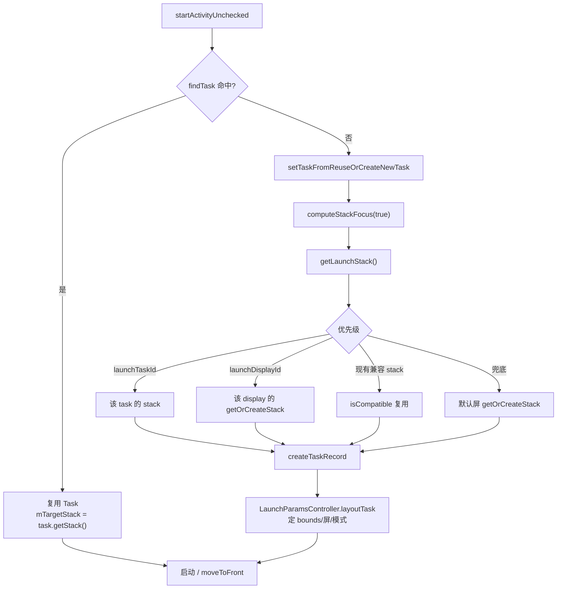
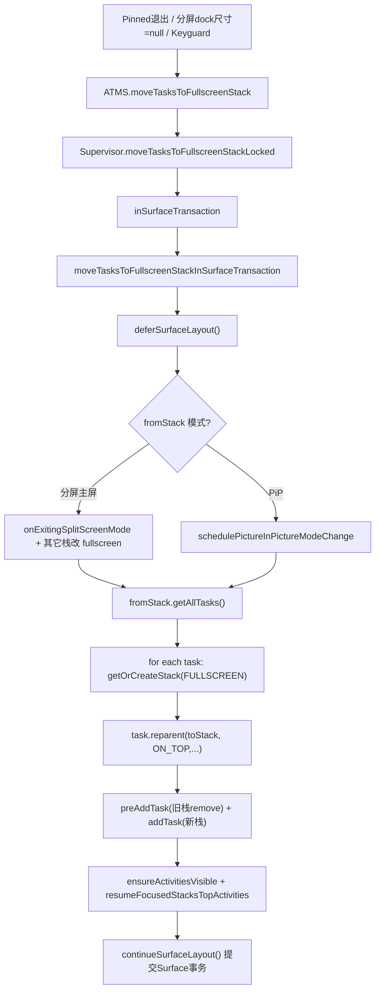
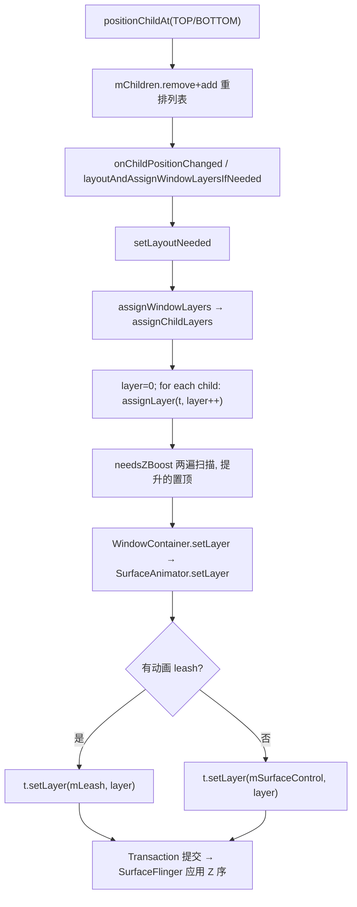

# Android 10 WMS/AMS 中 Task 与 TaskStack 机制分析

> 源码基准：`frameworks/base/services/core/java/com/android/server/wm/`（cells-android10 分支）
> 适用范围：Android 10。该版本 `ActivityTaskManagerService` 已独立，但 AMS/WMS 仍处于「unification（统一化）」合并过渡期 —— 两套对象并存且互相引用。

---

## 目录

1. 概述：两套并存的层次结构
2. Task 与 TaskStack 的具体关系
3. startActivity 如何决定 Stack / Task
4. 分屏 / PiP 的 moveTasksToFullscreenStack
5. positionChildAt 如何影响 SurfaceControl 的 Z 序
6. 关键代码锚点速查

---

## 1. 概述：两套并存的层次结构

Android 里 "task / taskstack" 从来不是**一个**概念，而是**两条并行的层次结构**：
- **AMS 侧**：管逻辑、生命周期、复用；
- **WMS 侧**：管层次、bounds、Surface、Z 序。

Android 10 正处于把两者合并的过渡期，所以你能看到它们互相引用。

### 1.1 AMS 侧（管逻辑、生命周期、复用）

```
RootActivityContainer
  └─ ActivityDisplay
       └─ ActivityStack        (mTaskHistory：List<TaskRecord>)
            └─ TaskRecord      (mActivities：List<ActivityRecord>)
                 └─ ActivityRecord
```

### 1.2 WMS 侧（管层次、bounds、Surface、Z 序）

```
RootWindowContainer
  └─ DisplayContent
       └─ TaskStackContainers
            └─ TaskStack          (WindowContainer<Task>)
                 └─ Task          (WindowContainer<AppWindowToken>)
                      └─ AppWindowToken
                           └─ WindowState
```

### 1.3 桥接引用（理解全图的关键）

| 桥 | 代码位置 |
|---|---|
| `ActivityStack.mTaskStack` | 构造函数内 `createTaskStack()` 创建 |
| `TaskStack.mActivityStack` | `TaskStack.java:155` |
| `TaskRecord.mTask` | `createTask()` 内 `new Task(...)` |
| `Task.mTaskRecord` | `Task.java:117` |

```java
// Task.java:116-117
    // TODO: remove after unification
    TaskRecord mTaskRecord;
```

```java
// TaskStack.java:154-155
    // TODO: remove after unification.
    ActivityStack mActivityStack;
```

> 结论：Android 10 是「把 Activity 管理层整体搬进 `wm` 包」的过渡版本（`ActivityTaskManagerService` 也是这版才有的）。到 Android 11+ 就把 `TaskRecord` 直接合并进 `Task`，只剩 `Task` / `ActivityRecord` / `WindowToken` 一套。

---

## 2. Task 与 TaskStack 的具体关系

### 2.1 基数关系（谁装谁）

```
TaskStack (1) ──mChildren:List<Task>──▶ Task (N)
Task     (1) ──mChildren:List<AppWindowToken>──▶ AppWindowToken (N) ──▶ WindowState
```

- 1 个 `TaskStack` 装 N 个 `Task`（全屏 Stack 里就堆着所有 App 的 Task）。
- 1 个 `Task` 装 N 个 `AppWindowToken`（对应返回栈里 N 个 Activity 的窗口令牌）。
- 1 个 `Task` 同一时刻**只属于 1 个 Stack**。

泛型参数就是子类型：`WindowContainer<Task>` 说明 `TaskStack` 的孩子是 `Task`；`WindowContainer<AppWindowToken>` 说明 `Task` 的孩子是 `AppWindowToken`。

### 2.2 父子绑定（代码里的真实绑定）

`TaskStack.addTask()` 做两件事：设子指针 + 建立 `WindowContainer` 父子关系。

```java
// TaskStack.java:547-548
        // Add child task.
        task.mStack = this;
        addChild(task, null);
```

- `task.mStack = this`：Task 记自己的父 Stack（子→父指针）。
- `addChild(task, null)`：把 Task 加进 `TaskStack.mChildren`（父→子列表，由 `WindowContainer` 提供）。

Task 取自己的 Display，必须「穿过」父 Stack：

```java
// Task.java:141-144
    @Override
    DisplayContent getDisplayContent() {
        return mStack != null ? mStack.getDisplayContent() : null;
    }
```

### 2.3 一个 Task 只能属于一个 Stack（硬约束）

```java
// TaskStack.java:536-544
    void addTask(Task task, int position, boolean showForAllUsers, boolean moveParents) {
        final TaskStack currentStack = task.mStack;
        if (currentStack != null && currentStack.mStackId != mStackId) {
            throw new IllegalStateException("Trying to add taskId=" + task.mTaskId
                    + " to stackId=" + mStackId
                    + ", but it is already attached to stackId=" + task.mStack.mStackId);
        }
```

所以「把 Task 从一个 Stack 移到另一个 Stack」**不是直接挪，而是先摘后挂**：先在旧 Stack `removeTask`，再新 Stack `addTask`（AMS 侧 `preAddTask` 即干此活）。

### 2.4 Stack 内顺序 = Z 序 / 前后

`TaskStack.mChildren` 是有序列表，**后加入 / 置顶的 Task 在视觉最前**（最近任务）。调位置一定走 `positionChildAt`，且每次都触发整树层级重排：

```java
// TaskStack.java:554-565
    void positionChildAt(Task child, int position) {
        ...
        child.positionAt(position);
        getDisplayContent().layoutAndAssignWindowLayersIfNeeded();
    }
```

### 2.5 与 AMS 侧区分（最容易混）

| WMS 侧（窗口/几何） | AMS 侧（逻辑/生命周期） | 关系 |
|---|---|---|
| `TaskStack` | `ActivityStack` | 1:1 双向引用 |
| `Task` | `TaskRecord` | 1:1 双向引用 |
| `AppWindowToken` | `ActivityRecord` | 1:1 |

- 「把 Task 加进 Stack」在 WMS 是 `TaskStack.addTask(task)`（管窗口树）；在 AMS 是 `ActivityStack.addTask(taskRecord)`（管 `mTaskHistory`）。
- 启动时二者成对发生（`ActivityStack.createTaskRecord` → `addTask` → `task.createTask` → `TaskStack.addTask`），但**是两套独立容器、被两处指针同步**，不是同一个东西。

### 2.6 Stack 分类维度：`windowingMode` × `activityType`

一个 Stack 基本由这两个属性唯一确定（`getLaunchStack` 按此二元组查找）。

```java
// WindowConfiguration.java
public static final int WINDOWING_MODE_UNDEFINED = 0;
public static final int WINDOWING_MODE_FULLSCREEN = 1;
public static final int WINDOWING_MODE_PINNED = 2;             // PiP
public static final int WINDOWING_MODE_SPLIT_SCREEN_PRIMARY = 3; // 分屏主屏(dock)
public static final int WINDOWING_MODE_SPLIT_SCREEN_SECONDARY = 4;
public static final int WINDOWING_MODE_FREEFORM = 5;

public static final int ACTIVITY_TYPE_UNDEFINED = 0;
public static final int ACTIVITY_TYPE_STANDARD = 1;
public static final int ACTIVITY_TYPE_HOME = 2;
public static final int ACTIVITY_TYPE_RECENTS = 3;
public static final int ACTIVITY_TYPE_ASSISTANT = 4;
```

**为什么一个 Stack 要装多个 Task？** Stack = 窗口模式单元（决定区域大小、Z 序区间）；Task = 用户视角的「一个任务」（一个返回栈）。全屏 Stack 里通常堆着所有普通 App 的 Task，而 PiP / 分屏这类特殊 Stack 一般只放 1 个 Task。

---

## 3. startActivity 如何决定 Stack / Task

整体是**两阶段决策**：先决定「要不要复用已有 Task」，再决定「这个 Task 落在哪个 Stack」。

### 3.1 阶段一：Task 决策（`ActivityStarter`）

```java
// ActivityStarter.java:2092-2096
            } else {
                // Otherwise find the best task to put the activity in.
                intentActivity =
                        mRootActivityContainer.findTask(mStartActivity, mPreferredDisplayId);
            }
```

- `findTask` 命中（按 `taskAffinity` 匹配历史 Task）→ **复用该 Task**，`mTargetStack = intentActivity.getActivityStack()`。
- 未命中（`NEW_TASK` 等）→ 走 `setTaskFromReuseOrCreateNewTask` **新建 Task**：

```java
// ActivityStarter.java:2323-2335
        mTargetStack = computeStackFocus(mStartActivity, true, mLaunchFlags, mOptions);
        if (mReuseTask == null) {
            final TaskRecord task = mTargetStack.createTaskRecord(
                    mSupervisor.getNextTaskIdForUserLocked(mStartActivity.mUserId),
                    ...
```

### 3.2 阶段二：Stack 决策（`computeStackFocus` → `getLaunchStack`）

`computeStackFocus` 先问 `getLaunchStack`，拿不到再退而求其次用 focusedStack / 指定 display：

```java
// ActivityStarter.java:2608-2614
    private ActivityStack computeStackFocus(ActivityRecord r, boolean newTask, int launchFlags,
            ActivityOptions aOptions) {
        final TaskRecord task = r.getTaskRecord();
        ActivityStack stack = getLaunchStack(r, launchFlags, task, aOptions);
        if (stack != null) {
            return stack;
        }
```

`getLaunchStack`（`RootActivityContainer`）的**真实优先级**：

1. `options.launchTaskId` 指定 → 用该 task 所在 stack；
2. `options.launchDisplayId` 指定 → 在该 display `getOrCreateStack`；
3. 现有 Task/Activity 所在的**兼容 Stack**（`isCompatible(windowingMode, activityType)`）复用；
4. 兜底 → 默认屏 `getOrCreateStack` 新建/复用。

```java
// RootActivityContainer.java:1748-1777
        if (candidateTask != null) {
            stack = candidateTask.getStack();
        }
        if (stack == null && r != null) {
            stack = r.getActivityStack();
        }
        if (stack != null) {
            display = stack.getDisplay();
            if (display != null && canLaunchOnDisplay(r, display.mDisplayId)) {
                int windowingMode = ...
                if (stack.isCompatible(windowingMode, activityType)) {
                    return stack;
                }
```

`canLaunchIntoFocusedStack`（`ActivityStarter.java:2658`）还会按 focusedStack 的 `windowingMode` 做能力检查：全屏装任何 task；分屏只收 `supportsSplitScreen`；freeform 只收 `supportsFreeform`。

### 3.3 阶段三：`LaunchParamsController.layoutTask` 收尾

Stack 选定后，`createTaskRecord` 会调它，按 `LaunchParamsModifier` 链算出最终摆放 —— **它还能反过来改 Stack 的显示/窗口模式**：

```java
// LaunchParamsController.java:139-147
            if (mTmpParams.hasPreferredDisplay()
                    && mTmpParams.mPreferredDisplayId != task.getStack().getDisplay().mDisplayId) {
                mService.moveStackToDisplay(task.getStackId(), mTmpParams.mPreferredDisplayId);
            }
            if (mTmpParams.hasWindowingMode()
                    && mTmpParams.mWindowingMode != task.getStack().getWindowingMode()) {
                task.getStack().setWindowingMode(mTmpParams.mWindowingMode);
            }
```

### 3.4 流程图



---

## 4. 分屏 / PiP 的 moveTasksToFullscreenStack

### 4.1 入口

多处触发退出分屏 / PiP 时调用：
- `ActivityStack.java:5675`：Pinned stack 退出时 `mService.moveTasksToFullscreenStack(mStackId, true)`；
- `ActivityStackSupervisor.java:1657`：分屏 dock 尺寸变为 null（被 dismiss）时；
- 以及 `KeyguardController`、`RootActivityContainer` 等场景。

```java
// ActivityStack.java:5675
                mService.moveTasksToFullscreenStack(mStackId, true /* onTop */);
```

```java
// ActivityTaskManagerService.java:4046-4058
    public void moveTasksToFullscreenStack(int fromStackId, boolean onTop) {
        ...
                    mStackSupervisor.moveTasksToFullscreenStackLocked(stack, onTop);
```

### 4.2 事务包裹

```java
// ActivityStackSupervisor.java:1578-1585
    void moveTasksToFullscreenStackLocked(ActivityStack fromStack, int toDisplayId, boolean onTop) {
        mWindowManager.inSurfaceTransaction(() ->
                moveTasksToFullscreenStackInSurfaceTransaction(fromStack, toDisplayId, onTop));
    }
```

### 4.3 核心搬运（`...InSurfaceTransaction`）

注意它在一个 `deferSurfaceLayout` + surface transaction 里批量做，避免界面抖动；分屏主屏还要先通知退出分屏、把其它 secondary 栈重置为全屏：

```java
// ActivityStackSupervisor.java:1505-1568 (节选)
    private void moveTasksToFullscreenStackInSurfaceTransaction(ActivityStack fromStack,
            int toDisplayId, boolean onTop) {
        mWindowManager.deferSurfaceLayout();
        try {
            final int windowingMode = fromStack.getWindowingMode();
            ...
            if (windowingMode == WINDOWING_MODE_SPLIT_SCREEN_PRIMARY) {
                toDisplay.onExitingSplitScreenMode();
                for (int i = toDisplay.getChildCount() - 1; i >= 0; --i) {
                    final ActivityStack otherStack = toDisplay.getChildAt(i);
                    if (!otherStack.inSplitScreenSecondaryWindowingMode()) continue;
                    otherStack.setWindowingMode(WINDOWING_MODE_UNDEFINED);
                }
                mAllowDockedStackResize = false;
            }
            ...
            final ArrayList<TaskRecord> tasks = fromStack.getAllTasks();
            if (!tasks.isEmpty()) {
                mTmpOptions.setLaunchWindowingMode(WINDOWING_MODE_FULLSCREEN);
                final int size = tasks.size();
                for (int i = 0; i < size; ++i) {
                    final TaskRecord task = tasks.get(i);
                    final ActivityStack toStack = toDisplay.getOrCreateStack(
                                null, mTmpOptions, task, task.getActivityType(), onTop);
                    ...
                    task.reparent(toStack, ON_TOP, REPARENT_MOVE_STACK_TO_FRONT,
                            isTopTask /* animate */, DEFER_RESUME,
                            schedulePictureInPictureModeChange,
                            "moveTasksToFullscreenStack - onTop");
```

最后恢复可见性与焦点，并提交 surface 事务：

```java
// ActivityStackSupervisor.java:1570-1575
            mRootActivityContainer.ensureActivitiesVisible(null, 0, PRESERVE_WINDOWS);
            mRootActivityContainer.resumeFocusedStacksTopActivities();
        } finally {
            mAllowDockedStackResize = true;
            mWindowManager.continueSurfaceLayout();
        }
```

**真正的「跨 Stack 搬家」是 `TaskRecord.reparent()`**：内部即 `preAddTask`（先从旧 Stack `removeTask`）再 `addTask` 到新 Stack，AMS 的 `mTaskHistory` 与 WMS 的 `TaskStack.mChildren` 两边同步。

### 4.4 调用栈图



---

## 5. positionChildAt 如何影响 SurfaceControl 的 Z 序

这是把「逻辑位置」翻译成「屏幕层级」的关键链路。

### 5.1 第 1 步：`positionChildAt` 重排 `mChildren` 列表

```java
// WindowContainer.java:434-444
        switch (position) {
            case POSITION_TOP:
                if (mChildren.peekLast() != child) {
                    mChildren.remove(child);
                    mChildren.add(child);           // 移到列表末尾 = 最前
                    onChildPositionChanged();
                }
```

`TaskStack.positionChildAt` 在重排后**立即**触发整屏重排（见 2.4 节 `TaskStack.java:565`）：

```java
        getDisplayContent().layoutAndAssignWindowLayersIfNeeded();
```

### 5.2 第 2 步：`layoutAndAssignWindowLayersIfNeeded` 进入布局 / 提交

```java
// DisplayContent.java:3191-3202
    void layoutAndAssignWindowLayersIfNeeded() {
        mWmService.mWindowsChanged = true;
        setLayoutNeeded();
        if (!mWmService.updateFocusedWindowLocked(UPDATE_FOCUS_WILL_PLACE_SURFACES,
                false /*updateInputWindows*/)) {
            assignWindowLayers(false /* setLayoutNeeded */);
        }
        mWmService.mWindowPlacerLocked.performSurfacePlacement();
        mInputMonitor.updateInputWindowsLw(false /*force*/);
    }
```

### 5.3 第 3 步（核心）：`assignChildLayers` 把「列表下标」映射成「integer layer」

```java
// WindowContainer.java:1091-1109
    void assignChildLayers(Transaction t) {
        int layer = 0;
        // 第一遍：普通孩子按列表顺序赋 layer
        for (int j = 0; j < mChildren.size(); ++j) {
            final WindowContainer wc = mChildren.get(j);
            wc.assignChildLayers(t);
            if (!wc.needsZBoost()) {
                wc.assignLayer(t, layer++);          // layer = 列表下标
            }
        }
        // 第二遍：needsZBoost() 的（动画/拖拽/特定窗口）提升到最后
        for (int j = 0; j < mChildren.size(); ++j) {
            final WindowContainer wc = mChildren.get(j);
            if (wc.needsZBoost()) {
                wc.assignLayer(t, layer++);
            }
        }
    }
```

**关键结论**：**Z 序 = 在 `mChildren` 中的顺序**，被线性映射成从 0 递增的 integer layer；`needsZBoost()` 的会被两遍扫描「提升」到最顶。**列表越靠后，layer 越大，越在最上层。**

### 5.4 第 4 步：`assignLayer` → `SurfaceControl.Transaction.setLayer` 真正写层

```java
// WindowContainer.java:1055-1058
    void assignLayer(Transaction t, int layer) {
        final boolean changed = layer != mLastLayer || mLastRelativeToLayer != null;
        if (mSurfaceControl != null && changed) {
            setLayer(t, layer);
            mLastLayer = layer;
```

```java
// SurfaceAnimator.java:189-190
    void setLayer(Transaction t, int layer) {
        t.setLayer(mLeash != null ? mLeash : mAnimatable.getSurfaceControl(), layer);
    }
```

> 注意最后一行 `mLeash`：若正在做动画，Surface 会被挂到一个 **leash**（动画绳）上，layer 设到 leash 而不是原始 Surface —— 这样动画系统能临时接管层级而不破坏真实层级。最终 `Transaction` 提交给 SurfaceFlinger，Z 序才真正生效。

### 5.5 Z 序原理图



---

## 6. 关键代码锚点速查

| 主题 | 文件:行 | 要点 |
|---|---|---|
| 两套树 & 桥接 | `Task.java:116`, `TaskStack.java:154` | `// TODO: remove after unification` |
| Task→Stack 指针 | `Task.java:65,141` | `mStack`；Display 经 Stack 取得 |
| Stack 装 Task | `TaskStack.java:547,536` | `task.mStack=this` + `addChild`；同栈校验 |
| 顺序=Z序 | `TaskStack.java:554-565` | `positionChildAt` → `layoutAndAssignWindowLayersIfNeeded` |
| 选 Task | `ActivityStarter.java:2092` | `findTask`（affinity 复用） |
| 选 Stack | `ActivityStarter.java:2608`, `RootActivityContainer.java:1686` | `computeStackFocus` → `getLaunchStack` 优先级 |
| 收尾 bounds/模式 | `LaunchParamsController.java:139` | 可反向 `moveStackToDisplay` / `setWindowingMode` |
| 退分屏搬家 | `ActivityStackSupervisor.java:1505,1578` | `moveTasksToFullscreenStackInSurfaceTransaction` |
| 跨栈搬家 | `ActivityStarter.java:5589` | `preAddTask`（先 remove 再 add） |
| Z 序映射 | `WindowContainer.java:1091` | `assignChildLayers` 下标→layer，两遍 Z-boost |
| 写 Surface | `SurfaceAnimator.java:189` | `t.setLayer(leash?:surface, layer)` |

### 调试命令

```bash
adb shell dumpsys activity activities      # AMS 侧：ActivityDisplay → ActivityStack → TaskRecord
adb shell dumpsys activity containers      # WMS 侧：DisplayContent → TaskStack → Task → ActivityRecord
adb shell dumpsys window windows           # 最底层 WindowState
```
