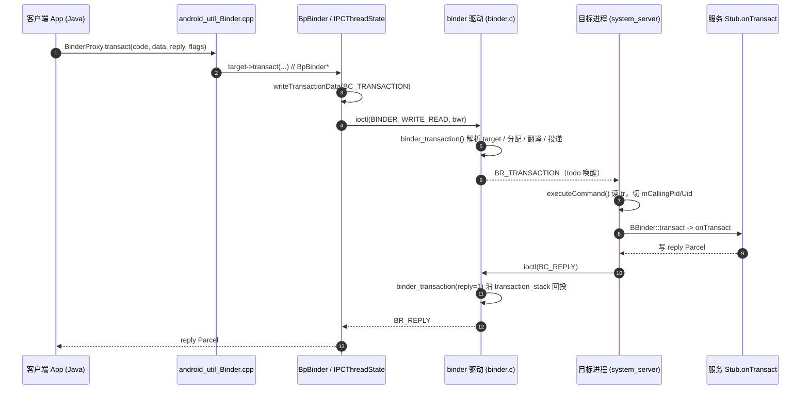

# Binder 一次完整请求：核心函数与核心数据结构（Android 10）

> **基线**：`cells-android10`，AOSP `android-10.0.0_r33`，Linux `4.9.200`（coral / bonito）
> **校验方式**：本文所有函数、结构体、字段行号均在本仓实测，可用 `grep -n` 复核；文末列出"行号来源"。
> **口径**：一次"同步请求 + 同步应答"的完整闭环（Java 客户端 → system_server 服务端 → 返回）。

---

## 一、结论前置

**一次 Binder 请求，本质是四段拼接、一次数据拷贝、两次地址空间切换。**

| # | 结论 | 证据 |
|---|------|------|
| 1 | 真正跨进程的**只有一次数据拷贝**：发送方用户态 `Parcel` → 目标进程 mmap 区的内核 `binder_buffer`。目标进程直接读自己 mmap 的那段内存，**没有第二次 copy_to_user**。 | `binder_alloc_copy_user_to_buffer` @ `binder.c:3530`、`:3545` |
| 2 | 路由**不靠全局 handle 表**，而靠"每进程一张描述符表"：`binder_ref` 以 `desc` 和 `node` 建双红黑树；应答则靠每条线程的 `transaction_stack` 原路回投。 | `binder_proc.refs_by_desc/refs_by_node` @ `binder.c:657/661`；`thread->transaction_stack` @ `:781` |
| 3 | 核心函数只有 **7 个**：发起端 `BpBinder::transact` → `IPCThreadState::transact` → `writeTransactionData` → `talkWithDriver`；驱动端 `binder_transaction`；接收端 `executeCommand` → `BBinder::onTransact`。 | 见 §3 |
| 4 | 核心结构只有 **9 个**：`Parcel`、`BpBinder`、`BBinder`、`IPCThreadState`、`ProcessState`、`binder_proc`、`binder_thread`、`binder_node`、`binder_ref`；再加 3 个"载体"`binder_transaction`、`binder_buffer`、`binder_alloc`。 | 见 §3.6 |
| 5 | 驱动里 **没有超时**。5s / 10s 超时是调用方（InputDispatcher、AMS ANR）自己实现的，不是 Binder 驱动的属性。 | `binder_transaction` 全文无计时器；见 §6 |

**一句话心智模型**：

> 用户态把参数压成 `Parcel`，包成 `binder_transaction_data` 写进驱动；驱动按 `handle` 找到目标 `binder_node`，在**目标进程**的 mmap 区分配 `binder_buffer`，把数据拷过去、把 `flat_binder_object` 翻译成目标进程视角的 `handle`/`ptr`，挂到目标线程 `todo` 并唤醒；目标线程读到 `BR_TRANSACTION`，切换 `mCallingPid/Uid`，回调 `onTransact`；返回值再以 `BC_REPLY` 沿 `transaction_stack` 回投，发起线程在 `BR_REPLY` 处拿到结果。

---

## 二、总览

### 2.1 一次请求 / 应答的完整时序



### 2.2 七个阶段

| 阶段 | 执行者 | 核心函数:行 | 产出 / 状态变化 |
|------|--------|-------------|-----------------|
| ① 编包 | 客户端 | `Parcel::writeInt32` @ `Parcel.cpp:1003`、`writeStrongBinder` @ `:1161` | `Parcel.mData` / `mObjects` 填充 |
| ② 构造事务 | libbinder | `IPCThreadState::writeTransactionData` @ `:1058` | `binder_transaction_data tr` 填好，写入 `mOut` |
| ③ 陷入内核 | libbinder | `talkWithDriver` @ `:955`（ioctl @ `:1008`） | `binder_write_read bwr` 交给驱动 |
| ④ 解析/分配/翻译/投递 | 驱动 | `binder_transaction` @ `binder.c:3201` | 目标线程 `todo` 多一个 `BINDER_WORK_TRANSACTION`，被唤醒 |
| ⑤ 目标读取 + 身份切换 | 目标 libbinder | `executeCommand` @ `:1101`（`BR_TRANSACTION` @ `:1181`） | `mCallingPid/Uid` 被设为发送方 |
| ⑥ 业务回调 | 目标服务 | `BBinder::transact` @ `Binder.cpp:123` → `onTransact` @ `:134`（Java 侧 `Binder.execTransact` @ `:987`） | 业务执行，写 `reply` Parcel |
| ⑦ 回程 | 目标 libbinder → 驱动 → 发起端 | `sendReply` @ `:842`（`BC_REPLY` @ `:846`）→ `binder_transaction(reply=1)` @ `:3201` → `waitForResponse` @ `:857`（`BR_REPLY` @ `:898`） | 发起端 `reply` 拿到结果 |

### 2.3 "谁分配、谁拷贝、谁释放"

| 问题 | 答案 | 位置 |
|------|------|------|
| buffer 谁分配？ | 驱动，在**目标进程**的 mmap 地址空间里分配 | `binder_alloc_new_buf` @ `binder_alloc.c:552`；调用点 `binder.c:3498` |
| 数据谁拷贝？ | 驱动，从**发送方用户态**拷到**目标内核 buffer** | `binder_alloc_copy_user_to_buffer` @ `binder.c:3530`（data）、`:3545`（offsets） |
| 目标怎么读？ | 直接读自己 mmap 的那段，无需再拷贝 | `ipcSetDataReference` @ `IPCThreadState.cpp:1201` |
| buffer 谁释放？ | 目标进程处理完发 `BC_FREE_BUFFER`；异常路径驱动自行释放 | `case BC_FREE_BUFFER` @ `binder.c:4089`；异常 `binder_alloc_free_buf` @ `:3852` |
| `binder_transaction` 谁释放？ | 同步回复完成后释放；异常路径走 `err_*` 标签链 | `binder_free_transaction(in_reply_to)` @ `:3794` |

---

## 三、分层拆解

### 3.1 用户态发起端：Java → native

**Java 入口**（`frameworks/base/core/java/android/os/BinderProxy.java`）：

```java
// BinderProxy.java:474
public boolean transact(int code, Parcel data, Parcel reply, int flags) throws RemoteException {
    Binder.checkParcel(this, code, data, "Unreasonably large binder buffer");
    ...
    return transactNative(code, data, reply, flags);   // :511
}
```

`transactNative` 是 native 方法，JNI 表在 `android_util_Binder.cpp:1440` 注册，落到：

```cpp
// android_util_Binder.cpp:1286
static jboolean android_os_BinderProxy_transact(JNIEnv* env, jobject obj,
        jint code, jobject dataObj, jobject replyObj, jint flags) {
    Parcel* data  = parcelForJavaObject(env, dataObj);      // :1294
    Parcel* reply = parcelForJavaObject(env, replyObj);     // :1298
    IBinder* target = getBPNativeData(env, obj)->mObject.get(); // :1303
    status_t err = target->transact(code, *data, reply, flags);  // :1326
}
```

**Native 代理**（`frameworks/native/libs/binder/BpBinder.cpp`）：

```cpp
// BpBinder.cpp:217
status_t BpBinder::transact(
    uint32_t code, const Parcel& data, Parcel* reply, uint32_t flags) {
    if (mAlive) {                                            // :221
        status_t status = IPCThreadState::self()->transact(
            mHandle, code, data, reply, flags);              // :222
        if (status == DEAD_OBJECT) mAlive = 0;               // :224
        return status;
    }
    return DEAD_OBJECT;                                      // :228
}
```

> `mHandle` 是**进程局部**的描述符（`BpBinder.h:118`）。它只在当前进程的 `binder_proc.refs_by_desc` 里有意义，不是全局 ID。

**编包核心**（`IPCThreadState.cpp:1058`）——这一步把 `Parcel` 变成驱动能懂的 `binder_transaction_data`：

```cpp
// IPCThreadState.cpp:1058
status_t IPCThreadState::writeTransactionData(int32_t cmd, uint32_t binderFlags,
    int32_t handle, uint32_t code, const Parcel& data, status_t* statusBuffer) {
    binder_transaction_data tr;              // :1061

    tr.target.ptr   = 0;                     // :1063  union 的另一半清零，防止栈残留泄露
    tr.target.handle = handle;               // :1064  BC 请求用 handle
    tr.code          = code;                 // :1065
    tr.flags         = binderFlags;          // :1066
    tr.cookie        = 0;                    // :1067
    tr.sender_pid    = 0;                    // :1068  驱动会覆盖，客户端填了也无效
    tr.sender_euid   = 0;                    // :1069

    const status_t err = data.errorCheck();
    if (err == NO_ERROR) {
        tr.data_size          = data.ipcDataSize();               // :1073
        tr.data.ptr.buffer    = data.ipcData();                   // :1074
        tr.offsets_size       = data.ipcObjectsCount() * sizeof(binder_size_t); // :1075
        tr.data.ptr.offsets   = data.ipcObjects();                // :1076
    } else if (statusBuffer) {
        tr.flags |= TF_STATUS_CODE;          // :1078  把错误当数据回传
        ...
    }

    mOut.writeInt32(cmd);                    // :1088  写 BC_TRANSACTION
    mOut.write(&tr, sizeof(tr));             // :1089
    return NO_ERROR;
}
```

`tr.data.ptr.buffer` / `offsets` 指向的是**当前进程**的 `Parcel.mData` / `mObjects`（`Parcel.h:478/482`）。驱动拿到的是用户态虚拟地址，靠 `copy_from_user` 读。

**陷入内核**（`IPCThreadState.cpp:955`）：

```cpp
// IPCThreadState.cpp:955
status_t IPCThreadState::talkWithDriver(bool doReceive) {
    binder_write_read bwr;                                   // :961
    const bool needRead = mIn.dataPosition() >= mIn.dataSize();
    const size_t outAvail = (!doReceive || needRead) ? mOut.dataSize() : 0;

    bwr.write_size   = outAvail;                             // :971
    bwr.write_buffer = (uintptr_t)mOut.data();               // :972
    if (doReceive && needRead) {
        bwr.read_size   = mIn.dataCapacity();                // :976
        bwr.read_buffer = (uintptr_t)mIn.data();             // :977
    } else {
        bwr.read_size = 0; bwr.read_buffer = 0;
    }

    do {
        if (ioctl(mProcess->mDriverFD, BINDER_WRITE_READ, &bwr) >= 0)  // :1008
            err = NO_ERROR;
        else
            err = -errno;
    } while (err == -EINTR);                                 // :1021

    if (bwr.write_consumed > 0) { ... mOut.remove(0, bwr.write_consumed); } // :1030-1032
    if (bwr.read_consumed  > 0) { mIn.setDataSize(bwr.read_consumed); ... } // :1038-1040
}
```

> `mOut` / `mIn` 是两个 `Parcel`（`IPCThreadState.h:180/179`）：一个出站命令流，一个入站返回流。`BINDER_WRITE_READ` 是**一次 ioctl 同时完成"写出去"和"读回来"**。

### 3.2 内核写路径

**顶层分发**：`binder_ioctl` @ `binder.c:5291` → `binder_ioctl_write_read` @ `:5117`。

```c
// binder.c:5117
static int binder_ioctl_write_read(struct file *filp,
                                   unsigned int cmd, unsigned long arg,
                                   struct binder_thread *thread) {
    struct binder_write_read bwr;
    if (copy_from_user(&bwr, ubuf, sizeof(bwr)))   // :5132  取 bwr
        ret = -EFAULT;

    if (bwr.write_size > 0) {
        ret = binder_thread_write(proc, thread,
                                  bwr.write_buffer, bwr.write_size,
                                  &bwr.write_consumed);   // :5143
    }
    if (bwr.read_size > 0) {
        ret = binder_thread_read(proc, thread, bwr.read_buffer,
                                 bwr.read_size, &bwr.read_consumed,
                                 filp->f_flags & O_NONBLOCK);  // :5156
    }
    if (copy_to_user(ubuf, &bwr, sizeof(bwr)))     // :5176  回填 consumed
        ret = -EFAULT;
}
```

**命令解析**：`binder_thread_write` @ `:3912`。`BC_TRANSACTION` 与 `BC_REPLY` 共用同一分支：

```c
// binder.c:4161
case BC_TRANSACTION:
case BC_REPLY: {
    struct binder_transaction_data tr;
    if (copy_from_user(&tr, ptr, sizeof(tr)))       // 读用户态 tr
        return -EFAULT;
    ptr += sizeof(tr);
    binder_transaction(proc, thread, &tr,           // :4168
                       cmd == BC_REPLY, 0);
} break;
```

**核心函数 `binder_transaction`**（`:3201`）——一次请求的全部关键动作都在这里，按执行顺序拆成 7 步：

| 步 | 动作 | 行号 | 说明 |
|----|------|------|------|
| 1 | 打印事务日志 | `:3227` | `binder_transaction_log`，debugfs 可读 |
| 2 | **解析目标** | `:3237`（reply）/ `:3313`（handle）/ `:3338`（handle==0） | reply 走 `transaction_stack`；非 reply 先按 `handle` 查 `binder_ref`，`handle==0` 直取 `context_mgr_node` |
| 3 | 安全检查 | `:3365` | `security_binder_transaction`，SELinux 在这里拦 |
| 4 | 分配事务对象 | `:3414`（`t`）、`:3424`（`tcomplete`） | `kzalloc`；`t` 是这次事务的载体 |
| 5 | 填身份/优先级 | `:3458` `t->sender_euid = task_euid(proc->tsk)`、`:3461` `t->code`、`:3462` `t->flags` | `sender_euid` 由驱动写，**客户端伪造无效** |
| 6 | **分配目标 buffer + 一次拷贝** | `:3498` `binder_alloc_new_buf`、`:3530` 拷 data、`:3545` 拷 offsets | 分配在 `target_proc->alloc` |
| 7 | **翻译对象 + 投递 + 唤醒** | `:3585` 对象循环、`:3619/3636` 翻译、`:3790/3810/3820` 入队、`:3792/3152` 唤醒 | 见下 |

**目标解析的三种情形**（这是最容易看错的地方）：

```c
// binder.c:3313
if (tr->target.handle) {                         // 普通服务：handle != 0
    binder_proc_lock(proc);
    ref = binder_get_ref_olocked(proc, tr->target.handle, true);  // :3325
    if (ref)
        target_node = binder_get_node_refs_for_txn(ref->node, &target_proc, &return_error); // :3328
    binder_proc_unlock(proc);
} else {                                         // handle == 0：ServiceManager / context manager
    mutex_lock(&context->context_mgr_node_lock);
    target_node = context->binder_context_mgr_node;  // :3339
    ...
}
```

- `handle != 0`：查**本进程**的 `refs_by_desc` 红黑树（`:657`），拿到 `binder_ref`，再由 `ref->node` 找到目标 `binder_node`。
- `handle == 0`：直接取 `binder_context->binder_context_mgr_node`——即 ServiceManager。**handle 0 是特例，不是普通服务编号**。
- `reply == 1`：不走 handle，直接从 `thread->transaction_stack` 取出 `in_reply_to`（`:3239`），再取 `target_thread = in_reply_to->from`（`:3268`），原路返回。

**一次拷贝的落点**：

```c
// binder.c:3498
t->buffer = binder_alloc_new_buf(&target_proc->alloc, tr->data_size,
                                 tr->offsets_size, extra_buffers_size,
                                 !reply && (t->flags & TF_ONE_WAY));

// :3530  数据段：发送方用户态 -> 目标内核 buffer
binder_alloc_copy_user_to_buffer(&target_proc->alloc, t->buffer, 0,
                                 (const void __user *)(uintptr_t)tr->data.ptr.buffer,
                                 tr->data_size);

// :3545  偏移段：紧随数据段之后，按 ALIGN(data_size, sizeof(void*)) 对齐
binder_alloc_copy_user_to_buffer(&target_proc->alloc, t->buffer,
                                 ALIGN(tr->data_size, sizeof(void *)),
                                 (const void __user *)(uintptr_t)tr->data.ptr.offsets,
                                 tr->offsets_size);
```

**对象翻译**：数据段里的 `flat_binder_object` 必须改写，否则目标进程拿到的 handle 是发送方视角的，会错。两个函数：

```c
// binder.c:2791  BINDER_TYPE_BINDER：本地实体 -> 目标进程的 ref
static int binder_translate_binder(struct flat_binder_object *fp, ...) {
    node = binder_get_node(proc, fp->binder);            // :2800
    if (!node) node = binder_new_node(proc, fp);         // :2802
    if (fp->cookie != node->cookie) { ... }              // :2806
    binder_inc_ref_for_node(target_proc, node, ...);     // :2819
    fp->hdr.type = BINDER_TYPE_HANDLE;                   // :2826  类型改写
    fp->binder   = 0;                                    // :2829
    fp->handle   = rdata.desc;                           // :2830  换成目标进程的 desc
    fp->cookie   = 0;                                    // :2831
}

// binder.c:2843  BINDER_TYPE_HANDLE：发送方的 ref -> 目标进程的 node 或另一个 ref
static int binder_translate_handle(struct flat_binder_object *fp, ...) {
    node = binder_get_node_from_ref(proc, fp->handle, ...);  // :2852
    if (node->proc == target_proc) {                     // :2865  目标就是实体所有者
        fp->hdr.type = BINDER_TYPE_BINDER;               // :2867
        fp->binder   = node->ptr;                        // :2870
        fp->cookie   = node->cookie;                     // :2871
    } else {                                             // :2885  目标也不是所有者，继续转 ref
        binder_inc_ref_for_node(target_proc, node, ...); // :2889
        fp->handle = dest_rdata.desc;                    // :2896
    }
}
```

> 这就是"同一份数据，在不同进程里 `flat_binder_object` 长得不一样"的原因。你刚优化的那张字段引用图里 `fbo.binder` / `fbo.handle` 的 union 语义，在这一步被真正改写。

**投递与唤醒**：`binder_proc_transaction` @ `:3108`：

```c
// binder.c:3138
if (!thread && !pending_async)
    thread = binder_select_thread_ilocked(proc);       // 从线程池挑一个空闲线程
if (thread) {
    binder_transaction_priority(thread->task, t, node_prio, node->inherit_rt); // :3142
    binder_enqueue_thread_work_ilocked(thread, &t->work);  // :3144  挂到线程 todo
} else if (!pending_async) {
    binder_enqueue_work_ilocked(&t->work, &proc->todo);    // :3146  挂到进程 todo
} else {
    binder_enqueue_work_ilocked(&t->work, &node->async_todo); // :3148  oneway 且已有异步事务
}
if (!pending_async)
    binder_wakeup_thread_ilocked(proc, thread, !oneway /* sync */); // :3152
```

同步事务在 `:3790` 也有一次直接入队 + `wake_up_interruptible_sync(&target_thread->wait)`（`:3792`）；oneway 走 `:3820`。

### 3.3 内核读取 / 投递到用户态

`binder_thread_read` @ `:4490`：

- `:4506` 先 `put_user(BR_NOOP, ...)`，保证 read buffer 至少有 4 字节，避免用户态空转。
- `:4537` `binder_wait_for_work`：没有活就睡，`non_block` 时返回 `-EAGAIN`。
- `:4766` `cmd = BR_TRANSACTION`；`:4796` `BR_TRANSACTION_SEC_CTX`（带 SELinux 安全上下文时）。
- 组装 `binder_transaction_data_secctx`（`tr`），把 `t->buffer->user_data`、`data_size`、`offsets` 等填进 `trd`，再 `put_user` 到用户态 read buffer。

### 3.4 目标进程接收

**`executeCommand` @ `IPCThreadState.cpp:1101`**，`BR_TRANSACTION` 分支 @ `:1181`：

```cpp
// IPCThreadState.cpp:1181
case BR_TRANSACTION:
{
    binder_transaction_data_secctx tr_secctx;
    binder_transaction_data& tr = tr_secctx.transaction_data;
    result = mIn.read(&tr, sizeof(tr));                    // :1189

    Parcel buffer;
    buffer.ipcSetDataReference(                            // :1201  零拷贝引用目标 mmap
        reinterpret_cast<const uint8_t*>(tr.data.ptr.buffer),
        tr.data_size,
        reinterpret_cast<const binder_size_t*>(tr.data.ptr.offsets),
        tr.offsets_size / sizeof(binder_size_t), freeBuffer, this);

    const pid_t origPid = mCallingPid;                     // :1207  保存现场
    ...
    mCallingPid = tr.sender_pid;                           // :1220  切换身份
    mCallingSid = reinterpret_cast<const char*>(tr_secctx.secctx); // :1221
    mCallingUid = tr.sender_euid;                          // :1222
    mLastTransactionBinderFlags = tr.flags;                 // :1223

    if (tr.target.ptr) {                                   // :1241  普通对象
        if (reinterpret_cast<RefBase::weakref_type*>(tr.target.ptr)->attemptIncStrong(this)) {
            error = reinterpret_cast<BBinder*>(tr.cookie)->transact(tr.code, buffer,
                        &reply, tr.flags);                 // :1246
            reinterpret_cast<BBinder*>(tr.cookie)->decStrong(this); // :1248
        } else {
            error = UNKNOWN_TRANSACTION;
        }
    } else {                                               // :1253  context manager
        error = the_context_object->transact(tr.code, buffer, &reply, tr.flags); // :1254
    }

    if ((tr.flags & TF_ONE_WAY) == 0) {                    // :1261  同步才回包
        if (error < NO_ERROR) reply.setError(error);
        sendReply(reply, 0);                               // :1264
    }
    ...
    mCallingPid = origPid;                                 // :1269  恢复现场
    mCallingUid = origUid;                                 // :1271
}
```

关键点：

- `ipcSetDataReference` 只是**记录指针**，不拷贝。`freeBuffer` 是回调，事务处理完后由它发 `BC_FREE_BUFFER`（`:913` 传入）。
- `mCallingPid/Uid` 是**线程局部**的"当前正在服务谁"。`getCallingPid()` / `getCallingUid()`（`:364` / `:374`）读的就是这两个字段。嵌套调用时靠保存/恢复现场（`:1207-1213` / `:1269-1275`）保证正确。
- `tr.target.ptr` 是本地对象的弱引用指针（`BINDER_TYPE_BINDER` 场景），先 `attemptIncStrong` 再调用，防止对象在处理前被析构。
- `tr.cookie` 才是 `BBinder*`（`flatten_binder` 里 `obj.cookie = local`，`Parcel.cpp:252`）。

### 3.5 业务回调与回程

**Native 层**（`Binder.cpp:123`）：

```cpp
// Binder.cpp:123
status_t BBinder::transact(uint32_t code, const Parcel& data, Parcel* reply, uint32_t flags) {
    data.setDataPosition(0);                               // :126
    switch (code) {
        case PING_TRANSACTION: reply->writeInt32(pingBinder()); break; // :130
        default: err = onTransact(code, data, reply, flags); break;    // :134
    }
    if (reply != nullptr) reply->setDataPosition(0);        // :139
}
```

**Java 服务端**：`JavaBBinder::onTransact` @ `android_util_Binder.cpp:355`，通过 JNI 回调 `Binder.execTransact`（`:368`）：

```cpp
// android_util_Binder.cpp:368
jboolean res = env->CallBooleanMethod(mObject, gBinderOffsets.mExecTransact,
    code, reinterpret_cast<jlong>(&data), reinterpret_cast<jlong>(reply), flags);
```

```java
// Binder.java:987
private boolean execTransact(int code, long dataObj, long replyObj, int flags) {
    final int callingUid = Binder.getCallingUid();          // :991
    ...
    return execTransactInternal(code, dataObj, replyObj, flags, callingUid); // :994
}
// Binder.java:1000
private boolean execTransactInternal(...) {
    Parcel data  = Parcel.obtain(dataObj);                  // :1006
    Parcel reply = Parcel.obtain(replyObj);                 // :1007
    res = onTransact(code, data, reply, flags);             // :1021  ← 业务 Stub
    ...
}
```

**回程**：`sendReply` @ `IPCThreadState.cpp:842`：

```cpp
status_t IPCThreadState::sendReply(const Parcel& reply, uint32_t flags) {
    err = writeTransactionData(BC_REPLY, flags, -1, 0, reply, &statusBuffer); // :846
    return waitForResponse(nullptr, nullptr);               // :849
}
```

驱动侧走 `binder_transaction` 的 `reply == 1` 分支（`:3237`）：从 `thread->transaction_stack` 取 `in_reply_to`，`target_thread = in_reply_to->from`（`:3268`），入队（`:3790`）、唤醒（`:3792`）、释放旧事务（`:3794`）。

发起端在 `waitForResponse`（`:857`）里等 `BR_REPLY`（`:898`），拿到 `tr` 后用 `ipcSetDataReference` 把结果挂到 `reply` Parcel（`:908-913`）。

### 3.6 核心数据结构（字段级）

#### A. 用户态（libbinder）

**`Parcel`**（`include/binder/Parcel.h`）——一次请求的"数据容器"：

| 字段 | 类型 | 行号 | 作用 |
|------|------|------|------|
| `mData` | `uint8_t*` | `:478` | 序列化数据区，即 `tr.data.ptr.buffer` 的来源 |
| `mDataSize` | `size_t` | `:479` | 有效字节数 |
| `mObjects` | `binder_size_t*` | `:482` | binder 对象偏移数组，即 `tr.data.ptr.offsets` 的来源 |
| `mObjectsSize` | `size_t` | `:483` | **元素个数**（不是字节数）；`offsets_size = mObjectsSize * sizeof(binder_size_t)` |
| `mObjectsCapacity` | `size_t` | `:484` | 容量 |
| `mNextObjectHint` | `mutable size_t` | `:485` | 对象查找提示，加速顺序写入 |
| `mAllowFds` | `bool` | `:493` | 是否允许传 fd |
| `mOwner` | `release_func` | `:495` | 数据释放回调；`freeBuffer` 最终由它触发 `BC_FREE_BUFFER` |

**`BpBinder`**（`include/binder/BpBinder.h`）——客户端对远端对象的代理：

| 字段 | 类型 | 行号 | 作用 |
|------|------|------|------|
| `mHandle` | `const int32_t` | `:118` | **进程局部**描述符，`tr.target.handle` 的来源 |
| `mAlive` | `volatile int32_t` | `:130` | 对象是否存活；`DEAD_OBJECT` 后置 0 |
| `mObitsSent` | `volatile int32_t` | `:131` | 死亡通知是否已派发 |
| `mObituaries` | `Vector<Obituary>*` | `:132` | 死亡回调列表 |
| `mObjects` | `ObjectManager` | `:133` | 附加对象表 |

**`BBinder`**（`include/binder/Binder.h`）：

| 字段 | 类型 | 行号 | 作用 |
|------|------|------|------|
| `mExtras` | `std::atomic<Extras*>` | `:84` | 附加数据（如 `attachObject` 的对象表） |

**`IPCThreadState`**（`include/binder/IPCThreadState.h`）——每线程一个（TLS）：

| 字段 | 类型 | 行号 | 作用 |
|------|------|------|------|
| `mProcess` | `sp<ProcessState>` | `:174` | 指向进程单例 |
| `mIn` | `Parcel` | `:179` | 入站命令流（`BR_*`） |
| `mOut` | `Parcel` | `:180` | 出站命令流（`BC_*`） |
| `mCallingPid` | `pid_t` | `:182` | 当前正在服务的发送方 PID |
| `mCallingUid` | `uid_t` | `:184` | 当前正在服务的发送方 UID |
| `mWorkSource` | `int32_t` | `:187` | 工作来源 |
| `mStrictModePolicy` | `int32_t` | `:190` | StrictMode 策略 |
| `mLastTransactionBinderFlags` | `int32_t` | `:191` | 最近一次事务 flags |

**`ProcessState`**（`include/binder/ProcessState.h`）——每进程一个单例：

| 字段 | 类型 | 行号 | 作用 |
|------|------|------|------|
| `mDriverFD` | `int` | `:113` | `/dev/binder` 的 fd，`ioctl` 的目标 |
| `mVMStart` | `void*` | `:114` | 进程 mmap 起点（驱动分配的接收缓冲区映射到这里） |
| `mMaxThreads` | `size_t` | `:122` | 线程池上限 |
| `mHandleToObject` | `Vector<handle_entry>` | `:128` | handle → `BpBinder` 缓存，避免重复创建 |

> `ProcessState::getStrongProxyForHandle`（`:273`）里对 `handle == 0` 有专门处理：先发一个 `PING_TRANSACTION` 探测（`:308`），确保 ServiceManager 已注册，再 `BpBinder::create(handle)`（`:314`）。

#### B. 内核 UAPI 线格式（`kernel/include/uapi/linux/android/binder.h`）

**`binder_write_read`**（`:222`）——一次 ioctl 的输入/输出总结构：

| 字段 | 类型 | 行号 | 作用 |
|------|------|------|------|
| `write_size` | `binder_size_t` | `:223` | 要写的字节数 |
| `write_consumed` | `binder_size_t` | `:224` | 驱动已消费字节数（回填） |
| `write_buffer` | `binder_uintptr_t` | `:225` | 写缓冲用户态地址（`mOut.data()`） |
| `read_size` / `read_consumed` / `read_buffer` | 同上 | `:226-228` | 读缓冲三元组（`mIn`） |

**`binder_transaction_data`**（`:299`）——一次事务的元数据：

| 字段 | 类型 | 行号 | 作用 |
|------|------|------|------|
| `target` | `union { __u32 handle; binder_uintptr_t ptr; }` | `:303-308` | **union**：BC 请求用 `handle`（`:305`）；BR 返回用 `ptr`（`:307`） |
| `cookie` | `binder_uintptr_t` | `:309` | 目标对象 cookie；本地调用时是 `BBinder*` |
| `code` | `__u32` | `:310` | 事务码（AIDL 方法号） |
| `flags` | `__u32` | `:313` | `TF_ONE_WAY` / `TF_ACCEPT_FDS` / `TF_STATUS_CODE` |
| `sender_pid` | `pid_t` | `:314` | **驱动填充**，客户端不可伪造 |
| `sender_euid` | `uid_t` | `:315` | **驱动填充**，客户端不可伪造 |
| `data_size` | `binder_size_t` | `:316` | 数据段字节数 |
| `offsets_size` | `binder_size_t` | `:317` | 偏移段字节数（**必须是 `binder_size_t` 的整数倍**） |
| `data` | `union { struct { buffer; offsets; } ptr; __u8 buf[8]; }` | `:323-331` | 普通事务用 `ptr.buffer/offsets`；≤8B 命令用内联 `buf` |

**`flat_binder_object`**（`:123`）——Parcel 里"传一个 Binder 对象"的表示：

| 字段 | 类型 | 行号 | 作用 |
|------|------|------|------|
| `hdr.type` | `__u32` | `:124` | `BINDER_TYPE_BINDER/HANDLE/WEAK_*/FD/FDA/PTR` |
| `flags` | `__u32` | `:125` | 优先级 / `FLAT_BINDER_FLAG_ACCEPTS_FDS` |
| `binder` | `binder_uintptr_t` | `:129` | **union 的一半**：本地对象，`BINDER_TYPE_BINDER` 时有效 |
| `handle` | `__u32` | `:130` | **union 的另一半**：远端引用，`BINDER_TYPE_HANDLE` 时有效 |
| `cookie` | `binder_uintptr_t` | `:134` | 用户态对象指针（本地调用时是 `BBinder*`） |

> `flatten_binder`（`Parcel.cpp:219`）把 `BBinder` 拍平时：`obj.binder = local->getWeakRefs()`（`:251`）、`obj.cookie = local`（`:252`）；把 `BpBinder` 拍平时：`obj.handle = proxy->handle()`（`:243`）。

#### C. 内核内部（`kernel/drivers/android/binder.c`）

**`binder_proc`**（`:641`）——每个打开 `/dev/binder` 的进程一个：

| 字段 | 类型 | 行号 | 作用 |
|------|------|------|------|
| `threads` | `rb_root` | `:649` | 线程池红黑树（按 tid） |
| `nodes` | `rb_root` | `:653` | 本进程所有 `binder_node`（按 ptr） |
| `refs_by_desc` | `rb_root` | `:657` | **handle → ref**，事务入口查它 |
| `refs_by_node` | `rb_root` | `:661` | node → ref，引用计数/清理用 |
| `waiting_threads` | `list_head` | `:665` | 空闲线程链表 |
| `pid` | `int` | `:669` | 进程 PID |
| `tsk` | `task_struct*` | `:673` | 进程描述符（SELinux 检查用） |
| `todo` | `list_head` | `:686` | 进程级待办 |
| `max_threads` | `int` | `:692` | 线程池上限 |
| `alloc` | `binder_alloc` | `:701` | **内嵌**的分配器，管本进程 mmap 区 |
| `context` | `binder_context*` | `:705` | 指向 ServiceManager 上下文 |
| `inner_lock` / `outer_lock` | `spinlock_t` | `:709/710` | 双锁：inner 保护 todo，outer 保护 ref |

**`binder_thread`**（`:759`）：

| 字段 | 类型 | 行号 | 作用 |
|------|------|------|------|
| `proc` | `binder_proc*` | `:763` | 所属进程 |
| `pid` | `int` | `:775` | 线程 tid |
| `looper` | `int` | `:776` | 循环状态位 |
| `transaction_stack` | `binder_transaction*` | `:781` | **在途事务栈**，应答路由的关键 |
| `todo` | `list_head` | `:785` | 线程级待办 |
| `process_todo` | `bool` | `:786` | 是否处理进程 todo |
| `return_error` / `reply_error` | `binder_error` | `:787/788` | 错误回传 |
| `wait` | `wait_queue_head_t` | `:789` | 睡眠等待队列 |
| `task` | `task_struct*` | `:796` | 线程描述符（优先级继承用） |

**`binder_node`**（`:441`）——服务的"实体"：

| 字段 | 类型 | 行号 | 作用 |
|------|------|------|------|
| `work` | `binder_work` | `:447` | 挂 todo 用 |
| `rb_node` / `dead_node` | union | `:452/456` | 存活时挂 `proc->nodes`，死亡时挂全局 dead 链 |
| `proc` | `binder_proc*` | `:458` | 拥有者进程 |
| `refs` | `hlist_head` | `:462` | 所有指向本 node 的 `binder_ref` |
| `ptr` | `binder_uintptr_t` | `:467` | 用户态对象地址（`BBinder` 的弱引用） |
| `cookie` | `binder_uintptr_t` | `:471` | 用户态对象指针（`BBinder*`） |
| `internal_strong_refs` / `local_weak_refs` / `local_strong_refs` / `tmp_refs` | `int` | `:463-466` | 四种引用计数 |
| `has_async_transaction` | `bool` | `:495` | 是否有异步事务在途 |
| `async_todo` | `list_head` | `:499` | 异步事务队列 |

**`binder_ref`**（`:548`）——"目标进程视角的引用"：

| 字段 | 类型 | 行号 | 作用 |
|------|------|------|------|
| `data` | `binder_ref_data` | `:553` | `{debug_id, desc, strong, weak}`（`:524-529`） |
| `rb_node_desc` | `rb_node` | `:554` | 挂 `refs_by_desc`，**handle 查找走它** |
| `rb_node_node` | `rb_node` | `:555` | 挂 `refs_by_node` |
| `node_entry` | `hlist_node` | `:556` | 挂 `node->refs` |
| `proc` | `binder_proc*` | `:557` | 引用持有者 |
| `node` | `binder_node*` | `:558` | 被引用的实体 |
| `death` | `binder_ref_death*` | `:559` | 死亡通知 |

**`binder_transaction`**（`:799`）——在途事务：

| 字段 | 类型 | 行号 | 作用 |
|------|------|------|------|
| `work` | `binder_work` | `:801` | 挂 todo 用，`type = BINDER_WORK_TRANSACTION` |
| `from` | `binder_thread*` | `:802` | 发起线程（**应答回投靠它**） |
| `from_parent` | `binder_transaction*` | `:803` | 调用链上一层 |
| `to_proc` | `binder_proc*` | `:804` | 目标进程 |
| `to_thread` | `binder_thread*` | `:805` | 目标线程 |
| `to_parent` | `binder_transaction*` | `:806` | 目标侧调用链上一层 |
| `need_reply` | `unsigned:1` | `:807` | 是否需要应答 |
| `buffer` | `binder_buffer*` | `:810` | 目标 buffer |
| `code` | `unsigned int` | `:811` | 事务码 |
| `flags` | `unsigned int` | `:812` | 事务 flags |
| `priority` / `saved_priority` | `binder_priority` | `:813/814` | 优先级继承 |
| `sender_euid` | `kuid_t` | `:816` | 驱动写入的发送方 euid |
| `security_ctx` | `binder_uintptr_t` | `:817` | SELinux 上下文 |
| `lock` | `spinlock_t` | `:824` | 保护 from/to_* |

**`binder_work`**（`:359`）/ **`binder_error`**（`:373`）：

| 结构 | 字段 | 行号 | 作用 |
|------|------|------|------|
| `binder_work` | `entry` / `type` | `:360/370` | 链表节点 + 类型（`BINDER_WORK_TRANSACTION` 等 7 种） |
| `binder_error` | `work` / `cmd` | `:374/375` | 错误码载体（`BR_FAILED_REPLY` 等） |

**`binder_buffer`**（`binder_alloc.h:47`）——目标 mmap 区里的一块：

| 字段 | 类型 | 行号 | 作用 |
|------|------|------|------|
| `entry` | `list_head` | `:48` | 按地址挂 `alloc->buffers` |
| `rb_node` | `rb_node` | `:49` | 空闲按大小、已分配按地址 |
| `free` / `allow_user_free` / `async_transaction` / `debug_id` | bitfield | `:51-54` | 状态位 |
| `transaction` | `binder_transaction*` | `:56` | 反向指回事务 |
| `target_node` | `binder_node*` | `:58` | 目标实体 |
| `data_size` / `offsets_size` / `extra_buffers_size` | `size_t` | `:59-61` | 三段大小 |
| `user_data` | `void __user*` | `:62` | **目标进程可读的虚拟地址**（`ipcSetDataReference` 用的就是它） |

**`binder_alloc`**（`binder_alloc.h:101`）——每进程一个分配器：

| 字段 | 类型 | 行号 | 作用 |
|------|------|------|------|
| `mutex` | `struct mutex` | `:102` | 分配锁 |
| `vma` / `vma_vm_mm` | `vm_area_struct*` / `mm_struct*` | `:103/104` | mmap 记录 |
| `buffer` | `void __user*` | `:105` | mmap 区基址 |
| `buffers` | `list_head` | `:106` | 所有 buffer |
| `free_buffers` | `rb_root` | `:107` | 空闲 buffer（按大小） |
| `allocated_buffers` | `rb_root` | `:108` | 已分配（按地址） |
| `free_async_space` | `size_t` | `:109` | 异步空间配额（初始为总空间一半） |
| `pages` | `binder_lru_page*` | `:110` | 物理页数组（shrinker 用） |
| `buffer_size` | `size_t` | `:111` | mmap 区大小 |
| `pid` | `int` | `:113` | 归属进程 |

### 3.7 一次请求到底拷贝了几次？

| 数据 | 拷贝次数 | 路径 |
|------|----------|------|
| 业务数据段 | **1 次** | 发送方用户态 → 目标内核 buffer（`:3530`） |
| offsets 段 | **1 次** | 发送方用户态 → 目标内核 buffer（`:3545`，紧跟在 data 之后） |
| `binder_transaction_data` 元数据 | 2 次（小结构） | 用户态 → 内核 `copy_from_user`；内核 → 目标用户态 `put_user` |
| 目标读取业务数据 | **0 次** | 目标直接读自己 mmap 的 `user_data`（`ipcSetDataReference` 只记指针） |
| reply | 同请求 | 目标 `Parcel` → 发起方 buffer，再一次单拷贝 |

> 所以"Binder 一次拷贝"指的是**业务数据段**；元数据和 offsets 是额外的小块拷贝，不改变量级结论。

---

## 四、速查表

### 4.1 一次同步请求的函数链（按调用顺序）

| 层 | 函数 | 文件:行 | 职责 |
|----|------|---------|------|
| Java | `BinderProxy.transact` | `BinderProxy.java:474` | Java 入口 |
| JNI | `android_os_BinderProxy_transact` | `android_util_Binder.cpp:1286` | Parcel → native，取 `BpBinder` |
| Native | `BpBinder::transact` | `BpBinder.cpp:217` | 查 `mAlive`，转发 |
| Native | `IPCThreadState::transact` | `IPCThreadState.cpp:663` | 编排"编包 + 等待" |
| Native | `writeTransactionData` | `IPCThreadState.cpp:1058` | 填 `binder_transaction_data`，写 `BC_TRANSACTION` |
| Native | `talkWithDriver` | `IPCThreadState.cpp:955` | 装 `binder_write_read`，`ioctl` |
| Kernel | `binder_ioctl` | `binder.c:5291` | 顶层分发 |
| Kernel | `binder_ioctl_write_read` | `binder.c:5117` | `copy_from_user` + write/read |
| Kernel | `binder_thread_write` | `binder.c:3912` | 解析 `BC_*`（`BC_TRANSACTION` @ `:4161`） |
| Kernel | `binder_transaction` | `binder.c:3201` | **核心**：解析/分配/翻译/投递/唤醒 |
| Kernel | `binder_alloc_new_buf` | `binder_alloc.c:552` | 目标 mmap 区分配 |
| Kernel | `binder_translate_binder` | `binder.c:2791` | `BINDER_TYPE_BINDER` → ref |
| Kernel | `binder_translate_handle` | `binder.c:2843` | `BINDER_TYPE_HANDLE` → node/ref |
| Kernel | `binder_proc_transaction` | `binder.c:3108` | 入 todo + 唤醒 |
| Kernel | `binder_thread_read` | `binder.c:4490` | 组装 `BR_*`（`BR_TRANSACTION` @ `:4766`） |
| Native | `executeCommand` | `IPCThreadState.cpp:1101` | `BR_TRANSACTION` @ `:1181`，切身份 |
| Native | `BBinder::transact` | `Binder.cpp:123` | 分发到 `onTransact` @ `:134` |
| JNI | `JavaBBinder::onTransact` | `android_util_Binder.cpp:355` | 回调 Java `execTransact` @ `:368` |
| Java | `Binder.execTransact` | `Binder.java:987` | → `execTransactInternal` @ `:1000` → `onTransact` @ `:1021` |
| Native | `sendReply` | `IPCThreadState.cpp:842` | `BC_REPLY` @ `:846` |
| Kernel | `binder_transaction(reply=1)` | `binder.c:3201` | 走 `:3237` 分支，回投 `:3790`，唤醒 `:3792` |
| Native | `waitForResponse` | `IPCThreadState.cpp:857` | `BR_REPLY` @ `:898` |

### 4.2 结构体速查（谁指向谁）

| 关系 | 字段 | 行号 |
|------|------|------|
| `BpBinder.mHandle` → `binder_ref.data.desc` | `desc` | `BpBinder.h:118` / `binder.c:526` |
| `binder_ref.node` → `binder_node` | `node` | `binder.c:558` |
| `binder_node.proc` → `binder_proc` | `proc` | `binder.c:458` |
| `binder_proc.alloc` → `binder_alloc` | 内嵌 | `binder.c:701` |
| `binder_transaction.buffer` → `binder_buffer` | `buffer` | `binder.c:810` |
| `binder_transaction.from` → 发起 `binder_thread` | `from` | `binder.c:802` |
| `binder_transaction.to_thread` → 目标 `binder_thread` | `to_thread` | `binder.c:805` |
| `binder_thread.transaction_stack` → 在途事务 | `transaction_stack` | `binder.c:781` |
| `binder_buffer.target_node` → 目标实体 | `target_node` | `binder_alloc.h:58` |
| `binder_buffer.user_data` → 目标用户态可读地址 | `user_data` | `binder_alloc.h:62` |

### 4.3 命令 / 常量速查

| 名称 | 值 / 行号 | 含义 |
|------|-----------|------|
| `BC_TRANSACTION` | `binder.h:459` | 发起请求 |
| `BC_REPLY` | `binder.h:460` | 回包 |
| `BC_FREE_BUFFER` | `binder.h:472` | 目标处理完释放 buffer |
| `BC_ENTER_LOOPER` | `binder.h:505` | 线程进入循环 |
| `BC_REGISTER_LOOPER` | `binder.h:499` | 注册为池线程 |
| `BR_TRANSACTION` | `binder.h:379` | 收到请求 |
| `BR_REPLY` | `binder.h:380` | 收到回包 |
| `BR_TRANSACTION_COMPLETE` | `binder.h:398` | oneway / 同步完成的确认 |
| `BR_DEAD_REPLY` | `binder.h:392` | 目标已死 |
| `BR_FAILED_REPLY` | `binder.h:451` | 事务失败 |
| `BR_SPAWN_LOOPER` | `binder.h:428` | 驱动要求起新池线程 |
| `BR_DEAD_BINDER` | `binder.h:442` | 死亡通知 |
| `TF_ONE_WAY` | `0x01` @ `binder.h:293` | 单向、无返回 |
| `TF_STATUS_CODE` | `0x08` @ `binder.h:295` | 内容是状态码 |
| `TF_ACCEPT_FDS` | `0x10` @ `binder.h:296` | 允许回传 fd |
| `BINDER_WORK_TRANSACTION` | `binder.c:363` | 事务工作项 |
| `BINDER_WORK_TRANSACTION_COMPLETE` | `binder.c:364` | 完成工作项 |
| `BINDER_WORK_NODE` | `binder.c:366` | node 引用变化 |
| `BINDER_WORK_DEAD_BINDER` | `binder.c:367` | 死亡通知 |

---

## 五、调试验证

### 5.1 看一次真实事务

```bash
# 1) 打开驱动事务日志（需要 root / debugfs）
adb shell 'echo 1 > /sys/kernel/debug/binder/transaction_log' 2>/dev/null || true

# 2) 读全量事务日志（含 from/to pid、data_size、target_handle）
adb shell cat /sys/kernel/debug/binder/transaction_log

# 3) 看失败事务（BR_FAILED_REPLY / BR_DEAD_REPLY 的原因行号）
adb shell cat /sys/kernel/debug/binder/transaction_log_failed

# 4) 看某个进程的 ref / node 表
adb shell cat /sys/kernel/debug/binder/proc/<pid>
```

`binder_transaction` 在 `:3227` / `:3889` 维护这两份日志，字段包括 `from_proc`、`from_thread`、`target_handle`、`data_size`、`offsets_size`、`return_error_line`。

### 5.2 抓 ioctl

```bash
# 客户端线程正在做什么（能看到 BINDER_WRITE_READ）
adb shell strace -f -p <pid> -e trace=ioctl 2>&1 | grep -i binder
```

`talkWithDriver` 的 `ioctl(mProcess->mDriverFD, BINDER_WRITE_READ, &bwr)` 在 `IPCThreadState.cpp:1008`。

### 5.3 看线程池与在途事务

```bash
adb shell dumpsys binder          # 部分版本有
adb shell cat /sys/kernel/debug/binder/state | head -100
adb shell cat /sys/kernel/debug/binder/stats
```

重点看：`proc <pid>` 下的 `threads` 数量、`todo` 是否堆积、`transaction_stack` 深度。

### 5.4 验证"一次拷贝"

在 `binder_alloc_copy_user_to_buffer` 处加 `trace_printk`，或用 ftrace：

```bash
adb shell 'echo 1 > /sys/kernel/debug/tracing/events/binder/enable'
adb shell cat /sys/kernel/debug/tracing/trace | grep binder_transaction
```

正常情况下，一次请求只应看到一次 `binder_transaction` 的 data copy；目标侧读取不再触发拷贝。

### 5.5 验证身份切换

在服务端 `onTransact` 打印：

```java
Log.d("BinderCall", "pid=" + Binder.getCallingPid() + " uid=" + Binder.getCallingUid());
```

应与客户端进程的 pid/uid 一致。若不一致，检查是否在 `clearCallingIdentity()` 之后打印。

---

## 六、踩坑清单

| # | 坑 | 真相 | 证据 |
|---|----|------|------|
| 1 | 以为 `handle 0` 是普通服务 | `handle == 0` 是 ServiceManager / context manager 的特例，走 `context->binder_context_mgr_node` | `binder.c:3338`；`ProcessState.cpp:287` |
| 2 | 把 `target.handle` 和 `target.ptr` 当两个独立字段 | 它们是 **union**：BC 请求用 `handle`，BR 返回用 `ptr` | `binder.h:303-308` |
| 3 | 把 `flat_binder_object.binder` 和 `.handle` 同时赋值 | **union**：`BINDER_TYPE_BINDER` 用 `binder`+`cookie`，`BINDER_TYPE_HANDLE` 用 `handle` | `binder.h:128-131`；`Parcel.cpp:241-252` |
| 4 | 以为客户端能决定 `sender_pid/euid` | 驱动在 `binder_transaction` 里覆盖；`writeTransactionData` 填 0 也没用 | `writeTransactionData` `:1068-1069`；`binder.c:3458` |
| 5 | 以为 `offsets_size` 是元素个数 | 它是**字节数**，必须能被 `sizeof(binder_size_t)` 整除 | `binder.h:317`；`binder.c:3561` |
| 6 | 以为 Binder 有 5s 超时 | 驱动**无超时**；5s/10s 是 InputDispatcher / AMS ANR 自己的逻辑 | `binder_transaction` 无计时器 |
| 7 | 以为 reply 靠 handle 返回 | reply 靠 `thread->transaction_stack` + `in_reply_to->from` 原路回投 | `binder.c:3239/3268` |
| 8 | 以为目标进程要再拷贝一次数据 | `ipcSetDataReference` 只记指针，目标直接读自己 mmap 区 | `IPCThreadState.cpp:1201` |
| 9 | 以为 `mObjectsSize` 等于 `offsets_size` | `mObjectsSize` 是元素数；`offsets_size = mObjectsSize * sizeof(binder_size_t)` | `Parcel.h:483`；`IPCThreadState.cpp:1075` |
| 10 | oneway 调用后还等 `reply` | `TF_ONE_WAY` 时 `waitForResponse(nullptr, nullptr)` 在 `BR_TRANSACTION_COMPLETE` 就返回 | `IPCThreadState.cpp:728/877` |
| 11 | 忘记 `BC_FREE_BUFFER` 导致 buffer 泄漏 | 目标处理完必须释放；`freeBuffer` 回调负责发 `BC_FREE_BUFFER` | `IPCThreadState.cpp:913`；`binder.c:4089` |
| 12 | 32/64 位混跑时结构体大小错 | `binder_transaction_data` 64 位 64B、32 位 40B；跨位宽通信会直接失败 | `binder_uintptr_t` / `binder_size_t` 定义 |
| 13 | 在 `clearCallingIdentity()` 之后取 `getCallingUid()` | 会拿到自己进程的 uid，不是调用方 | `IPCThreadState.cpp:379` |
| 14 | 线程池打满后新请求挂起 | 需要 `BR_SPAWN_LOOPER` 起新线程；`max_threads` 由 `BINDER_SET_MAX_THREADS` 设置 | `binder.h:428`；`IPCThreadState.cpp:1307` |

---

## 附：行号来源

| 文件 | 行号 |
|------|------|
| `kernel/drivers/android/binder.c` | `binder_proc:641`、`binder_thread:759`、`binder_transaction:799`、`binder_node:441`、`binder_ref:548`、`binder_work:359`；`binder_translate_binder:2791`、`binder_translate_handle:2843`、`binder_proc_transaction:3108`、`binder_transaction:3201`、`binder_thread_write:3912`、`binder_thread_read:4490`、`binder_ioctl_write_read:5117`、`binder_ioctl:5291` |
| `kernel/drivers/android/binder_alloc.c` | `binder_alloc_new_buf:552`、`binder_alloc_mmap_handler:744` |
| `kernel/drivers/android/binder_alloc.h` | `binder_buffer:47`、`binder_alloc:101` |
| `kernel/include/uapi/linux/android/binder.h` | `flat_binder_object:123`、`binder_write_read:222`、`binder_transaction_data:299`、`TF_*:293-296`、`BR_TRANSACTION:379`、`BC_TRANSACTION:459` |
| `frameworks/native/libs/binder/IPCThreadState.cpp` | `transact:663`、`sendReply:842`、`waitForResponse:857`、`talkWithDriver:955`、`writeTransactionData:1058`、`executeCommand:1101` |
| `frameworks/native/libs/binder/BpBinder.cpp` | `transact:217` |
| `frameworks/native/libs/binder/Binder.cpp` | `BBinder::transact:123`、`onTransact:232` |
| `frameworks/native/libs/binder/Parcel.cpp` | `flatten_binder:219`、`writeInterfaceToken:624`、`writeStrongBinder:1161` |
| `frameworks/base/core/java/android/os/Binder.java` | `onTransact:734`、`execTransact:987`、`execTransactInternal:1000` |
| `frameworks/base/core/java/android/os/BinderProxy.java` | `transact:474` |
| `frameworks/base/core/jni/android_util_Binder.cpp` | `JavaBBinder::onTransact:355`、`android_os_BinderProxy_transact:1286` |

---

> **版本提示**：本文基于 Android 10 / kernel 4.9.200。Android 12+ 把 binder 内部结构拆到 `binder_internal.h`、`binder_alloc` 进一步模块化，函数名与文件布局有调整，但"解析目标 → 分配 buffer → 一次拷贝 → 翻译对象 → 入队唤醒 → BR_TRANSACTION → BC_REPLY 回投"这条主干不变。迁移到 Android 14 时，重点核对 `binder_transaction` 的 `TF_UPDATE_TXN`、`binder_transaction_data` 的 ABI 稳定性，以及 `binder_alloc` 的 `binder_alloc_new_buf` 签名。
