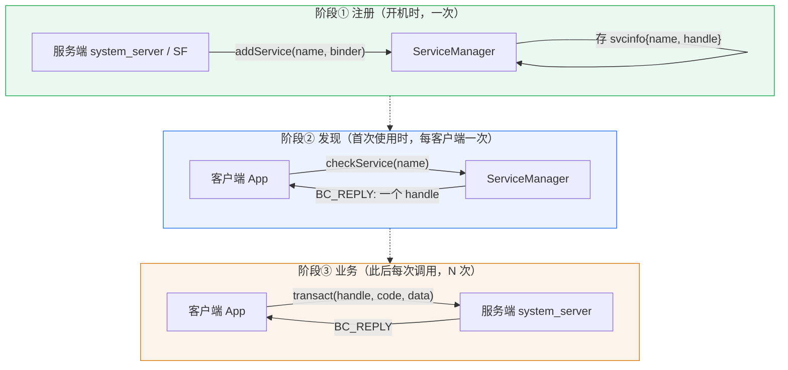
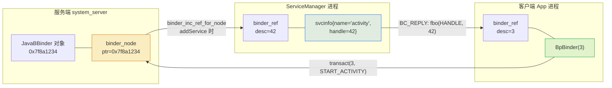
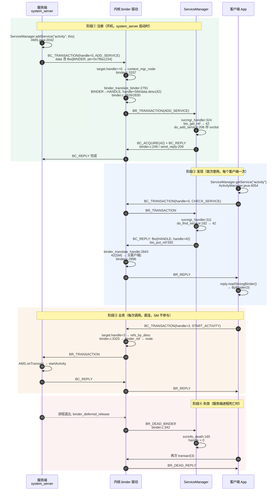
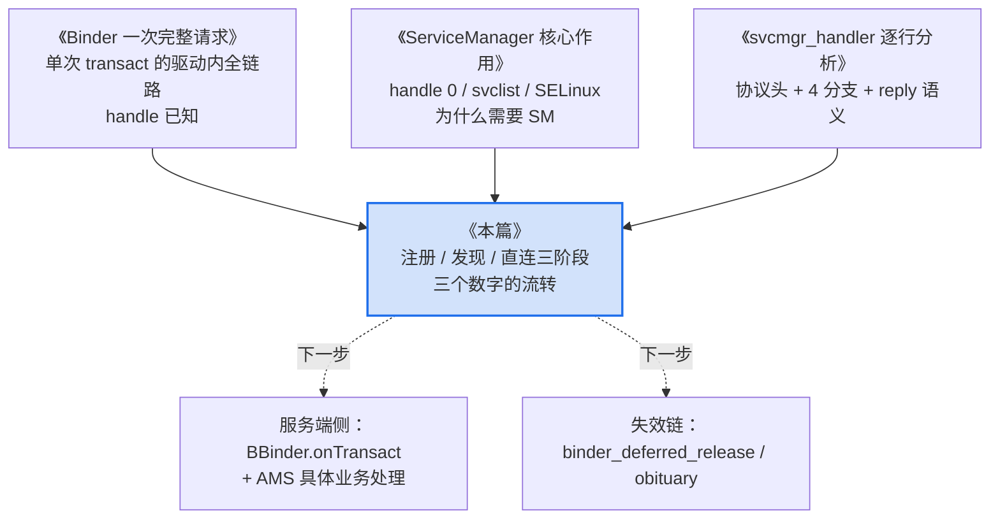

# Binder 服务发现完整闭环 · 注册 / 发现 / 直连 · Android 10

> 基线：`cells-android10` / android-10.0.0_r33 / kernel 4.9.200  
> 所有行号本仓实测。  
> 承接：`ServiceManager_核心作用_Android10.md`、`ServiceManager_svcmgr_handler_逐行分析_Android10.md`、`Binder_一次完整请求_核心函数与数据结构_Android10.md`

---

## 一、结论前置

### 1.1 先把那条链纠正过来

ServiceManager 不做任何流量转发，它甚至没有能力把请求转给服务端——它手里只有一个 `uint32 handle`，没有业务方法、没有连接池、没有转发逻辑。

真相是**三段互不重叠的独立过程**：



**你画的五个箭头，真实对应物是**：

| 你的写法                     | 真实发生                                                   | 时机                |
| ------------------------ | ------------------------------------------------------ | ----------------- |
| 客户端 → servicemanager     | `checkService("activity")`，`CHECK_SERVICE_TRANSACTION` | 首次调用时             |
| servicemanager → **服务端** | ❌ **不存在**。SM 返回的是给**客户端**的 handle                      | —                 |
| 服务端 → servicemanager     | ✅ 但这是 `addService`，发生在**开机阶段**，**早于**客户端查询             | system_server 启动时 |
| servicemanager → 客户端     | ✅ `BC_REPLY` 带一个 `flat_binder_object`                  | 同第一段              |
| （缺）                      | 客户端 → 服务端 **直连** 业务调用                                  | 每次业务              |

### 1.2 一句话答案

> **ServiceManager 只做一件事：把一个字符串换成一个数字。**  
> 拿到数字之后，客户端和服务端点对点通信，SM 完全退场。  
> SM 唯一持续参与的是**生命周期管理**——服务端进程死了，SM 负责把那个数字作废（`handle = 0`）。

### 1.3 为什么必须有 SM（bootstrap 问题）

这是这道题真正的深度所在：**先有鸡还是先有蛋**。

- 客户端要和 system_server 通信，需要一个 handle
- handle 由谁给？SM
- 那客户端和 SM 通信，需要谁的 handle？**handle 0**
- handle 0 从哪来？**硬编码**，内核特例（`binder.c:3337`），不需要查表、不需要注册

**内核只给了一个固定坑位**（`binder_context_mgr_node`），所以只能有一个"引导服务"。如果所有服务都用固定 handle，就无法支持动态注册、进程隔离、多实例。

`ProcessState.cpp:117` 那行 `return getStrongProxyForHandle(0);` 就是整个 bootstrap 的落脚点——**硬编码 0，是 Binder 唯一不需要解析的地址**。

---

## 二、总览：三阶段 × 三方 × 三个数字

### 2.1 一个服务，三个进程，三个不同的数字

这是理解整条链最关键的一张表。以 `activity`（AMS）为例：

| 视角                      | 标识                                           | 值（示意）        | 出处                          |
| ----------------------- | -------------------------------------------- | ------------ | --------------------------- |
| **服务端** (system_server) | `flat_binder_object.binder` = `JavaBBinder*` | `0x7f8a1234` | `Parcel::flatten_binder`    |
| 内核                      | `binder_node.ptr`                            | `0x7f8a1234` | `binder.c:1479`             |
| **SM 进程**               | `svcinfo.handle`（= SM 的 `binder_ref.desc`）   | `42`         | `service_manager.c:229/237` |
| **客户端进程**               | `BpBinder.mHandle`（= 客户端的 `binder_ref.desc`） | `3`          | `ProcessState.cpp:273`      |

**同一张服务，服务端看到的是指针，SM 看到 42，客户端看到 3。**

这就是为什么《ServiceManager 核心作用》§6.3 强调：`service list` 的第一列不是 handle，且绝不能跨进程裸传 handle。



**注意最后那条箭头**：`transact(3, ...)` 直达 `binder_node`，**绕过了 SM**。SM 在这张图里只在中间出现过一次（给出 42→3 的翻译）。

### 2.2 完整时序（含三次驱动改写）



---

## 三、分层拆解

### 3.1 阶段① 注册：服务端 → SM

#### 3.1.1 Java 服务（system_server 里的 AMS）

`frameworks/base/services/java/com/android/server/SystemServer.java:781`

```java
        mActivityManagerService.setSystemProcess();
```

`frameworks/base/services/core/java/com/android/server/am/ActivityManagerService.java:2040`

```java
    public void setSystemProcess() {
        try {
            ServiceManager.addService(Context.ACTIVITY_SERVICE, this, /* allowIsolated= */ true,
                    DUMP_FLAG_PRIORITY_CRITICAL | DUMP_FLAG_PRIORITY_HIGH | DUMP_FLAG_PRIORITY_NORMAL);  // :2042
            ServiceManager.addService(ProcessStats.SERVICE_NAME, mProcessStats);      // :2044
            ServiceManager.addService("meminfo", new MemBinder(this), ...);            // :2045
            ServiceManager.addService("gfxinfo", new GraphicsBinder(this));            // :2047
            ...
```

**一个进程注册多个服务**：`system_server` 一路 `addService` 上百次（`SystemServer.java` 里 25+ 处，AMS 内部还有一批）。它们共享同一个 `binder_proc`，但**每个服务是独立的 `binder_node`**。

`Context.ACTIVITY_SERVICE` = `"activity"`。

`ServiceManager.addService`（`ServiceManager.java:189`）→ `getIServiceManager().addService(...)`（`:192`）→ `ServiceManagerProxy.addService`（`ServiceManagerNative.java:147`）：

```java
    public void addService(String name, IBinder service, boolean allowIsolated, int dumpPriority)
            throws RemoteException {
        Parcel data = Parcel.obtain();
        Parcel reply = Parcel.obtain();
        data.writeInterfaceToken(IServiceManager.descriptor);   // :151
        data.writeString(name);                                 // :152
        data.writeStrongBinder(service);                        // :153 ★
        data.writeInt(allowIsolated ? 1 : 0);                   // :154
        data.writeInt(dumpPriority);                            // :155
        mRemote.transact(ADD_SERVICE_TRANSACTION, data, reply, 0);   // :156
```

`data.writeStrongBinder(service)` 中 `service` 是 `AMS this`（继承 `IActivityManager.Stub` → `Binder`）。JNI 层 `android_os_Parcel_writeStrongBinder` 会为这个 Java `Binder` 对象创建一个 **`JavaBBinder`** 包装，然后调 `Parcel::writeStrongBinder` → `flatten_binder`。

**驱动看到的 `flat_binder_object`**：

```c
struct flat_binder_object {
    struct binder_object_header hdr;    // type = BINDER_TYPE_BINDER
    __u32                       flags;
    union {
        binder_uintptr_t        binder; // = (uintptr_t) JavaBBinder*
        __u32                   handle;
    };
    binder_uintptr_t            cookie;
};
```

`binder` 字段是 **system_server 进程内 `JavaBBinder` 对象的虚拟地址**。

#### 3.1.2 Native 服务（SurfaceFlinger）

`frameworks/native/services/surfaceflinger/main_surfaceflinger.cpp:132`

```cpp
    // publish surface flinger
    sp<IServiceManager> sm(defaultServiceManager());                          // :132
    sm->addService(String16(SurfaceFlinger::getServiceName()), flinger, false,
                   IServiceManager::DUMP_FLAG_PRIORITY_CRITICAL | IServiceManager::DUMP_FLAG_PROTO);  // :133-134
```

`defaultServiceManager()`（`IServiceManager.cpp:43`）→ `ProcessState::self()->getContextObject(nullptr)`（`:55`）→ `getStrongProxyForHandle(0)`（`ProcessState.cpp:119`）→ `BpBinder(0)`。

`addService`（`IServiceManager.cpp:271`）→ `writeStrongBinder(service)`（`:278`）→ `transact(ADD_SERVICE_TRANSACTION, ...)`（`:282`）。

此时 `flinger` 是 `SurfaceFlinger*`（继承 `BnSurfaceComposer` → `BBinder`），`flatten_binder` 写入的 `binder` 是**该 BBinder 对象的地址**。

#### 3.1.3 驱动改写（第一次）

`kernel/drivers/android/binder.c:2791`

```c
static int binder_translate_binder(struct flat_binder_object *fp, ...) {
    ...
    node = binder_get_node(proc, fp->binder);              // :2800 按指针找/建 node
    if (!node) node = binder_new_node(proc, fp);           // :2802
    if (fp->cookie != node->cookie) { ... ret = -EINVAL; }  // :2806 防伪造
    if (security_binder_transfer_binder(...)) { ... }       // :2814
    ret = binder_inc_ref_for_node(target_proc, node,
                                  fp->hdr.type == BINDER_TYPE_BINDER,
                                  &thread->todo, &rdata);  // :2819 ★ 在 SM 进程建 ref
    ...
    if (fp->hdr.type == BINDER_TYPE_BINDER)
        fp->hdr.type = BINDER_TYPE_HANDLE;                 // :2826 ★ 类型改写
    else
        fp->hdr.type = BINDER_TYPE_WEAK_HANDLE;
    fp->binder = 0;                                        // :2829 ★ 指针清零
    fp->handle = rdata.desc;                               // :2830 ★ 换成 SM 视角 desc
    fp->cookie = 0;
```

**三件事同时发生**：

1. 在 system_server 的 `binder_proc` 里建/找一个 `binder_node`（`ptr = 0x7f8a1234`）
2. 在 **SM 的 `binder_proc`** 里建一个 `binder_ref`（`desc = 42`）
3. 把数据里的 `flat_binder_object` **原地改写**成 `BINDER_TYPE_HANDLE` + `handle = 42`，**指针清零**


> 注意 `fp->binder = 0`（`:2829`）。这是安全边界：跨进程永远不泄露本地指针。

#### 3.1.4 SM 侧存储

`service_manager.c:256` `svcmgr_handler` → `:324` `case SVC_MGR_ADD_SERVICE` → `bio_get_ref(msg)`（`:329`）拿到 42 → `do_add_service`（`:332`）。

`do_add_service:206`：

```c
    si = find_svc(s, len);
    if (si) {
        if (si->handle) { ... svcinfo_death(bs, si); }   // :224-227 覆盖旧服务
        si->handle = handle;                             // :229
    } else {
        si = malloc(sizeof(*si) + (len + 1) * sizeof(uint16_t));   // :231
        ...
        si->handle = handle;                             // :237 ★ 记住 42
        ...
        si->next = svclist; svclist = si;                // :245-246
    }
    binder_acquire(bs, handle);                          // :249 ★ 强引用保活
    binder_link_to_death(bs, handle, &si->death);        // :250 ★ 死亡通知
```

**`binder_acquire(42)` → `BC_ACQUIRE(42)`** 让 SM 持有该 node 的强引用。这样即使没有任何客户端在用，node 也不会被回收。

### 3.2 阶段② 发现：客户端 ⇄ SM

#### 3.2.1 客户端入口

Java（`frameworks/base/core/java/android/app/ActivityManager.java:4041`）：

```java
    public static IActivityManager getService() {
        return IActivityManagerSingleton.get();          // :4042
    }

    private static final Singleton<IActivityManager> IActivityManagerSingleton =
            new Singleton<IActivityManager>() {
                @Override
                protected IActivityManager create() {
                    final IBinder b = ServiceManager.getService(Context.ACTIVITY_SERVICE);   // :4054
                    final IActivityManager am = IActivityManager.Stub.asInterface(b);       // :4055
                    return am;
                }
            };
```

**三级缓存**：
1. `IActivityManagerSingleton`（进程级单例，Java 对象）
2. `ServiceManager.sCache`（`ServiceManager.java:125` `sCache.get(name)`）
3. 内核 `refs_by_desc`（`binder_ref` 复用）

所以 `getService("activity")` **在同一个进程里只真正走一次 IPC**。

Native 客户端同理，`ProcessState::getStrongProxyForHandle()`（`ProcessState.cpp:273`）用 `mHandleToObject` 做缓存：

```cpp
sp<IBinder> ProcessState::getStrongProxyForHandle(int32_t handle) {
    sp<IBinder> result;
    AutoMutex _l(mLock);
    handle_entry* e = lookupHandleLocked(handle);        // :279 进程级缓存表

    if (e != nullptr) {
        IBinder* b = e->binder;
        if (b == nullptr || !e->refs->attemptIncWeak(this)) {
            if (handle == 0 ||  handle >= INIT_SYSTEM_CONTEXT_MGR_HANDLE) {   // :287
                // Special case for context manager...
                // The context manager is the only object for which we create
                // a BpBinder proxy without already holding a reference.
                // Perform a dummy transaction to ensure the context manager
                // is registered before we create the first local reference
                // to it (which will occur when creating the BpBinder).
                // If a local reference is created for the BpBinder when the
                // context manager is not present, the driver will fail to
                // provide a reference to the context manager, but the
                // driver API does not return status.
                ...
                Parcel data;
                status_t status = IPCThreadState::self()->transact(
                        handle, IBinder::PING_TRANSACTION, data, nullptr, 0);   // :308-309
                if (status == DEAD_OBJECT)
                   return nullptr;                                               // :311
            }

            b = BpBinder::create(handle);      // :314 ★ 真正创建
            e->binder = b;
            if (b) e->refs = b->getWeakRefs();
            result = b;
        } else {
            result.force_set(b);
            e->refs->decWeak(this);
        }
    }
    return result;
}
```

**这段注释（`:288-305`）是 Android 官方对 bootstrap 问题的说明，值得逐字读**：

> `The context manager is the only object for which we create a BpBinder proxy without already holding a reference.`
> （context manager 是**唯一**一个"我还没持有引用就要创建 BpBinder"的对象）

原因是：创建 `BpBinder(0)` 会让驱动尝试建 `binder_ref`。如果此刻 SM 还没注册 context mgr，驱动 `binder_get_ref_olocked` 失败，**但驱动 API 不返回错误**（`ProcessState` 拿不到失败信号）。所以先发一个 `PING` 探测：

- `status == DEAD_OBJECT` → SM 不存在，返回 `nullptr`，不创建 `BpBinder`
- 否则 → 说明 SM 在，安全创建

注释也承认这个设计有缺陷（`:299-305`）：

> `Note that this is not race-free if the context manager dies while this code runs.`
> `TODO: ... stop special casing handle 0 for context manager and add a driver API ...`

**这是 handle 0 特例的"历史包袱"直接证据。** 普通 handle（非 0）不做这个 PING——因为普通 handle 一定来自一个已有 `flat_binder_object`，ref 必然已存在。

#### 3.2.2 查询请求

`ServiceManagerProxy.checkService`（`ServiceManagerNative.java:135`）：

```java
        data.writeInterfaceToken(IServiceManager.descriptor);   // :138
        data.writeString(name);                                 // :139
        mRemote.transact(CHECK_SERVICE_TRANSACTION, data, reply, 0);   // :140
        IBinder binder = reply.readStrongBinder();              // :141
```

`mRemote` 就是 `BpBinder(0)`。

#### 3.2.3 SM 查询

`svcmgr_handler:311` → `do_find_service:182`：

```c
    struct svcinfo *si = find_svc(s, len);
    if (!si || !si->handle) return 0;                       // :186 不存在（或已死）
    if (!si->allow_isolated) {                              // :190
        uid_t appid = uid % AID_USER;
        if (appid >= AID_ISOLATED_START && appid <= AID_ISOLATED_END) return 0;
    }
    if (!svc_can_find(s, len, spid, sid, uid)) return 0;    // :199 权限
    return si->handle;                                      // :203 ★ 返回 42
```

`bio_put_ref(reply, 42)`（`:321` → `binder.c:592`）：

```c
    obj->hdr.type = BINDER_TYPE_HANDLE;    // :604
    obj->handle = 42;                      // :605 ★ SM 视角的数字
```

#### 3.2.4 驱动再改写（第二次）

`binder_translate_handle`（`binder.c:2843`）：

```c
    node = binder_get_node_from_ref(proc, fp->handle,               // :2852 用 42 找 node
                                    fp->hdr.type == BINDER_TYPE_HANDLE, &src_rdata);
    ...
    binder_node_lock(node);
    if (node->proc == target_proc) {                                // :2865 目标就是宿主
        fp->hdr.type = BINDER_TYPE_BINDER;
        fp->binder = node->ptr;                                    // :2870 反解成指针
        ...
    } else {                                                        // :2885 常规跨进程
        ret = binder_inc_ref_for_node(target_proc, node, ...);      // :2889 在客户端建 ref
        ...
        fp->binder = 0;
        fp->handle = dest_rdata.desc;                               // :2896 ★ 42 → 3
```

**这次是 `42 → 3`**：`42` 是 SM 进程里那个 ref 的 desc，`3` 是**客户端进程**里新建 ref 的 desc。

`dest_rdata.desc` 的分配规则（`binder.c:1929-1936`）：

```c
    new_ref->data.desc = (node == context->binder_context_mgr_node) ? 0 : 1;
    for (n = rb_first(&proc->refs_by_desc); n != NULL; n = rb_next(n)) {
        ref = rb_entry(n, struct binder_ref, rb_node_desc);
        if (ref->data.desc > new_ref->data.desc) break;
        new_ref->data.desc = ref->data.desc + 1;
    }
```

**是「最小可用编号」，不是严格递增**。所以一个进程里反复拿/放服务，desc 会复用。这也是为什么不能用 desc 做唯一标识。

客户端最终 `reply.readStrongBinder()` → `unflatten_binder` → `BpBinder(3)`。

### 3.3 阶段③ 业务：客户端 → 服务端（直连）

```cpp
// ActivityManager.java:4055 → IActivityManager.Stub.asInterface(b)
// 生成的 Proxy 里：
public int startActivity(...) {
    Parcel data = Parcel.obtain();
    data.writeInterfaceToken("android.app.IActivityManager");
    ...
    mRemote.transact(/*START_ACTIVITY_TRANSACTION*/ 8, data, reply, 0);
}
```

`mRemote` = `BpBinder(3)` → `BpBinder::transact:217` → `IPCThreadState::transact:663` → `talkWithDriver:955`（ioctl `:1008`）。

驱动里（`binder.c:3313`）：

```c
        if (tr->target.handle) {                                  // :3313 handle=3 ≠ 0
            binder_proc_lock(proc);
            ref = binder_get_ref_olocked(proc, tr->target.handle, true);   // :3325 查 refs_by_desc
            if (ref) target_node = binder_get_node_refs_for_txn(ref->node, ...);
            ...
        } else {                                                  // :3337 只有 0 走特例
```

**`handle = 3` 走的是普通红黑树查表，完全不碰 ServiceManager。**

然后 `binder_transaction:3201` → `binder_proc_transaction:3108` → 投递到 system_server 的 `binder_thread` → `BR_TRANSACTION` → `executeCommand:1101` → `JavaBBinder::onTransact:355` → `Binder.execTransact:987` → `AMS.onTransact`。

回程 `BC_REPLY` → `binder_transaction(reply=1)` → 客户端 `waitForResponse:857` 拿到 `BR_REPLY`。

**全程 SM 不出现。**

### 3.4 阶段④ 失效：服务端死亡 → SM → 客户端

这是 SM 唯一"持续参与"的场景。

服务端进程退出 → 内核 `binder_deferred_release` 清理 → 对每个注册过 death 通知的进程发 `BR_DEAD_BINDER`。

SM 收到（`binder.c:342`）：

```c
            case BR_DEAD_BINDER: {
                struct binder_death *death = (struct binder_death *)(uintptr_t)*(binder_uintptr_t*)ptr;
                ptr += sizeof(binder_uintptr_t);
                death->func(bs, death->ptr);      // :345 → svcinfo_death
                break;
            }
```

`svcinfo_death`（`service_manager.c:165`）：

```c
    ALOGI("service '%s' died\n", str8(si->name, si->len));   // :169
    if (si->handle) {
        binder_release(bs, si->handle);   // :171
        si->handle = 0;                   // :172 ★ 作废，但名字保留
    }
```

此后 `do_find_service:186` 的 `!si->handle` 命中，返回 0 → 客户端拿到 `null`。

**客户端原有 handle 也不会自动失效**：客户端的 `binder_ref` 仍在，但 `node->proc == NULL`，下次 `transact` 得到 `BR_DEAD_REPLY`（`IPCThreadState` 转成 `DEAD_OBJECT`）。此时必须重新 `getService`。

**这就是"服务重启后客户端必须重连"的机制根源。**

### 3.5 三阶段对照表

| 维度 | 阶段① 注册 | 阶段② 发现 | 阶段③ 业务 |
|------|-----------|-----------|-----------|
| 触发时机 | 开机 / 服务启动 | 首次使用（懒加载） | 每次调用 |
| 频次 | 每服务 1 次 | 每客户端每服务 1 次 | N 次 |
| 方向 | 服务端 → SM | 客户端 ⇄ SM | 客户端 ⇄ 服务端 |
| `target.handle` | **0**（特例分支） | **0**（特例分支） | 非 0（查红黑树） |
| code | `ADD_SERVICE_TRANSACTION`(3) | `CHECK_SERVICE_TRANSACTION`(2) | 服务自定义（如 `START_ACTIVITY`） |
| 携带 fbo | 有（`BINDER_TYPE_BINDER`） | 无 | 看业务 |
| 返回值 | 异常码 0 | `fbo(HANDLE)` | 业务数据 |
| 经过 SM | ✅ | ✅ | ❌ |
| SM 的产出物 | 存 `svcinfo.handle` | 返回一个 `uint32` | 无 |

---

## 四、速查表

### 4.1 三阶段关键函数

| 阶段 | 层 | 函数 / 语句 | 位置 |
|------|----|------------|------|
| ① | Java | `SystemServer` 调 `setSystemProcess` | `SystemServer.java:781` |
| ① | Java | `AMS.setSystemProcess` | `ActivityManagerService.java:2040` |
| ① | Java | `ServiceManager.addService("activity", this, true, ...)` | `:2042` |
| ① | Java | `ServiceManagerProxy.addService` | `ServiceManagerNative.java:147` |
| ① | Java | `data.writeStrongBinder(service)` | `:153` |
| ① | Java | `mRemote.transact(ADD_SERVICE_TRANSACTION, ...)` | `:156` |
| ① | Native | `main_surfaceflinger` 注册 SF | `main_surfaceflinger.cpp:132-134` |
| ① | Native | `BpServiceManager::addService` | `IServiceManager.cpp:271` |
| ① | 内核 | `binder_translate_binder` | `binder.c:2791`（改写 `:2826/2830`） |
| ① | SM | `svcmgr_handler` ADD 分支 | `service_manager.c:324` |
| ① | SM | `do_add_service` | `:206`（存 handle `:229/237`，acquire `:249`，death `:250`） |
| ② | Java | `ActivityManager.getService` | `ActivityManager.java:4041` |
| ② | Java | `ServiceManager.getService("activity")` | `:4054` |
| ② | Java | `ServiceManagerProxy.checkService` | `ServiceManagerNative.java:135` |
| ② | Java | `reply.readStrongBinder()` | `:141` |
| ② | Java | `WindowManagerGlobal.getWindowManagerService` | `WindowManagerGlobal.java:178-182` |
| ② | Native | `defaultServiceManager()` | `IServiceManager.cpp:43`（`getContextObject` `:55`） |
| ② | Native | `ProcessState::getContextObject` | `ProcessState.cpp:117`（`handle 0` `:119`） |
| ② | Native | `getStrongProxyForHandle` | `ProcessState.cpp:273`（`PING` `:287`） |
| ② | SM | `svcmgr_handler` GET/CHECK | `service_manager.c:311` |
| ② | SM | `do_find_service` | `:182`（返回 handle `:203`） |
| ② | SM | `bio_put_ref` | `binder.c:592` |
| ② | 内核 | `binder_translate_handle` | `binder.c:2843`（改写 `:2896`） |
| ③ | Native | `BpBinder::transact` | `BpBinder.cpp:217` |

| ③ | Native | `IPCThreadState::transact` | `IPCThreadState.cpp:663` |
| ③ | 内核 | handle≠0 查表 | `binder.c:3313-3336` |
| ③ | 内核 | `binder_transaction` | `binder.c:3201` |
| ④ | 内核 | `BR_DEAD_BINDER` 解析 | `binder.c:342` |
| ④ | SM | `svcinfo_death` | `service_manager.c:165`（`handle=0` `:172`） |

### 4.2 三个数字的对照

| 数字 | 归属 | 存在形式 | 生命周期 |
|------|------|---------|---------|
| `0x7f8a1234` | 服务端进程 | `flat_binder_object.binder` / `binder_node.ptr` | 对象存活期 |
| `42` | SM 进程 | `svcinfo.handle` / `binder_ref.desc` | 注册到 `handle=0` |
| `3` | 客户端进程 | `BpBinder.mHandle` / `binder_ref.desc` | 首次 getService 到进程退出 |

### 4.3 事务码对照

| 常量 | 值 | 客户端位置 | 服务端位置 |
|------|-----|-----------|-----------|
| `GET_SERVICE_TRANSACTION` | 1 | `IServiceManager.h:77` | `binder.h:39` |
| `CHECK_SERVICE_TRANSACTION` | 2 | `IServiceManager.h:78` | `binder.h:40` |
| `ADD_SERVICE_TRANSACTION` | 3 | `IServiceManager.h:79` | `binder.h:41` |
| `LIST_SERVICES_TRANSACTION` | 4 | `IServiceManager.h:80` | `binder.h:42` |
| `PING_TRANSACTION` | `'_PNG'` | `IBinder.h` | `binder.h:38` |

---

## 五、调试验证

### 5.1 验证"三个数字不同"（最有说服力的实验）

```bash
# 1. SM 视角：svclist 的遍历序号（注意：第一列不是 handle）
adb shell service list | head
# 输出形如：
#   Found 217 services:
#   0	phone: [com.android.internal.telephony.ITelephony]

# 2. 服务端视角：system_server 里的 JavaBBinder 地址（= node->ptr）
adb shell cat /sys/kernel/debug/binder/proc/$(adb shell pidof system_server) | grep -A5 "node"
# 输出形如：node 12345: u0000007f8a1234 proc 1234 ...  ← 这就是 ptr

# 3. SM 视角：SM 进程里的 ref（每个 ref 有 desc N）
adb shell cat /sys/kernel/debug/binder/proc/$(adb shell pidof servicemanager) | grep "ref"
#   ref 67890: desc 42 s 1 w 1 node 12345 ...

# 4. 客户端视角：随便一个 App 进程里的 ref
adb shell cat /sys/kernel/debug/binder/proc/$(adb shell pidof com.android.systemui) | grep "ref"
#   ref 11111: desc 3 s 1 w 1 node 12345 ...
# ★ 同一个 node 12345，在三个 proc 里的 desc 各不相同（42 / 3），ptr 只在服务端
```

### 5.2 验证"业务不经过 SM"

```bash
# 给 SM 加断点式验证：让 SM 短暂不可用，已缓存 handle 的客户端仍能工作
# 方法：观察 iowait / 事务计数
adb shell cat /sys/kernel/debug/binder/stats | grep -E "transaction|BC_TRANSACTION"
# 反复触发业务调用（如点击界面），SM 的计数不增长，system_server 的计数增长
```

更直接的方法用 ftrace：

```bash
adb shell su -c 'echo 1 > /sys/kernel/debug/tracing/events/binder/binder_transaction/enable'
# 只抓 servicemanager 的入向事务
adb shell su -c 'cat /sys/kernel/debug/tracing/trace_pipe' | grep servicemanager
# 点击界面 → 看不到新事务（因为业务直连 system_server）
```

### 5.3 验证"注册在发现之前"

```bash
# 开机早期抓 SM 收到的 ADD_SERVICE
adb logcat -b all | grep -E "add_service|ServiceManager"
# 时间戳应早于第一次 getService
```

### 5.4 验证服务死亡后的重新连接

```bash
# 1. 杀掉某个 native 服务（如 cameraserver，非 critical 可重启）
adb shell kill $(adb shell pidof cameraserver)

# 2. 观察 SM 日志
adb logcat -s ServiceManager | grep "died"
# → "service 'media.camera' died"

# 3. 此时 checkService 返回 null
adb shell service check media.camera
# → not found

# 4. 服务重启后重新注册，checkService 恢复
```

### 5.5 代码级验证

```bash
cd C:/D/android_project/cells-android10

# 三阶段入口
grep -n "setSystemProcess" frameworks/base/services/java/com/android/server/SystemServer.java
grep -n "ServiceManager.addService(Context.ACTIVITY_SERVICE" frameworks/base/services/core/java/com/android/server/am/ActivityManagerService.java
grep -n "IActivityManagerSingleton\|ServiceManager.getService(Context.ACTIVITY_SERVICE)" frameworks/base/core/java/android/app/ActivityManager.java

# 两次改写
grep -n "fp->handle = rdata.desc\|fp->handle = dest_rdata.desc" kernel/drivers/android/binder.c
# → 2830, 2896

# handle 0 特例
grep -n "tr->target.handle" kernel/drivers/android/binder.c
# → 3313, 3337

# desc 分配
grep -n "binder_context_mgr_node) ? 0 : 1" kernel/drivers/android/binder.c
# → 1929
```

---

## 六、踩坑清单

### 6.1 【最核心误区】ServiceManager 不是代理

`客户端 → SM → 服务端` 这条链**在任何 Android 版本都不存在**。

SM 手里只有 `uint32 handle`，它：
- 没有服务端的方法签名
- 不解析业务 code
- 没有转发队列
- 不做连接管理

**能验证这一点的铁证**：SM 是单线程的（`binder_loop` `binder.c:455`，无 `BR_SPAWN_LOOPER` 处理），如果它转发所有业务流量，整个系统会瞬间卡死。

### 6.2 注册在发现之前，顺序不能反

`addService` 必须早于 `checkService`。否则 `do_find_service:186` 的 `!si` 命中，返回 0，客户端拿到 `null`。

这就是为什么 `SystemServer` 里服务注册顺序有严格依赖注释（如 `main_surfaceflinger.cpp:137` 的 `// dependency on SF getting registered above`）。

**客户端侧有 5s 重试兜底**（`IServiceManager.cpp:230`）：

```cpp
        const long timeout = uptimeMillis() + 5000;
        ...
        const long sleepTime = gSystemBootCompleted ? 1000 : 100;
        while (uptimeMillis() < timeout) {
            sp<IBinder> svc = checkService(name);      // :247
            if (svc != nullptr) return svc;
            usleep(1000*sleepTime);
        }
```

开机阶段 100ms 一轮，启动完成后 1s 一轮。这是 `getService` 会阻塞的原因——**它不是纯查询，是「查询 + 最多 5s 等待」**。

### 6.3 一个进程一个 `binder_proc`，但可以有 N 个 `binder_node`

`system_server` 注册了 100+ 个服务，它们：
- 共享同一个 `binder_proc`（同一个 `/dev/binder` fd、同一块 mmap）
- 各有独立的 `binder_node`（每个 `BBinder`/`JavaBBinder` 一个）
- 在 SM 里各有一条 `svcinfo`，各有独立 handle

**推论**：不能靠 `binder_proc` 判断"是哪个服务"，必须靠 `binder_node`。

### 6.4 desc 是「最小可用编号」，不是递增 ID

`binder.c:1929-1936` 的逻辑是从 1 起找**第一个空隙**。所以：

- 同一个服务在不同进程里 desc 不同
- 同一个进程里，服务被 `BC_RELEASE` 后 desc 会被复用
- **desc 不能用来做唯一标识或持久化**

### 6.5 `handle 0` 只在「查表前」有意义

- `target.handle == 0` → 内核直接读 `binder_context_mgr_node`（`binder.c:3339`），**不查 `refs_by_desc`**
- 但 `desc == 0` 的 `binder_ref` 也可能真实存在（`binder.c:1929` 强制赋值）

两者是**同一个 node 的两个投影**，不是同一个东西。发包时填 `target.handle`，收包时读 `target.ptr`（union 两成员）。

### 6.6 服务端重启 = 客户端必须重新 `getService`

服务端进程死 → SM 把 `svcinfo.handle = 0`（`service_manager.c:172`）→ 客户端原 handle 变成 `BR_DEAD_REPLY`。

客户端**不会自动重连**。`BpBinder` 只是标记 `mAlive = false`，下次 `transact` 直接返回 `DEAD_OBJECT`。

**这就是为什么很多系统服务在 `system_server` 重启后，App 需要重新 `getSystemService()`。** 而 `ActivityManager.IActivityManagerSingleton` 这种静态单例一旦缓存了死的 `BpBinder`，就会持续报 `DEAD_OBJECT`——除非进程被杀重建。

### 6.7 `getService` 有阻塞语义，别在主线程随便调

`IServiceManager.cpp:230` 的 5s 超时 + `usleep` 轮询。如果在主线程调 `getService` 一个尚未注册的服务，会**卡主线程最多 5 秒**。

`Binder.allowBlocking()`（`ServiceManager.java:129`）就是给这类调用打标记，让 StrictMode 不要报 `BlockedBinderCall`。

### 6.8 Java 服务与 Native 服务的 `flat_binder_object` 不同

| | Java 服务 | Native 服务 |
|---|---|---|
| 对象 | `JavaBBinder`（JNI 包装） | `BBinder` 子类（如 `SurfaceFlinger`） |
| `fbo.binder` | `JavaBBinder*` | `BBinder*` |
| `onTransact` 落点 | `JavaBBinder::onTransact:355` → `Binder.execTransact:987` | `BBinder::transact:123` → 虚函数 `onTransact:134` |

两者在驱动眼里**完全一样**，都是 `BINDER_TYPE_BINDER` + 一个指针。跨进程后都是 handle。**这是 Binder 的核心抽象：语言无关。**

### 6.9 `writeStrongBinder` 与 `writeInt32(handle)` 绝不可混用

- `writeStrongBinder` → `flat_binder_object` → 驱动翻译 desc → 对方能用
- `writeInt32(handle)` → 裸数字 → 驱动不翻译 → 对方拿到的数字是**它自己进程的 desc 空间**，几乎必然指向错误的服务

**这是跨进程传 Binder 的唯一正确方式。** 详见《ServiceManager 核心作用》§6.4。

### 6.10 `service list` 输出的第一列不是 handle

`slist` 的第一列是 `svclist` 的遍历序号（`svcmgr_handler:338` 的 `n`），不是 `si->handle`。

想拿真实 handle，只能：
- 从 `svcinfo.handle` 读（需改 SM 或在 debugfs 看 ref）
- 或直接 `getService` 一次，看 `BpBinder::handle()`

### 6.11 服务数量上限 127 字符名 + 无数量上限

`do_add_service:213` 只限制 `len > 127`，**没有服务数量上限**。但：

- `svclist` 是单链表，线性查找 O(n)
- `service list` 是 N 次 IPC（每次一个名字）
- 开机注册 200+ 服务 = 200+ 次 `addService`，每次一个 `binder_transaction`

这是开机阶段 SM 有一定 CPU 占用的原因。

### 6.12 本仓 `check_mac_perms` 恒 true，整条链的鉴权失效

延续前两篇的发现（`service_manager.c:88` `return true;`）：

| 阶段 | 本应拦截 | 实际 |
|------|---------|------|
| ① 注册 | 无 `add` 权限的进程 | 放行（仅剩 uid < AID_APP 硬门槛 `:120`） |
| ② 发现 | 无 `find` 权限的服务 | 放行 |
| ② 列举 | 无 `list` 权限 | 放行 |

**后果**：任意 native 进程可 `addService` 顶替 `activity` / `window` / `package`（`do_add_service:225` OVERRIDE），此后所有客户端 `getService` 都会拿到**劫持者**的 handle，业务流量直连攻击者。

**这是完整的中间人攻击链**：不需要碰 SM 的流量（它本来就不转发），只需在阶段①把名字占掉。

---

## 附：三篇文档的拼图关系



## 一句话总结

> **SM 只做一次「名字 → 数字」的翻译，然后就永久退场。**
> 服务端用指针注册（`fbo.binder = JavaBBinder*`），SM 存 SM 视角的 desc，客户端拿客户端视角的 desc——同一个服务，三个进程三个数字，全靠驱动在 `flat_binder_object` 上原地改写两次。
> 它唯一持续在场的是**失效通知**：服务端一死，SM 把 `svcinfo.handle` 清零，客户端下次调用得到 `BR_DEAD_REPLY`。
