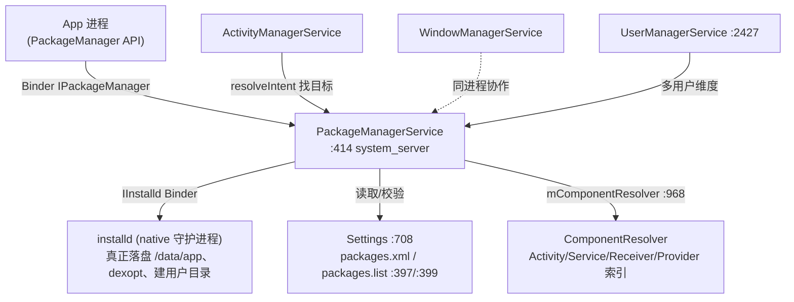
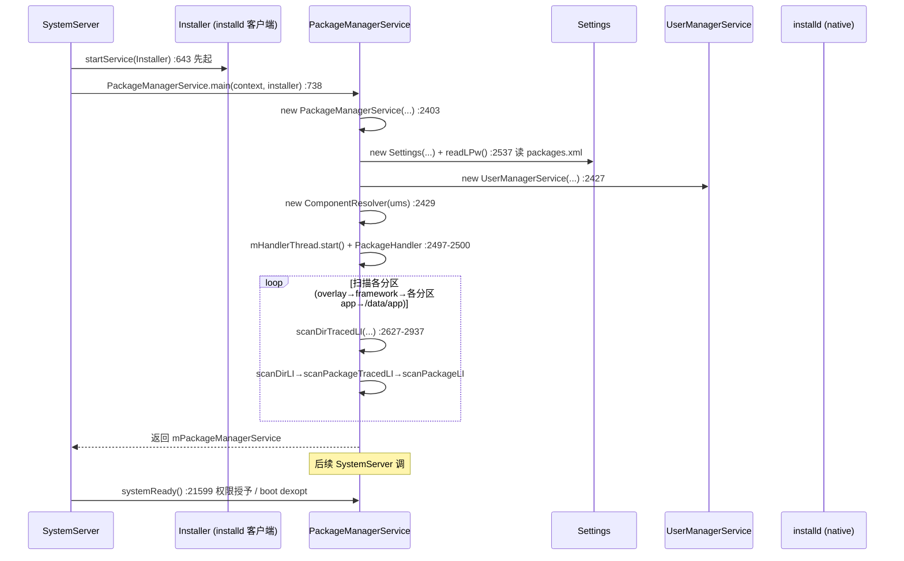
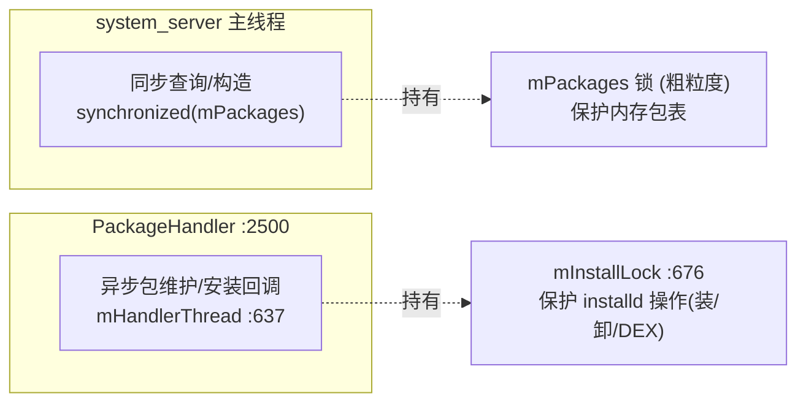

# PMS 总览与启动（Android 10 / android-10.0.0_r33）

> 本仓：`C:/D/android_project/cells-android10`，基线 `android-10.0.0_r33`（Columbia Cells 树，kernel 4.9.200）。
> 全部行号基于本仓实测；源码主文件 `frameworks/base/services/core/java/com/android/server/pm/PackageManagerService.java`（25622 行）。

---

## 1. 结论前置（6 条核心）

1. **PMS 是 system_server 内的 `IPackageManager.Stub` Binder 服务端**（`PackageManagerService.java:414`），统管全机已安装包的**安装 / 卸载 / 查询 / 权限授予 / 组件解析**。App 的"能不能装、谁能启动谁、有哪些权限"都归它裁决。
2. **启动链**：`SystemServer.startBootstrapServices`（`:625`）→ 先起 `Installer`（连 native installd，`:643`）→ `PackageManagerService.main`（`:738`）→ 构造器（`:2403`）扫描 7+ 个分区 → `systemReady`（`:21599`）→ 后续 phase。**`Installer` 必须先于 PMS**，因为 PMS 构造就要调 installd。
3. **双锁模型**：粗粒度 `synchronized (mPackages)` 保护内存包表；`mInstallLock`（`:676`）保护真正的 installd 操作（安装/卸载/DEX/建数据目录）。**两把锁职责分离**——前者快路径、后者慢路径（installd 跨进程）。
4. **双线程**：构造与同步查询跑在 system_server 主线程；异步包操作（安装完成回调、包维护）跑在 `PackageHandler`（`:2500`，绑 `ServiceThread mHandlerThread` `:637`）。
5. **两套持久化/内存表不要混**：内存 `mPackages`（`:684`，`包名 → PackageParser.Package` 解析产物）vs `Settings.mPackages`（`:263`，`包名 → PackageSetting` 落盘设置）。前者是"解析出来的样子"，后者是"装完记下来的样子"。
6. **组件解析（Intent → Activity/Service）交给 `mComponentResolver`**（`:968`），入口 `resolveIntent`（`:6579`）→ `resolveIntentInternal`（`:6590`）→ `queryActivities`。这是 AMS `startActivity` 找目标 Activity 的数据来源。

---

## 2. 总览：PMS 在系统中的位置

**与 installd 的关系**：`Installer extends SystemService`（`Installer.java:42`），内部持 `IInstalld`（`:28` 导入）指向 native `installd` 守护进程。PMS 不直接碰 `/data/app` 文件系统，而是通过 `Installer` 让 installd 代劳（装包、dexopt、建 CE/DE 用户数据目录）。**installd 死掉 → PMS 装不了任何 App**。

**与 AMS/WMS 的关系**：AMS 启动 Activity 前调 `resolveIntent` 经 PMS 拿到目标 `ResolveInfo`；PMS 与 WMS 同处 system_server、共享进程，权限/可见性策略互相调用。

---

## 3. 分层拆解 A：启动链（systemReady 之前）

### 3.1 时序图

### 3.2 SystemServer 启动入口（实测行号）

| 步骤 | 位置 | 说明 |
|---|---|---|
| `startBootstrapServices()` | `SystemServer.java:625` | 引导服务阶段 |
| `Installer installer = startService(Installer.class)` | `:643` | **必须先于 PMS** |
| `traceBeginAndSlog("StartPackageManagerService")` | `:735` | 启动标记 |
| `mPackageManagerService = PackageManagerService.main(...)` | `:738` | 创建 PMS |
| `mFirstBoot = mPackageManagerService.isFirstBot()` | `:743` | 记录是否首启 |

### 3.3 PMS 构造器（`:2403`）做了什么

1. 建 `Settings`（`mSettings:708`）并 `readLPw()`（`:2537`）读历史 `packages.xml`/`packages.list`，决定 `mFirstBoot`。
2. 建 `UserManagerService`（`sUserManager`，`:2427`）—— 多用户维度基础。
3. 建 `ComponentResolver`（`mComponentResolver`，`:2429`）—— 组件索引。
4. 建 `ServiceThread mHandlerThread`（`:637`）并 `start()`，再 `mHandler = new PackageHandler(looper)`（`:2500`）—— 异步工作线程。
5. **逐级扫描分区**（见 §5.1 顺序表）。
6. 把解析出的包写回 `Settings` 并 `writeLPr()` 落盘。

### 3.4 systemReady（`:21599`）

开机后半段由 SystemServer 调。关键点：逐用户做**权限授予**（`grantPermissionsUserIds` 收集需授权用户，`:77-89`）、触发 `performBootDexopt`/后台 dexopt、reconcile 用户数据目录等。App 在 `systemReady` 之前查询 PMS 可能拿到**不完整状态**（组件/权限未就绪）。

---

## 4. 分层拆解 B：核心数据模型与多线程

### 4.1 内存与持久化两套表（最易混）

| 表 | 声明位置 | Key → Value | 生命周期 |
|---|---|---|---|
| `mPackages` | `PMS:684` `ArrayMap<String, PackageParser.Package>` | 包名 → **解析产物**（Manifest 解析后的结构） | 内存，开机扫描重建 |
| `Settings.mPackages` | `Settings.java:263` `ArrayMap<String, PackageSetting>` | 包名 → **落盘设置**（安装路径、安装态、权限授予结果） | 持久化于 `packages.xml` |

> **版本注意**：`PackageParser.Package`（`PackageParser.java:6425`，`extends PackageLite`）是 Manifest 解析结果（`packageName:6428`、`applicationInfo:6472`、`activities:6479`、`receivers:6481`、`providers:6483`、`services:6485`、`permissions:6475`、`signingDetails` 来自 `PackageLite:466`）。`PackageSetting`（`Settings.java`）是"装完记下来"的持久对象。**修 PMS 时两者都要同步维护**。

### 4.2 持久化文件（Settings）

| 文件 | 位置 | 内容 |
|---|---|---|
| `packages.xml` | `Settings.java:397` | 全量包安装信息（路径/版本/权限/共享 UID） |
| `packages.list` | `Settings.java:399` | 精简列表（包名、uid、路径、seinfo），供 installd/SELinux 用 |
| `packages-backup.xml` | 同类 | 写失败时的备份 |

辅助结构：`mSharedUsers`（`:346`，`android.uid.system` 等共享 UID）、`mPermissions`（`PermissionSettings:383`）、`mPreferredActivities`（`:334`，默认打开器偏好）。

### 4.3 多线程与双锁

- **`mPackages` 锁**：Android 10 仍是**单把粗粒度全局锁**（与同版本 WMS 一致），所有包表读写 `synchronized (mPackages)`（构造器内 `:2496`、数千处调用）。对比 Android 12+ 拆成 `mLock` + 多个细粒度锁，本仓不要套新版本行号。
- **`mInstallLock`（`:676`）**：保护 installd 实际调用（安装/卸载/DEX/建用户目录），这些操作**慢且跨进程**，不能持 `mPackages` 锁去做，否则阻塞所有包查询。
- **`PackageHandler`（`:2500`）**：绑 `ServiceThread`（`:637`，HandlerThread 子类），处理 `MCS_*` 消息（安装完成、包清理等异步任务）。

---

## 5. 核心流程拆解

### 5.1 流程一：开机扫描链路（boot scan）

构造器按**固定顺序**逐目录 `scanDirTracedLI`（含 trace，`:9027`）→ `scanDirLI`（`:9036`）→ 每个 APK `scanPackageTracedLI`（`:9175`）→ `scanPackageLI`（`:9190`，真正解析 Manifest + 注册组件）。扫描顺序（实测）：

| 顺序 | 目录 | 行号（构造器内调用） |
|---|---|---|
| 1–5 | overlay 分区（vendor/product/services/odm/oem） | `:2627`–`:2655` |
| 6 | `framework` 目录（系统框架资源） | `:2666` |
| 7–17 | 各分区 app（priv-system/system、priv-vendor/vendor、priv-odm/odm、oem、priv-product/product、priv-product-services/product-services） | `:2681`–`:2829` |
| 18 | `/data/app`（用户安装，含 `SCAN_REQUIRE_KNOWN`） | `:2937` |

> **顺序即优先级/覆盖关系**：overlay 先于 framework，framework 先于各分区 app；同包名在靠后分区可覆盖（系统更新场景）。`/data/app` 最后扫，且带 `SCAN_REQUIRE_KNOWN`（仅在 settings 已记录的才接受，防止孤儿）。

### 5.2 流程二：Intent 解析（resolveIntent）

`resolveIntent`（`:6579`）→ `resolveIntentInternal`（`:6590`）→ `mComponentResolver.queryActivities(intent, ...)`（实际调用点如 `:7302`、`:7499`）。`ComponentResolver`（`:968`）持有全部已注册 Activity/Service/Receiver/Provider 的带优先级索引，`RESOLVE_PRIORITY_SORTER`（PMS `:98` 导入）按优先级/匹配度排序返回 `ResolveInfo` 列表。这是 AMS `startActivity` 找目标 Activity 的数据底座。

### 5.3 流程三：安装入口（install）

安装链：`installPackageLIF`（final，处理已解码的安装请求）→ `installPackageLI`（private，真正校验 + 拷贝 APK 到 `/data/app` + 调 installd + 更新 `Settings`）。本篇**仅标入口**，安装是全链路长流程（含 `PackageInstallerSession`、`verify`、`dexopt`），可单独成篇深挖。

---

## 6. 速查表：核心方法与字段行号

### 6.1 PMS 主类

| 项 | 行号 | 说明 |
|---|---|---|
| `class PackageManagerService extends IPackageManager.Stub` | `:414` | Binder 服务端 |
| `final ServiceThread mHandlerThread` | `:637` | 异步工作线程基类 |
| `final PackageHandler mHandler` | `:639`（声明）/` :2500`（创建） | 异步消息处理 |
| `final Installer mInstaller` | `:662` | installd 客户端 |
| `final Object mInstallLock` | `:676` | **installd 操作锁** |
| `ArrayMap<String, PackageParser.Package> mPackages` | `:684` | 内存包表（解析产物） |
| `final Settings mSettings` | `:708` | 持久化设置 |
| `final ComponentResolver mComponentResolver` | `:968` | 组件索引 |
| `static PMS main(...)` | `:2306` | 启动入口 |
| `PackageManagerService(...)` 构造器 | `:2403` | 扫描+装配 |
| `void systemReady()` | `:21599` | 权限授予/DEX |
| `scanDirTracedLI(...)` | `:9027` | 目录扫描（trace） |
| `scanDirLI(...)` | `:9036` | 目录扫描 |
| `scanPackageTracedLI(...)` | `:9175` | 单包扫描（trace） |
| `scanPackageLI(...)` | `:9190` | 单包解析+注册 |
| `resolveIntent(...)` | `:6579` | Intent 解析入口 |
| `resolveIntentInternal(...)` | `:6590` | Intent 解析实现 |

### 6.2 关键辅助类

| 类 | 位置 | 角色 |
|---|---|---|
| `Settings` | `Settings.java:133` | 持久化（`packages.xml` `:397` / `packages.list` `:399`） |
| `PackageParser.Package` | `PackageParser.java:6425` | Manifest 解析产物 |
| `Installer` | `Installer.java:42` | `IInstalld` 客户端（连 native installd） |
| `UserManagerService` | `sUserManager` PMS `:1348/2427` | 多用户维度 |
| `ComponentResolver` | `:968` | 组件匹配索引 |

---

## 7. 调试与验证

### 7.1 常用命令
- `dumpsys package` / `dumpsys package <pkg>` —— 看某包完整信息（权限、组件、安装路径）。
- `pm list packages` —— 列出所有包；`pm path <pkg>` 看 APK 路径。
- `pm dump <pkg>` —— 等价于 dumpsys 单包。
- `cat /data/system/packages.xml` —— 直接看持久化（需 root）。

### 7.2 logcat 锚点（grep 这些字符串）
- `"Scanning"` / 分区扫描日志 —— 开机扫描进度（scanDirLI 附近）。
- `"dexopt"` / `performBootDexopt` —— 开机 dexopt 进度。
- `"PackageManager"` 标签的 `I`/`W` 级日志 —— 安装失败、签名冲突、权限问题。
- `"First boot"` / `isFirstBoot` —— 判定是否首次启动（packages.xml 是否成功读取）。

---

## 8. 踩坑清单（8 条）

1. **`mPackages`（PMS）与 `Settings.mPackages` 是两个不同的表**：前者 `包名→PackageParser.Package`（解析产物），后者 `包名→PackageSetting`（落盘设置）。改 PMS 时两者都要同步，否则出现"装了却查不到"或"查到却落不了盘"。
2. **Android 10 仍是单把粗粒度 `mPackages` 锁**：所有包查询/修改串行。线上卡顿若堆栈卡在 `synchronized (mPackages)`，问题在别的持锁长操作（如某安装回调做了重活），不是 PMS 自身设计问题；不要套 Android 12+ 的细粒度锁行号。
3. **installd 是 native 守护进程**：PMS 经 `Installer→IInstalld` Binder 调它干落盘/DEX 的活。installd crash → 所有安装/卸载失败；改 installd 接口要同步 `Installer.java`。
4. **`Installer` 必须先于 `PackageManagerService` 启动**：`SystemServer:643` 先于 `:738`。顺序反了 PMS 构造就会因 `mInstaller` 不可用而失败。
5. **扫描顺序 = 覆盖/优先级**：overlay → framework → 各分区 app → `/data/app`。同包名靠后分区覆盖靠前分区；`/data/app` 带 `SCAN_REQUIRE_KNOWN`（`:2937`），只在 settings 已记录的才接受。
6. **`packages.xml` 是开机关键持久化**：损坏会触发重建（`firstBoot` 或被判定升级），可能丢失已授予权限/安装态；OTA 后 `updatePackagesIfNeededLocked` 会重跑。
7. **`systemReady` 前状态不完整**：权限授予、`bootDexopt`、组件索引收尾都在 `systemReady`（`:21599`）之后。早期（如其他引导服务）查询 PMS 拿到的可能是残缺视图。
8. **签名在 `PackageParser.Package.signingDetails`**（继承自 `PackageLite:466`，非空即已签名校验通过）：装包冲突、覆盖安装签名不一致报错，根因都在这；`sharedUserId` 还要求签名一致（见 `Settings.mSharedUsers:346`）。

---

## 9. 与既有文档路线衔接

- 本篇对标 `WMS_总览与启动` / `SystemUI_总览与启动` / `SurfaceFlinger_总览与启动`，是 PMS 子系统的**入口级地图**。
- 与 `WMS` 系列：PMS 与 WMS 同处 system_server，权限/可见性策略互相调用；`packages.xml` 里的 `seinfo` 也供给 SELinux/WMS。
- 与 `输入事件处理流程`：PMS 不参与输入派发，但通过 `ComponentResolver` 决定 Activity 启动目标，间接影响焦点窗口归属。
- **可深挖的后续专篇**：① `installPackageLI` 全链路（校验→拷贝→installd→dexopt→写 settings）；② `ComponentResolver` + Intent 解析优先级算法；③ `packages.xml` 字段与升级/恢复机制；④ 多用户（`UserManagerService`）下包状态隔离。
