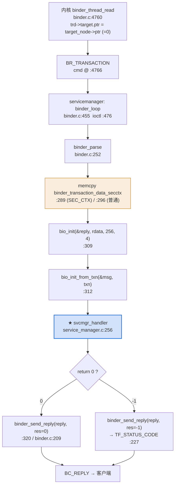
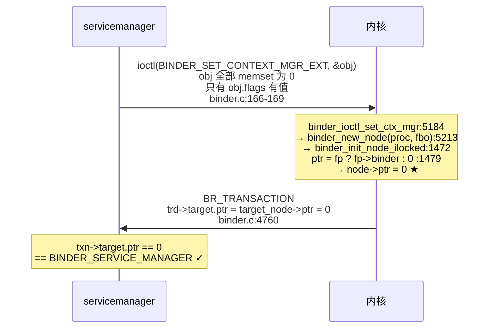
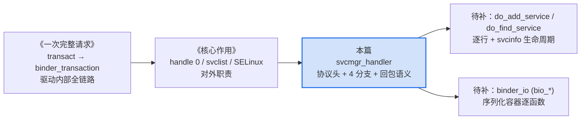

# svcmgr_handler 逐行分析 · Android 10 源码级拆解

> 基线：`cells-android10` / android-10.0.0_r33 / kernel 4.9.200
> 文件：`frameworks/native/cmds/servicemanager/service_manager.c`（455 行）
> 所有行号本仓实测，可用 `grep -n` 复核。
> 承接：`ServiceManager_核心作用_Android10.md`（下称《核心作用》）、`Binder_一次完整请求_核心函数与数据结构_Android10.md`（下称《一次完整请求》）

---

## 一、结论前置

`svcmgr_handler` 是 ServiceManager **唯一的业务函数**，全进程只有它一个回调，被 `binder_loop` 串行调用。

**一句话定位**：它是「Binder 协议头解析器 + 4 分支命令分发器」，不碰任何业务数据。

五个必须记住的结论：

1. **它不是 Binder 接口方法**。没有 `BnServiceManager::onTransact`，是**裸 C 函数**，直接吃 `binder_transaction_data_secctx`。整个 Android 只有这一处这么写。
2. **第一道校验是 `txn->target.ptr == 0`**（`:274`）。这个 0 不是"约定"，而是 `BINDER_SET_CONTEXT_MGR_EXT` 时传入的 `flat_binder_object` 被 `memset` 清零、`obj.binder == 0`，内核 `binder_init_node_ilocked` 把 `node->ptr` 存成 0 的结果（`binder.c:1479`）。**巧合与设计重合**。
3. **它自己实现了 `enforceInterface`**（`:284-295`）：手写读 strict policy → worksource → interface token 三段，再逐个字节 `memcmp` `"android.os.IServiceManager"`。不走 `Parcel`。
4. **reply 缓冲是栈上 256 字节**（`binder.c:304` `unsigned rdata[256/4]`），`offs` 槽位只有 4 个。这决定了 `listServices` 一次只能返回**一个**服务名。
5. **GET 和 ADD 两条路径的 reply 格式不对称**：GET 成功时 `return 0`，reply 里**只有** `flat_binder_object`；ADD 成功时 `break` 落到底部写 `uint32 0`（异常码）。客户端必须按各自方式读。

---

## 二、总览

### 2.1 调用链位置



### 2.2 函数体骨架（12 个动作）


---

## 三、分层拆解

### 3.1 函数签名：为什么长这样

`service_manager.c:256`

```c
int svcmgr_handler(struct binder_state *bs,
                   struct binder_transaction_data_secctx *txn_secctx,
                   struct binder_io *msg,
                   struct binder_io *reply)
{
    struct svcinfo *si;
    uint16_t *s;
    size_t len;
    uint32_t handle;
    uint32_t strict_policy;
    int allow_isolated;
    uint32_t dumpsys_priority;

    struct binder_transaction_data *txn = &txn_secctx->transaction_data;   // :269
```

四个参数各有讲究：

| 参数 | 是什么 | 谁填的 |
|------|--------|--------|
| `bs` | `binder_state{fd, mapped, mapsize}` | `binder_open` (`binder.c:109`)，用于回包时 `BC_ACQUIRE` / `BC_REPLY` |
| `txn_secctx` | `transaction_data` + `secctx` 指针 | 驱动 `binder_thread_read` 填充；EXT 模式下带 SELinux 上下文 |
| `msg` | 请求数据的 `binder_io` 视图 | `bio_init_from_txn` (`binder.c:497`) —— **只记指针，不拷贝** |
| `reply` | 回包数据容器 | `binder_parse` 栈上 `rdata[64]` (`binder.c:304/309`) |

**关键：`msg` 零拷贝**。`bio_init_from_txn`（`binder.c:497`）：

```c
void bio_init_from_txn(struct binder_io *bio, struct binder_transaction_data *txn) {
    bio->data = bio->data0 = (char *)(intptr_t) txn->data.ptr.buffer;      // :498
    bio->offs = bio->offs0 = (binder_size_t *)(intptr_t) txn->data.ptr.offsets;
    bio->data_avail = txn->data_size;
    bio->offs_avail = txn->offsets_size / sizeof(size_t);
    bio->flags = BIO_F_SHARED;      // :503 标记"这块内存要 BC_FREE_BUFFER 归还"
}
```

`msg->data0` 直接指向 **本进程 mmap 区里的 binder_buffer**。`svcmgr_handler` 读它 = 直接读共享映射，无第二次 memcpy。这与《一次完整请求》的"只拷一次"结论完全吻合。

`bio->flags = BIO_F_SHARED`（`:503`）是个隐含约定：这块缓冲区处理完必须归还。但 `svcmgr_handler` **自己不归还**——由 `binder_parse:318/320` 统一 `binder_free_buffer` 或 `binder_send_reply`（内含 `BC_FREE_BUFFER`）。这是职责分离。

### 3.2 第一道校验：`target.ptr == 0` 的真正来源

`service_manager.c:274`

```c
    if (txn->target.ptr != BINDER_SERVICE_MANAGER)      // BINDER_SERVICE_MANAGER = 0U (binder.h:32)
        return -1;
```

**为什么是 `ptr` 而不是 `handle`？** 因为这是**服务端视角**的收包。

完整因果链（本仓实测）：



三处源码对齐：

- `binder.c:164-169`（servicemanager 侧）：`memset(&obj, 0, sizeof(obj)); obj.flags = FLAT_BINDER_FLAG_TXN_SECURITY_CTX;` —— **`obj.binder` 从未赋值，就是 0**
- 内核 `binder.c:1479`：`binder_uintptr_t ptr = fp ? fp->binder : 0;` → `node->ptr = 0`
- 内核 `binder.c:4760`：`trd->target.ptr = target_node->ptr;` → 客户端收到 0

**对照普通服务**：`addService` 时 `writeStrongBinder(service)` 里 `flat_binder_object.binder = (uintptr_t)p`（BBinder 真实地址），所以普通服务端收到的 `target.ptr` 是**自己 BBinder 对象的地址**，非 0。`svcmgr_handler` 是唯一把它当 0 用的。

> 这就是《核心作用》里说的"独占 handle 0 坑位"在**收包侧**的对应物：发向量是 `handle 0`，收向量是 `ptr 0`，同一个 node 的两个投影。

**返回值语义**：`return -1` → `binder_parse:315` 拿到 `res = -1` → `binder_send_reply(..., status=-1)`（`:320`）→ 客户端 `readExceptionCode()` 读到 -1。这是"协议错误"，客户端会当成 `UNKNOWN_ERROR`。

### 3.3 PING 短路：为什么在校验 token 之前

`service_manager.c:277`

```c
    if (txn->code == PING_TRANSACTION)
        return 0;
```

`PING_TRANSACTION = B_PACK_CHARS('_','P','N','G')`（`binder.h:38`），即 `0x5f504e47`。对应 `IBinder::PING_TRANSACTION`。

**位置很关键**：它在 `:277`，而 interface token 校验在 `:291`。**PING 不需要 token**。

原因：`IPCThreadState::pingBinder()` 发的是**空 Parcel**，不写 `writeInterfaceToken`。如果 PING 放在 token 校验之后，健康检查永远失败。

`return 0` 时 reply 是空的（`bio` 未写入任何东西），`binder_send_reply` 走 `status==0` 分支，`data_size = reply->data - reply->data0 = 0`，发出一个**零长度回复**。客户端 `transact` 返回 `NO_ERROR` 即视为存活。

### 3.4 RPC 头三段：手写 enforceInterface

`service_manager.c:280-289`

```c
    // Equivalent to Parcel::enforceInterface(), reading the RPC
    // header with the strict mode policy mask and the interface name.
    // Note that we ignore the strict_policy and don't propagate it
    // further (since we do no outbound RPCs anyway).
    strict_policy = bio_get_uint32(msg);        // :284  ① StrictMode 策略
    bio_get_uint32(msg);  // Ignore worksource header.   // :285  ② WorkSource uid
    s = bio_get_string16(msg, &len);            // :286  ③ interface token
    if (s == NULL) {
        return -1;                              // :288
    }
```

**这三段的顺序必须与客户端 `Parcel::writeInterfaceToken` 严格一致**（`Parcel.cpp:624`）：

```cpp
status_t Parcel::writeInterfaceToken(const String16& interface) {
    const IPCThreadState* threadState = IPCThreadState::self();
    writeInt32(threadState->getStrictModePolicy() | STRICT_MODE_PENALTY_GATHER);   // :627 ①
    updateWorkSourceRequestHeaderPosition();
    writeInt32(threadState->shouldPropagateWorkSource() ?
            threadState->getCallingWorkSourceUid() : IPCThreadState::kUnsetWorkSource);  // :629 ②
    // currently the interface identification token is just its name as a string
    return writeString16(interface);            // :632 ③
}
```

对应关系：

| 序 | 客户端写（`Parcel.cpp:624`） | 服务端读（`service_manager.c`） | 处理 |
|----|------------------------------|--------------------------------|------|
| ① | `writeInt32(strictModePolicy \| PENALTY_GATHER)` `:627` | `strict_policy = bio_get_uint32(msg)` `:284` | **读了就扔** |
| ② | `writeInt32(workSourceUid)` `:629` | `bio_get_uint32(msg)`（无变量） `:285` | **读了就扔** |
| ③ | `writeString16(interface)` `:632` | `s = bio_get_string16(msg, &len)` `:286` | 严格比对 |

**为什么扔 strict policy？** 注释写得很清楚（`:282-283`）：SM 不做任何 outbound RPC，StrictMode 惩罚无意义。而 `Parcel::enforceInterface`（`Parcel.cpp:666`）里是会 `setStrictModePolicy()` 的——SM 主动放弃了这个副作用。

**为什么扔 worksource？** SM 收到 worksource 也无法往下传（它没有下游调用），且 SM 的所有操作都要走 `selinux_check_access`，worksource 不参与鉴权。注意 `enforceInterface` 同位置调的是 `setCallingWorkSourceUidWithoutPropagation()`（`Parcel.cpp:687`），SM 连这个都省了。

> ⚠ **这是典型的"协议头兼容但不消费"**。若将来给 SM 加业务，必须补回这两段的语义，否则监控/统计会失真。

### 3.5 interface token 严格校验：svcmgr_id

`service_manager.c:176`

```c
uint16_t svcmgr_id[] = {
    'a','n','d','r','o','i','d','.','o','s','.',
    'I','S','e','r','v','i','c','e','M','a','n','a','g','e','r'
};
```

25 个 UTF-16 字符，对应字符串 `"android.os.IServiceManager"`，也与 `binder.h:34` 的 `SVC_MGR_NAME`、`IServiceManager.cpp:306` 的 `IMPLEMENT_META_INTERFACE(ServiceManager, "android.os.IServiceManager")` 三处一致。

`service_manager.c:291`

```c
    if ((len != (sizeof(svcmgr_id) / 2)) ||                    // 25 字符
        memcmp(svcmgr_id, s, sizeof(svcmgr_id))) {             // 50 字节逐字节比较
        fprintf(stderr,"invalid id %s\n", str8(s, len));
        return -1;                                              // :294
    }
```

三个细节：

- `sizeof(svcmgr_id) / 2` = `50 / 2` = 25 是**字符数**，因为 `uint16_t` 占 2 字节
- `memcmp` 用的是 `sizeof(svcmgr_id)` = **50 字节**，不是 `len`——先比长度所以安全
- 失败时 `str8()`（`:32`）把 UTF-16 转成 ASCII 打日志，仅用于调试

**这是 Binder 接口令牌机制的裸 C 实现**。它防的是"误投"而非"攻击"——`svcmgr_id` 是公开常量，任何人都能写对。真正的鉴权在后面的 `svc_can_*`。

### 3.6 SELinux 策略热更新

`service_manager.c:297-307`

```c
    if (sehandle && selinux_status_updated() > 0) {
#ifdef VENDORSERVICEMANAGER
        struct selabel_handle *tmp_sehandle = selinux_android_vendor_service_context_handle();
#else
        struct selabel_handle *tmp_sehandle = selinux_android_service_context_handle();
#endif
        if (tmp_sehandle) {
            selabel_close(sehandle);          // :304
            sehandle = tmp_sehandle;          // :305
        }
    }
```

**为什么每个请求都查一次？** `selinux_status_updated()` 是**内存映射页轮询**（`selinux_status_open(true)` 在 `:438` 打开），读一个 `mmap` 的 `uint32` 计数，开销约 1 个内存读。当 `setenforce` / 策略重载发生时，计数变化，SM 重建 `selabel_handle`。

这是 Android 10 引入的机制：**策略热更新无需重启 servicemanager**。之前版本必须重启才能生效，而 SM 重启会连带重启 zygote 等 13 个进程（见 `servicemanager.rc:5-17`）。

注意位置：它在 **token 校验之后、switch 之前**（`:297`）。所以无效请求不会触发重建。

### 3.7 switch 四分支逐行

`service_manager.c:309`

```c
    switch(txn->code) {
```

#### 3.7.1 GET / CHECK（合并处理）

`service_manager.c:311-322`

```c
    case SVC_MGR_GET_SERVICE:              // = 1
    case SVC_MGR_CHECK_SERVICE:            // = 2
        s = bio_get_string16(msg, &len);
        if (s == NULL) {
            return -1;                     // :315
        }
        handle = do_find_service(s, len, txn->sender_euid, txn->sender_pid,
                                 (const char*) txn_secctx->secctx);   // :317 ★
        if (!handle)
            break;                         // :320 失败落到 :367 写 0
        bio_put_ref(reply, handle);        // :321 打包 flat_binder_object(HANDLE)
        return 0;                          // :322 ★ 直接返回，不写异常码
```

**两个 code 完全等价**。客户端 `BpServiceManager` 实际只用 `CHECK_SERVICE_TRANSACTION`（`IServiceManager.cpp:259`），`GET_SERVICE_TRANSACTION` 是历史遗留（早期 libbinder 用 GET，后来统一到 CHECK，服务端保留兼容）。

**鉴权参数来源**（`:317`）：

| 参数 | 来源 | 可信度 |
|------|------|--------|
| `txn->sender_euid` | 驱动 `binder_thread_read` 写入 `from_kuid(current_user_ns(), t->sender_euid)`（`binder.c:4774`） | 不可伪造 |
| `txn->sender_pid` | 驱动 `task_tgid_nr_ns(sender, ...)`（`binder.c:4780`） | 不可伪造 |
| `txn_secctx->secctx` | EXT 模式驱动填入的调用方 SELinux 上下文 | 仅在 `BINDER_SET_CONTEXT_MGR_EXT` 成功后可用；否则为 NULL，退回 `getpidcon()` |

这三点是《核心作用》§3.2 强调 EXT 接口的意义所在——**避免 TOCTOU**。

**注意 `return 0` 与 `break` 的分野**：见 §3.8。

#### 3.7.2 ADD_SERVICE

`service_manager.c:324-335`

```c
    case SVC_MGR_ADD_SERVICE:              // = 3
        s = bio_get_string16(msg, &len);
        if (s == NULL) {
            return -1;
        }
        handle = bio_get_ref(msg);         // :329 ★ 从 flat_binder_object 取 handle
        allow_isolated = bio_get_uint32(msg) ? 1 : 0;   // :330
        dumpsys_priority = bio_get_uint32(msg);         // :331
        if (do_add_service(bs, s, len, handle, txn->sender_euid, allow_isolated, dumpsys_priority,
                           txn->sender_pid, (const char*) txn_secctx->secctx))   // :332
            return -1;                     // :334 注册失败 → 客户端拿到 -1
        break;                             // :335 成功落到 :367 写 uint32 0
```

**`bio_get_ref` 拿到的 handle 已经是"SM 视角的 desc"**（`binder.c:707`）：

```c
uint32_t bio_get_ref(struct binder_io *bio) {
    obj = _bio_get_obj(bio);                       // :710 按 offs 数组定位对象
    if (!obj) return 0;
    if (obj->hdr.type == BINDER_TYPE_HANDLE)
        return obj->handle;                        // :714-715
    return 0;
}
```

驱动已在 `binder_translate_binder:2826-2830` 把客户端发的 `BINDER_TYPE_BINDER`（`binder = BBinder 地址`）改写成 `BINDER_TYPE_HANDLE`（`handle = rdata.desc`）。**所以 SM 里存的全是 handle，没有指针**。

`_bio_get_obj`（`binder.c:692`）的实现很土：遍历 `offs` 数组，找 `offs[n] == 当前读取偏移`。找到就按 `flat_binder_object` 大小取。

**`allow_isolated` 与 `dumpsys_priority` 的顺序**必须与 `IServiceManager.cpp:279-280` 一致：

```cpp
    data.writeInt32(allowIsolated ? 1 : 0);    // :279
    data.writeInt32(dumpsysPriority);          // :280
```

注意是两个独立 `writeInt32`，**不是** `writeBool`——`bio_get_uint32` 按 4 字节读，若客户端用 `writeBool` 会错位。

#### 3.7.3 LIST_SERVICES

`service_manager.c:337-361`

```c
    case SVC_MGR_LIST_SERVICES: {          // = 4
        uint32_t n = bio_get_uint32(msg);               // :338 索引
        uint32_t req_dumpsys_priority = bio_get_uint32(msg);   // :339 优先级过滤掩码

        if (!svc_can_list(txn->sender_pid, (const char*) txn_secctx->secctx, txn->sender_euid)) {
            ALOGE("list_service() uid=%d - PERMISSION DENIED\n", txn->sender_euid);
            return -1;                                  // :344
        }
        si = svclist;                                   // :346
        // walk through the list of services n times skipping services that
        // do not support the requested priority
        while (si) {
            if (si->dumpsys_priority & req_dumpsys_priority) {    // :350 位与过滤
                if (n == 0) break;
                n--;
            }
            si = si->next;
        }
        if (si) {
            bio_put_string16(reply, si->name);          // :357
            return 0;
        }
        return -1;                                      // :360 ★ 用 -1 表示"列表结束"
    }
```

三个要点：

1. **`n` 是过滤后的序号**，不是链表下标。`dumpsys_priority` 不匹配的服务不占号。
2. **`return -1` 表示结束**，不是错误。客户端 `IServiceManager.cpp:287` 的 `for(;;)` 靠 `err != NO_ERROR` 退出：

```cpp
    for (;;) {
        Parcel data, reply;
        data.writeInterfaceToken(IServiceManager::getInterfaceDescriptor());
        data.writeInt32(n++);                     // :294
        data.writeInt32(dumpsysPriority);         // :295
        status_t err = remote()->transact(LIST_SERVICES_TRANSACTION, data, &reply);   // :296
        if (err != NO_ERROR) break;               // :297-298
        res.add(reply.readString16());
    }
```

3. **一次只返回一个**，因为 reply 缓冲只有 256 字节（`binder.c:304`）。这是硬约束，不是设计偏好。

`dumpsys_priority` 的取值在 `IServiceManager.h`：`DUMP_FLAG_PRIORITY_DEFAULT` / `HIGH` / `NORMAL` / `CRITICAL` / `ALL`，用位掩码组合。

#### 3.7.4 default

`service_manager.c:362-364`

```c
    default:
        ALOGE("unknown code %d\n", txn->code);
        return -1;
```

未知 code 直接 `-1`。注意这里**不区分**是恶意还是版本错配——都会让客户端拿到 `UNKNOWN_ERROR`。

### 3.8 返回值语义：0 / -1 / break 三态

这是最容易看错的地方。三态在本函数里有**三种不同含义**：

| 写法 | 行 | 含义 | reply 内容 | 客户端收到 |
|------|-----|------|-----------|-----------|
| `return 0`（GET 成功） | `:322` | 成功，**reply 已填好 handle** | `flat_binder_object` | `readStrongBinder()` → 有效 BpBinder |
| `break` → `:367` | `:320/335/357前` | 成功但**reply 只写异常码 0** | `uint32 0` | GET 路径：`readStrongBinder()` → **null**；ADD 路径：`readExceptionCode()` → 0 |
| `return -1` | `:275/288/294/315/334/344/360/364` | 失败 | 由 `binder_send_reply` 填充 | `TF_STATUS_CODE` → `readExceptionCode()` 非 0 |

`break` 落到底部的代码（`service_manager.c:367-368`）：

```c
    bio_put_uint32(reply, 0);      // :367 写 int32 0 = 无异常
    return 0;                      // :368
```

**为什么 GET 失败也能工作？** GET 失败时 `break`，reply 里是一个 `uint32 0`（4 字节）。客户端 `reply.readStrongBinder()`（`IServiceManager.cpp:260`）最终走到 `Parcel::readNullableStrongBinder` → `unflatten_binder`，读到 `flat_binder_object.hdr.type == 0` 就返回 `nullptr`。**`BINDER_TYPE_*` 里没有 0**（`binder.h:31-37` 全是 `B_PACK_CHARS(...)` 拼出的非 0 magic，如 `BINDER_TYPE_BINDER = B_PACK_CHARS('s','b','*',B_TYPE_LARGE)`），所以 type==0 天然表示"空"。这是刻意的零值语义，虽然看起来像 bug。

> 严格说这是个**协议层的小 hack**：用 4 字节的 int32 冒充 `flat_binder_object` 的 type 字段。因为 `flat_binder_object` 的第一个字段就是 `struct binder_object_header hdr`（`binder.h:124`），而 `hdr.type` 是 `__u32`（`binder.h:113`），读 4 字节刚好取到 type；后面 `binder`/`cookie` 读越界但 `unflatten_binder` 已因 type==0 提前返回。

**ADD 成功的 reply 是什么？** `uint32 0`。客户端 `IServiceManager.cpp:283`：

```cpp
    return err == NO_ERROR ? reply.readExceptionCode() : err;
```

`readExceptionCode()`（`Parcel.cpp:2279`）读一个 `binder::Status`（Android 10 里就是 int32 exception + 可选 message），得到 0 → 表示 `OK`。

### 3.9 回包：binder_send_reply 如何把 res 变成 TF_STATUS_CODE

`binder_parse:315-321`

```c
                    res = func(bs, &txn, &msg, &reply);          // :315 调用 svcmgr_handler
                    if (txn.transaction_data.flags & TF_ONE_WAY) {
                        binder_free_buffer(bs, txn.transaction_data.data.ptr.buffer);   // :318
                    } else {
                        binder_send_reply(bs, &reply, txn.transaction_data.data.ptr.buffer, res);  // :320
                    }
```

`binder_send_reply`（`binder.c:209`）：

```c
void binder_send_reply(struct binder_state *bs, struct binder_io *reply,
                       binder_uintptr_t buffer_to_free, int status) {
    struct {
        uint32_t cmd_free;
        binder_uintptr_t buffer;
        uint32_t cmd_reply;
        struct binder_transaction_data txn;
    } __attribute__((packed)) data;              // :213-218 ★ 一次 write 携带 4 段

    data.cmd_free = BC_FREE_BUFFER;              // :220 先还旧缓冲
    data.buffer = buffer_to_free;
    data.cmd_reply = BC_REPLY;                   // :222
    data.txn.target.ptr = 0;                     // :223
    data.txn.cookie = 0;
    data.txn.code = 0;
    if (status) {                                // :226 ★ status != 0
        data.txn.flags = TF_STATUS_CODE;         // :227 ★ 标记"这是错误码不是数据"
        data.txn.data_size = sizeof(int);        // :228 只发 4 字节
        data.txn.offsets_size = 0;               // :229 无对象
        data.txn.data.ptr.buffer = (uintptr_t) &status;   // :230 ★ 指向栈上 status
        data.txn.data.ptr.offsets = 0;
    } else {
        data.txn.flags = 0;
        data.txn.data_size = reply->data - reply->data0;              // :234
        data.txn.offsets_size = ((char *) reply->offs) - ((char *) reply->offs0);  // :235
        data.txn.data.ptr.buffer = (uintptr_t) reply->data0;          // :236
        data.txn.data.ptr.offsets = (uintptr_t) reply->offs0;
    }
    binder_write(bs, &data, sizeof(data));       // :239
}
```

**这是整个 SM 最值得学的技巧**：`BC_FREE_BUFFER` + `BC_REPLY` **打包进同一次 `BINDER_WRITE_READ`**（`__attribute__((packed))` 保证无填充）。两次 ioctl 变一次，减少一次系统调用。

`status` 非 0 时：
- `TF_STATUS_CODE` 让客户端 `executeCommand` 知道"这不是业务数据，是错误码"
- 日志里 `status` 是栈变量，`&status` 只在这一瞬间有效——但 `binder_write` 是同步 ioctl，内核在返回前已把 4 字节拷走，所以安全

**客户端侧对应**（`IPCThreadState.cpp` BR_TRANSACTION 分支 `:1181`，`executeCommand`）：`the_context_object->transact(...)` 后

```cpp
        if ((tr.flags & TF_ONE_WAY) == 0) {
            sendReply(reply, (tr.flags & TF_STATUS_CODE) ? &error : nullptr);
        }
```

`TF_STATUS_CODE` 时把 `error` 作为 reply 数据发回，客户端 `readExceptionCode()` 读出。

### 3.10 reply 的 256 字节硬约束

`binder.c:304-309`

```c
                if (func) {
                    unsigned rdata[256 / 4];          // :304 栈上 256 字节
                    struct binder_io msg;
                    struct binder_io reply;
                    int res;

                    bio_init(&reply, rdata, sizeof(rdata), 4);   // :309 maxoffs = 4
```

`bio_init`（`binder.c:506`）：

```c
void bio_init(struct binder_io *bio, void *data, size_t maxdata, size_t maxoffs) {
    size_t n = maxoffs * sizeof(size_t);      // 4 * 8 = 32 字节（64 位）

    if (n > maxdata) {                        // 32 <= 256，通过
        bio->flags = BIO_F_OVERFLOW;
        ...
        return;
    }
    bio->data = bio->data0 = (char *) data + n;   // :517 ★ 数据从 offs 数组之后开始
    bio->offs = bio->offs0 = data;                // :518 offs 在前
    bio->data_avail = maxdata - n;                // 256 - 32 = 224 字节可用
    bio->offs_avail = maxoffs;                    // 4 个对象槽
    bio->flags = 0;
}
```

**实际可用数据只有 224 字节**（256 减去 4 个 offs 槽的 32 字节）。所以：

| 操作 | 消耗 | 剩余 |
|------|------|------|
| `bio_put_ref`（1 个 fbo） | 8(offs) + 24(fbo, 64位) = 32 | 192 |
| `bio_put_string16("activity")` | 4(len) + 18(9 chars × 2) = 22（对齐 24） | 200 |
| `bio_put_uint32` | 4 | 220 |

`listServices` 返回一个长服务名（如 `"media.camera.proxy"`，18 字符 = 36 字节 + 4 = 40）也不会溢出。但**如果服务名超长**（理论上 127 上限）或加新事务返回列表，必然溢出。

溢出是**静默的**（`bio_alloc:526` 只置 `BIO_F_OVERFLOW` 返回 NULL，`bio_put_*` 直接 `return`），最终客户端收到截断数据或空 reply，**不报错**。这是排查 SM 疑难问题时要盯的点。

---

## 四、速查表

### 4.1 函数内行号索引

| 动作 | 行 |
|------|-----|
| 函数签名 | `256` |
| 取 `txn` | `269` |
| **target.ptr 校验** | `274` |
| PING 短路 | `277` |
| 读 strict_policy（丢弃） | `284` |
| 读 worksource（丢弃） | `285` |
| 读 interface token | `286` |
| token 为 NULL 检查 | `287-289` |
| **svcmgr_id 校验** | `291-295` |
| SELinux 策略热更新 | `297-307` |
| `switch(txn->code)` | `309` |
| GET / CHECK | `311-322` |
| ADD_SERVICE | `324-335` |
| LIST_SERVICES | `337-361` |
| default | `362-364` |
| 写异常码 0 | `367` |
| `return 0` | `368` |

### 4.2 依赖的外部函数

| 函数 | 文件:行 | 作用 |
|------|---------|------|
| `bio_get_uint32` | `binder.c:677` | 读 4 字节（对齐） |
| `bio_get_string16` | `binder.c:682` | 读 len + UTF-16 串 |
| `bio_get_ref` | `binder.c:707` | 从 fbo 取 handle |
| `bio_put_ref` | `binder.c:592` | 打包 fbo(HANDLE) |
| `bio_put_string16` | `binder.c:609` | 写 len + UTF-16 串 |
| `bio_put_uint32` | `binder.c:568` | 写 4 字节 |
| `bio_init` | `binder.c:506` | 初始化 reply 容器 |
| `bio_init_from_txn` | `binder.c:497` | 零拷贝包装 msg |
| `do_find_service` | `service_manager.c:182` | 查表 + 鉴权 |
| `do_add_service` | `service_manager.c:206` | 注册 + 保活 |
| `svc_can_list` | `service_manager.c:127` | list 鉴权 |
| `binder_send_reply` | `binder.c:209` | 回包 + TF_STATUS_CODE |
| `binder_free_buffer` | `binder.c:198` | oneway 时还缓冲 |

### 4.3 协议字段顺序（客户端 ↔ 服务端）

| 事务 | 客户端写入顺序 | 服务端读取顺序 |
|------|---------------|---------------|
| **所有** | strictPolicy(i32) → workSource(i32) → token(String16) | `:284` → `:285` → `:286` |
| GET/CHECK | token → name(String16) | `:313` |
| ADD | token → name(String16) → binder(fbo) → allowIsolated(i32) → priority(i32) | `:325` → `:329` → `:330` → `:331` |
| LIST | token → n(i32) → priorityMask(i32) | `:338` → `:339` |

### 4.4 常量

| 常量 | 值 | 位置 |
|------|-----|------|
| `BINDER_SERVICE_MANAGER` | `0U` | `binder.h:32` |
| `PING_TRANSACTION` | `'_PNG'` (0x5f504e47) | `binder.h:38` |
| `SVC_MGR_GET_SERVICE` | 1 | `binder.h:39` |
| `SVC_MGR_CHECK_SERVICE` | 2 | `binder.h:40` |
| `SVC_MGR_ADD_SERVICE` | 3 | `binder.h:41` |
| `SVC_MGR_LIST_SERVICES` | 4 | `binder.h:42` |
| `svcmgr_id` | 25 个 UTF-16 字符 | `service_manager.c:176` |
| reply 缓冲 | 256 B / 4 offs 槽 / 净 224 B | `binder.c:304/309` |
| `TF_STATUS_CODE` | `0x08` | `kernel/include/uapi/linux/android/binder.h:295` |
| `TF_ONE_WAY` | `0x01` | 同上 `:293` |
| `flat_binder_object` | `hdr.type` 为首字段 | 同上 `:123-135` |

---

## 五、调试验证

### 5.1 代码级验证

```bash
cd C:/D/android_project/cells-android10

# 1. 确认 target.ptr 校验
grep -n "txn->target.ptr != BINDER_SERVICE_MANAGER" frameworks/native/cmds/servicemanager/service_manager.c
# → 274

# 2. 确认注册时 ptr 被 memset 成 0（因果链起点）
sed -n '164,170p' frameworks/native/cmds/servicemanager/binder.c
# → memset(&obj, 0, sizeof(obj)); 只有 flags 赋值

# 3. 确认内核存 ptr = fbo->binder
grep -n "binder_uintptr_t ptr = fp ? fp->binder : 0" kernel/drivers/android/binder.c
# → 1479

# 4. 确认服务端收到的是 node->ptr
grep -n "trd->target.ptr = target_node->ptr" kernel/drivers/android/binder.c
# → 4760

# 5. 确认三态返回
grep -n "return -1;\|return 0;\|break;" frameworks/native/cmds/servicemanager/service_manager.c | sed -n '1,20p'
```

### 5.2 触发每个分支

```bash
# PING（不发 token，验证 :277 短路）
adb shell service check --help 2>/dev/null || true
# 或直接：
adb shell su -c 'service call servicemanager _PNG'

# GET/CHECK（走 :311-322）
adb shell service check activity

# ADD（走 :324-335）—— 需 native 进程，普通 shell 会被 :120 挡
# 观察日志：
adb logcat -s ServiceManager

# LIST（走 :337-361）
adb shell service list | head -5

# default（走 :362-364）—— 发一个非法 code
adb shell su -c 'service call servicemanager 99'
# 预期 logcat: "unknown code 99"
```

### 5.3 验证 interface token 校验

```bash
# 构造错误 token：客户端侧用错误接口名 transact
# 现象：logcat 出现 "invalid id xxx"
adb logcat -s ServiceManager | grep "invalid id"
```

### 5.4 验证 SELinux 热更新

```bash
# 观察 SM 是否重建 sehandle（需在策略变化时抓）
adb shell su -c 'setenforce 0'
adb shell service list > /dev/null
adb shell su -c 'setenforce 1'
# 若策略加载失败，SM 会 log "SELinux: Failed to find sehandle"
adb logcat -s ServiceManager | grep -i selinux
```

### 5.5 抓 SM 收到的原始事务

```bash
# 内核 debugfs（需 root + CONFIG_ANDROID_BINDER_DEBUG）
adb shell su -c 'cat /sys/kernel/debug/binder/transaction_log' | grep -i servicemanager | tail -20
# 每行含 code / pid / uid / data_size，可与 svcmgr_handler 参数对上
```

---

## 六、踩坑清单

### 6.1 `target.ptr == 0` 不是"约定值"，是 `memset` 的副产品

新手会以为 `BINDER_SERVICE_MANAGER = 0U` 是"协议规定 handle 0 → ptr 0"。**实际链路是**：

`memset(&obj, 0, sizeof(obj))`（`binder.c:166`）→ `fp->binder = 0` → `node->ptr = 0`（内核 `:1479`）→ `trd->target.ptr = 0`（`:4760`）→ `txn->target.ptr == 0`（`service_manager.c:274`）。

**如果你修改 `binder_become_context_manager` 给 `obj.binder` 赋非 0 值，`svcmgr_handler` 会立刻对所有请求返回 -1**，服务全部注册失败。这个耦合极其隐蔽。

### 6.2 用 `handle` 而不是 `ptr` 校验会永远失败

服务端收到的 `binder_transaction_data` 里，`target` 是 union：
- **收包侧（BR_TRANSACTION）**：驱动填 `target.ptr`（`:4760`），**`target.handle` 无意义**
- **发包侧（BC_TRANSACTION）**：客户端填 `target.handle`

`svcmgr_handler:274` 用 `ptr` 是对的。若写成 `txn->target.handle != 0`，读到的是 union 里的垃圾值（虽然当前实现因为都是 0 恰好能过，但语义错误）。

### 6.3 GET 成功 `return 0`、ADD 成功 `break`——reply 格式不同

| 路径 | 服务端写法 | reply 内容 | 客户端读法 |
|------|-----------|-----------|-----------|
| GET/CHECK 成功 | `return 0`（`:322`） | `flat_binder_object` | `readStrongBinder()` |
| ADD 成功 | `break`（`:335`） | `uint32 0` | `readExceptionCode()` |
| GET 失败 | `break`（`:320`） | `uint32 0` | `readStrongBinder()` → null |

**GET 失败靠 `flat_binder_object.hdr.type == 0` 表达"空"**。这是个协议 hack。若你给 GET 的 reply 改成先写别的字段，`readStrongBinder` 会读到错误 type 而崩溃。

### 6.4 strict_policy / worksource 读了不用，不等于可以省略

`svcmgr_handler:284-285` 读完就扔，但**必须读**——因为它们在数据流最前面。若跳过不读，`bio_get_string16` 会把 strict_policy 的低 32 位当长度，读到垃圾。**协议头必须按序消费，哪怕不用**。

### 6.5 reply 只有 224 字节净空间，溢出是静默的

`binder.c:309` `bio_init(&reply, rdata, sizeof(rdata), 4)`：
- 总 256 字节
- offs 区占 `4 × sizeof(size_t)` = 32 字节（64 位）
- **净数据 224 字节**

`bio_alloc`（`binder.c:524`）溢出时只置 `BIO_F_OVERFLOW` + 返回 NULL，`bio_put_*` 系列直接静默 `return`。**客户端收到空 reply，不报错，不抛异常**。

排查手法：`reply->flags & BIO_F_OVERFLOW`。

### 6.6 `allow_isolated` / `dumpsys_priority` 必须各用 `writeInt32`

`IServiceManager.cpp:279-280` 是两个独立 `writeInt32`。服务端 `:330-331` 是两个 `bio_get_uint32`。

**常见错误**：客户端改用 `writeBool(allowIsolated)`。`writeBool` 在 Parcel 里是 `writeInt32(v ? 1 : 0)`（4 字节），所以**实际兼容**——但若改用 `writeInt8` 或塞进 `writeInt32` 的位域，就会错位。

### 6.7 LIST 的 `-1` 是"结束"不是"错误"

`service_manager.c:360` `return -1` 表示列表遍历完毕。但 `binder_send_reply` 会把它当 `TF_STATUS_CODE` 发回，客户端 `transact` 返回**非 NO_ERROR**（实际是 `UNKNOWN_ERROR`）。

所以客户端必须用 `err != NO_ERROR` 判断结束（`IServiceManager.cpp:297`）。**若你把 LIST 的 -1 改成 return 0 + 空串，需要同步改客户端循环条件**，否则死循环。

### 6.8 一次 LIST 只返回一个名字

不是设计品味问题，是 **reply 只能装 224 字节**。`service list` 列出 200+ 服务 = 200+ 次 IPC。这就是 `service list` 在低端机上明显卡顿的原因。

### 6.9 `SVC_MGR_GET_SERVICE` 与 `CHECK_SERVICE` 行为完全相同

服务端合并处理（`:311-312`）。客户端 `BpServiceManager` 只用 CHECK（`:259`）。

**面试陷阱**：问"GET 和 CHECK 有什么区别"，正确答案是"服务端无区别，客户端只用 CHECK，GET 是历史遗留"。

### 6.10 PING 不走接口令牌校验

`:277` 在 `:291` 之前。所以 `service call servicemanager _PNG` 不需要构造 token。

若你把 PING 检查挪到 token 校验之后，`IPCThreadState::pingBinder()`（发空 Parcel）会全部失败，表现为 `service check` 报 "Service manager has died"。

### 6.11 本仓 `check_mac_perms` 恒返回 true，`svcmgr_handler` 的鉴权全部失效

延续《核心作用》§6.1：`service_manager.c:88` 是 `return true;`（AOSP 原版 `return allowed;`）。

对本函数的具体影响：

| 调用点 | 本应拦截 | 实际 |
|--------|---------|------|
| `:317` `do_find_service` → `svc_can_find:199` | 无 `find` 权限的服务名 | 全部放行 |
| `:332` `do_add_service` → `svc_can_register:216` | 无 `add` 权限的进程 | 全部放行（仅剩 `:120` 的 uid<AID_APP 硬门槛） |
| `:341` `svc_can_list:341` | 无 `list` 权限 | 全部放行，任何进程可枚举全部服务 |

**加上 `do_add_service:225` 的 OVERRIDE 逻辑，任何 native 进程可顶替任意服务**——包括 `activity`、`package`、`window`。这是本树最高危的发现。

### 6.12 `binder_send_reply` 里 `&status` 是栈地址，别试图异步化

`sender_reply:230` `data.txn.data.ptr.buffer = (uintptr_t) &status;` 指向**当前栈帧的局部变量**。只因为 `binder_write` 是同步 `ioctl`，内核在返回前已把 4 字节拷进目标进程的 mmap 区，才安全。

**若把 `binder_send_reply` 改成异步/排队发送，这行会变成野指针**。`TF_STATUS_CODE` 分支的 `data_size = sizeof(int)` 也只拷 4 字节，多一个字节都不行。

### 6.13 `bio_get_ref` 找不到对象时静默返回 0

`binder.c:707`：

```c
    obj = _bio_get_obj(bio);       // :710 按 offs 数组匹配偏移
    if (!obj) return 0;            // :712 ★ 静默返回 0
```

`_bio_get_obj`（`:692`）依赖 **`offs` 数组里记录的对象偏移**。若客户端用非标准方式写 binder（不更新 offs），这里会返回 0，`do_add_service:213` 判 `!handle` 返回 -1，客户端只看到"注册失败"，**日志里没有原因**。

排查时先确认客户端用的是 `writeStrongBinder`（会正确更新 `mObjects`），而不是手工拼 `flat_binder_object`。

---

## 附：与相邻文档的关系



## 一句话总结

> `svcmgr_handler` = **一个 0 校验 + 一个 PING 短路 + 三段协议头 + 四次 memcmp + 四个 switch 分支**。
> 它用裸 C 手写了 `Parcel::enforceInterface` 的全部语义，用 224 字节栈缓冲撑起整个服务注册表协议。
> 返回值三态（`return 0` / `break` / `return -1`）对应三种截然不同的 reply 格式——这是读这个函数最容易踩的坑。
