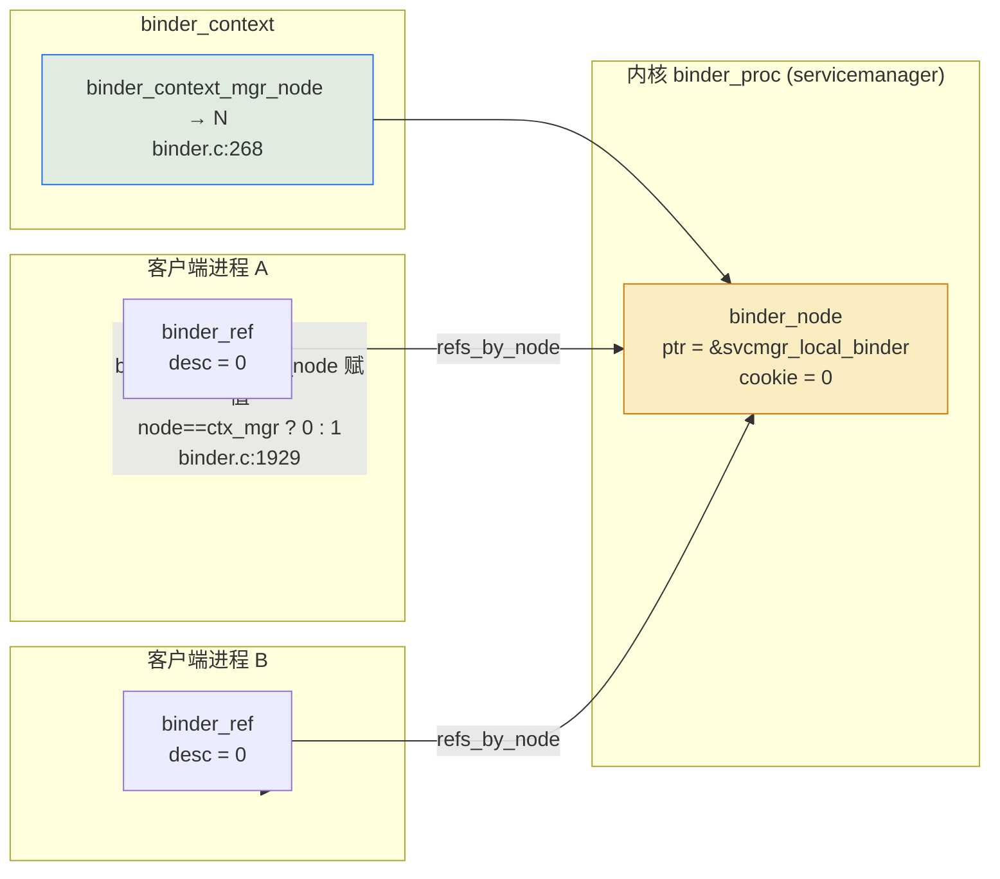

# ServiceManager 核心作用 · Android 10 源码级拆解

> 基线：`cells-android10` / android-10.0.0_r33 / kernel 4.9.200（带 `CONFIG_DRV_NS` 定制分支）
> 所有行号均在本仓实测，可用 `grep -n` 复核。
> 承接文档：`Binder_一次完整请求_核心函数与数据结构_Android10.md`（下称《一次完整请求》）

---

## 一、结论前置

ServiceManager 不是"Binder 的调度中心"，它**只干一件事：把"字符串服务名"翻译成"一个 uint32 handle"**。

三层定位一句话：

| 视角 | 一句话 |
|------|--------|
| **功能定位** | Binder 世界的 DNS。名字 → handle，仅此而已，不转发、不代理、不参与业务通信 |
| **内核定位** | 它是 `binder_context_mgr_node` 的唯一持有者，占用 **handle 0** 这个硬编码特例；内核为它开了独立分支，不走红黑树查表 |
| **信任定位** | 它是 SELinux `service_manager` 类的**唯一裁决点**：`add` / `find` / `list` 三个权限都在此判 |

**最关键的认知纠正**：

> 一次业务 Binder 调用（AMS→WMS、App→PMS）**根本不经过 ServiceManager**。
> ServiceManager 只在"首次拿服务"时被调用一次，返回 handle 后客户端自己缓存（`ProcessState::mHandleToObject`），此后全程点对点直连。
> 所以 ServiceManager 挂了 = **新服务全部拿不到**，但已拿到的 handle 仍在通信（直到进程重启）。

**五大核心作用**（按重要性排序）：

1. **注册表**：维护 `svclist` 单向链表（`service_manager.c:150`），name → handle 映射
2. **handle 0 锚点**：通过 `BINDER_SET_CONTEXT_MGR_EXT` 让内核记住"谁是 context manager"，从此 `handle 0` 全局可解析
3. **权限闸门**：`add`/`find`/`list` 三类 SELinux 检查（`service_manager.c:116/127/133`）
4. **引用保活**：`binder_acquire` 强引用 + `binder_link_to_death` 死亡通知，服务死了自动失效（`:249/250`）
5. **隔离进程管控**：`allow_isolated` 位，控制 isolated app 能否访问该服务（`:190`）

---

## 二、总览

### 2.1 启动时序（init 阶段，早于一切服务）

```mermaid
sequenceDiagram
    participant INIT as init (pid 1)
    participant SM as servicemanager (pid ~600)
    participant DRV as /dev/binder (kernel)
    participant SS as system_server

    INIT->>SM: fork/exec, class core animation, user system
    Note over SM: servicemanager.rc:1-6<br/>critical → 挂了重启 zygote 等 13 个进程
    SM->>DRV: open("/dev/binder", O_RDWR|O_CLOEXEC)  binder.c:120
    SM->>DRV: ioctl(BINDER_VERSION) 校验协议号  :127
    SM->>DRV: mmap(NULL, 128*1024, PROT_READ)  :138
    SM->>DRV: ioctl(BINDER_SET_CONTEXT_MGR_EXT)  :169
    Note over DRV: binder_ioctl_set_ctx_mgr()<br/>binder.c:5184<br/>binder_context_mgr_node = new_node :5223
    SM->>DRV: ioctl(BINDER_WRITE_READ, BC_ENTER_LOOPER)  :465-476
    loop for(;;) 单线程串行
        DRV-->>SM: BR_TRANSACTION
        SM->>SM: binder_parse → svcmgr_handler  :485 / :256
        SM->>DRV: BC_REPLY  binder_send_reply :209
    end
    SS->>DRV: transact(handle=0, ADD_SERVICE) 首次注册
    Note over DRV: target.handle==0 → 直接取 context_mgr_node<br/>binder.c:3337-3346
    DRV-->>SM: 投递到 servicemanager
```

### 2.2 三方法器关系（谁有 handle 0）



**同一张表里的两棵树**（《一次完整请求》已述）：`refs_by_desc` 与 `refs_by_node`。`desc=0` 是唯一被**强制指定**的值，其余从 1 起单调递增。

---

## 三、分层拆解

### 3.1 用户态入口：四行代码讲完的 main

`frameworks/native/cmds/servicemanager/service_manager.c:391`

```c
int main(int argc, char** argv) {
    struct binder_state *bs;
    ...
    bs = binder_open(driver, 128*1024);              // :406  打开 + mmap 128K
    if (!bs) { ... }
    if (binder_become_context_manager(bs)) {          // :419  关键一步：成为 context mgr
        ALOGE("cannot become context manager (%s)\n", strerror(errno));
        return -1;
    }
    ...
    sehandle = selinux_android_service_context_handle();  // :436  载入 service_contexts
    ...
    binder_loop(bs, svcmgr_handler);                  // :451  单线程死循环
}
```

注意三个细节：

- **没有线程池**。servicemanager 只有主线程，`BC_ENTER_LOOPER` 后串行处理所有请求。这是它吞吐低但绝不会乱序的原因。
- **mapsize 硬编码 128K**（`:406`）。这决定了 servicemanager 进程的 mmap 区只有 128K，单次事务数据上限受此约束——面试常问的"Binder 传输大小限制"，对 SM 而言就是 128K（普通进程是 1M-8K）。
- **`sehandle` 与 `getcon()` 失败直接 abort**（`:440/445`）。SM 宁可不启动也不降级——因为它是 SELinux 的裁决点。

### 3.2 成为 context manager：一次 ioctl 定终身

`frameworks/native/cmds/servicemanager/binder.c:164`

```c
int binder_become_context_manager(struct binder_state *bs) {
    struct flat_binder_object obj;
    memset(&obj, 0, sizeof(obj));
    obj.flags = FLAT_BINDER_FLAG_TXN_SECURITY_CTX;       // :167 请求驱动携带安全上下文
    int result = ioctl(bs->fd, BINDER_SET_CONTEXT_MGR_EXT, &obj);   // :169 新接口

    if (result != 0) {                                    // :172 老内核降级
        android_errorWriteLog(0x534e4554, "121035042");
        result = ioctl(bs->fd, BINDER_SET_CONTEXT_MGR, 0);          // :175 老接口
    }
    return result;
}
```

**为什么有 EXT 版本？**
`BINDER_SET_CONTEXT_MGR_EXT` 允许传入 `flat_binder_object`，从而让驱动在投递给 SM 的 `binder_transaction_data_secctx` 里带上**调用方的 SELinux secctx**（`binder_parse` 里的 `BR_TRANSACTION_SEC_CTX` 分支 `:279`）。这样 SM 校验权限时不用回头 `getpidcon()` 查——避免 TOCTOU（进程可能在查询后 exec 换域）。老接口无此能力，只能靠 `getpidcon(spid)`。

内核侧对应实现（`kernel/drivers/android/binder.c:5184`）：

```c
static int binder_ioctl_set_ctx_mgr(struct file *filp, struct flat_binder_object *fbo)
{
    struct binder_proc *proc = filp->private_data;
    struct binder_context *context = proc->context;
    ...
    mutex_lock(&context->context_mgr_node_lock);
    if (context->binder_context_mgr_node) {              // :5193 只能有一个！
        pr_err("BINDER_SET_CONTEXT_MGR already set\n");
        ret = -EBUSY;
        goto out;
    }
    ret = security_binder_set_context_mgr(proc->tsk);    // :5198 SELinux 守卫
    if (ret < 0) goto out;

    if (uid_valid(context->binder_context_mgr_uid)) {    // :5201 uid 必须一致
        if (!uid_eq(context->binder_context_mgr_uid, curr_euid)) { ret = -EPERM; goto out; }
    } else {
        context->binder_context_mgr_uid = curr_euid;     // :5211 首次记录
    }
    new_node = binder_new_node(proc, fbo);               // :5213
    ...
    new_node->local_weak_refs++;
    new_node->local_strong_refs++;                       // :5219-5222 自持强弱引用
    new_node->has_strong_ref = 1;
    new_node->has_weak_ref = 1;
    context->binder_context_mgr_node = new_node;         // :5223 全局唯一锚点
    ...
}
```

**三道防线**确保"篡位"不可能：

| 防线 | 位置 | 效果 |
|------|------|------|
| 单例 | `:5193` | 第二次调用返回 `-EBUSY` |
| UID 绑定 | `:5201-5211` | 只有首个注册者的 euid 能重入（system=1000） |
| SELinux | `:5198` | 仅 `servicemanager` 域有 `set_context_mgr` 权限 |

进程退出时清空（`:5740-5745`）：若退出者正是 ctx_mgr 持有者，`binder_context_mgr_node = NULL`，此后所有 `handle 0` 调用返回 `BR_DEAD_REPLY`——**这就是 ServiceManager 一死全系统拿不到新服务的根因**。

### 3.3 内核的 handle 0 特例：不走红黑树

`binder_transaction()` 解析目标时的三分支（`:3291-3355`）：

```c
} else {                                        // 非 REPLY
    if (tr->target.handle) {                    // :3313  普通 handle → 查红黑树
        struct binder_ref *ref;
        binder_proc_lock(proc);
        ref = binder_get_ref_olocked(proc, tr->target.handle, true);   // :3325
        if (ref) target_node = binder_get_node_refs_for_txn(ref->node, &target_proc, &return_error);
        else     { return_error = BR_FAILED_REPLY; }                   // :3334
        binder_proc_unlock(proc);
    } else {                                    // :3337  handle == 0 → 直取 context mgr
        mutex_lock(&context->context_mgr_node_lock);
        target_node = context->binder_context_mgr_node;                // :3339
        if (target_node) target_node = binder_get_node_refs_for_txn(target_node, &target_proc, &return_error);
        else             return_error = BR_DEAD_REPLY;                 // :3345 SM 已死
        mutex_unlock(&context->context_mgr_node_lock);
        if (target_node && target_proc == proc) {   // :3347 禁止自己给自己发
            return_error = BR_FAILED_REPLY;
            goto err_invalid_target_handle;
        }
    }
```

**这是 handle 0 唯一特殊的地方**：`target.handle == 0` 时**根本不查 `refs_by_desc`**，直接读全局 `binder_context_mgr_node`。

带来的推论：

- 客户端**不需要**先在本地建立 handle 0 的 `binder_ref`，第一次调用就能通。
- 但 `binder_ref(desc=0)` 仍会在后续被创建（回程带 `flat_binder_object` 时，或 `BC_ACQUIRE` 时），所以 `desc=0` 在表里又是真实存在的。
- 反过来，服务端侧 `handle 0` 的 `binder_ref` 是**客户端视角**的东西，`desc` 编号**每个进程独立**——这是《一次完整请求》里"每进程一张表"的直接体现。

`binder_get_ref_for_node()` 里的强制赋值（`:1929`，非定制分支）：

```c
    new_ref->data.desc = (node == context->binder_context_mgr_node) ? 0 : 1;
    for (n = rb_first(&proc->refs_by_desc); n != NULL; n = rb_next(n)) {
        ref = rb_entry(n, struct binder_ref, rb_node_desc);
        if (ref->data.desc > new_ref->data.desc) break;
        new_ref->data.desc = ref->data.desc + 1;        // 从 1 起找第一个空位
    }
```

`desc=0` 是**预留位**，普通节点永不可能拿到 0。

> ⚠ 本仓带 `CONFIG_DRV_NS` 定制（华为多 context 方案）：`:1904-1927` 分支把 `context_mgr_node` 的 desc 扩展成 `INIT_OTHER_CONTEXT_MGR_HANDLE + i`（i 为 acontext 下标），system context 仍为 0。这是**非 AOSP 主线代码**，对照上游时要注意 `#ifdef`。

### 3.4 客户端如何拿到 handle 0

**Native 路径**（`frameworks/native/libs/binder/IServiceManager.cpp:43`）：

```cpp
sp<IServiceManager> defaultServiceManager() {
    if (gDefaultServiceManager != nullptr) return gDefaultServiceManager;   // :45 缓存
    {
        AutoMutex _l(gDefaultServiceManagerLock);
        while (gDefaultServiceManager == nullptr) {
            // gDefaultServiceManager = new BpServiceManager(new BpBinder(0))
            gDefaultServiceManager = interface_cast<IServiceManager>(
                ProcessState::self()->getContextObject(nullptr));           // :55
            if (gDefaultServiceManager == nullptr) sleep(1);
        }
    }
    return gDefaultServiceManager;
}
```

`ProcessState.cpp:117`：

```cpp
sp<IBinder> ProcessState::getContextObject(const sp<IBinder>& /*caller*/) {
    return getStrongProxyForHandle(0);      // :119 硬编码 0
}
```

即 `new BpBinder(0)` → `mHandle == 0` → `IPCThreadState::transact(0, ...)` → `tr.target.handle = 0` → 命中内核 `:3337` 分支。**全链路无任何名字解析**，0 就是内核约定。

`ProcessState.cpp:273` 的 `getStrongProxyForHandle()` 里对 0 还有一层语义区分（`:287`）：

```cpp
    if (handle == 0 || handle >= INIT_SYSTEM_CONTEXT_MGR_HANDLE) {
        //  本地 BpBinder 无缓存，直连内核
```

**Java 路径**（`frameworks/base/core/java/android/os/ServiceManager.java:105`）：

```java
private static IServiceManager getIServiceManager() {
    if (sServiceManager != null) return sServiceManager;
    // Find the service manager
    sServiceManager = ServiceManagerNative
            .asInterface(Binder.allowBlocking(BinderInternal.getContextObject()));  // :112
    return sServiceManager;
}
```

`BinderInternal.getContextObject()` 是 native，内部即 `ProcessState::getContextObject(nullptr)`，与 Native 路径汇合。

### 3.5 注册表本体：svclist

`service_manager.c:139`

```c
struct svcinfo {
    struct svcinfo *next;          // 单向链表
    uint32_t handle;               // 该服务的 binder handle
    struct binder_death death;     // 死亡回调
    int allow_isolated;            // 是否允许 isolated app 访问
    uint32_t dumpsys_priority;     // dumpsys / list 的分级
    size_t len;
    uint16_t name[0];              // 柔性数组，UTF-16 名字
};

struct svcinfo *svclist = NULL;    // :150 全局唯一注册表
```

**注意数据结构的选择**：单向链表 + 线性搜索（`find_svc` `:152`）。Android 10 上服务数量约 200+，线性搜索在这个量级完全够用——SM 不是性能瓶颈。所有服务共用一条链表，没有哈希、没有排序、没有锁（单线程）。

### 3.6 四个事务：svcmgr_handler 的全部业务

`service_manager.c:309` 的 `switch(txn->code)`，只有 4 个 case：

| code | 常量 | 值 | 语义 |
|------|------|----|------|
| 1 | `SVC_MGR_GET_SERVICE` | `IServiceManager.h:77` | 查服务，不存在返回 null |
| 2 | `SVC_MGR_CHECK_SERVICE` | `:78` | 同 GET（客户端层面无区别） |
| 3 | `SVC_MGR_ADD_SERVICE` | `:79` | 注册服务 |
| 4 | `SVC_MGR_LIST_SERVICES` | `:80` | 按索引逐个列举 |

另有 `PING_TRANSACTION`（`'_PNG'`，`binder.h:38`），`:277` 直接返回 0——`service ping` / 健康检查用。

**关键前置校验**（每个请求必过，`:291`）：

```c
if ((len != (sizeof(svcmgr_id) / 2)) ||
    memcmp(svcmgr_id, s, sizeof(svcmgr_id))) {        // 必须带 "android.os.IServiceManager"
    fprintf(stderr,"invalid id %s\n", str8(s, len));
    return -1;
}
```

对应客户端 `data.writeInterfaceToken(IServiceManager::getInterfaceDescriptor())`（`IServiceManager.cpp:257/276`）。**这是 Binder 的接口令牌机制**，防止误投到错误服务。

#### 3.6.1 addService 全链路

客户端（`IServiceManager.cpp:271`）：

```cpp
virtual status_t addService(const String16& name, const sp<IBinder>& service,
                            bool allowIsolated, int dumpsysPriority) {
    Parcel data, reply;
    data.writeInterfaceToken(IServiceManager::getInterfaceDescriptor());   // :276
    data.writeString16(name);            // :277 服务名
    data.writeStrongBinder(service);     // :278 ★ 关键：把 BBinder 拍平成 flat_binder_object
    data.writeInt32(allowIsolated ? 1 : 0);   // :279
    data.writeInt32(dumpsysPriority);         // :280
    status_t err = remote()->transact(ADD_SERVICE_TRANSACTION, data, &reply);  // :282
    return err == NO_ERROR ? reply.readExceptionCode() : err;
}
```

`writeStrongBinder` → `Parcel::flatten_binder`，写一个 `flat_binder_object`：
- 服务端自身进程：`hdr.type = BINDER_TYPE_BINDER`，`binder = (uintptr_t)p`（BBinder 地址）
- 跨进程转发时：`hdr.type = BINDER_TYPE_HANDLE`，`handle = desc`

驱动在 `binder_translate_binder`（`binder.c:2791`）里把这个本地指针**转换成目标进程的 node**：

```c
static int binder_translate_binder(struct flat_binder_object *fp,
                                   struct binder_transaction *t,
                                   struct binder_thread *thread) {
    struct binder_node *node;
    struct binder_proc *proc = thread->proc;
    struct binder_proc *target_proc = t->to_proc;
    struct binder_ref_data rdata;
    ...
    node = binder_get_node(proc, fp->binder);       // :2800 按用户态指针找 node
    if (!node) {
        node = binder_new_node(proc, fp);           // :2802 没有就新建
        ...
    }
    if (fp->cookie != node->cookie) { ... ret = -EINVAL; goto done; }   // :2806 防伪造
    if (security_binder_transfer_binder(proc->tsk, target_proc->tsk)) { // :2814
        ret = -EPERM; goto done;
    }
    ret = binder_inc_ref_for_node(target_proc, node,
                                  fp->hdr.type == BINDER_TYPE_BINDER,
                                  &thread->todo, &rdata);               // :2819 ★ 建目标侧 ref
    ...
    if (fp->hdr.type == BINDER_TYPE_BINDER)
        fp->hdr.type = BINDER_TYPE_HANDLE;          // :2826 ★ 改写成 handle 形式
    else
        fp->hdr.type = BINDER_TYPE_WEAK_HANDLE;     // :2828
    fp->binder = 0;                                 // :2829 指针清零
    fp->handle = rdata.desc;                        // :2830 ★ 填入目标进程的 desc
    fp->cookie = 0;
    ...
}
```

**这一点极重要**：SM 进程收到的 `ADD_SERVICE` 里，`writeStrongBinder` 那个对象已经被驱动从 `BINDER_TYPE_BINDER` 改写成了 `BINDER_TYPE_HANDLE`，`handle` 字段是 **SM 进程视角的描述符**。所以 `bio_get_ref()`（`binder.c:707`）直接取 `obj->handle` 就拿到了（`:714`）：

```c
uint32_t bio_get_ref(struct binder_io *bio) {
    obj = _bio_get_obj(bio);
    if (!obj) return 0;
    if (obj->hdr.type == BINDER_TYPE_HANDLE) return obj->handle;   // :714-715
    return 0;
}
```

服务端 `do_add_service`（`service_manager.c:206`）：

```c
    if (!handle || (len == 0) || (len > 127)) return -1;   // :213 名字长度上限 127
    if (!svc_can_register(s, len, spid, sid, uid)) {       // :216 权限
        ALOGE("add_service('%s',%x) uid=%d - PERMISSION DENIED\n", ...);
        return -1;
    }
    si = find_svc(s, len);
    if (si) {                                             // :223 同名服务已存在
        if (si->handle) {
            ALOGE("... - ALREADY REGISTERED, OVERRIDE\n"); // :225 ★ 允许覆盖！
            svcinfo_death(bs, si);                        // 释放旧 handle
        }
        si->handle = handle;
    } else {
        si = malloc(sizeof(*si) + (len + 1) * sizeof(uint16_t));   // :231
        ...
        si->next = svclist; svclist = si;                 // :245 头插
    }
    binder_acquire(bs, handle);                           // :249 ★ 拿强引用保活
    binder_link_to_death(bs, handle, &si->death);         // :250 ★ 注册死亡通知
```

`binder_acquire` → `BC_ACQUIRE`（`binder.c:363`），`binder_link_to_death` → `BC_REQUEST_DEATH_NOTIFICATION`（`binder.c:377`）。

**为什么要 acquire？**若 SM 只存 handle 而不持强引用，服务进程的 binder node 引用计数可能归零，node 被回收，handle 变野。SM 持强引用 = 服务"注册即保活"，直到主动覆盖或进程死亡。

#### 3.6.2 getService 全链路

客户端 `checkService`（`IServiceManager.cpp:254`）：

```cpp
virtual sp<IBinder> checkService(const String16& name) const {
    Parcel data, reply;
    data.writeInterfaceToken(IServiceManager::getInterfaceDescriptor());
    data.writeString16(name);
    remote()->transact(CHECK_SERVICE_TRANSACTION, data, &reply);   // :259
    return reply.readStrongBinder();                                // :260
}
```

服务端 `do_find_service`（`service_manager.c:182`）：

```c
uint32_t do_find_service(const uint16_t *s, size_t len, uid_t uid, pid_t spid, const char* sid) {
    struct svcinfo *si = find_svc(s, len);
    if (!si || !si->handle) return 0;                     // :186 不存在
    if (!si->allow_isolated) {                            // :190 isolated 拦截
        uid_t appid = uid % AID_USER;
        if (appid >= AID_ISOLATED_START && appid <= AID_ISOLATED_END) return 0;
    }
    if (!svc_can_find(s, len, spid, sid, uid)) return 0;  // :199 权限
    return si->handle;                                    // :203 返回 SM 视角的 desc
}
```

回包（`:319-322`）：

```c
    handle = do_find_service(...);
    if (!handle) break;
    bio_put_ref(reply, handle);      // :321 ★ 打包成 flat_binder_object(HANDLE)
    return 0;
```

`bio_put_ref`（`binder.c:592`）：

```c
    obj->hdr.type = BINDER_TYPE_HANDLE;    // :604
    obj->handle = handle;                  // :605  SM 视角的 desc
```

驱动回程 `binder_translate_handle`（`binder.c:2843`）把它**翻译成客户端视角的 desc**：

```c
static int binder_translate_handle(struct flat_binder_object *fp,
                                   struct binder_transaction *t,
                                   struct binder_thread *thread) {
    struct binder_proc *proc = thread->proc;
    struct binder_proc *target_proc = t->to_proc;
    struct binder_node *node;
    struct binder_ref_data src_rdata;
    ...
    node = binder_get_node_from_ref(proc, fp->handle,
                                    fp->hdr.type == BINDER_TYPE_HANDLE, &src_rdata);  // :2852
    if (!node) { binder_user_error("... invalid handle ..."); return -EINVAL; }        // :2854
    ...
    binder_node_lock(node);
    if (node->proc == target_proc) {                // :2865 ★ 目标就是宿主进程 → 反解成指针
        if (fp->hdr.type == BINDER_TYPE_HANDLE)
            fp->hdr.type = BINDER_TYPE_BINDER;
        else
            fp->hdr.type = BINDER_TYPE_WEAK_BINDER;
        fp->binder = node->ptr;                     // :2870 归还 BBinder 地址
        fp->cookie = node->cookie;
        ...
    } else {
        struct binder_ref_data dest_rdata;
        binder_node_unlock(node);
        ret = binder_inc_ref_for_node(target_proc, node,
                                      fp->hdr.type == BINDER_TYPE_HANDLE,
                                      NULL, &dest_rdata);   // :2889 ★ 建目标侧 ref
        ...
        fp->binder = 0;
        fp->handle = dest_rdata.desc;               // :2896 ★ 改成目标进程的 desc
        fp->cookie = 0;
        ...
    }
}
```

`binder_translate_handle` 有**两个方向**，这一点常被忽略：

- **目标就是 node 的宿主进程**（`:2865`）：说明服务在往自己进程内传，`handle` 反解成 `node->ptr`（BBinder 地址），`hdr.type` 变回 `BINDER_TYPE_BINDER`
- **目标是第三方进程**（`:2885`）：才是常规的 `desc → desc` 翻译，`fp->handle = dest_rdata.desc`（`:2896`）

**这是整个 ServiceManager 机制最精妙的一处**：SM 返回的数字是 **SM 进程的 desc**，客户端拿到的数字是 **客户端的 desc**，两者通常不同。全凭驱动在 `flat_binder_object` 上做一次 in-place 改写。

> 这也解释了为什么《一次完整请求》说"handle 是进程局部量"。跨进程传 handle 必须走 `flat_binder_object` 包装，绝不能裸传 uint32。

#### 3.6.3 listServices

`service_manager.c:337` 按索引 n 返回第 n 个服务的名字，**一次一个**：

```c
    si = svclist;
    while (si) {
        if (si->dumpsys_priority & req_dumpsys_priority) {   // :350 按优先级过滤
            if (n == 0) break;
            n--;
        }
        si = si->next;
    }
    if (si) { bio_put_string16(reply, si->name); return 0; }
    return -1;                                               // 返回 -1 表示列表结束
```

客户端 `listServices`（`IServiceManager.cpp:287`）用 `for(;;) n++` 循环拉到 `err != NO_ERROR` 为止。

**为什么一次一个？**回包缓冲只有 256 字节栈空间（`binder.c:304` `unsigned rdata[256 / 4]`）。这是 SM 的设计约束——reply 是栈上的固定小缓冲，装不下一整个服务列表。

### 3.7 权限模型：SELinux service_manager 类

三个检查函数（`service_manager.c:116/127/133`）：

| 函数 | perm | 目标 context 来源 | 用途 |
|------|------|------------------|------|
| `svc_can_register` | `add` | `selabel_lookup(sehandle, name)` → `service_contexts` | 注册 |
| `svc_can_find` | `find` | 同上，按服务名查 | 查询 |
| `svc_can_list` | `list` | `getcon(service_manager)` 自身域 | 列举 |

外加一道 UID 硬门槛（`:120`）：

```c
    if (multiuser_get_app_id(uid) >= AID_APP) {   // appid >= 10000 即普通 App
        return 0; /* Don't allow apps to register services */
    }
```

**普通 App 永远不能注册 Binder 服务**——即使它有 SELinux 权限也不行。这是硬编码的 UID 判断，`add` 权限只对 native daemon / system_server 开放。

权限映射表是 `/system/etc/selinux/*/service_contexts`，格式 `服务名 u:object_r:xxx_service:s0`。`sehandle` 在 `:436` 载入，`selinux_status_updated()` 支持热更新（`:297-307`）。

### 3.8 死亡通知：服务没了怎么办

`binder_link_to_death`（`binder.c:377`）注册 `BC_REQUEST_DEATH_NOTIFICATION`，回调 `svcinfo_death`（`service_manager.c:165`）：

```c
void svcinfo_death(struct binder_state *bs, void *ptr) {
    struct svcinfo *si = (struct svcinfo* ) ptr;
    ALOGI("service '%s' died\n", str8(si->name, si->len));   // :169
    if (si->handle) {
        binder_release(bs, si->handle);   // :171 释放强引用
        si->handle = 0;                   // :172 标记失效
    }
}
```

驱动侧发出 `BR_DEAD_BINDER`，在 `binder_parse` 的 `:342` 分支被解析：

```c
case BR_DEAD_BINDER: {
    struct binder_death *death = (struct binder_death *)(uintptr_t)*(binder_uintptr_t*)ptr;
    ptr += sizeof(binder_uintptr_t);
    death->func(bs, death->ptr);      // :345 回调 svcinfo_death
    break;
}
```

注意：**`svcinfo` 结构不删除，只把 handle 清零**。所以 `service list` 仍会列出死掉的服务名（但 `checkService` 返回 null）。这是刻意的——保留名字信息便于调试，同时避免指针失效。

客户端侧也有死亡通知（`BpBinder::sendObituary` / `linkToDeath`），那是另一条路径，见《一次完整请求》。

### 3.9 与《一次完整请求》的衔接点

| 《一次完整请求》讲的 | ServiceManager 补上的 |
|---------------------|---------------------|
| `BpBinder::transact(handle, ...)` 的 handle 从哪来 | `defaultServiceManager()` → `BpBinder(0)` → `checkService(name)` 拿到的 desc |
| `binder_transaction` `target.handle` 查 `refs_by_desc` | `handle==0` 走**特例分支** `:3337`，不查表 |
| `flat_binder_object` 被驱动改写 | `binder_translate_binder:2791`（发）/ `binder_translate_handle:2843`（回）双向翻译 |
| `binder_acquire` / `BC_ACQUIRE` | SM 用它给所有注册服务保活（`service_manager.c:249`） |
| `BC_REQUEST_DEATH_NOTIFICATION` | SM 用它感知服务死亡（`:250`） |

---

## 四、速查表

### 4.1 用户态关键函数

| 层 | 函数 | 位置 |
|----|------|------|
| main | `main` | `service_manager.c:391` |
| open | `binder_open` | `binder.c:109`（`open` `:120` / `BINDER_VERSION` `:127` / `mmap` `:138`） |
| 注册 | `binder_become_context_manager` | `binder.c:164`（EXT `:169` / 降级 `:175`） |
| 循环 | `binder_loop` | `binder.c:455`（`BC_ENTER_LOOPER` `:465` / `ioctl` `:476`） |
| 解析 | `binder_parse` | `binder.c:252`（`BR_TRANSACTION` `:280` / 回调 `:315`） |
| 业务 | `svcmgr_handler` | `service_manager.c:256`（switch `:309`） |
| 注册 | `do_add_service` | `service_manager.c:206` |
| 查询 | `do_find_service` | `service_manager.c:182` |
| 查表 | `find_svc` | `service_manager.c:152` |
| 权限 | `svc_can_register/find/list` | `service_manager.c:116/127/133` |
| 死亡 | `svcinfo_death` | `service_manager.c:165` |
| 回包 | `binder_send_reply` | `binder.c:209` |
| 打引用 | `bio_put_ref` | `binder.c:592` |
| 取引用 | `bio_get_ref` | `binder.c:707` |

### 4.2 内核关键点

| 语义 | 位置 |
|------|------|
| `binder_context_mgr_node` 字段 | `binder.c:268` |
| `binder_context_mgr_uid` 字段 | `binder.c:271` |
| 设置 context mgr | `binder_ioctl_set_ctx_mgr` `:5184`（单例 `:5193` / SELinux `:5198` / uid `:5201` / 赋值 `:5223`） |
| `BINDER_SET_CONTEXT_MGR_EXT` | `:5336` |
| `BINDER_SET_CONTEXT_MGR` | `:5348` |
| **handle 0 特例分支** | `:3337-3346` |
| 普通 handle 查表 | `:3313-3336` |
| `desc=0` 强制赋值 | `:1929` |
| 进程退出清空 | `:5740-5745` |
| 设备初始化 | `:6449-6455` |
| 发方向翻译 | `binder_translate_binder` `:2791` |
| 回方向翻译 | `binder_translate_handle` `:2843` |

### 4.3 客户端入口

| 场景 | 位置 |
|------|------|
| Native 取 SM | `IServiceManager.cpp:43`（`getContextObject` `:55`） |
| `getContextObject` | `ProcessState.cpp:117`（`getStrongProxyForHandle(0)` `:119`） |
| `BpServiceManager` | `IServiceManager.cpp:215` |
| `getService`（含重试） | `IServiceManager.cpp:223`（5s 超时 `:230`，轮询 `:241`） |
| `checkService` | `IServiceManager.cpp:254` |
| `addService` | `IServiceManager.cpp:271`（`writeStrongBinder` `:278`） |
| `listServices` | `IServiceManager.cpp:287` |
| Java 取 SM | `ServiceManager.java:105`（`BinderInternal.getContextObject()` `:112`） |
| Java `getService` | `ServiceManager.java:123` |
| Java Proxy | `ServiceManagerNative.java:113/123/147` |

### 4.4 常量

| 常量 | 值 | 位置 |
|------|-----|------|
| `BINDER_SERVICE_MANAGER` | `0U` | `binder.h:32` |
| `SVC_MGR_NAME` | `"android.os.IServiceManager"` | `binder.h:34` |
| `PING_TRANSACTION` | `'_PNG'` | `binder.h:38` |
| `SVC_MGR_GET_SERVICE` | 1 | `binder.h:39` |
| `SVC_MGR_CHECK_SERVICE` | 2 | `binder.h:40` |
| `SVC_MGR_ADD_SERVICE` | 3 | `binder.h:41` |
| `SVC_MGR_LIST_SERVICES` | 4 | `binder.h:42` |
| mapsize | `128*1024` | `service_manager.c:406` |
| 名字长度上限 | 127 | `service_manager.c:213` |
| reply 缓冲 | 256 B | `binder.c:304` |

---

## 五、调试验证

### 5.1 service 命令

```bash
# 列出所有服务（走 LIST_SERVICES）
adb shell service list
# 输出形如：
#   0	phone: [com.android.internal.telephony.ITelephony]
#   1	activity: [android.app.IActivityManager]

# 注意：第一列是 SM 视角的 desc，与客户端 desc 不同！
# 只有 handle 0 是全局一致的（SM 自己）

# 查询单个服务
adb shell service check activity
# Service activity: found

# 调用服务方法（内部走 getService + transact）
adb shell service call activity 1
```

### 5.2 dumpsys 与 servicemanager 自身

```bash
# servicemanager 没有实现 dump，但可以看它持有的引用
adb shell dumpsys | head

# 内核侧 binder 状态（需 root，debugfs）
adb shell cat /sys/kernel/debug/binder/state | head -50
# 找 proc 名 "servicemanager"，其 nodes 里应有一个
#   node <addr> ... proc <pid> ... ptr ... cookie 0
# 且 binder_context_mgr_node 指向它

# 看所有 handle 0 相关引用
adb shell cat /sys/kernel/debug/binder/proc/<sm_pid> | grep -A2 "ref"
```

### 5.3 验证 handle 0 特例

**实验**：kill servicemanager，再执行 `service list`。

```bash
adb shell ps -A | grep servicemanager     # 记下 pid
adb shell kill -9 <pid>
adb shell service list
# 预期：<empty> 或 "Service manager has died"
# 因为 handle 0 → context_mgr_node == NULL → BR_DEAD_REPLY
```

**注意**：`servicemanager.rc:5` 有 `critical`，`onrestart` 会连带重启 13 个进程（zygote / media / surfaceflinger / inputflinger 等），实测等于软重启。**不要在生产机上随便试**。

### 5.4 抓 SM 的 IPC 流量

```bash
# 打开 binder debug 日志（需 kernel config 支持）
adb shell su -c 'echo 1 > /sys/kernel/debug/binder/transaction_log_enable 2>/dev/null'

# 或用 ftrace
adb shell su -c 'echo 1 > /sys/kernel/debug/tracing/events/binder/binder_transaction/enable'
adb shell su -c 'cat /sys/kernel/debug/tracing/trace_pipe' | grep servicemanager
```

### 5.5 代码级验证（本仓可做）

```bash
cd C:/D/android_project/cells-android10

# 1. 确认 handle 0 特例存在
grep -n "target.handle == 0\|tr->target.handle)" kernel/drivers/android/binder.c
# → 3313, 3337

# 2. 确认 desc=0 强制赋值
grep -n "binder_context_mgr_node) ? 0 : 1" kernel/drivers/android/binder.c
# → 1929

# 3. 确认单例保护
grep -n "BINDER_SET_CONTEXT_MGR already set" kernel/drivers/android/binder.c
# → 5194

# 4. 确认 EXT 优先 + 降级
grep -n "BINDER_SET_CONTEXT_MGR_EXT\|BINDER_SET_CONTEXT_MGR," frameworks/native/cmds/servicemanager/binder.c
# → 169, 175
```

---

## 六、踩坑清单

### ⚠ 6.1 【本仓实测】SELinux 检查恒通过 —— 安全后门

`service_manager.c:64-89`：

```c
static bool check_mac_perms(pid_t spid, const char* sid, uid_t uid, const char *tctx,
                            const char *perm, const char *name)
{
    ...
    int result = selinux_check_access(sid ? sid : lookup_sid, tctx, class, perm, (void *) &ad);
    allowed = (result == 0);          // :85  计算结果

    freecon(lookup_sid);
    return true;                      // :88  ★★★ 恒返回 true，allowed 被丢弃！
}
```

**这是与 AOSP 原版不一致的改动**。AOSP `android-10.0.0_r33` 原版最后一行是 `return allowed;`。

后果：
- `svc_can_register` / `svc_can_find` / `svc_can_list` 全部恒为 true
- SELinux `service_manager` 类的 `add`/`find`/`list` 权限形同虚设
- 结合 `do_add_service` 的 OVERRIDE 逻辑（`:225`），**任何 native 进程（非 app，uid<10000）都能顶替任意已有服务**
- `selabel_lookup` 失败时（`:106-108`）也是 `return true`——原版这里就是 true，属"无匹配则不拦"的历史行为；但主路径的 `return true` 是明确的逻辑错误

剩余防护只有：`multiuser_get_app_id(uid) >= AID_APP`（`:120`，挡普通 App）+ 内核 `security_binder_set_context_mgr`（只护 handle 0 本身）。

**建议**：若此树用于产品，必须确认这是否为调试残留。改回 `return allowed;` 后需同步确认 `service_contexts` 已正确配置，否则会大面积服务失败。

### 6.2 handle 0 与 handle 1 不是一回事

新手常见误解：`service list` 第一行 `0  phone` 意味着 phone 的 handle 是 0。**错**。

- `0` 是 **SM 自己**（`BINDER_SERVICE_MANAGER`）
- `service list` 输出的第一列是 `svclist` 的**遍历序号**，不是 handle
- 实际 handle 在客户端进程里各不相同，首次 `getService` 时由驱动分配

验证方法：在两个不同进程里 `getService("activity")` 打印 `BpBinder::handle()`，数字通常不同。

### 6.3 SM 返回的 handle 是"SM 的 desc"，不是你的

`do_find_service` 返回 `si->handle`——这是 **SM 进程视角**的 desc。客户端拿到的数字是驱动在 `binder_translate_handle:2843` 里改写的**客户端视角** desc。

**推论**：绝不能把 `service list` 第一列当 handle 硬编码传给 `transact()`。必须走 `getService()` 让驱动做翻译。

### 6.4 裸传 uint32 handle 是错的

同一原因：跨进程传 handle 必须用 `writeStrongBinder` → 驱动包装成 `flat_binder_object` → 目标进程侧翻译。若 `writeInt32(myHandle)`，对方拿着这个数字去 `transact()`，会命中**它自己进程里恰好同号的另一个服务**，或者直接 `BR_FAILED_REPLY`。这是极其隐蔽的 bug。

### 6.5 servicemanager 是单线程，不要塞重活

`binder_loop`（`binder.c:455`）是单线程 `for(;;)`，`BC_ENTER_LOOPER` 后没有 spawn 任何 looper 线程。所有 `add`/`find`/`list` 串行处理。

- 好处：无锁、无竞态，`svclist` 不需要任何同步
- 坏处：某个请求卡住（如 `selabel_lookup` 慢）会阻塞全部服务查询
- `svclist` 线性搜索 O(n)，200+ 服务量级可接受

**绝对不要**在 SM 里加耗时操作。它的定位就是"极简、绝不阻塞"。

### 6.6 reply 缓冲只有 256 字节

`binder.c:304` `unsigned rdata[256 / 4]`，栈上固定 256 字节。这就是 `listServices` 必须一次返回一个、客户端要循环拉取的原因。

若你在 SM 里加新事务返回大对象，会静默触发 `BIO_F_OVERFLOW`（`bio_alloc` `:526`），最终返回空——**不报错，只是数据没了**。排查这类问题要看 `bio->flags & BIO_F_OVERFLOW`。

### 6.7 mapsize 128K 是 SM 专属，别当通用值

`service_manager.c:406` 硬编码 `128*1024`。普通进程的 `ProcessState::initWithDriver` 用的是 `BINDER_VM_SIZE`（1M - 8K）。SM 用 128K 是因为它只做小对象传递。

**不要**参考 SM 的 128K 去回答"Binder 传输上限是多少"——那个答案取决于进程的 mmap 大小，且实际单次事务还受 `binder_buffer` 分配和对端剩余空间约束。

### 6.8 服务"注册了但用不了"

常见三因：

| 现象 | 根因 | 排查 |
|------|------|------|
| `checkService` 返回 null | 服务还没注册（时序问题） | `service list \| grep name`，注意 `BpServiceManager::getService` 有 5s 重试（`IServiceManager.cpp:230`） |
| 名字在 `service list` 里但拿不到 | handle 已清零（进程死了，`svcinfo_death`） | `logcat \| grep "service 'xxx' died"` |
| 拿到但 `transact` 失败 | 接口令牌不匹配（`:291` 校验） | 确认 `writeInterfaceToken` 用的是 `android.os.IServiceManager` |

### 6.9 isolated 进程拿不到服务是设计如此

`do_find_service:190` 里，若服务的 `allow_isolated == 0`，且调用方 uid 落在 `AID_ISOLATED_START ~ AID_ISOLATED_END`，直接返回 0。

**注册时** `addService(name, service, allowIsolated, priority)` 第三个参数（`IServiceManager.cpp:279`）就是它。WebView renderer、isolated_process 里的组件会受影响。**不要**为了"方便"给所有服务加 `allow_isolated=true`，那等于放弃隔离进程的沙箱边界。

### 6.10 本仓 `CONFIG_DRV_NS` 会让行号/行为与上游不一致

`binder.c:1904-1927` 是一整块 `#ifdef CONFIG_DRV_NS` 的厂商定制（多 binder context，`acontext[]` 数组 + `INIT_OTHER_CONTEXT_MGR_HANDLE`）。它把 `desc` 的分配规则改成了"按 context 下标编址"。

对照 AOSP 上游或面试作答时：
- 讲**机制**用 `:1929` 的 `? 0 : 1`（主线逻辑）
- 讲**本仓行为**要说明这是定制分支，`dumpsys` / debugfs 里可能看到 `handle >= 0x1000` 之类的异常值

同理 `ProcessState.cpp:128` 的 `getMgrContextObject`、`IServiceManager.cpp:74/113` 的 `getMgrContextObject(index)` 都是定制扩展，AOSP 主线没有。

### 6.11 不要试图"重启 servicemanager"

`servicemanager.rc:5` 的 `critical` + `:6-17` 的 13 条 `onrestart restart` 意味着：SM 一挂，init 会重启 zygote / media / surfaceflinger / inputflinger / audioserver / cameraserver / keystore / gatekeeperd / thermalservice / drm / healthd / cellsservice。**实测等效整机软重启**。

调试时若必须验证 SM 死亡场景，用 `adb shell stop` 全停再 `start`，比 kill 单个进程可控。

---

## 附：一句话总结

> **ServiceManager = 内核 handle 0 这个坑位的唯一占用者 + 一张叫 svclist 的链表 + 三道 SELinux 检查。**
> 它只在 `getService` 那一刻被访问，返回的 handle 还要靠驱动翻译一次才能用。
> 它不是 Binder 的总线，而是 Binder 的**户籍科**——登记一次，之后各走各的。
