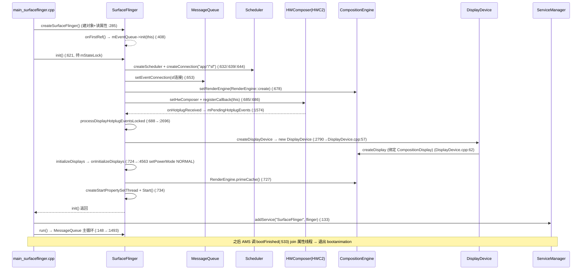

# SurfaceFlinger 初始化源码分析（Android 10 / cells-android10）

> 适用工程：`cells-android10` / AOSP `android-10.0.0_r33`（Columbia Cells 树，Pixel 3a XL / coral）
> 配套：`SurfaceFlinger 总览与启动_Android10.md`（本文是其「启动链」的逐行深挖版）
> 源码根：`frameworks/native/services/surfaceflinger/`（`SurfaceFlinger.cpp` / `main_surfaceflinger.cpp` / `DisplayDevice.cpp` / `CompositionEngine/` / `libs/renderengine/`）

---

## 1. 结论前置

1. **SurfaceFlinger 初始化分三段**，且顺序不可乱：`构造器`（建对象 + 读属性）→ `onFirstRef()`（只建消息队列）→ `init()`（装配全部硬件/调度/显示子系统）。`main()` 在 `init()` 之后才把服务 `addService` 并 `run()`，所以**客户端（WMS 等）在 init 完成前根本拿不到 SF Binder**。
2. **Android 10 全程走 Factory 注入**：`SurfaceFlinger` 不直接 new 子系统，而是 `getFactory().createXxx()`（`Scheduler`/`HWComposer`/`MessageQueue`/`CompositionEngine`/`DisplayDevice`/`Layer` 等）。Columbia Cells 树里这套 Factory（`SurfaceFlingerFactory`）是依赖装配与定制化入口——改初始化行为优先看 Factory 实现，而不是在 `SurfaceFlinger.cpp` 里硬改。
3. **`init()` 的核心产物是两条 VSync 连接 + 一块内屏 DisplayDevice**：
   - `mScheduler` 建 `app` / `sf` 两条带相位偏移的 VSync 连接（`init:639`/`init:644`）；
   - `HWComposer` 经 `registerCallback(this)`（`init:686`）异步触发热插拔，第一次热插拔事件在 `init:688` 同步 `processDisplayHotplugEventsLocked` 处理，由此建出内屏 `DisplayDevice`（`setupNewDisplayDeviceInternal:2739` → `createDisplayDevice:2790` → `DisplayDevice.cpp:57`）。
4. **内屏缺失是硬 FATAL**：`init:690`/`init:691` 两次 `LOG_ALWAYS_FATAL_IF`——若注册 HWC 回调后没有内屏连上或处于断开态，SF 直接 abort。这是「设备开机卡在 bootanimation」最常见的死法之一。
5. **首屏真正出图在 `bootFinished()`（`SurfaceFlinger.cpp:533`）之后**：由 system_server（AMS）在系统就绪时回调，`join` 掉 `StartPropertySetThread`（负责设 `bootanimation` 等属性），在此之前一直是开机动画。

---

## 2. 总览：初始化的三段式

```
main_surfaceflinger.cpp:84  main()
   │
   ├─ surfaceflinger::createSurfaceFlinger()   ──► SurfaceFlinger.cpp:285 构造器
   │        └─ 委托构造 SurfaceFlinger(factory, SkipInitialization)  (:277)
   │              ├─ Factory 注入 5 大成员 (:279-283)
   │              └─ 读 sysprop / debug 属性 (:288-405)
   │
   ├─ flinger->init()   ──► SurfaceFlinger.cpp:621  init()（装配全部子系统，15 步）
   │
   ├─ sm->addService("SurfaceFlinger", flinger)  (main:133)  ← 此后客户端才能连
   │
   └─ flinger->run()    ──► SurfaceFlinger.cpp:1493  进入 MessageQueue 主循环
```

> 注意 `onFirstRef()`（`SurfaceFlinger.cpp:408`）由 `sp<SurfaceFlinger>` 第一次被强引用时触发（`createSurfaceFlinger` 返回 `sp` 即触发），时机在构造之后、`init()` 之前，但它只做一件事：`mEventQueue->init(this)`。

---

## 3. 分层拆解（逐行源码）

### 3.1 进程入口 `main()` —— 14 步编排（`main_surfaceflinger.cpp:84`）

`main()` 本身不碰硬件，只做「环境准备 + 建对象 + 注册 + 进循环」：

| 步 | 行 | 动作 | 为什么 |
|---|---|---|---|
| 1 | `:86` | `OtherSystemServiceLoopRun()` | 先拉起伴随 HIDL 服务的 looper |
| 2 | `:89` | `signal(SIGPIPE, SIG_IGN)` | 向已关 socket 写数据不杀进程 |
| 3 | `:92` | `configureRpcThreadpool(1, false)` | 配 HIDL RPC 线程池（passthrough HAL 用） |
| 4 | `:99` | `startGraphicsAllocatorService()` | 启图形内存分配器 HAL（V3→V2 回退），BufferQueue 才能分配内存 |
| 5 | `:104` | `setThreadPoolMaxThreadCount(4)` | **独立进程** Binder 线程上限 4，防膨胀 |
| 6 | `:109` | `ps->startThreadPool()` | 启动 Binder 线程池，准备收跨进程请求 |
| 7 | `:113` | `createSurfaceFlinger()` | 建 SF 实例（触发构造器 + `onFirstRef`） |
| 8 | `:116` | `setpriority(URGENT_DISPLAY)` | 主线程提升为显示紧急优先级 |
| 9 | `:124` | `set_cpuset_policy(SP_SYSTEM)` | 放 system-background cpuset，避免占大核（须在 Binder 池之后） |
| 10 | `:128` | `flinger->init()` | **核心**：客户端连接前完成全部硬件装配 |
| 11 | `:133` | `sm->addService(...)` | 注册到 ServiceManager（带 `DUMP_FLAG_PRIORITY_CRITICAL`），WMS 此后可获取 |
| 12 | `:137` | `startDisplayService()` | 注册 DisplayService（依赖 SF 已注册） |
| 13 | `:142` | `sched_setscheduler(SCHED_FIFO, 2)` | 主循环线程改硬实时调度，保证合成响应 |
| 14 | `:148` | `flinger->run()` | 当前线程成为 SF 主循环线程，永不返回 |

### 3.2 构造器 —— 双构造器 + Factory 注入（`SurfaceFlinger.cpp:277`/`285`）

Android 10 用「委托构造」把成员初始化拆成两层：

```cpp
// 底层：只注入 5 个核心成员，不读属性
SurfaceFlinger::SurfaceFlinger(Factory& factory, SkipInitializationTag)     // :277
      : mFactory(factory),
        mPhaseOffsets(mFactory.createPhaseOffsets()),                       // :279
        mInterceptor(mFactory.createSurfaceInterceptor(this)),              // :280
        mTimeStats(mFactory.createTimeStats()),                             // :281
        mEventQueue(mFactory.createMessageQueue()),                         // :282
        mCompositionEngine(mFactory.createCompositionEngine()) {}           // :283

// 上层：委托底层后，读全部 sysprop / debug 属性
SurfaceFlinger::SurfaceFlinger(Factory& factory)                            // :285
      : SurfaceFlinger(factory, SkipInitialization) {
    ...
    hasSyncFramework = running_without_sync_framework(true);                // :288
    maxFrameBufferAcquiredBuffers = max_frame_buffer_acquired_buffers(2);   // :299
    useColorManagement = use_color_management(false);                       // :303
    defaultCompositionPixelFormat = ... RGBA_8888;                          // :311
    // debug.sf.* 一系列 property_get 控制 backpressure / 三缓冲 / 最大层数等 (:357-387)
    mVsyncModulator.setPhaseOffsets(...);                                   // :390
}
```

**关键认知**：所有「组件对象」（`mEventQueue` / `mCompositionEngine` 等）在**构造期**就由 Factory 建好（空壳），但真正的硬件装配（`HWComposer` / `Scheduler` / `RenderEngine` / `DisplayDevice`）推迟到 `init()`。这种「先建壳、后填充」是 SF 能安全跨 `onFirstRef` 生命周期的关键。

### 3.3 `onFirstRef()` —— 只建消息队列（`SurfaceFlinger.cpp:408`）

```cpp
void SurfaceFlinger::onFirstRef() {        // :408
    mEventQueue->init(this);               // :411  把 this 绑进 MessageQueue
}
```

极简。`sp<SurfaceFlinger>` 首次强引用即触发（即 `main:113` 的 `createSurfaceFlinger()` 返回值），此时 `mEventQueue` 已在构造期由 Factory 建好，这里只是完成它的初始化。

### 3.4 `init()` —— 15 步装配全部子系统（`SurfaceFlinger.cpp:621`）

`init()` 在 `mStateLock` 临界区内（`Mutex::Autolock _l(mStateLock)` `:629`）执行，逐步：

| 步 | 行 | 动作 | 产物 |
|---|---|---|---|
| 0 | `:623` | 打启动日志 + 打印 app 相位偏移 | 日志锚点 |
| 1 | `:632` | `getFactory().createScheduler(...)` | `mScheduler`（传入 VSync 使能回调 + `mRefreshRateConfigs`） |
| 2 | `:635` | `makeResyncCallback(getVsyncPeriod)` | 重同步回调（刷新率切换用） |
| 3 | `:639`/`:644` | `mScheduler->createConnection("app"/"sf", ...)` | `mAppConnectionHandle` / `mSfConnectionHandle`（两条带相位偏移的 VSync 连接） |
| 4 | `:653` | `mEventQueue->setEventConnection(sf 连接)` | SF 主循环开始被 VSync 驱动 |
| 5 | `:656` | `mVsyncModulator.setSchedulerAndHandles(...)` | 统一调制 app/sf 相位 |
| 6 | `:660` | `new RegionSamplingThread(...)` | 内容亮度采样线程（暗色状态栏适配） |
| 7 | `:666` | 计算 `renderEngineFeature` 位 | 色彩管理 / 高优先级 / 保护内容 |
| 8 | `:678` | `mCompositionEngine->setRenderEngine(RenderEngine::create(...))` | GPU 绘制后端（实现 `GLESRenderEngine::create`，`RenderEngine.cpp:27/33`） |
| 9 | `:685` | `setHwComposer(getFactory().createHWComposer(...))` | **HWC2 硬件合成 HAL** |
| 9a | `:686` | `getHwComposer().registerCallback(this, ...)` | 注册热插拔/VSync/刷新回调；`this` 即回调接收者（`onHotplugReceived` 等） |
| 9b | `:688` | `processDisplayHotplugEventsLocked()` | 处理 init 前队列里的首次热插拔 → 建内屏 `DisplayDevice` |
| 9c | `:690`/`:691` | `LOG_ALWAYS_FATAL_IF(!display / !isConnected)` | 内屏缺失/断开 → **直接 abort** |
| 10 | `:695` | （可选）`dvr::VrFlinger::Create(...)` | VR 模式（Daydream 设备） |
| 11 | `:721` | `mDrawingState = mCurrentState` | 初始化绘制状态 |
| 11a | `:724` | `initializeDisplays()` | 点亮默认屏、设初始显示状态（见 3.5） |
| 12 | `:727` | `getRenderEngine().primeCache()` | 预热着色器缓存，防首帧卡顿 |
| 13 | `:732` | 读 `PresentFenceIsNotReliable` 能力 | 决定 present 时间戳是否可靠 |
| 13a | `:734` | `createStartPropertySetThread(presentFenceReliable)` + `Start()` | 开机属性设置线程（管 `bootanimation` 等） |
| 14 | `:742`/`:748`/`:766` | 注册 3 个刷新率回调 | `setChangeRefreshRateCallback` / `getCurrentRefreshRateType` / `getVsyncPeriod` |
| 15 | `:772` | `mRefreshRateConfigs.populate(getHwComposer().getConfigs(...))` | 用 HWC 配置填刷新率表 |

### 3.5 `init` 的关键子例程

#### (a) HWC 回调 → 建 DisplayDevice（`init:686` → `:688` → `:2696` → `:2739` → `:2790`）

`registerCallback(this)`（`init:686`）把 `SurfaceFlinger` 注册为 HWC2 回调。HWC 一上电就会回调 `onHotplugReceived`（`SurfaceFlinger.cpp:1574`），把事件塞进 `mPendingHotplugEvents`（`:1590`）。`init:688` 主动调用 `processDisplayHotplugEventsLocked()`（`:2696`）消费这些事件：

```
processDisplayHotplugEventsLocked (:2696)
  └─ 对每个事件 getHwComposer().onHotplug(...)  (:2699) 取 DisplayIdentificationInfo
     ├─ Connected：
     │    mPhysicalDisplayTokens[id] = new BBinder()       (:2708)  ← display token
     │    mCurrentState.displays.add(token, state)         (:2713)  ← 登记显示状态
     └─ processDisplayChangesLocked()                      (:2728)
            └─ setupNewDisplayDeviceInternal(...)          (:2739)
                   ├─ DisplayDeviceCreationArgs(...)
                   └─ getFactory().createDisplayDevice(args)   (:2790)  ← 经 Factory
                          └─ new DisplayDevice(args)  → DisplayDevice.cpp:57
                                ├─ mCompositionDisplay = getCompositionEngine().createDisplay(...)  (DisplayDevice.cpp:62)
                                ├─ createRenderSurface(...)  (:69)
                                └─ createDisplayColorProfile(...)  (:76)
```

> 这就是 `SurfaceFlinger 总览与启动` 里「DisplayDevice 构造时向 CE 要 Display」(`DisplayDevice.cpp:62`) 的来源。DisplayDevice 与 CompositionEngine 的 `Display` 对象在此一一绑定。

#### (b) 点亮默认屏（`init:724` → `initializeDisplays:4597` → `onInitializeDisplays:4563`）

```cpp
void SurfaceFlinger::initializeDisplays() {   // :4597
    postMessageAsync(new LambdaMessage([this] { onInitializeDisplays(); }));  // :4599 异步抛回主线程
}
void SurfaceFlinger::onInitializeDisplays() {  // :4563
    ...
    setTransactionState(state, displays, ...); // :4584 重置投影/层栈（layerStack=0, 默认方向）
    setPowerModeInternal(display, HWC_POWER_MODE_NORMAL);  // :4586 内屏正常供电
    mAnimFrameTracker.setDisplayRefreshPeriod(getVsyncPeriod());  // :4589
}
```

注意 `initializeDisplays` 用 `postMessageAsync` 把真正工作抛回主线程（`onInitializeDisplays`），避免在 `init` 临界区里做重活/死锁。

#### (c) `bootFinished()` —— 首屏就绪（`SurfaceFlinger.cpp:533`）

```cpp
void SurfaceFlinger::bootFinished() {          // :533
    if (mStartPropertySetThread->join() != NO_ERROR) {  // :535 join 开机属性线程
        ALOGE("Join StartPropertySetThread failed!");
    }
    ...
}
```

由 system_server（AMS）在系统首屏就绪后跨 Binder 调用。`join` 掉 `StartPropertySetThread`（它负责 `ctl.start bootanim` / 设 `service.bootanim.exit` 等属性），开机动画随之退出，真机画面接管。在此之前屏幕一直是 bootanimation。

---

## 4. 初始化时序图（Mermaid）



---

## 5. 速查表（初始化相关函数 → 文件 → 行）

| 函数 / 动作 | 文件 | 行 | 角色 |
|---|---|---|---|
| `main()` | `main_surfaceflinger.cpp` | `:84` | 进程入口，14 步编排 |
| `createSurfaceFlinger()` | `SurfaceFlinger.cpp` | `:285`（委托 `:277`） | 工厂建实例 + 读属性 |
| 5 大成员 Factory 注入 | `SurfaceFlinger.cpp` | `:279`–`:283` | `mPhaseOffsets/mInterceptor/mTimeStats/mEventQueue/mCompositionEngine` |
| `onFirstRef()` | `SurfaceFlinger.cpp` | `:408` | `mEventQueue->init(this)` |
| `init()` | `SurfaceFlinger.cpp` | `:621` | 15 步装配全部子系统 |
| `createScheduler` | `SurfaceFlinger.cpp` | `:632` | 经 Factory |
| `createConnection("app"/"sf")` | `SurfaceFlinger.cpp` | `:639` / `:644` | 两条 VSync 连接 |
| `setRenderEngine` | `SurfaceFlinger.cpp` | `:678` | 注入 GPU 后端 |
| `setHwComposer` / `registerCallback` | `SurfaceFlinger.cpp` | `:685` / `:686` | HWC2 HAL + 回调注册 |
| 内屏 FATAL 校验 | `SurfaceFlinger.cpp` | `:690` / `:691` | 缺失/断开即 abort |
| `processDisplayHotplugEventsLocked` | `SurfaceFlinger.cpp` | `:2696` | 消费热插拔、建显示状态 |
| `setupNewDisplayDeviceInternal` | `SurfaceFlinger.cpp` | `:2739` | 装配 DisplayDevice 参数 |
| `createDisplayDevice`（Factory） | `SurfaceFlinger.cpp` | `:2790` | `new DisplayDevice` 入口 |
| `DisplayDevice` 构造 | `DisplayDevice.cpp` | `:57` | 向 CE 要 `Display` / `RenderSurface` |
| `initializeDisplays` / `onInitializeDisplays` | `SurfaceFlinger.cpp` | `:4597` / `:4563` | 点亮内屏、设 NORMAL 供电 |
| `bootFinished()` | `SurfaceFlinger.cpp` | `:533` | join 属性线程、退出 bootanim |
| `RenderEngine::create` | `libs/renderengine/RenderEngine.cpp` | `:27` / `:33` | 返回 `GLESRenderEngine` |

---

## 6. 调试验证

| 排查目的 | 手段 | 关联行号 / 关键字 |
|---|---|---|
| 初始化是否走到 init | `logcat -b all -d \| grep -i surfaceflinger` | `"SurfaceFlinger is starting"`（`:286`）/ `"main thread ready to run"`（`:623`）/ `"Phase offset NS"`（`:626`）/ `"Done initializing"`（`:775`） |
| 卡 bootanimation（内屏缺失） | 看 kernel/HWC 是否报 FATAL | `LOG_ALWAYS_FATAL_IF(!display...)`（`:690`）、`Internal display is disconnected`（`:691`）——FATAL 后进程 abort，logcat 有 `fatal` 堆栈 |
| HWC 回调有没有来 | `logcat \| grep onHotplug` | `onHotplugReceived`（`:1574`）；`Creating display`（`:2707`）应出现一次 |
| VSync 连接是否建立 | `dumpsys SurfaceFlinger` | 看 `app`/`sf` connection、相位偏移（呼应 `init:639/644`） |
| 首屏不出图 | 确认 `bootFinished` 被 AMS 调 | `bootFinished`（`:533`）未到则一直 bootanim；`StartPropertySetThread` 失败也卡开机 |
| Factory 定制点 | 查 `SurfaceFlingerFactory.cpp` / `createXxx` 实现 | 所有 `getFactory().create*`（`init:633/685/734` 等）都可在此拦截改写 |

---

## 7. 踩坑清单（初始化专属）

1. **顺序依赖是铁律**：`addService`（`main:133`）必须在 `init()`（`main:128`）之后——否则 WMS 拿到的 SF 还没装 HWC/Display，后续事务全崩。改 `main()` 顺序前先想清楚。
2. **内屏缺失 = 进程直接死**：`init:690/691` 两个 `LOG_ALWAYS_FATAL_IF`。设备换屏、HWC HAL 没起来、DRM 驱动异常都会导致这里 abort，表现就是「无限 bootanimation + logcat fatal」。优先查 HWC/DRM，不要怀疑 SF 逻辑。
3. **热插拔是异步回调而非同步轮询**：`registerCallback(this)`（`init:686`）后 HWC 才回调 `onHotplugReceived`，事件先进队列（`init` 内 `:688` 主动消费一次）。若后续热插拔事件没被 `processDisplayHotplugEventsLocked` 处理，新屏不会出——排查「外接屏不识别」先确认事件有没有进队列、有没有被消费。
4. **`DisplayDevice` 经 Factory 创建**：`init` 建屏走 `getFactory().createDisplayDevice`（`SurfaceFlinger.cpp:2790`），不是裸 `new`。要在屏创建时注入定制逻辑（Columbia Cells 树常见），改 Factory 的 `createDisplayDevice`，别在 `setupNewDisplayDeviceInternal` 里硬加。
5. **RenderEngine 在 HWC 之后才建**：`init:678` 在 `init:685` 之后。原因是有时需要 HWC 能力决定 GPU 后端特性位（`renderEngineFeature`，`:666`）。把 RenderEngine 创建挪到 HWC 之前会因为能力未知而出错。
6. **`StartPropertySetThread` 与 bootanimation 强相关**：`init:734` 起的线程负责设置 `bootanimation` 启动/退出属性。它 `Start()` 失败（`init:737` 仅 ALOGE 不 FATAL）会导致开机动画不退出——表现为「系统其实起了但一直显示动画」。
7. **`init()` 全程持 `mStateLock`**：临界区里不要调可能回 `SurfaceFlinger` 自身的方法（会重入死锁）。这也是 `initializeDisplays`（`:4597`）要用 `postMessageAsync` 抛回主线程的原因——`onInitializeDisplays` 内部会再拿 `mStateLock`。
8. **`onFirstRef` 只建消息队列，别往里加活**：它的唯一职责是 `mEventQueue->init(this)`（`SurfaceFlinger.cpp:411`）。把硬件装配误放这里会在 `init` 之前执行、对象未就绪而崩溃。

---

## 8. 与既有文档的衔接

- 本文是 `SurfaceFlinger 总览与启动_Android10.md` 第 3.1/3.5 节「启动链」的**逐行深挖版**。
- `init()` 装配出的 `Scheduler`/`HWComposer`/`CompositionEngine`/`DisplayDevice` 各自的整体角色与后续合成流程，见 `SurfaceFlinger 合成流程详解_Android10.md`。
- 想看「装配后的每一帧怎么跑」，从 `onMessageReceived`（`SurfaceFlinger.cpp:1759`）继续下钻。
