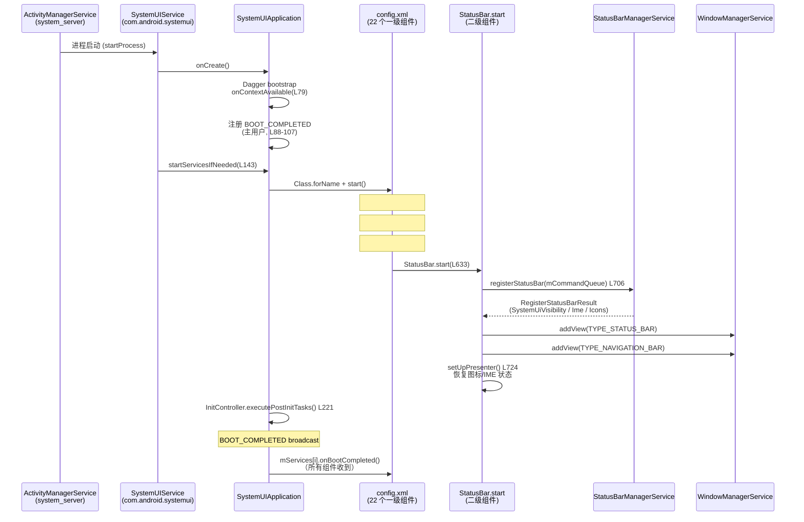

# SystemUI 总览与启动（Android 10 / android-10.0.0_r33）

> 范围：本仓 `frameworks/base/packages/SystemUI/`（Q 分支）。
> 核心结论：**SystemUI 进程里不是"一个 UI 框架"，而是 20+ 个独立 `SystemUI` 组件依次初始化**。它没有单一主类，而是 `SystemUIService`（前台 Service）→ `SystemUIApplication`（Application）→ 反射实例化一组组件（`config_systemUIServiceComponents`）→ 每个组件各自 `start()`。本文把这条**启动链**、**组件拓扑**、**与 WMS/AMS 的注册关系**讲透。

---

## 0. 结论前置

1. **双进程**：SystemUI 主进程名 `com.android.systemui`（Manifest `L261`），另有 `:screenshot` / `:tuner` / `:sweetsweetdesserts` 三个子进程。子进程 `Application.onCreate` 检测到非主进程后直接 `return`（`SystemUIApplication.java:121-127`），不启动主组件。
2. **启动入口**：`SystemUIService.onCreate`（`SystemUIService.java:38`）是唯一入口，它调 `SystemUIApplication.startServicesIfNeeded()`（`SystemUIService.java:40`）。Service 本身只有 `onCreate/dump`，没有 UI。
3. **组件拓扑 = 反射启动 22 个一级组件 + 二级 `StatusBar`**：`startServicesIfNeeded`（`SystemUIApplication.java:143`）读 `res/values/config.xml` 的 `config_systemUIServiceComponents` 数组（`config.xml:275`），按序 `Class.forName → newInstance → start()`。`StatusBar` 不在此数组里——它由 **`SystemBars.start`**（`SystemBars.java:37`）内部 `new StatusBar().start()` 作为二级组件启动。
4. **Dependency 体系**：`Dependency.get(cls)`（`Dependency.java:603`）是一个**静态组件注册表**（`SystemUIApplication.mComponents` HashMap，`SystemUIApplication.java:62`）。一级组件 `start()` 里通过 `putComponent(Class, obj)` 把自己的接口对象注册进去，后续组件用 `getComponent(cls)` 拿引用。**不是 Java 构造器注入，而是运行时注册 + 查表**。
5. **SystemUI 注册到 WMS/AMS 的关键点**：`StatusBar.start` 里 `mBarService.registerStatusBar(mCommandQueue)`（`StatusBar.java:706`）→ WMS 侧 `StatusBarManagerService` 把 `CommandQueue`（`IStatusBar.Stub`）保存为 statusBar 的回调端；`createAndAddWindows(result)`（`StatusBar.java:711`）创建 `StatusBarWindow`（type=`TYPE_STATUS_BAR`）+ `NavigationBarView`（`TYPE_NAVIGATION_BAR`），经 `WindowManager.addView` 注入 WMS。
6. **CommandQueue = SystemUI 与 StatusBarManagerService（system_server）之间的主要桥梁**：`CommandQueue extends IStatusBar.Stub`（`CommandQueue.java:66`），`CommandQueueStart.start`（`CommandQueue.java:1100`）把它注册进 `Dependency`，让所有组件能拿它调 `IStatusBar` 接口的方法。

---

## 1. 架构总图

```
┌────────────────────────── com.android.systemui 主进程 ─────────────────────────┐
│                                                                             │
│  SystemUIService (前台 Service, 唯一入口)                                    │
│    onCreate → SystemUIApplication.startServicesIfNeeded()                   │
│                                                                             │
│  SystemUIApplication extends Application                                     │
│    构造 Dagger 依赖（onContextAvailable）                                      │
│    反射实例化 22 个一级 SystemUI 组件（config.xml:275）                       │
│                                                                             │
│  一级组件（按启动顺序，节选）：                                                 │
│    1.  NotificationChannels (util, 先于所有 UI)                              │
│    2.  CommandQueue$CommandQueueStart                                       │
│    3.  KeyguardViewMediator                                                 │
│    4.  Recents                                                              │
│    5.  VolumeUI                                                             │
│    6.  Divider                                                              │
│    7.  SystemBars ──── 二级 ──→ StatusBar (statusbar.phone.StatusBar.start) │
│    8.  StorageNotification                                                  │
│    9.  PowerUI                                                              │
│   10.  RingtonePlayer                                                       │
│   11.  KeyboardUI                                                           │
│   12.  PipUI                                                                │
│   13.  ShortcutKeyDispatcher                                                │
│   14.  VendorService (@string/config_systemUIVendorServiceComponent)        │
│   15.  GarbageMonitor$Service                                               │
│   16.  LatencyTester                                                        │
│   17.  GlobalActionsComponent                                               │
│   18.  ScreenDecorations                                                    │
│   19.  BiometricDialogImpl                                                  │
│   20.  SliceBroadcastRelayHandler                                           │
│   21.  SizeCompatModeActivityController                                      │
│   22.  InstantAppNotifier                                                   │
│   23.  ThemeOverlayController                                               │
│                                                                             │
│  Dependency (静态注册表, SystemUIApplication.mComponents HashMap)            │
│    putComponent(Class, obj) ← 各组件 start() 里注册                            │
│    getComponent(Class)   → 后续组件查表拿引用                                  │
│                                                                             │
└─────────────────────────────────────────────────────────────────────────────┘
                    │  IStatusBar (AIDL, 跨进程)
                    ▼
┌────────────────── system_server ─────────────────────────────┐
│  StatusBarManagerService                                      │
│    mStatus = mCommandQueue (IStatusBar.Stub)                  │
│    StatusBarManagerService.registerStatusBar(cmQueue)        │
│    管理 statusBar/navBar window 的可见性 (WindowState)          │
└───────────────────────────────────────────────────────────────┘
```

---

## 2. 启动链逐层拆解

### 2.1 进程启动 → Application.onCreate

```
Manifest L261: android:process="com.android.systemui"
                android:name=".SystemUIApplication"

进程启动 → SystemUIApplication.onContextAvailable（Dagger）
              SystemUIApplication.onCreate L71
                └─ mContextAvailableCallback.onContextAvailable(this)  L79  (Dagger bootstrap)
                └─ setTheme(Theme_SystemUI)                           L85
                └─ 主用户 → register BOOT_COMPLETED receiver          L88-107
                └─ 子进程 → 直接 return（不启动组件）                   L121-127
```

**BOOT_COMPLETED 注册**（`L88-107`）是关键设计：主用户 SystemUI 在 `bootAnimation` 播放期间就创建并 `start()` 所有组件，但 `onBootCompleted()` 回调要等到 `BOOT_COMPLETED` broadcast。若系统启动快于 SystemUI 注册（`sys.boot_completed=1`），`startServicesIfNeeded` 里直接补判（`L169`），不等广播。

### 2.2 Service.onCreate → 组件批量启动

```
SystemUIService.onCreate (SystemUIService.java:38)
  └─ ((SystemUIApplication)getApplication()).startServicesIfNeeded()  L40

SystemUIApplication.startServicesIfNeeded (SystemUIApplication.java:143)
  ├─ 读 config_systemUIServiceComponents (config.xml:275, 22个类)
  ├─ Class.forName → newInstance (若实现在 SystemUI.Injector 则 apply DI)
  ├─ 每个组件: mServices[i].mContext = this; mServices[i].mComponents = mComponents;
  ├─ mServices[i].start()   ← 各组件依次初始化
  └─ Dependency.get(InitController.class).executePostInitTasks()  L221
     └─ 所有 start() 完成后的"收尾任务"（如启动后台线程、注册监听）
```

**启动顺序的意义**：数组顺序即依赖顺序。`CommandQueueStart`（#2）必须早于 `StatusBar`（#7），因为 `StatusBar.start` 里 `getComponent(CommandQueue.class)` 需要它已注册。`KeyguardViewMediator`（#3）必须早于 `Recents`（#4）和 `StatusBar`（#7），因为 Keyguard UI 是它们的依赖。

### 2.3 StatusBar 二级启动

```
SystemBars.start (SystemBars.java:37)
  └─ createStatusBarFromConfig()  L49
       ├─ 读 config_systemuiBarClass（默认 = com.android.systemui.statusbar.phone.StatusBar）
       └─ cls.newInstance() → mStatusBar.start()  L62/68

StatusBar.start (StatusBar.java:633)
  ├─ getDependencies()  L634  (从 DI 图拉出所有 @Inject 字段)
  ├─ mKeyguardUpdateMonitor.setKeyguardBypassController(...)  L688-689
  ├─ mBarService = IStatusBarService.Stub.asInterface(SM.getService(STATUS_BAR_SERVICE))  L690
  ├─ mCommandQueue = getComponent(CommandQueue.class)  L701
  ├─ mCommandQueue.addCallback(this)  L702
  ├─ mBarService.registerStatusBar(mCommandQueue)  L706  ← 注册到 WMS 侧
  ├─ createAndAddWindows(result)  L711
  │   └─ inflateStatusBarWindow + mStatusBarWindow.setService(this)  L802-803
  │   └─ addView(barView, TYPE_STATUS_BAR)  ← 注入 WMS
  │   └─ createNavigationBarView + addView(TYPE_NAVIGATION_BAR)
  └─ setUpPresenter() → 初始化图标（PhoneStatusBarPolicy 等）  L769
```

### 2.4 CommandQueueStart 的特殊设计

`CommandQueue` 本身继承 `IStatusBar.Stub`（`CommandQueue.java:66`），但它**不能继承 `SystemUI` 基类**（一个类不能继承两个非接口类）。所以设计为**外壳类 `CommandQueueStart` 继承 `SystemUI`，内部 `new CommandQueue` 并存入 `Dependency`**（`CommandQueue.java:1100-1104`）。

### 2.5 Dependency 注册表机制

```java
// SystemUIApplication.java
private final Map<Class<?>, Object> mComponents = new HashMap<>();  // L62
// 每个组件 start() 里:
putComponent(StatusBar.class, this);          // StatusBar.java:677
putComponent(CommandQueue.class, new CommandQueue(mContext));  // CommandQueue.java:1103
// 后续组件查:
CommandQueue cmdQ = getComponent(CommandQueue.class);  // 等价 Dependency.get
```

**注意**：`Dependency.get(cls)`（`Dependency.java:603`）查的是同一张 `mComponents` HashMap（由 `DependencyProvider` 在 `onContextAvailable` 时注入），**不是 Java 构造器注入**。这是 Android 10 的旧 DI 模式——Android 11/12 之后逐步被 Dagger 2 全量接管（`@SysUISingleton` 等）。

---

## 3. 一级组件职责速查表

| 序号 | 组件 | 文件 | 职责 |
|---|---|---|---|
| 1 | `NotificationChannels` | `util/NotificationChannels.java` | 创建所有通知 channel（如 StatusBar/Notification/Phone）|
| 2 | `CommandQueue$CommandQueueStart` | `statusbar/CommandQueue.java:1100` | 注册 `CommandQueue` 到 `Dependency`，后续所有组件共用 |
| 3 | `KeyguardViewMediator` | `keyguard/KeyguardViewMediator.java` | 锁屏（Keyguard）状态机，与 `KeyguardUpdateMonitor`（WMS 侧）通信 |
| 4 | `Recents` | `recents/Recents.java` | 最近任务界面（Quickstep 集成）、RecentsView |
| 5 | `VolumeUI` | `volume/VolumeUI.java` | 音量 HUD（TYPE_VOLUME_OVERLAY） |
| 6 | `Divider` | `stackdivider/Divider.java` | 多窗口分割线 UI |
| 7 | `SystemBars` → `StatusBar` | `SystemBars.java:37` → `statusbar/phone/StatusBar.java:633` | 状态栏 + 导航栏，**核心组件**，向 `StatusBarManagerService` 注册 |
| 8 | `StorageNotification` | `usb/StorageNotification.java` | 存储/USB 接入通知 |
| 9 | `PowerUI` | `power/PowerUI.java` | 飞行模式、充电状态、电池状态条 |
| 10 | `RingtonePlayer` | `media/RingtonePlayer.java` | 来电铃声 |
| 11 | `KeyboardUI` | `keyboard/KeyboardUI.java` | 键盘导航按钮（方向、菜单）|
| 12 | `PipUI` | `pip/PipUI.java` | 画中画窗口 |
| 13 | `ShortcutKeyDispatcher` | `shortcut/ShortcutKeyDispatcher.java` | 键盘快捷键分发 |
| 14 | VendorService | `config_systemUIVendorServiceComponent` | 厂商自定义（可替换/为空）|
| 15 | `GarbageMonitor$Service` | `util/leak/GarbageMonitor.java` | 内存泄漏检测（开发版）|
| 16 | `LatencyTester` | `LatencyTester.java` | 性能测试（AOSP 内置）|
| 17 | `GlobalActionsComponent` | `globalactions/GlobalActionsComponent.java` | 全局快捷键（如音量键快捷）|
| 18 | `ScreenDecorations` | `screenDecorations/ScreenDecorations.java` | 屏幕装饰（圆角、刘海）|
| 19 | `BiometricDialogImpl` | `biometrics/BiometricDialogImpl.java` | 生物识别对话框（指纹/人脸）|
| 20 | `SliceBroadcastRelayHandler` | `SliceBroadcastRelayHandler.java` | Slice 广播中继 |
| 21 | `SizeCompatModeActivityController` | `sizecompat/SizeCompatModeActivityController.java` | 大屏适配弹窗 |
| 22 | `InstantAppNotifier` | `statusbar/notification/InstantAppNotifier.java` | 即时 App 通知 |
| 23 | `ThemeOverlayController` | `theme/ThemeOverlayController.java` | 主题 Overlay（动态壁纸颜色）|

**注意**：`StatusBar` 是数组第 7 位 `SystemBars` 的**二级子组件**，不直接出现在 `config_systemUIServiceComponents` 里。这是 Android 10 的设计：`SystemBars` 负责同时管理"状态栏 + 导航栏"两个窗口，`StatusBar`（phone）只是其实现。TV 走 `TvStatusBar`（`statusbar/tv/TvStatusBar.java`）。

---

## 4. 与 WMS / StatusBarManagerService 的注册关系

```
SystemUI 进程（com.android.systemui）         system_server
──────────────────────────────────────       ──────────────────────────────
StatusBar.start
  mBarService =
    IStatusBarService.Stub.asInterface(
      ServiceManager.getService(STATUS_BAR_SERVICE))  L690
  mBarService.registerStatusBar(mCommandQueue)       L706
       IStatusBar(AIDL)──────────────────────────►  StatusBarManagerService
                                                    mStatus = commandQueue
                                                    statusBarWindows 管理
  createAndAddWindows(result)                     L711
    addView(statusBarView, TYPE_STATUS_BAR)
    addView(navBarView, TYPE_NAVIGATION_BAR)
       IWindowManager(AIDL)─────────────────────►  WindowManagerService
                                                    WindowState 创建
                                                    显示给 SurfaceFlinger
```

**`registerStatusBar` 返回值 `RegisterStatusBarResult`**（`StatusBar.java:704`）携带：
- `mSystemUiVisibility`：当前 WMS 侧记录的 `View.SYSTEM_UI_FLAG_*` 值
- `mImeToken`/`mImeWindowVis`：IME 窗口状态（`StatusBar.java:731` 立即恢复）
- `mIcons`：已有状态栏图标集合（`StatusBar.java:736` 立即重建）
- `mDisabledFlags1`：被禁用功能位掩码

这是 SystemUI **冷启动时恢复所有 UI 状态**的机制——不依赖重启，从 WMS 备份恢复。

---

## 5. 启动时序图（Mermaid）



---

## 6. 方法 → 文件 → 行号速查表

| 关注点 | 方法 | 文件:行 |
|---|---|---|
| 进程 Service 入口 | `SystemUIService.onCreate` | `SystemUIService.java:38` |
| Application 构造 | `SystemUIApplication.onCreate` | `SystemUIApplication.java:71` |
| Dagger bootstrap | `mContextAvailableCallback.onContextAvailable` | `SystemUIApplication.java:79` |
| 一级组件启动 | `startServicesIfNeeded` | `SystemUIApplication.java:143` |
| 组件实例化循环 | `Class.forName → start()` | `SystemUIApplication.java:184-209` |
| 启动后收尾 | `InitController.executePostInitTasks` | `SystemUIApplication.java:221` |
| BOOT_COMPLETED 回调 | `mServices[i].onBootCompleted()` | `SystemUIApplication.java:101` |
| 组件注册表 | `SystemUIApplication.mComponents` | `SystemUIApplication.java:62` |
| `Dependency.get` | `Dependency.get(cls)` | `Dependency.java:603` |
| CommandQueue 注册 | `CommandQueueStart.start` | `CommandQueue.java:1100-1103` |
| StatusBar 二级启动 | `SystemBars.start` → `createStatusBarFromConfig` | `SystemBars.java:37/49` |
| StatusBar 初始化 | `StatusBar.start` | `StatusBar.java:633` |
| 注册到 WMS | `mBarService.registerStatusBar` | `StatusBar.java:706` |
| 创建窗口 | `createAndAddWindows` | `StatusBar.java:711` |
| 一级组件配置数组 | `config_systemUIServiceComponents` | `res/values/config.xml:275` |

---

## 7. 调试验证

```bash
# 1) 查看 SystemUI 各组件启动耗时
adb shell dumpsys activity service com.android.systemui/.SystemUIService
# 关注：Service 列表 + 组件名称

# 2) 查看 StatusBar 注册状态
adb shell dumpsys statusbar
# 关注：StatusBar / NavBar 窗口状态、CommandQueue 的 callback 数

# 3) 确认 BOOT_COMPLETED 时机
adb shell getprop sys.boot_completed
adb shell dumpsys activity broadcast | grep BOOT_COMPLETED

# 4) 查看 Dagger / Dependency 启动耗时
adb shell dumpsys activity com.android.systemui/.SystemUIService | grep -A5 "StartServices"
# 或 logcat 过滤 SystemUI
adb logcat | grep -E "SystemUI|StatusBar|CommandQueue"

# 5) 查看 StatusBar 窗口
adb shell dumpsys window windows | grep -A8 "StatusBar"
adb shell dumpsys window windows | grep -A8 "NavigationBar"
```

**logcat 锚点**（`SystemUIApplication.java`）：
- `"SystemUIApplication constructed."`（`L67`）：进程创建
- `"SystemUIApplication created."`（`L73`）：Application.onCreate 开始
- `"Starting SystemUI services for user X"`（`L177`）：组件启动循环开始
- `"running: [component]"`（`L208`）：每个组件 start() 完成
- `"Initialization of X took N ms"`（`L215`）：组件启动超 1s 的警告

---

## 8. 踩坑清单

1. **`StatusBar` 不在一级组件数组里**：它是 `SystemBars`（#7）的二级子组件。改 `StatusBar` 初始化逻辑要找 `SystemBars.start`（`SystemBars.java:37`），不在 `config_systemUIServiceComponents` 里找它。TV 设备走 `TvStatusBar`。

2. **组件启动顺序即依赖顺序**：`CommandQueueStart`（#2）必须早于 `StatusBar`（#7），因为 `StatusBar.start` 里 `getComponent(CommandQueue.class)` 拿它。如果重排 `config.xml` 数组导致 `CommandQueue` 未注册，`StatusBar.start` 会 NPE。

3. **`Dependency.get` 是查表，不是构造器注入**：Android 10 是旧 DI 模式（`mComponents` HashMap + `Dependency.get`），`Dependency.java:603` 走 `SystemUIApplication.mComponents` 查表。Android 11/12 起逐步切换为 Dagger 2 全量注入，`Dependency.get` 保留作兜底，**改组件依赖时不要直接假设是构造器注入**。

4. **子进程不启动组件**：`:screenshot`（`ScreenshotService`）/`:tuner`/`:sweetsweetdesserts` 子进程里 `SystemUIApplication.onCreate` 检测到非主用户主进程后直接 `return`（`L121-127`），`startServicesIfNeeded` 不执行。调试 `SystemUIApplication` 相关代码时注意进程名。

5. **BOOT_COMPLETED 早于 SystemUI 启动时的补救**：如果 SystemUI 进程启动时 `sys.boot_completed` 已经是 `1`（系统 boot 比它快），`startServicesIfNeeded` 直接补判（`L169`），不等广播。这是 `AMS.finishBooting` 与 SystemUI 启动的竞态处理，理解它有助于排查"开机后 StatusBar 状态不对"类问题。

6. **`registerStatusBar` 返回值是状态快照**：`RegisterStatusBarResult`（`StatusBar.java:704`）携带当前 `systemUiVisibility`/IME/图标/`disabledFlags1`，`StatusBar.start` 用它们立即恢复 UI 状态，**不依赖重启**（`StatusBar.java:726-748`）。冷启动时如果这个结果不对，UI 会恢复到错误的初始状态。

7. **`KeyguardViewMediator` 早于 `Recents` 和 `StatusBar`**：数组顺序（#3）先于 Recents（#4）和 SystemBars（#7），因为后两者都依赖 Keyguard UI 已就绪。Keyguard 状态机（`keyguard_service_startup_analysis.md` 专篇）的启动顺序约束就是这条。

8. **`VendorService` 是厂商扩展点**：`config_systemUIVendorServiceComponent` 指向一个字符串资源（`res/values/config.xml:301`），OEM 可替换实现（如 CDMa 信号栏、自定义锁屏）。AOSP 默认为空，车机（AAOS）场景通常在此注入车厂 UI 组件。

---

## 9. 与既有文档分工

| 文档 | 侧重 |
|---|---|
| `SystemUI_总览与启动_Android10.md`（本篇） | 进程结构、组件启动链、`Dependency` 注册表、WMS 注册关系 |
| `keyguard_service_startup_analysis.md` | Keyguard 状态机 + `KeyguardUpdateMonitor`（system_server 侧）启动与状态流转 |
| 下一步（模块 2 可选） | `StatusBar` 内部 `createAndAddWindows` → `StatusBarWindowController` 窗口可见性状态机（与 WMS `WindowState` 协作） |
| 下一步（模块 3 可选） | `CommandQueue` 的 `IStatusBar` 接口完整方法列表 + 状态推送流程（WMS→SystemUI 事件通知） |
