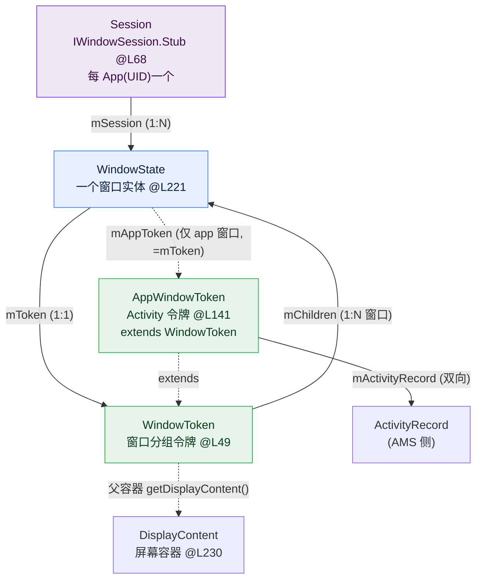

# WMS 核心类：Session / WindowState / WindowToken / AppWindowToken

> 分析基线：`cells-android10` 仓内 `android-10.0.0_r33` 完整 `frameworks/base`
> 文档定位：WMS 学习路线**模块 5（Token 体系）扩展版**——四元组（连接 + 窗口实体 + 两层令牌）的字段级拆解
> 约定：行号来自本仓 `grep -n` 实测，可直接 `Read` 复现

---

## 1. 结论前置（四类一句话 + 它们如何串起来）

1. **Session** = 一个 App（按 UID）对 WMS 的 **Binder 连接端点**（`IWindowSession.Stub` @L68）。App 进程所有窗口共用同一个 Session；App 死亡时由 `binderDied`(L145) 触发整 App 窗口清理。
2. **WindowState** = **一个具体窗口**的运行时状态（`@L221`，`extends WindowContainer<WindowState>`）。尺寸、层级(`mBaseLayer`/`mSubLayer`)、可见性、Surface 都由它承载。
3. **WindowToken** = 一组相关窗口的 **分组令牌**（`@L49`，`extends WindowContainer<WindowState>`）。它的 `token`(IBinder L53) 是客户端传来的 binder 标识；子窗口挂在它的 `mChildren` 里（**不是 `mWindows`**，见踩坑 #1）。
4. **AppWindowToken** = **一个 Activity 的窗口令牌**（`@L141`，`extends WindowToken`）。持有 `mActivityRecord`(L260) 与 AMS 的 `ActivityRecord` 双向引用，并管理启动窗口(`startingWindow` L211)、转场(`mTransit` L271)。

**串起来**：一次 `addWindow` 后 → `Session`(L154 转发) → WMS 建 `WindowState` → `WindowState.mToken`/`mAppToken`(L247/L249) 指向对应 `WindowToken`/`AppWindowToken` → Token 作为 `WindowContainer` 节点挂在 `DisplayContent`(或 Task) 之下 → 形成完整的容器树。

---

## 2. 总览（四类关系图）



> 实线 = 强拥有/引用；虚线 = 继承或条件引用或父容器关系。`WindowState` 同时被 `Session`(创建者) 和 `WindowToken`(分组容器) 关联——前者记"谁建的"，后者记"属于哪一组"。

---

## 3. 分层拆解

### 3.1 Session（连接端点）

**角色**：`class Session extends IWindowSession.Stub implements DeathRecipient`(@L68)。每 App 进程在 WMS 侧的唯一代表。客户端 `ViewRootImpl` 通过 `IWindowSession` 调用，服务端落地到这个 Session 实例。

**关键字段**（实测行号）

| 字段 | 行号 | 含义 |
|------|------|------|
| `final WindowManagerService mService` | L69 | 反向指向 WMS，所有操作转发给它 |
| `final IWindowSessionCallback mCallback` | L70 | 客户端回调（死亡通知用） |
| `final int mUid` / `final int mPid` | L71/L72 | 该 App 的 UID/PID（权限与归属判定） |
| `SurfaceSession mSurfaceSession` | L74 | 通往 SurfaceFlinger 的图形会话（创建 Surface 的入口） |
| `final boolean mCanAddInternalSystemWindow` | L81 | 是否持有 `INTERNAL_SYSTEM_WINDOW` 权限（系统窗口白名单） |
| `boolean mShowingAlertWindowNotificationAllowed` | L85 | 是否允许弹"悬浮窗威胁"通知 |

**关键方法**

| 方法 | 行号 | 作用 |
|------|------|------|
| `binderDied()` | L145 | App 进程死 → `killSessionLocked()` 清理该 App 全部窗口 |
| `addToDisplay(...)` | L154 | **直接转发** `mService.addWindow(this, ...)`（L159） |
| `addToDisplayWithoutInputChannel(...)` | L165 | 同上但无输入通道（如壁纸） |
| `remove(IWindow)` | L175 | 转发 `mService.removeWindow(this, window)` |
| `relayout(...)` | L185 | 转发 `mService.relayoutWindow(...)`（L194） |
| `getWindowId(...)` | L416 | 返回 `WindowId`（用于 `IWindowId` 焦点观察） |

> **关键点**：Session 自身几乎不做逻辑，是 WMS 的"薄代理"。真正的窗口管理全在 `WindowManagerService.addWindow`，Session 只是带 UID/PID 上下文的调用入口 + 死亡清理器。

### 3.2 WindowState（窗口实体）

**角色**：`@L221` `class WindowState extends WindowContainer<WindowState> implements WindowManagerPolicy.WindowState`。一个 `ViewRootImpl`（一个 DecorView）对应一个 `WindowState`。

**关键字段**（实测行号）

| 字段 | 行号 | 含义 |
|------|------|------|
| `final Session mSession` | L239 | 创建此窗口的 Session（谁建的） |
| `final IWindow mClient` | L240 | 回调 App 的端点（`ViewRootImpl.W`） |
| `final int mOwnerUid` | L243 | 窗口归属 UID（多用户隔离） |
| `WindowToken mToken` | L247 | 所属的分组令牌 |
| `AppWindowToken mAppToken` | L249 | **若是 app 窗口则 == mToken，否则 null** |
| `final WindowManager.LayoutParams mAttrs` | L253 | 客户端传来的窗口参数（type/flags/softInput 等） |
| `final int mBaseLayer` / `final int mSubLayer` | L256/L257 | 基础层级 / 子层（决定 Z-order） |
| `final boolean mLayoutAttached` | L258 | 是否依附父窗口（子窗口） |
| `boolean mPolicyVisibility` | L281 | policy 决定的可见性位掩码 |
| `boolean mHidden` | L299 | 子窗口显隐判定用 |
| `int mLayer` | L324 | 最终计算出的 Z 序数值 |
| `int mRequestedWidth`/`mRequestedHeight` | L319/L320 | App 请求尺寸 |
| `final WindowStateAnimator mWinAnimator` | L516 | 窗口动画/ Surface 控制 |
| `boolean mHasSurface` | L518 | 是否已向 SF 申请到 Surface |

**可见性判定（高频面试题）**：`WindowState` 提供多个"可见"方法，含义不同——

| 方法 | 行号 | 判定依据 |
|------|------|----------|
| `isVisible()` | L1483 | 综合：policy 可见 + 已 hasSurface + 非 exiting 等 |
| `isVisibleByPolicy()` | L1494 | 仅 policy 维度（`mPolicyVisibility` 等） |
| `isVisibleLw()` | L1522 | 旧的 "Lw" 命名，policy 可见 |
| `isVisibleNow()` | L1540 | 当前帧实际可见（最严格） |
| `isVisibleOrAdding()` | L1559 | 可见或正在添加中 |

**关键方法**：`computeFrameLw()`(L913，计算窗口各 Rect 帧) / `canReceiveKeys()`(L2599，能否接收按键→焦点) / `prepareWindowToDisplayDuringRelayout()`(L2415，relayout 时准备显示)。

### 3.3 WindowToken（窗口分组令牌）

**角色**：`@L49` `class WindowToken extends WindowContainer<WindowState>`。把"同一 token（binder）下的多个窗口"聚成一组，便于整体显隐、层级管理。

**关键字段**（实测行号）

| 字段 | 行号 | 含义 |
|------|------|------|
| `final IBinder token` | L53 | 客户端传入的 binder 标识（如 Activity 的 token） |
| `final int windowType` | L56 | `LayoutParams.type`（如 TYPE_APPLICATION / TYPE_INPUT_METHOD） |
| `final boolean mRoundedCornerOverlay` | L59 | 圆角覆盖层专用 |
| `boolean mPersistOnEmpty` | L63 | 即使窗口全移除也保留 token（显式 add 的 token） |
| `boolean mHidden` | L72 | 整组是否隐藏（`setHidden` L125 / `isHidden` L131） |
| `boolean hasVisible` | L75 | 临时标记（找无可见窗口的 token 用） |
| `boolean waitingToShow` / `sendingToBottom` | L79/L83 | 挂起事务状态 |
| `final boolean mOwnerCanManageAppTokens` | L86 | 持有 `MANAGE_APP_TOKENS` 权限 |

**关键方法**

| 方法 | 行号 | 作用 |
|------|------|------|
| 构造 `WindowToken(...)` | L108/L114 | `onDisplayChanged(dc)` 把自己挂到 DisplayContent 下 |
| `addWindow(WindowState)` | L199 | 把窗口加入 `mChildren`（容器树子节点） |
| `removeAllWindowsIfPossible()` | L135 | 遍历 `mChildren` 逐个移除 |
| `setHidden` / `isHidden` | L125/L131 | 整组显隐 |
| `onDisplayChanged(DisplayContent)` | L260 | 显示器变更时重挂 |

> **核心澄清（踩坑 #1）**：Android 10 是容器树模型，`WindowToken` 继承 `WindowContainer<WindowState>`，**子窗口列表就是 `mChildren`**（来自 `WindowContainer`），**不存在 `mWindows` 字段**（那是 Android 8 及更早的 `WindowList` 旧模型）。分析层级遍历要认 `mChildren`。

### 3.4 AppWindowToken（Activity 级令牌）

**角色**：`@L141` `class AppWindowToken extends WindowToken implements AppFreezeListener, ConfigurationContainerListener`。是 `WindowToken` 的子类，**专用于一个 Activity**。

**关键字段**（实测行号）

| 字段 | 行号 | 含义 |
|------|------|------|
| `final IApplicationToken appToken` | L151 | AMS 侧 `ActivityRecord` 的 binder 句柄 |
| `final ComponentName mActivityComponent` | L152 | Activity 组件名 |
| `ActivityRecord mActivityRecord` | L260 | **与 AMS 侧 ActivityRecord 双向引用** |
| `WindowState startingWindow` / `StartingSurface startingSurface` | L211/L212 | 启动窗口（冷启动占位） |
| `boolean mIsExiting` | L227 | 正在退出 |
| `boolean mLaunchTaskBehind` | L229 | 是否后台启动 |
| `boolean mEnteringAnimation` | L230 | 进入动画中 |
| `boolean hiddenRequested` / `mClientHidden` | L190/L193 | 隐藏请求 / 已通知客户端隐藏 |

> **【版本注意】** 上述 `AppWindowToken` / `ActivityRecord` 二分结构**仅适用于 Android 10（本仓 android-10.0.0_r33）**。在 **Android 11（API 30）及以上**，`AppWindowToken` 类已被**合并进 `ActivityRecord`**（`ActivityRecord` 直接继承窗口容器、自身即为 App 令牌），`dumpsys window tokens` 会直接打印 `ActivityRecord{...}` 而看不到独立的 `AppWindowToken{...}`。详见 `WMS_dumpsys_window_tokens_分析.md` §3.5（含真机 dump 证据：2033/2040 类型 + ActivityRecord 打印格式锁定设备为 ≥ Android 11）。读真机 `dumpsys` 时务必先判断 Android 版本。
| `boolean reportedVisible` / `reportedDrawn` | L200/L203 | 上报给 App 的可见/绘制状态 |
| `final InputApplicationHandle mInputApplicationHandle` | L224 | 输入分发用的应用句柄 |
| `private int mTransit` | L271 | 转场类型（`AppTransition.TRANSIT_*`） |
| `private int mTransitFlags` | L277 | 转场标志 |

> **核心澄清（踩坑 #2）**：`AppWindowToken` 与 `WindowToken` 是**父子类**而非兄弟——它额外持有 `ActivityRecord` 引用、管理启动窗口与转场，是 WMS 与 AMS 在窗口层的"握手点"。一个 Activity 的所有窗口（`WindowState`）最终都挂在它的 `mChildren` 下。

---

## 4. 速查表（类 → 文件 → 行号 → 角色）

| 类 | 文件（相对 `frameworks/base/services/core/java/com/android/server/wm/`） | 行号 | 角色 |
|----|------|------|------|
| `Session` | `Session.java` | L68 / addToDisplay L154 / binderDied L145 | 每 App 的 Binder 连接端点 |
| `WindowState` | `WindowState.java` | L221 / mToken L247 / mAppToken L249 / mBaseLayer L256 / isVisible L1483 | 一个窗口的实体状态 |
| `WindowToken` | `WindowToken.java` | L49 / token L53 / addWindow L199 / isHidden L131 | 窗口分组令牌 |
| `AppWindowToken` | `AppWindowToken.java` | L141 / mActivityRecord L260 / startingWindow L211 / mTransit L271 | Activity 级令牌（WindowToken 子类） |
| `ActivityRecord` | `ActivityRecord.java`（AMS 侧） | — | AMS 的 Activity 记录，与 AWT 双向引用 |

---

## 5. 调试验证

```bash
adb shell dumpsys window tokens      # 看 WindowToken / AppWindowToken 树（按 display）
adb shell dumpsys window windows     # 看 WindowState 列表（含 mBaseLayer/mLayer、mToken 指向）
adb shell dumpsys window p             # policy 状态（含 focus、keyguard）
```

> 源码级复现（本仓可直读）：从 `WindowManagerService.addWindow`(L1299) 一路看 `new WindowState(...)` 后如何 `token.addWindow(win)`(L199)、如何把 `win.mToken`/`win.mAppToken` 赋值——对照本文字段行号逐行核对。

---

## 6. 踩坑清单（四类相关高频误解）

1. **WindowToken 子窗口列表是 `mChildren`，不是 `mWindows`**：Android 10 容器树重构后，子节点统一由 `WindowContainer.mChildren` 承载（旧版 `WindowList`/`mWindows` 已废弃）。读层级遍历代码要认 `mChildren`。
2. **`AppWindowToken` 是 `WindowToken` 的子类，不是兄弟**：分析 token 继承体系时，AWT 直接复用 WT 的全部能力（分组、显隐、容器树位置）。
3. **`WindowState.mAppToken` 在普通窗口为 `null`**：仅当 `mToken` 本身是 `AppWindowToken` 时 `mAppToken == mToken`，否则 `null`（源码注释 L248-249 明确）。判断"是否 app 窗口"用 `mAppToken != null`。
4. **Session 是每 App（UID）一个，不是每窗口**：同一 App 的所有 `WindowState.mSession` 指向同一 Session；每窗口的回调端点是 `IWindow`（`ViewRootImpl.W`），不是 Session。
5. **Token 没有 `mDisplayContent` 字段**：`DisplayContent` 是它的**父容器**，通过 `getDisplayContent()`（WindowContainer 继承）获取，不要找 `mDisplayContent` 成员。
6. **WindowState 可见性有多维度**：`mPolicyVisibility`(policy) / `mHidden`(子窗口) / `mAppOpVisibility` / `hiddenRequested`(AWT) 等组合，`isVisible()`(L1483) 是综合判定——面试常问"窗口为什么不显示"，要从这些维度逐一排查。
7. **`addToDisplay` 不做实质逻辑**：Session.addToDisplay(L154) 仅转发 `WMS.addWindow`；想在 WMS 侧追逻辑要从 `addWindow`(L1299) 入手，而非 Session。

---

## 7. 与学习路线的关系 / 下一步

本文覆盖了路线 **模块 5（Token 体系）** 的全部核心类，并额外把 `Session`（连接）与 `WindowState`（实体）补齐，形成"连接→实体→分组→Activity 分组"的完整四元组心智模型。

建议下一步（点单）：
- **模块 2「Window 添加全流程」**：看 `WMS.addWindow`(L1299) 如何创建 `WindowState`、解析 token、计算 `mBaseLayer`/`mSubLayer`、决定归属——本文的字段在此被逐一填充。
- **模块 3「窗口层级与 Z-order」**：深入 `mBaseLayer`/`mSubLayer`/`mLayer` 的计算规则（谁盖谁）。
- **模块 6「焦点与输入」**：`canReceiveKeys`(L2599) 与 `InputApplicationHandle`(L224) 如何决定焦点窗口。

> 前置：本文与 `doc/WMS_总览与启动_Android10.md`（§3.1 系统位置图、§4.2 客户端链路）及 `doc/binder_全景分析_Android10.md`（IWindowSession/IWindow 三对 Binder 接口）互为支撑。
