# WMS `dumpsys window tokens` 真实设备 dump 分析

> 分析对象：`adb shell dumpsys window tokens`（真机输出，见本文末附录原文）  
> 设备：YTO 物流 PDA，`com.yto.pda.wwms` 为前台 App，`com.android.launcher3` 为桌面  
> 对照基线：本仓 `cells-android10` = **android-10.0.0_r33**（完整 `frameworks/base`）  
> 文档定位：把一篇真实 `dumpsys` 输出，逐条映射回前面学的 WMS 令牌体系（`WMS_Session与窗口令牌体系_Android10.md`），并点破**版本差异**。  
> 结论前置 → 总览 → 分层解码 → 速查表 → 调试验证 → 踩坑清单

---

## 1. 结论前置（5 条，先看这个）

1. **这台设备不是纯 Android 10，而是 Android 11（API 30）或更高。**
   - 证据 1：dumpsys 直接打印 `ActivityRecord{...}` 当作窗口令牌。但本仓 android-10 源码里 `ActivityRecord`（`ActivityRecord.java:239`）和 `AppWindowToken`（`AppWindowToken.java:141 extends WindowToken`）是**两个独立类、双向引用**（L265 ↔ L260）。Android 11 才把 `AppWindowToken` 合并进 `ActivityRecord`，此后 dumpsys 才直接打 `ActivityRecord{...}`。
   - 证据 2：dump 出现 `windowType=2033`(AssistPreviewPanel)、`2040`(NotificationShade)。这两个常量在 android-10 AOSP **根本不存在**（`TYPE_ASSISTANT`、`TYPE_NOTIFICATION_SHADE` 是 Android 11 新增；android-10 的系统窗口类型只到 `2038=TYPE_APPLICATION_OVERLAY`）。
2. **Display #0 上共 9 个令牌**：2 个"App 令牌"（即两个 `ActivityRecord` → launcher 桌面 + wwms 前台 App）+ 7 个"非 App 令牌"（`WindowToken`/`WallpaperWindowToken`，对应 IME / 状态栏 / 导航栏 / 通知栏 / 壁纸 / PiP 遮罩 / 助手预览）。
3. **`Binder` vs `BinderProxy` 暴露了"谁创建了令牌"**：
   - App 令牌的 IBinder 由 **system_server（ATM）** 自己创建 → dumpsys 显示 `android.os.Binder@...`（真身）。
   - 系统窗口令牌（StatusBar / NavBar / IME / 壁纸等）的 IBinder 由**客户端进程（SystemUI / 输入法 App）**&#x521B;建后传给 WMS → WMS 持 `android.os.BinderProxy@...`（代理）。这与我们文档里"WindowToken.token 是客户端提供的 IBinder"完全吻合。
4. **"令牌存在" ≠ "窗口可见"**：`pip-dismiss-overlay`(2024) 与 `AssistPreviewPanel`(2033) 都是 `hasVisible=false`——窗口对象在，但当前没显示。可见性是一组**多维状态**（`hasVisible` / `mVisibleRequested` / `mVisible` / `nowVisible` / `mAppStopped`），不是单一布尔。
5. **前台/后台一目了然**：wwms App 的 `mVisible=true / nowVisible=true / reportedVisible=true`（前台，已绘完）；launcher 桌面 `state=STOPPED / mAppStopped=true / mVisible=false`（被压到后台已 stop）。这正是一次标准"从桌面点开 App"后的窗口态快照。

---

## 2. 总览：这台设备的令牌树（映射回 WMS 类）

```mermaid
graph TB
    D["Display #0 (单屏 PDA)"]
    subgraph APP["App 令牌 = ActivityRecord (Android 11+ 即 AppWindowToken)"]
        A1["ActivityRecord dfefe3a<br/>launcher3 / QuickstepLauncher<br/>home · STOPPED · mVisible=false"]
        A2["ActivityRecord f6ab1d7<br/>com.yto.pda.wwms.MainActivity<br/>standard · 前台 · mVisible=true"]
    end
    subgraph SYS["非 App 令牌 = WindowToken / WallpaperWindowToken"]
        S1["WindowToken fb36d99 · InputMethod · 2011 · V"]
        S2["WindowToken 90b8f36 · pip-dismiss-overlay · 2024 · 隐"]
        S3["WindowToken 3fc1b19 · AssistPreviewPanel · 2033 · 隐"]
        S4["WindowToken 7860cc1 · StatusBar · 2000 · V"]
        S5["WindowToken 3a3589 · NotificationShade · 2040 · V"]
        S6["WallpaperWindowToken fdaee5f · ImageWallpaper · 2013 · V"]
        S7["WindowToken 1f1d235 · NavigationBar0 · 2019 · V"]
    end
    D --> APP
    D --> SYS
    A1 -.->|"owns WindowState"| W1["Window{f98728f u0 launcher3}"]
    A2 -.->|"owns WindowState"| W2["Window{... u0 wwms.MainActivity}"]
    S1 -.->|"owns WindowState"| W3["Window{e9afe9a u0 InputMethod}"]
    S2 -.->|"owns WindowState (隐藏)"| W8["Window{a3c6c66 u0 pip-dismiss-overlay}"]
    S3 -.->|"owns WindowState (隐藏)"| W9["Window{ef57de u0 AssistPreviewPanel}"]
    S4 -.->|"owns WindowState"| W4["Window{9529e37 u0 StatusBar}"]
    S5 -.->|"owns WindowState"| W5["Window{60eb98e u0 NotificationShade}"]
    S6 -.->|"owns WindowState"| W6["Window{2322530 u0 ImageWallpaper}"]
    S7 -.->|"owns WindowState"| W7["Window{809303b u0 NavigationBar0}"]
    classDef app fill:#e8f0fe,stroke:#4285f4,color:#0b1f44;
    classDef sys fill:#fef7e0,stroke:#f9ab00,color:#5b3d00;
    classDef wstate fill:#e6f4ea,stroke:#34a853,color:#0d3b1e;
    class A1,A2 app;
    class S1,S2,S3,S4,S5,S6,S7 sys;
    class W1,W2,W3,W4,W5,W6,W7,W8,W9 wstate;
```




> 图例：实线 `D → 令牌` = DisplayContent 包含令牌（父子容器）；虚线 `令牌 → Window` = 令牌（WindowToken/ActivityRecord）在 WindowContainer 树中持有 WindowState 子节点。本 dump 中 **9 个令牌每个都恰好挂 1 个 `Window{...}`**（即 `WindowState`），两个"隐"的是 `hasVisible=false`（窗口对象在但当前不显示）。每个 `WindowState` 都由客户端经 `Session`（`IWindowSession.Stub`，每 App 一个）调 `WMS.addWindow` 创建并挂入对应令牌。

> 注：每个 `Window{...}` 即我们学的 **`WindowState`**；每个令牌即 **`WindowToken`**（或其子类 `WallpaperWindowToken` / 合并后的 `ActivityRecord`）；客户端通过 **`Session`**（每 App 一个 `IWindowSession.Stub`）调用 `WMS.addWindow` 把 WindowState 挂到对应令牌下。

---

## 3. 分层解码

### 3.1 令牌总表（Display #0 全部 9 个）

| # | dumpsys 标识                     | 内部类（Android 11+）                     | windowType | 解码（含义）                                          | Binder 身份                 | hasVisible | 当前状态       |
| - | ------------------------------ | ------------------------------------ | ---------- | ----------------------------------------------- | ------------------------- | ---------- | ---------- |
| 1 | `WindowToken fb36d99`          | WindowToken                          | 2011       | `TYPE_INPUT_METHOD`（输入法）                        | `BinderProxy`（IME 进程创建）   | true       | 显示中        |
| 2 | `WindowToken 90b8f36`          | WindowToken                          | 2024       | 扩展系统悬浮窗（PiP 关闭遮罩，版本相关）                          | `BinderProxy`             | **false**  | 隐藏         |
| 3 | `WindowToken 3fc1b19`          | WindowToken                          | 2033       | `TYPE_ASSISTANT`（助手预览面板，Android 11+）            | `BinderProxy`             | **false**  | 隐藏         |
| 4 | `ActivityRecord dfefe3a`       | **ActivityRecord(=AppWindowToken)**  | 2          | `TYPE_APPLICATION`（桌面）                          | system_server 真身 `Binder` | true       | STOPPED·后台 |
| 5 | `WindowToken 7860cc1`          | WindowToken                          | 2000       | `TYPE_STATUS_BAR`（状态栏）                          | `BinderProxy`（SystemUI）   | true       | 显示中        |
| 6 | `ActivityRecord f6ab1d7`       | **ActivityRecord(=AppWindowToken)**  | 2          | `TYPE_APPLICATION`（wwms 前台）                     | system_server 真身 `Binder` | true       | 前台·已绘      |
| 7 | `WindowToken 3a3589`           | WindowToken                          | 2040       | `TYPE_NOTIFICATION_SHADE`（通知 shade，Android 11+） | `BinderProxy`（SystemUI）   | true       | 显示中        |
| 8 | `WallpaperWindowToken fdaee5f` | WallpaperWindowToken(WindowToken 子类) | 2013       | `TYPE_WALLPAPER`（壁纸）                            | 真身 `Binder`               | true       | 显示中        |
| 9 | `WindowToken 1f1d235`          | WindowToken                          | 2019       | `TYPE_NAVIGATION_BAR`（导航栏）                      | `BinderProxy`（SystemUI）   | true       | 显示中        |

### 3.2 windowType 解码（数值 → 常量）

对照 **android-10 AOSP** `frameworks/base/core/java/android/view/WindowManager.java` 实测值：

| 值    | android-10 常量                             | 说明                   |
| ---- | ----------------------------------------- | -------------------- |
| 2    | `TYPE_APPLICATION` (L734)                 | 普通 App 窗口            |
| 2000 | `TYPE_STATUS_BAR` (FIRST_SYSTEM_WINDOW+0) | 状态栏                  |
| 2011 | `TYPE_INPUT_METHOD` (+11)                 | 输入法                  |
| 2013 | `TYPE_WALLPAPER` (+13)                    | 壁纸                   |
| 2019 | `TYPE_NAVIGATION_BAR` (+19, L982)         | 导航栏                  |
| 2038 | `TYPE_APPLICATION_OVERLAY` (+38, L1111)   | 应用悬浮窗（android-10 封顶） |

**设备上 3 个"超纲"值（android-10 源码里没有，证明版本 ≥ 11）：**

| 设备值  | 推断常量                      | 推断来源              | 备注              |
| ---- | ------------------------- | ----------------- | --------------- |
| 2033 | `TYPE_ASSISTANT`          | Android 11 新增     | android-10 无此常量 |
| 2040 | `TYPE_NOTIFICATION_SHADE` | Android 11 新增     | android-10 无此常量 |
| 2024 | 扩展系统悬浮类型（PiP 关闭遮罩）        | 非 android-10 公开常量 | 版本/厂商相关，不强行对应   |

> ⚠️ 不要拿 android-10 的 `WindowManager.java` 常量表去硬解 2024/2033/2040——这套设备类型编号是 Android 11+ 扩出来的。

### 3.3 Binder 身份：谁创建了令牌（关键认知）

dumpsys 里每个令牌后面跟的 `android.os.Binder@xxxx` 或 `android.os.BinderProxy@xxxx` 不是装饰，它直接回答"这个 IBinder 是在哪个进程 new 出来的"：

- **`android.os.Binder`（真身）**：对象就在 **system_server** 进程里。`ActivityRecord` 的 `appToken`（`IApplicationToken.Stub`，`ActivityRecord.java:263/949`）由 ATM 在 system_server 创建 → 所以 App 令牌在 dump 中是真身 Binder。
- **`android.os.BinderProxy`（代理）**：对象的真身在**别的进程**，system_server 这边只拿到跨进程代理。StatusBar / NavBar / NotificationShade / IME / 壁纸这些系统窗口，是由 SystemUI 或输入法 App 在自己的进程里 `new Binder()` 作为 token，再通过 `addWindow` 传进 WMS → WMS 侧就是 `BinderProxy`。

这正好印证 `WMS_Session与窗口令牌体系_Android10.md` 里的结论：**`WindowToken.token`（IBinder）是客户端提供的身份标识，WMS 用它做 HashMap 去重/查找；只有 App 令牌由 AMS 代管。**

### 3.4 可见性语义（多维，不是单一布尔）

dump 里出现一整套可见性字段，对应我们文档里 `WindowState`/`WindowToken` 的可见性判定：

| 字段                                  | 含义                     | launcher(后台)       | wwms(前台) |
| ----------------------------------- | ---------------------- | ------------------ | -------- |
| `hasVisible`                        | 令牌下是否有窗口当前带 surface/可见 | true               | true     |
| `mVisibleRequested`                 | WMS 是否"请求"它可见（策略意图）    | **false**          | **true** |
| `mVisible`                          | 实际可见（经 relayout 落实）    | **false**          | **true** |
| `nowVisible`                        | 最近一次上报的可见              | **false**          | **true** |
| `reportedVisible` / `reportedDrawn` | App 端已上报可见/绘完          | false              | true     |
| `mAppStopped` / `state`             | App 是否已 stop           | **true / STOPPED** | —（运行中）   |

注意 launcher 的 `hasVisible=true` 但 `mVisible=false / mAppStopped=true`：它的窗口 surface 还在（没被 destroy），但 Activity 已被 stop、WMS 不再请求它可见。**"hasVisible" 只代表窗口对象有内容，不代表用户能看到。**

### 3.5 App 令牌：ActivityRecord 与 AppWindowToken 的版本差异（本文重点）

| 维度          | android-10 AOSP（本仓 cells-android10）                                                                                  | 这台 PDA（Android 11+）                                       |
| ----------- | -------------------------------------------------------------------------------------------------------------------- | --------------------------------------------------------- |
| App 令牌类     | `AppWindowToken extends WindowToken`（`AppWindowToken.java:141`）                                                      | `AppWindowToken` 已**删除/合并**                               |
| Activity 表示 | `ActivityRecord extends ConfigurationContainer`（`ActivityRecord.java:239`），持有 `AppWindowToken mAppWindowToken`（L265） | `ActivityRecord` 直接**继承 WindowToken/窗口容器**，自身就是 App 令牌    |
| 双向引用        | `AppWindowToken.mActivityRecord`（L260）↔ `ActivityRecord.mAppWindowToken`（L265）                                       | 合一，无此二分                                                   |
| dumpsys 打印  | `AppWindowToken{...}` 行 + 其下 ActivityRecord 详情                                                                       | 直接 `ActivityRecord{...}` 一行带全（含 `windows=`/`windowType=`） |

> **对我们之前文档的修正说明**：`WMS_Session与窗口令牌体系_Android10.md` 描述 `AppWindowToken` 持有 `mActivityRecord` —— **那在 android-10 AOSP 是正确的**。但当你在 Android 11+ 真机上 `dumpsys` 时，看到的是合并后的 `ActivityRecord{...}`。学习时务必带版本号：我们源码基线（android-10）和这台设备（≥11）不是同一代结构。

### 3.6 Task / Stack / Home 布局

- **launcher**：`Task{5cec406 #4748 ... StackId=1 type=home}`。`StackId=1` 是经典的"主/Home 栈"（primary stack）；`launchMode=2` 即 `singleTask`（桌面标准配置）。
- **wwms**：`Task{362a717 #5040 ... StackId=5040 type=standard A=10298:com.yto.pda.wwms}`。`StackId=5040` 是 Android 10 起"每个 Task 动态分配栈 id"的模型（旧的固定 Home/Fullscreen 栈被弱化，Task 自身成为窗口组织单元）。`taskAffinity=10298:com.yto.pda.wwms` 与 `launchedFromUid=10298` 对应 App 的 uid。
- **单 Display**：`Display #0` 唯一，PDA 无外接屏。

---

## 4. 速查表（dumpsys 字段 → WMS 概念 → 源码位置）

| dumpsys 字段/行                             | 对应 WMS 概念                                | android-10 源码                     |
| ---------------------------------------- | ---------------------------------------- | --------------------------------- |
| `WindowToken{hash Binder@/BinderProxy@}` | `WindowToken` + 其 token IBinder          | `WindowToken.java:49/53`          |
| `ActivityRecord{hash ...}`               | App 令牌（android-10=`AppWindowToken`）      | `AppWindowToken.java:141`         |
| `windows=[Window{...}]`                  | 该令牌下的 `WindowState` 列表（容器树 `mChildren`）  | `WindowState.java:221`            |
| `windowType=N`                           | `LayoutParams.type`                      | `WindowManager.java` 常量           |
| `hasVisible=`                            | `WindowToken.mHidden` 反相 / 子窗口可见性        | `WindowToken.java`                |
| `mVisibleRequested / mVisible`           | `WindowState` 可见性多维状态                    | `WindowState.java:1483 isVisible` |
| `WallpaperWindowToken{...}`              | `WindowToken` 子类，专管壁纸                    | `WallpaperWindowToken.java`       |
| `Task{... #id StackId=N}`                | `Task` / `ActivityStack`（Android 10 动态栈） | `TaskRecord`/`Task`               |
| `t4748` / `u0`                           | task id / userId                         | —                                 |

---

## 5. 调试验证（如何复现 & 深挖）

```bash
# 1) 本机复现（需设备是 Android 11+ 才有 2033/2040 这种类型）
adb shell dumpsys window tokens          # 全部令牌
adb shell dumpsys window tokens          # 管道过滤只看 App 令牌
adb shell dumpsys window tokens | grep -iE "ActivityRecord|WindowToken|windowType"

# 2) 对照看窗口状态（WindowState 详情，含 mBaseLayer/mSubLayer）
adb shell dumpsys window windows         # 比 tokens 更细，含 Z-order/baseLayer

# 3) 看某 App 的 Session / 焦点
adb shell dumpsys window sessions
adb shell dumpsys window focus

# 4) 在本仓源码里核对本次结论
#    ActivityRecord 与 AppWindowToken 是否为两个类：
grep -n "class ActivityRecord\|class AppWindowToken" \
  frameworks/base/services/core/java/com/android/server/wm/ActivityRecord.java \
  frameworks/base/services/core/java/com/android/server/wm/AppWindowToken.java
#   类型常量是否存在（android-10 应无 TYPE_ASSISTANT / TYPE_NOTIFICATION_SHADE）：
grep -n "TYPE_ASSISTANT\|TYPE_NOTIFICATION_SHADE" frameworks/base/core/java/android/view/WindowManager.java
```


```

---

## 6. 踩坑清单（本 dump 暴露的 6 个坑）

1. **【版本坑·最重要】别用 android-10 心智模型读 Android 11+ 的 `dumpsys`**：`ActivityRecord` 直接当令牌打印 = AppWindowToken 已合并。看 dump 先判断 Android 版本（本设备靠 2033/2040 类型 + ActivityRecord 格式锁定为 ≥11）。
2. **【类型坑】android-10 的 `WindowManager.java` 类型表只到 2038**：设备上 2024/2033/2040 是更高版本扩展，**硬套会解错**。
3. **【Binder 坑】`BinderProxy` 不代表"远程"，只代表"令牌对象不在 system_server 进程"**：系统窗口令牌都是 proxy，因为它们由 SystemUI 等客户端创建。
4. **【可见性坑】`hasVisible=true` ≠ 用户可见**：launcher 就是反例（窗口在但 Activity stop）。要看 `mVisible`/`nowVisible`/`mAppStopped` 组合。
5. **【令牌≠窗口坑】一个令牌下可以有 0~N 个 `WindowState`**：`pip-dismiss-overlay`/`AssistPreviewPanel` 令牌存在但 `hasVisible=false`（窗口隐藏）。
6. **【学习坑】我们源码基线（cells-android10 = android-10）与这台设备结构不同代**：分析真机时凡涉及 `AppWindowToken`/`ActivityRecord` 关系，必须标注版本；`WMS_Session与窗口令牌体系_Android10.md` 的二分描述仅适用于 android-10。

---

## 附录：原始 dump 关键信息（已解码）

- 设备前台：`com.yto.pda.wwms/.ui.activity.MainActivity`（uid 10298，`mVisible=true`，`nowVisible=true`，`reportedDrawn=true`）。
- 桌面后台：`com.android.launcher3/.uioverrides.QuickstepLauncher`（`state=STOPPED`，`mAppStopped=true`，`mVisible=false`，`launchMode=2`）。
- 系统栏：StatusBar(2000) / NavigationBar0(2019) / NotificationShade(2040) 均 `hasVisible=true`。
- 输入法：InputMethod(2011) `hasVisible=true`（前台有输入场景）。
- 壁纸：`WallpaperWindowToken` → `ImageWallpaper`(2013) `hasVisible=true`。
- 两个隐藏系统窗：`pip-dismiss-overlay`(2024) / `AssistPreviewPanel`(2033) `hasVisible=false`。
```
