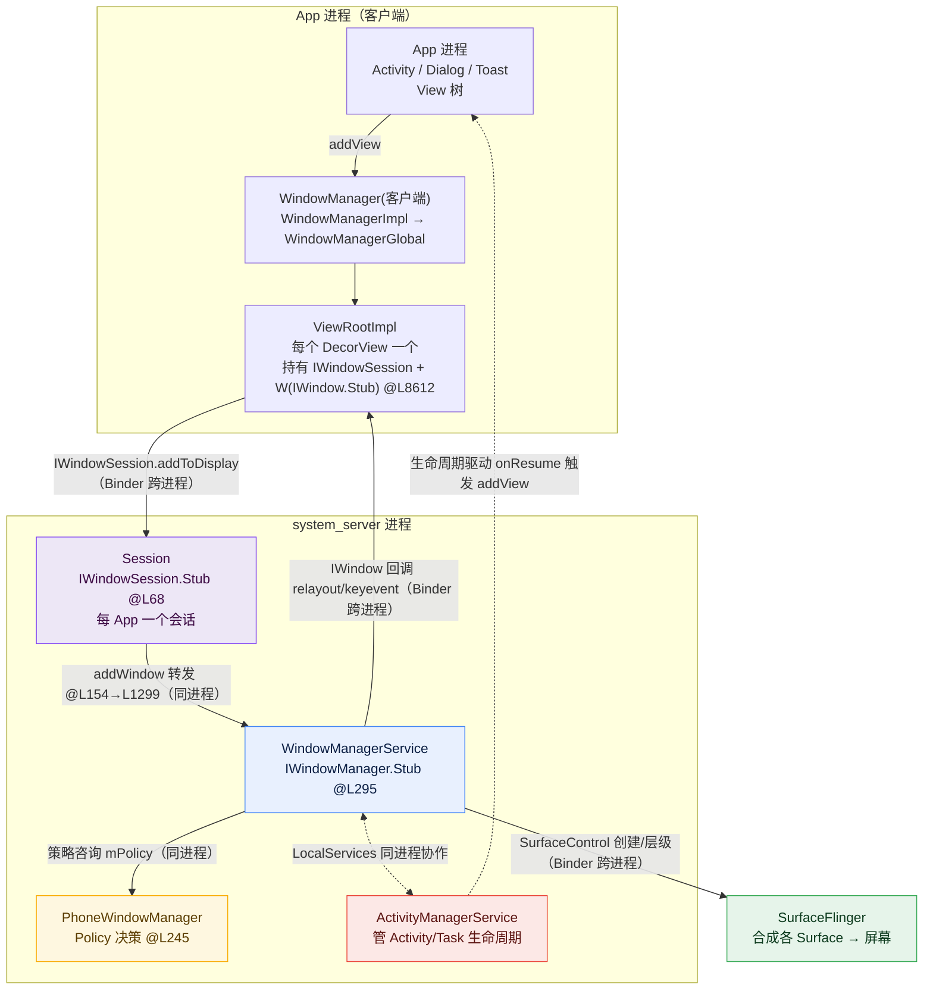
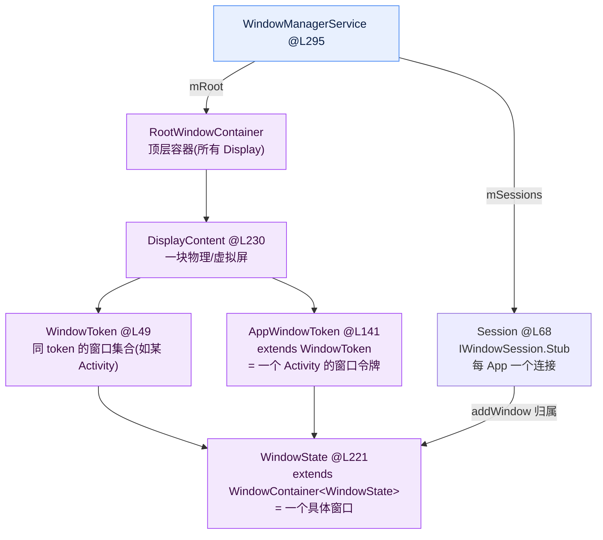
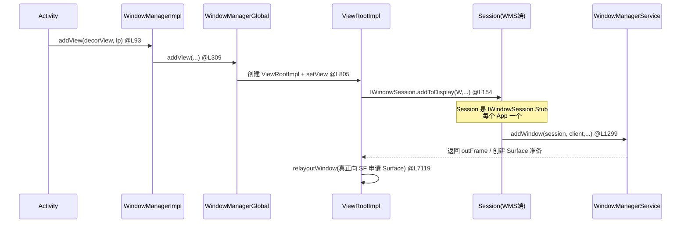

# WMS（WindowManagerService）学习总纲与第一篇：总览与启动

> 分析基线：`cells-android10` 仓内 `android-10.0.0_r33` 完整 `frameworks/base`（服务端 147 个类）
> 文档定位：WMS 系列**唯一权威总览/索引卡**；后续各模块为独立 per-section 文档，本文给出路线与全局关系图
> 约定：行号均来自本仓实测 `grep -n`，可 `Read` 直接复现

---

## 1. 结论前置（先记这 5 条）

1. **WMS 是什么**：`system_server` 进程里管理「窗口」的 system service，负责窗口的**增删、层级（Z-order）、布局、动画、焦点、输入通道、与 SurfaceFlinger 的 Surface 对接**。它**不画像素**，像素由 SurfaceFlinger 合成。
2. **三层职责边界**：`App/View` 只描述「想要什么窗口」→ `WMS` 决定「窗口在哪、多大、谁在上层、能不能接收输入」→ `SurfaceFlinger` 按 WMS 给的层级把各窗口 Surface 合成到屏幕。WMS 是**策略与状态中枢**，不是渲染器。
3. **WMS 与 AMS 强耦合但分工**：AMS 管「Activity/Task 生命周期与栈」，WMS 管「Activity 对应的那个窗口」。一个 Activity 启动后，AMS 安排生命周期，WMS 在 `onResume` 时机由 `ActivityThread` 触发 `addView` 真正把窗口挂上。二者通过 `AppWindowToken`(L141) 与 `ActivityRecord` 双向关联。
4. **Binder 是 WMS 的 IPC 基石**：客户端走 `IWindowSession`（每 App 一个 `Session` L68），服务端回调走 `IWindow`（`ViewRootImpl.W` L8612）。这与前面 binder 系列完全一致——WMS 是 binder 的重度使用者。
5. **Policy 外置**：所有「该不该显示状态栏/导航栏、旋转策略、按键拦截、Keyguard」等**策略决策**委托给 `PhoneWindowManager`(L245)，WMS 持有 `mPolicy`(L485) 调用它，自身不写策略细节。

---

## 2. WMS 学习路线（后续逐节生成，可点单）

| # | 模块 | 核心问题 | 关键类/方法（本仓行号） |
|---|------|---------|------------------------|
| 1 | **总览与启动**（本文） | WMS 在系统里干什么、怎么起来 | `WMS.main` L993 / `initPolicy` L1020 / `systemReady` L4540 |
| 2 | Window 添加全流程 | `addWindow` 怎么校验 token/type/权限、归入哪层 | `WMS.addWindow` L1299 / `Session.addToDisplay` L154 |
| 3 | 窗口层级与 Z-order | 谁盖谁、子父窗口、display 内排序 | `WindowState` L221 / `mBaseLayer` / `DisplayContent` L230 |
| 4 | Layout 与 Relayout | 尺寸怎么算、Surface 何时创建 | `WMS.relayoutWindow` L2050 / `ViewRootImpl.performTraversals` L1989 |
| 5 | Token 体系 | WindowToken/AppWindowToken/ActivityRecord 关系 | `WindowToken` L49 / `AppWindowToken` L141 |
| 6 | 焦点与输入 | 焦点窗口怎么选、输入事件怎么路由 | `InputMonitor` / `setFocusedWindow` |
| 7 | 动画与转场 | App 启动/退出动画、窗口动画 | `AppTransition` / `WindowStateAnimator` |
| 8 | Policy 详解 | 状态栏/导航栏/旋转/Keyguard 决策 | `PhoneWindowManager` L245 |
| 9 | Surface 与 SF 对接 | WMS 怎么把窗口交给 SurfaceFlinger | `SurfaceControl` / `WindowSurfaceController` |
| 10 | 与 AMS 协同 | Activity 启动里 WMS 的介入时机 | `ActivityStack.resumeTopActivity` |
| 11 | 多窗口/分屏/Pip | Android 10 的多窗口形态 | `TaskStack` / `PinnedStackController` |
| 12 | 调试与踩坑 | `dumpsys window`、常见 window ANR | `dumpsys window` / `wm` 命令 |

> 面试导向：模块 2/3/5/6/10 是高频面试题（addWindow 流程、Z-order、token 关系、焦点、AMS-WMS 协同）。

---

## 3. 总览（三张图）

### 3.1 WMS 在 Android 系统中的位置



### 3.2 WMS 内部核心类关系（容器树）



> 关键点：`WindowContainer<E>`(L64) 是整个层级树的泛型基类；`WindowState` 是叶子（具体窗口），`WindowToken`/`AppWindowToken`/`DisplayContent` 是不同粒度的分组容器。这与 Android 10 引入的「容器树」重构一致（取代了早期 `WindowList` 链表）。

### 3.3 一次 addWindow 的客户端→服务端链路（时序）



---

## 4. 分层拆解

### 4.1 启动链路（system_server 内）

WMS 由 `SystemServer` 在 `startOtherServices()` 阶段拉起，时序如下（行号来自本仓 `WindowManagerService.java`）：

| 阶段 | 方法 | 行号 | 职责 |
|------|------|------|------|
| 入口 | `WindowManagerService.main(...)` | L993 / L1010 | 静态工厂，创建 WMS 实例并注册到 ServiceManager（作为 `window` 服务） |
| 构造 | `WindowManagerService(...)` ctor | L1046 | 初始化 `mRoot`(RootWindowContainer)、`mSessions`、`mPolicy`、`WindowHashMap`、Surface 相关、`InputManager` 回调 |
| Policy 绑定 | `initPolicy()` | L1020 | 在 `WindowManagerPolicyThread` 上调用 `mPolicy.init(...)`，把 WMS 自身作为 `WindowManagerFuncs` 注入 Policy |
| 显示就绪 | `displayReady()` | L4517 | 初始化 DisplayContent、DisplayMetrics、壁纸、Rotation 策略 |
| 系统就绪 | `systemReady()` | L4540 | 通知 Policy `systemReady`、启动观察器、允许后续窗口操作 |

> `mPolicy` 在 ctor 处 `mPolicy = policy`(L1088)，并经 `LocalServices.addService(WindowManagerPolicy.class, mPolicy)`(L1100) 暴露给 AMS 等其它 service 复用——这是 WMS 与 Policy 解耦的关键注入点。

### 4.2 客户端添加窗口链路（App 侧）

1. `WindowManagerImpl.addView`(L93) → 委托 `WindowManagerGlobal.getInstance().addView`(L309)。
2. `WindowManagerGlobal` 在 `getWindowSession()`(L197) 时通过 `IWindowManager` 向 WMS 打开一个 `IWindowSession`（即服务端的 `Session`），缓存到 `mWindowSession`。
3. `ViewRootImpl` 构造时持有 `mWindowSession`(L313) 与 `mWindow = new W(this)`（L329，`W extends IWindow.Stub` L8612，作为 WMS 回调 App 的 Binder 端点）。
4. `ViewRootImpl.setView`(L805) → `requestLayout()` + `mWindowSession.addToDisplay(...)`。
5. `Session.addToDisplay`(L154) 直接转发 `mService.addWindow(this, window, ...)`(L1299)。
6. `WMS.addWindow` 完成窗口注册、层级分配、Surface 占位；后续 `ViewRootImpl.relayoutWindow`(L7119) 真正向 SurfaceFlinger 申请图形缓冲。

> 三对 Binder 接口需牢记：
> - `IWindowManager`：App→WMS 的**全局**接口（getService("window") 拿到）。
> - `IWindowSession`：App→WMS 的**每进程会话**接口（Session，轻量、按 UID 隔离）。
> - `IWindow`：WMS→App 的**每窗口回调**接口（ViewRootImpl.W，用于 relayout 完成、按键、焦点变更通知）。

### 4.3 服务端核心类角色

| 类 | 文件 | 行号 | 角色 |
|----|------|------|------|
| `WindowManagerService` | `services/core/java/com/android/server/wm/WindowManagerService.java` | L295 | 总控：add/remove/relayout、焦点、层级、动画、Policy 调用 |
| `Session` | 同目录 `Session.java` | L68 | 每 App 一个，代理其所有窗口与 WMS 交互；DeathRecipient 负责 App 死时清理 |
| `WindowState` | `WindowState.java` | L221 | 一个窗口的运行时状态（尺寸、层级、Surface、可见性、动画） |
| `WindowToken` | `WindowToken.java` | L49 | 一组相关窗口的令牌（如输入法、壁纸、某 Activity） |
| `AppWindowToken` | `AppWindowToken.java` | L141 | 一个 Activity 的窗口令牌，`extends WindowToken`，与 `ActivityRecord` 绑定 |
| `DisplayContent` | `DisplayContent.java` | L230 | 一块显示屏上所有窗口的容器 |
| `RootWindowContainer` | `RootWindowContainer.java` | — | 所有 DisplayContent 的顶层容器（WMS.mRoot） |
| `WindowContainer<E>` | `WindowContainer.java` | L64 | 容器树泛型基类（Android 10 重构核心） |
| `PhoneWindowManager` | `policy/PhoneWindowManager.java` | L245 | 策略实现，被 WMS 通过 `mPolicy` 调用 |

---

## 5. 速查表（类 → 文件 → 行号 → 角色）

| 类 / 接口 | 文件（相对 `frameworks/base`） | 行号 | 角色 |
|-----------|-------------------------------|------|------|
| `WindowManagerService` | `services/core/java/com/android/server/wm/WindowManagerService.java` | L295 / main L993 / addWindow L1299 / relayoutWindow L2050 / systemReady L4540 | 窗口总控 |
| `Session` | `.../wm/Session.java` | L68 / addToDisplay L154 | 每 App 会话 |
| `WindowState` | `.../wm/WindowState.java` | L221 | 单窗口状态 |
| `WindowToken` | `.../wm/WindowToken.java` | L49 | 窗口分组令牌 |
| `AppWindowToken` | `.../wm/AppWindowToken.java` | L141 | Activity 窗口令牌 |
| `DisplayContent` | `.../wm/DisplayContent.java` | L230 | 屏内窗口容器 |
| `WindowContainer` | `.../wm/WindowContainer.java` | L64 | 容器树基类 |
| `PhoneWindowManager` | `services/core/java/com/android/server/policy/PhoneWindowManager.java` | L245 | 策略实现 |
| `WindowManagerImpl` | `core/java/android/view/WindowManagerImpl.java` | addView L93 | 客户端入口 |
| `WindowManagerGlobal` | `core/java/android/view/WindowManagerGlobal.java` | getInstance L168 / addView L309 / getWindowSession L197 | 进程单例 |
| `ViewRootImpl` | `core/java/android/view/ViewRootImpl.java` | setView L805 / performTraversals L1989 / relayoutWindow L7119 / W L8612 | 视图根 + 双端 Binder |
| `IWindowSession` / `IWindow` | `core/java/android/view/IWindowSession.aidl` / `IWindow.aidl` | — | IPC 接口定义 |

---

## 6. 调试验证

```bash
# 系统运行时（需完整镜像，本仓缺 build/ 无法本地整编验证）
adb shell dumpsys window         # 全量窗口状态（tokens / windows / displays）
adb shell dumpsys window windows # 只看 WindowState 列表（含 z-order、可见性）
adb shell dumpsys window tokens  # 看 WindowToken / AppWindowToken 树
adb shell wm size                # 当前分辨率
adb shell wm density             # 当前 DPI
adb shell service list | grep window  # 确认 window 服务已注册（= WMS IBinder）
```

> 源码级复现（本仓可直接做）：`Read frameworks/base/services/core/java/com/android/server/wm/WindowManagerService.java` 从 L993 起读 main→ctor→initPolicy→addWindow，对照本文行号逐行核对。

---

## 7. 踩坑清单（WMS 高频误解）

1. **WMS 不画像素**：它只管理窗口状态与层级，最终合成由 SurfaceFlinger 完成（常见误以为 WMS 负责渲染）。
2. **`addWindow` 不等于「显示出来」**：addWindow 只是登记窗口与分配层级；真正能看到画面要等 `relayoutWindow` 向 SurfaceFlinger 申请到 Surface 并完成 `performTraversals` 绘制。
3. **`Session` 是每 App 一个，不是每窗口**：同一 App 的所有窗口共享一个 Session；每窗口的回调端点是 `IWindow`(ViewRootImpl.W)。
4. **`AppWindowToken` 不是 `WindowToken` 的兄弟而是子类**：一个 Activity 对应一个 AWT，AWT 是其所属 DisplayContent 下的一棵子树。
5. **Policy 不是 WMS 内部类**：`PhoneWindowManager` 独立实现 `WindowManagerPolicy` 接口，WMS 通过 `mPolicy` 调用——改状态栏/导航栏行为应去 Policy 而非 WMS。
6. **Android 10 已是「容器树」模型**：`WindowContainer` 泛型基类取代了旧版 `WindowList` 链表，分析层级遍历要先理解 `WindowContainer<E>`(L64)。
7. **WMS 与 AMS 跨进程协作但有本地快捷通道**：同处 `system_server`，大量调用是直接 Java 方法而非 Binder（如 `LocalServices.getService(WindowManagerInternal.class)`），调试时不要只找 Binder 调用。

---

## 8. 下一步（点单式）

告诉我从哪个模块继续，我直接落地对应的 per-section 文档（带本仓实测行号 + 图）：

- **最推荐起手**：模块 2「Window 添加全流程」（`addWindow` L1299 逐段拆解：token 校验 → type 分类 → 权限检查 → 创建 WindowState → 归入 DisplayContent/Token → z-order 计算）。这是理解后续一切的基础，也是面试高频。
- 或模块 5「Token 体系」（理清 WindowToken / AppWindowToken / ActivityRecord 三者关系，是 WMS 心智模型的核心）。
- 或模块 3「窗口层级与 Z-order」（搞清谁盖谁）。

> 本文与 `doc/binder_全景分析_Android10.md` 是前置关系：WMS 所有跨进程调用都建立在 binder 机制之上，建议先读 binder 系列再深入 WMS。
