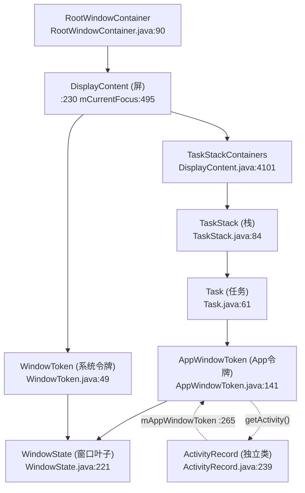
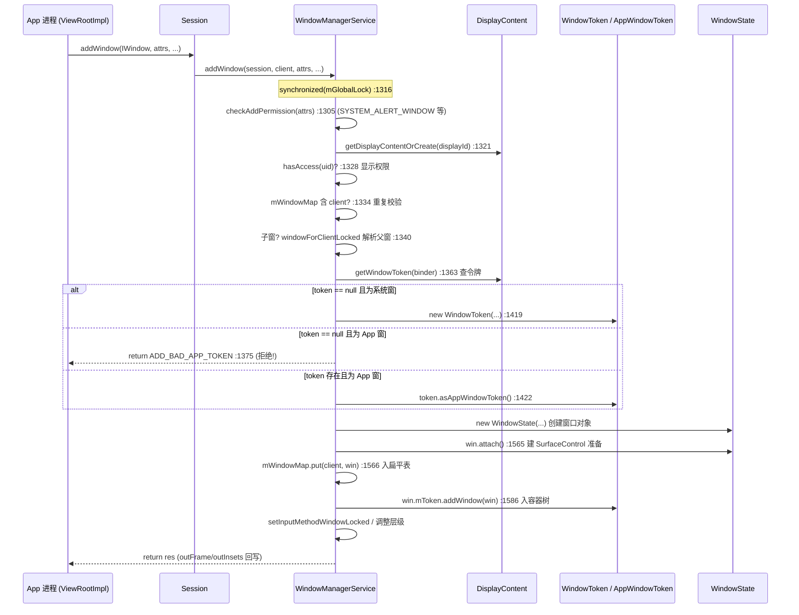
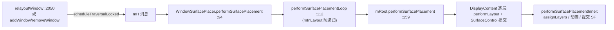
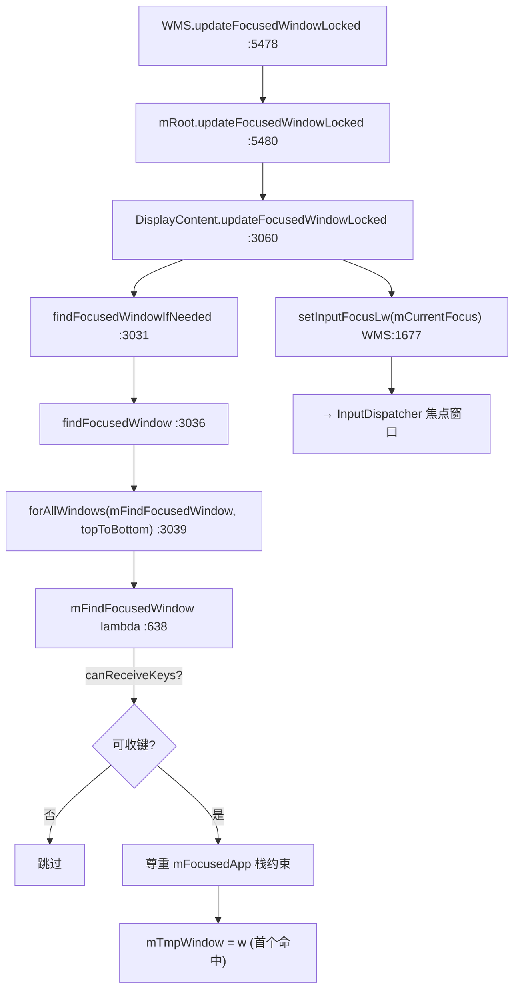

# WMS 核心分析（Android 10 / android-10.0.0_r33）

> 本仓：`C:/D/android_project/cells-android10`，基线 `android-10.0.0_r33`（Columbia Cells 树，kernel 4.9.200）。
> 全部行号基于本仓实测；与既有 WMS 文档分工见文末 §7。

---

## 1. 结论前置（5 条核心）

1. **WMS 内部有「两套数据模型并存」**：一棵层级 `WindowContainer` 树（`mRoot`）负责**结构/层级/Z 序/动画**，一张扁平 `mWindowMap`（`IWindow` Binder → `WindowState`）负责 **O(1) 按客户端句柄检索**。两结构同一批 `WindowState` 对象，互为索引——这是看懂 WMS 的头号前提。
2. **Android 10 的窗口容器树是 `RootWindowContainer → DisplayContent → TaskStackContainers → TaskStack → Task → AppWindowToken → WindowState`**。`WindowToken`（非 App 令牌，IME/壁纸等）与 `AppWindowToken` 同级挂在 `DisplayContent` 下；`AppWindowToken` 之下才是 `WindowState` 叶子。
3. **`ActivityRecord` 与 `AppWindowToken` 在 Android 10 仍是两个独立类**（分别在 `ActivityRecord.java:239` / `AppWindowToken.java:141`），靠 `ActivityRecord.mAppWindowToken`（`:265`）+ `AppWindowToken.getActivity()` 双向引用。**Android 11+ 才合并**，dumpsys 直接打 `ActivityRecord{}`——这是本仓真机分析里反复踩的版本坑。
4. **`addWindow` 不是简单建对象**：它先做权限/显示/重复/子窗/token 五重校验，再 `new WindowToken`（系统窗）或复用既有 `AppWindowToken`（App 窗），最后 `attach()` + `mWindowMap.put` + `token.addWindow` 入树。token 不存在的 App 窗直接 `ADD_BAD_APP_TOKEN` 拒绝。
5. **焦点与布局都收敛到两把锁 + 一个主线程**：全程 `synchronized (mGlobalLock)`（WMS `:510` 的 `WindowManagerGlobalLock`，Android 10 仍是**单把粗粒度全局锁**）；焦点结果经 `setInputFocusLw`（WMS `:1677`）喂给 `InputDispatcher`，与「输入事件处理流程」文档闭环。

---

## 2. 总览：WMS 在系统中的位置与内部双结构

`WindowManagerService extends IWindowManager.Stub`（WMS `:295`）—— 跑在 **system_server** 的 Binder 服务端，与 AMS（`ActivityManagerService`）同进程、与 SurfaceFlinger/InputDispatcher 跨进程协作。

### 2.1 双数据模型（WMS 设计精髓）

```
            ┌──────────────────────────────────────────────┐
            │   WindowManagerService (system_server)         │
            │                                               │
            │   mWindowMap  (WindowHashMap, 扁平 O(1))       │  ← IWindow.asBinder() → WindowState
            │     L507  key=IWindow Binder, value=WindowState│
            │   mSessions  (ArraySet<Session>)  L504         │  ← 每个 App 进程一个 Session
            │   mRoot     (RootWindowContainer)  L603/L1090  │  ← 层级树根
            └──────────────────────────────────────────────┘
                     │                            │
        mWindowMap 查客户端句柄              mRoot 遍历层级/Z序/动画
                     │                            │
                     ▼                            ▼
              WindowState 对象 ◀──────同一个对象──────▶ 挂在 WindowContainer 树里
```

**为什么两套？**
- `mWindowMap`：Binder 调用 `addWindow/relayoutWindow/removeWindow` 拿的是 `IWindow` 客户端句柄，必须 O(1) 反查 `WindowState`，扁平 map 最合适。
- `mRoot` 树：要计算 Z 序、`performLayout`、动画、焦点（top-to-bottom 遍历），必须有序容器层次——`WindowContainer` 树的 `mChildren` 列表天然有序。

### 2.2 锁与线程模型（Android 10 特征）

- 锁：`final WindowManagerGlobalLock mGlobalLock`（WMS `:510`）。**Android 10 仍是单把全局锁**，所有窗口操作 `synchronized (mGlobalLock)`（addWindow `:1316`、removeWindow `:1824`、relayout `:2050` 入参处等）。对比 Android 12+ 拆成 `mGlobalLock` + 多个细粒度锁，本仓不要套新版本的行号。
- 线程：WMS 主逻辑跑在 system_server 的 `android.display`/`android.anim` 等线程 + `mH`（Handler）。`requestTraversal`/`performSurfacePlacement` 通过 `mH` 消息驱动，避免重入（`performSurfacePlacementLoop` `:112` 有 `mInLayout` 递归保护）。

---

## 3. 分层拆解 A：WindowContainer 容器树（核心架构）

### 3.1 继承层次（实测行号）

| 类 | 文件:行 | extends | 泛型 E（子类型） | 角色 |
|---|---|---|---|---|
| `ConfigurationContainer<E>` | — | — | — | 配置（config/语言/旋转）基类 |
| `WindowContainer<E>` | `WindowContainer.java:64` | `ConfigurationContainer<E>` | 任意 | 容器树节点基类，带 `mChildren` 有序列表 |
| `RootWindowContainer` | `RootWindowContainer.java:90` | `WindowContainer<DisplayContent>` | `DisplayContent` | 树根，持有所有 Display |
| `DisplayContent` | `DisplayContent.java:230` | `WindowContainer<DisplayChildWindowContainer>` | 显示子容器 | 一块屏的所有窗口 + TaskStack |
| `TaskStackContainers` | `DisplayContent.java:4101` | `DisplayChildWindowContainer<TaskStack>` | `TaskStack` | Display 下的栈容器（分屏/多栈） |
| `TaskStack` | `TaskStack.java:84` | `WindowContainer<Task>` | `Task` | 一个栈（如 freeform/stackId） |
| `Task` | `Task.java:61` | `WindowContainer<AppWindowToken>` | `AppWindowToken` | 一个任务（TaskRecord 的窗口侧） |
| `AppWindowToken` | `AppWindowToken.java:141` | `WindowToken` | `WindowState` | **App 窗口令牌**（Activity 的窗口集合） |
| `WindowToken` | `WindowToken.java:49` | `WindowContainer<WindowState>` | `WindowState` | 非 App 令牌（IME/壁纸/Toast 等） |
| `WindowState` | `WindowState.java:221` | `WindowContainer<WindowState>` | 自身（叶子） | **单个窗口**实例，树的叶子 |
| `ActivityRecord` | `ActivityRecord.java:239` | `ConfigurationContainer` | — | **独立类**，AMS 侧 Activity 记录，链接 AWT |

> **版本注意（必读）**：Android 10 中 `WindowState` 叶子挂在 `WindowToken`（含 `AppWindowToken`）之下；`ActivityRecord`（AMS 概念）与 `AppWindowToken`（WMS 概念）是**两个独立类**，靠 `ActivityRecord.mAppWindowToken`（`:265`）+ `AppWindowToken` 反查 `ActivityRecord` 双向链接。Android 11 把 `AppWindowToken` 合并进 `ActivityRecord`，dumpsys 直接显示 `ActivityRecord{}`——本仓真机 PDA 曾是 Android 11+，才出现 `ActivityRecord` 直打的现象。

### 3.2 树结构图



### 3.3 WindowState 关键成员（与树/令牌的关系）

`WindowState.java` 实测：
- `final Session mSession`（`:239`）—— 拥有它的 App 进程会话（见 `WMS_Session与窗口令牌体系`）。
- `final int mOwnerUid`（`:243`）—— 窗口归属 UID。
- `WindowToken mToken`（`:247`）—— 直接父令牌（系统窗为 `WindowToken`，App 窗为 `AppWindowToken`）。
- `AppWindowToken mAppToken`（`:249`）—— 若为 App 窗则非空（`:743` `mAppToken = mToken.asAppWindowToken()`）。
- `final WindowManager.LayoutParams mAttrs`（`:253`）—— 窗口布局参数（type/flags/Token 等）。

---

## 4. 分层拆解 B：四大核心类职责

| 类 | 关键字段 / 方法（实测行号） | 职责 |
|---|---|---|
| `WindowManagerService` | `mGlobalLock:510`、`mWindowMap:507`、`mSessions:504`、`mRoot:603/1090`、`mPolicy`（PhoneWindowManager）、`addWindow:1299`、`relayoutWindow:2050`、`removeWindow:1831`、`updateFocusedWindowLocked:5478`、`requestTraversal:5465` | 窗口系统总入口/Binder 服务端；装配树、校验、调度合成 |
| `Session` | 每个 App 进程一个；`addWindow`/`relayout` 经 `Session` 入口到 WMS（见令牌体系文档） | App 进程在 WMS 的会话代理，权限/uid 隔离 |
| `WindowState` | 见 §3.3；`attach:1565`、`mToken.addWindow:1586` | 单窗口的全部状态：attrs、frame、SurfaceControl、焦点资格 |
| `WindowToken` / `AppWindowToken` | `WindowToken:49`、`AppWindowToken:141`、`asAppWindowToken()`、`windowsAreFocusable()` | 令牌 = 一组相关窗口的策略/层级单元；App 令牌绑定 Activity |

---

## 5. 核心流程拆解

### 5.1 流程一：`addWindow` 全流程（WMS `:1299`）

`Session.addWindow` → `WindowManagerService.addWindow(session, client, seq, attrs, ...)`。全程 `synchronized (mGlobalLock)`（`:1316`）。



**关键校验顺序（面试高频）**：
1. `checkAddPermission`（`:1305`）—— 悬浮窗等权限门禁。
2. 显示就绪 + 访问权限（`:1317`、`:1328`）。
3. 重复添加（`:1334` `ADD_DUPLICATE_ADD`）。
4. 子窗必须挂到合法父窗（`:1339-1352`）。
5. **token 解析是核心分支**（`:1363`）：
   - 系统窗（IME/壁纸/Toast 等）token 为 null → 自动 `new WindowToken`（`:1419`）。
   - **App 窗 token 为 null → 直接 `ADD_BAD_APP_TOKEN` 拒绝**（`:1375`）——因为 App 窗必须由 AMS 先 `addAppToken` 建好 `AppWindowToken`。
   - App 窗 token 存在但类型不匹配 → `ADD_NOT_APP_TOKEN`（`:1426`）。

### 5.2 流程二：`relayoutWindow` + 合成编排（WMS `:2050`）

`relayoutWindow`（`:2050`）是 App 请求"重新布局/创建 Surface"的入口：更新 `WindowState.mAttrs`、计算 `outFrame/outInsets`、创建或更新 `SurfaceControl`（`winAnimator`/`createSurfaceLocked`），最后 `scheduleTraversalLocked` 触发整树重排。

合成（真正出图）由 `WindowSurfacePlacer` 驱动：



- 入口：`performSurfacePlacement()`（`:94`）→ `performSurfacePlacementLoop`（`:112`）。
- **最多 6 轮布局**（`:102` `loopCount = 6`）：若 `mRoot.isLayoutNeeded()` 仍为真，再 `requestTraversal`（`:165`），超过 6 轮打 log 跳出不死循环（`:167`）。
- 真正干活：`mService.mRoot.performSurfacePlacement(recoveringMemory)`（`:159`）→ 各 `DisplayContent` 做 `performLayout` + 把 `SurfaceControl` 事务提交给 SurfaceFlinger（衔接 `SurfaceFlinger_总览与启动` 文档）。

### 5.3 流程三：焦点计算（与 InputDispatcher 闭环）

入口 `updateFocusedWindowLocked(mode, updateInputWindows)`（WMS `:5478`）→ `mRoot.updateFocusedWindowLocked`（`:5480`）→ `DisplayContent.updateFocusedWindowLocked`（DisplayContent `:3060`）。



**焦点算法核心 `mFindFocusedWindow`**（DisplayContent `:638`，top-to-bottom 遍历）：
1. `w.canReceiveKeys()`（`:643`）—— 必须可见 + 非 `FLAG_NOT_FOCUSABLE` + 未被冻结，否则跳过。
2. 跳过 `removed` / `sendingToBottom` 的 App 令牌（`:651`）。
3. 若存在 `mFocusedApp`（当前前台 Activity 的 AWT），只有**该 App 栈之上或之内**的窗口可夺焦（`:676` `focusedApp.compareTo(wtoken) > 0` 则拒绝）—— 这是"后台 App 窗口不抢焦点"的实现。

**焦点结果外溢**：`DisplayContent.updateFocusedWindowLocked` 在焦点变化时 `setInputFocusLw(displayContent.mCurrentFocus, ...)`（WMS `:1677`），把焦点窗口喂给 `InputDispatcher` 的 `InputMonitor`—— 这正是「输入事件处理流程」文档里 `findFocusedWindowTargetsLocked` 取焦点的来源。**WMS 管"谁该有焦点"，InputDispatcher 管"事件发谁"**，二者靠 `mCurrentFocus`（DisplayContent `:495`）衔接。

---

## 6. 速查表：核心方法与字段行号

### 6.1 WMS 主类（system_server Binder 服务端）

| 项 | 行号 | 说明 |
|---|---|---|
| `class WindowManagerService extends IWindowManager.Stub` | `:295` | Binder 服务端 |
| `final WindowManagerGlobalLock mGlobalLock` | `:510` | **单把全局锁（Android 10 粗粒度）** |
| `final ArraySet<Session> mSessions` | `:504` | 每 App 进程一个 Session |
| `final WindowHashMap mWindowMap` | `:507` | `IWindow` Binder → `WindowState` 扁平索引 |
| `RootWindowContainer mRoot` | `:603` / `:1090` | 容器树根 |
| `addWindow(...)` | `:1299` | 加窗入口（§5.1） |
| `relayoutWindow(...)` | `:2050` | 重布局/建 Surface |
| `removeWindow(...)` | `:1831` | 移除窗口 |
| `updateFocusedWindowLocked(...)` | `:5478` | 焦点更新入口 |
| `requestTraversal()` | `:5465` | 触发整树重排 |
| `setInputFocusLw(mCurrentFocus)` | `:1677` | 焦点外溢给 InputDispatcher |

### 6.2 容器树关键行号

| 类 | 声明行 | 子类型 |
|---|---|---|
| `WindowContainer<E>` | `:64` | 基类，带 `mChildren` |
| `RootWindowContainer` | `:90` | `<DisplayContent>` |
| `DisplayContent` | `:230` | `mCurrentFocus:495` |
| `TaskStackContainers` | `:4101` | `<TaskStack>` |
| `TaskStack` | `:84` | `<Task>` |
| `Task` | `:61` | `<AppWindowToken>` |
| `AppWindowToken` | `:141` | extends `WindowToken`，`<WindowState>` |
| `WindowToken` | `:49` | `<WindowState>` |
| `WindowState` | `:221` | 叶子 |
| `ActivityRecord` | `:239` | 独立类，`mAppWindowToken:265` |

---

## 7. 调试与验证

### 7.1 常用命令
- `dumpsys window windows` / `dumpsys window tokens` —— 看完整容器树（呼应 `WMS_dumpsys_window_tokens_分析.md`）。
- `dumpsys window visible` —— 当前可见窗口。
- `dumpsys window focused-window` / `dumpsys input` —— 核对 WMS 焦点与 InputDispatcher 焦点是否一致（§5.3 闭环验证）。
- `adb shell wm size` / `wm density` —— 显示配置。

### 7.2 logcat 锚点（grep 这些字符串）
- `"Attempted to add window ... Aborting"` —— addWindow 校验失败（§5.1 各 `ADD_*` 分支）。
- `"Changing focus from"`（DisplayContent `:3088`）—— 焦点切换日志（`DEBUG_FOCUS_LIGHT`）。
- `"Looking for focus:"`（`:641`）—— 焦点遍历逐窗判定（`DEBUG_FOCUS`）。
- `"Performed 6 layouts in a row. Skipping"`（`:167`）—— 布局抖动/死循环保护触发。

---

## 8. 踩坑清单（8 条）

1. **双结构不是冗余**：`mWindowMap` 管"按句柄查"，`mRoot` 树管"按层级算"。改 WMS 时两个都得同步维护，否则出现"窗口存在却遍历不到"或"遍历到却查不到"。
2. **App 窗必须有 AMS 预建的 AppWindowToken**：`addWindow` 对 token 为 null 的 App 窗直接 `ADD_BAD_APP_TOKEN`（`:1375`）。常见崩溃根因是 Activity 还没 `addAppToken` 就 `addView`。
3. **`ActivityRecord` ≠ `AppWindowToken`（Android 10）**：前者在 AMS、后者在 WMS，本仓靠 `mAppWindowToken:265` 双向链接。dumpsys 看到 `ActivityRecord{}` 直打说明**设备其实是 Android 11+**，别用 android-10 行号去对。
4. **Android 10 是单全局锁 `mGlobalLock`**：所有窗口操作串行。线上卡顿若堆栈在 `synchronized (mGlobalLock)` 上，问题在别的持锁长操作（如某 App 的 `relayout` 阻塞），不是 WMS 自身。
5. **焦点 ≠ Z 序最上**：焦点算法（`:638`）要求 `canReceiveKeys()`（可见 + 可聚焦），被 `FLAG_NOT_FOCUSABLE` 或不可见的顶层窗不会抢焦点；且受 `mFocusedApp` 栈约束（`:676`）。排查"点不动"先查焦点而非 Z 序。
6. **焦点是 InputDispatcher 的输入**：WMS 算完焦点经 `setInputFocusLw`（`:1677`）推给 InputDispatcher。二者不一致时优先查 WMS 焦点是否真的 `canReceiveKeys`，而非 InputDispatcher 派发逻辑。
7. **布局最多 6 轮**：`performSurfacePlacement` 的 `loopCount=6`（`:102`）防布局死循环；若频繁触发 `:167` 日志，说明某窗口 `isLayoutNeeded` 永远清不掉（典型是 `FLAG_LAYOUT_IN_SCREEN` 与 `requestLayout` 互相触发）。
8. **`addWindow` 在 `mGlobalLock` 内创建 `WindowState`/`WindowToken`**：这些对象的构造会触碰 `SurfaceControl`（经 `win.attach()` `:1565`），若底层 SF 未就绪会抛异常——开机早期 `mDisplayReady=false`（`:1317`）直接 IllegalStateException，属正常保护。

---

## 9. 与既有 WMS 文档的分工

| 文档 | 边界 | 本文角色 |
|---|---|---|
| `WMS_总览与启动_Android10.md` | 系统位置 + 启动链（main → WMS.start → Policy 初始化） | **本文互补**：启动后内部架构与核心机制 |
| `WMS_Session与窗口令牌体系_Android10.md` | Session/WindowState/WindowToken/AppWindowToken 四元组字段表 | **本文互补**：把四元组放大进整棵 `WindowContainer` 树 + addWindow/relayout/焦点流程 |
| `WMS_dumpsys_window_tokens_分析.md` | 真机 `dumpsys window tokens` 输出逐令牌解读 | **本文互补**：dumpsys 看到的树正是 §3.2 这棵 |

> 本文聚焦「WMS 单体内部机制」，与 InputDispatcher/SurfaceFlinger/IMS 的交叉点在 §5.2（→SF 合成）、§5.3（→InputDispatcher 焦点）、`IMS_显示软键盘全流程`（IME 窗口 `TYPE_INPUT_METHOD` 经 `addWindow` `:1587` `setInputMethodWindowLocked` 入树）形成闭环。
