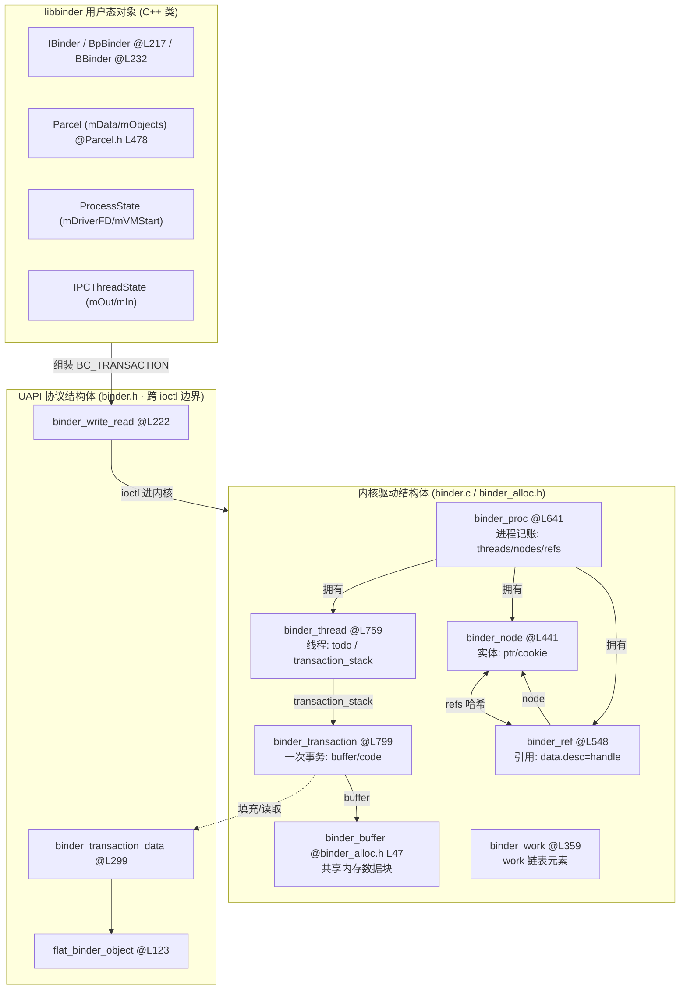
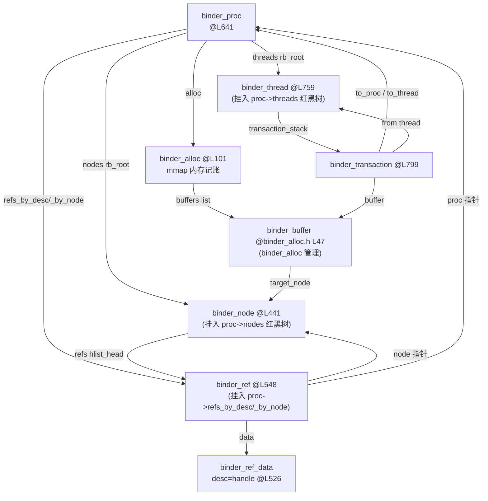
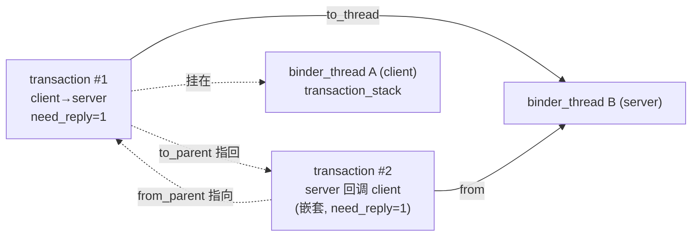
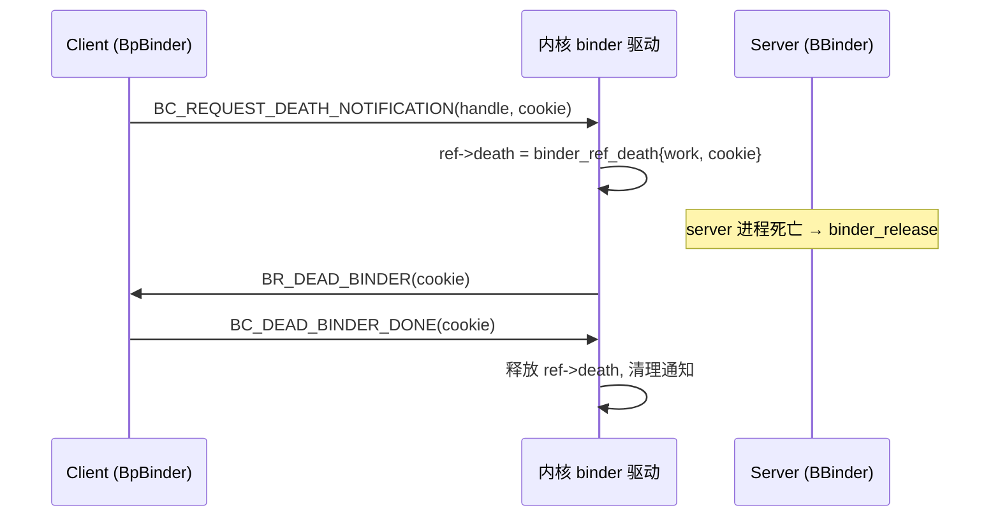

# Binder 数据结构（Android 10 / 本仓实测）

> 基线：`android-10.0.0_r33`；内核 `kernel/drivers/android/binder.c`（4.9.200）、`binder_alloc.h`、`kernel/include/uapi/linux/android/binder.h`；用户态 `frameworks/native/libs/binder/`
> 分析日期：2026-10-15 | 结构体定义行号全部 `grep`/`Read` 实测
> 配套：`binder_source_analysis_Android10.md`（三层端到端）、`binder_kernel_vs_servicemanager_Android10.md`（内核 vs 黄页）、`libbinder_role_Android10.md`（封装库作用）

---

## 1. 结论前置

1. **Binder 通信的本质 = 一套内核记账结构体 + 跨 `ioctl` 边界的协议结构体 + 用户态的面向对象镜像**。三者不是孤立的，而是"同一份事实"的三个视图：
   - **内核驱动结构体**：`binder_proc` / `binder_thread` / `binder_node` / `binder_ref` / `binder_buffer` / `binder_transaction`，全部定义在 `binder.c`（4.9.200），是驱动内部记账。
   - **UAPI 协议结构体**：`binder_write_read` / `binder_transaction_data` / `flat_binder_object` 等，定义在 `binder.h`（uapi），是**用户态与内核共享、真正跨 `ioctl(BINDER_WRITE_READ)` 边界**的数据。
   - **libbinder 用户态对象**：`IBinder` / `BpBinder` / `BBinder` / `Parcel` / `ProcessState` / `IPCThreadState`，是对内核结构体的 C++ 封装。
2. **核心关系链（一句说清）**：`binder_proc`（进程）拥有四类东西——`binder_thread`（线程池）、`binder_node`（本进程**提供**的实体）、`binder_ref`（对**别人** node 的引用，用户态叫 `handle`）、`binder_alloc` 管理的 `binder_buffer`（mmap 共享内存）。**一次事务 = 一个 `binder_transaction` 把源 proc 的 buffer 映射到目标 proc 的 buffer，并通过 `binder_ref.desc`（handle）→ `binder_ref.node`（`binder_node`）找到接收方**。
3. **`handle` 是「进程内」局部编号，不是全局唯一**：`binder_ref_data.desc`（`binder.c:526`）是 per-proc 的；同一远端实体在 A 进程是 handle 1，在 B 进程可能是 handle 5。内核靠 `refs_by_desc`（`binder.c:657`）红黑树做本地查找。
4. **`flat_binder_object` 是「会变形的对象」**：sender 端它是 `binder`（本地实体指针），过内核时被改写成 `handle`（引用），到 receiver 端再按本进程 `refs_by_node` 落成一个新的本地 handle——这就是 Android「能在 IPC 里传 Binder 对象」的秘密。

---

## 2. 总览

### 2.1 三层数据结构全景



### 2.2 内核核心结构体关系（以 `binder_proc` 为中心）



---

## 3. 分层拆解（字段级）

### 3.1 内核驱动结构体（`kernel/drivers/android/binder.c`）

#### binder_proc —— 进程记账（L641）
每个打开 `/dev/binder` 的进程一个，挂在全局 `binder_procs` 链表上。

| 字段 | 行号 | 说明 |
|---|---|---|
| `proc_node` (hlist_node) | L645 | 挂入全局 `binder_procs` 链表 |
| `threads` (rb_root) | L649 | 本进程所有 binder 线程，**红黑树**（按 pid） |
| `nodes` (rb_root) | L653 | 本进程提供的所有 **实体** node，**红黑树**（按 `node->ptr`） |
| `refs_by_desc` (rb_root) | L657 | 本进程所有 **引用** ref，**按 handle（desc）** 查 |
| `refs_by_node` (rb_root) | L661 | 同上 ref，**按 node** 查（双向查找用） |
| `waiting_threads` (list_head) | L665 | 当前空闲等活的线程链表 |
| `pid` / `tsk` | L669 / L673 | 进程 pid、group_leader 的 task_struct |
| `todo` (list_head) | L686 | **进程级待处理 work 队列**（线程没活时从这里取） |
| `max_threads` / `requested_threads` | L692 / L693 | 线程池上限（对应 libbinder `BINDER_SET_MAX_THREADS`） |
| `alloc` (binder_alloc) | L701 | 共享内存分配器（见 §3.1.6） |
| `context` (binder_context*) | L705 | 指向 context manager 信息（servicemanager 的 node） |
| `acontext[MAX_CONTEXT]` | L707 | **本仓改造**（CONFIG_DRV_NS）：多 context manager 支持 |

> **理解关键**：`nodes` 是本进程"我能服务谁"，`refs_by_*` 是"我要调谁"。一个进程既是服务端（有 node）又是客户端（有 ref）。

#### binder_thread —— 线程记账（L759）
每个调用 `ioctl` 的线程一个，挂入 `proc->threads`。

| 字段 | 行号 | 说明 |
|---|---|---|
| `proc` (binder_proc*) | L763 | 所属进程 |
| `rb_node` | L767 | 挂入 `proc->threads` |
| `pid` | L775 | 线程 tid |
| `looper` | L776 | 循环状态位图（`BINDER_LOOPER_STATE_*` @L713） |
| `transaction_stack` (binder_transaction*) | L781 | 该线程**正在处理**的事务栈（嵌套调用用） |
| `todo` (list_head) | L785 | **线程级**待处理 work（优先于 proc->todo） |
| `return_error` / `reply_error` | L787 / L788 | 错误回报 |

#### binder_node —— 实体（本进程提供的 Binder 对象）（L441）
对应一个 `BBinder`（用户态），`ptr` 就是 `BBinder` 地址，`cookie` 是业务对象。

| 字段 | 行号 | 说明 |
|---|---|---|
| `rb_node` / `dead_node` (union) | L452 / L456 | 活着挂 `proc->nodes`；死了挂全局 `binder_dead_nodes` |
| `proc` (binder_proc*) | L458 | 拥有它的进程 |
| `refs` (hlist_head) | L462 | 指向本 node 的**所有 ref**（即所有客户端） |
| `internal_strong_refs` / `local_weak_refs` / `local_strong_refs` / `tmp_refs` | L463-466 | 强弱引用计数 |
| `ptr` (binder_uintptr_t) | L467 | **用户态实体指针**（= `BBinder*` 地址，跨进程不变） |
| `cookie` (binder_uintptr_t) | L471 | 用户态 cookie（= 业务对象指针） |
| `has_strong_ref` / `pending_strong_ref` / `has_weak_ref` / `pending_weak_ref`（位域） | L477-480 | 引用通知状态机 |
| `sched_policy` / `inherit_rt` / `accept_fds` / `txn_security_ctx` / `min_priority`（位域） | L486-490 | 事务调度/安全属性 |
| `async_todo` (list_head) | L499 | 异步事务队列 |

#### binder_ref —— 引用（客户端手里的"远端句柄"）（L548）
用户态看到的 `handle` 就是 `binder_ref_data.desc`。

| 字段 | 行号 | 说明 |
|---|---|---|
| `data` (binder_ref_data) | L553 | 见下，`desc` 即 handle |
| `rb_node_desc` | L554 | 挂入 `proc->refs_by_desc`（按 handle 查） |
| `rb_node_node` | L555 | 挂入 `proc->refs_by_node`（按 node 查） |
| `node_entry` (hlist_node) | L556 | 挂入 `node->refs`（反向：谁引用了我） |
| `proc` / `node` | L557 / L558 | 所属进程、指向的目标实体 node |
| `death` (binder_ref_death*) | L559 | 死亡通知（`linkToDeath` 时用） |

`binder_ref_data`（L524）：`debug_id` / `desc`(u32, **=handle**) / `strong` / `weak`。
`binder_ref_death`（L502）：`work` + `cookie`（死亡回调 cookie）。

#### binder_buffer —— 共享内存数据块（binder_alloc.h L47）
一次事务的 payload 就装在这里，位于 `mmap` 出来的共享区。

| 字段 | 行号 | 说明 |
|---|---|---|
| `entry` / `rb_node` | L48 / L49 | 空闲/已分配链表与红黑树节点 |
| `free` / `allow_user_free` / `async_transaction` | L51-53 | 状态位 |
| `transaction` (binder_transaction*) | L56 | 所属事务 |
| `target_node` (binder_node*) | L58 | **接收方实体**（内核据此投递） |
| `data_size` / `offsets_size` / `extra_buffers_size` | L59-61 | 数据/偏移表大小 |
| `user_data` (void __user*) | L62 | 映射到用户态的虚拟地址 |

`binder_alloc`（L101，挂在 `proc->alloc`）：`buffer`（mmap 基址）、`buffers`/`free_buffers`/`allocated_buffers`（红黑树）、`free_async_space`（异步额度，初始化为 1/2 空间）、`buffer_size`（= `BINDER_VM_SIZE`，即 1MB-8K）。

#### binder_transaction —— 一次事务（L799）

| 字段 | 行号 | 说明 |
|---|---|---|
| `from` / `from_parent` | L802 / L803 | 发起线程、嵌套父事务 |
| `to_proc` / `to_thread` | L804 / L805 | **目标进程/线程**（投递去向） |
| `need_reply` | L807 | 是否同步（one-way 时为 0） |
| `buffer` (binder_buffer*) | L810 | 承载 payload 的共享内存块 |
| `code` | L811 | 事务方法码（AIDL 的 enum） |
| `flags` | L812 | `TF_ONE_WAY` 等（binder.h L293） |
| `priority` / `saved_priority` | L813 / L814 | 调度优先级继承 |
| `sender_euid` (kuid_t) | L816 | **发送方 euid**（内核填，防伪装） |
| `security_ctx` | L817 | SELinux 安全上下文 |

#### binder_work —— work 链表元素（L359）
`binder_proc.todo` / `binder_thread.todo` / `binder_node.work` 里挂的都是它；`type` 枚举（`BINDER_WORK_TRANSACTION` / `_COMPLETE` / `_DEAD_BINDER` 等 @L362-369）决定 `binder_thread_read` 时翻译成哪个 `BR_*` 命令。

### 3.2 UAPI 协议结构体（`kernel/include/uapi/linux/android/binder.h`）

这些结构体是**用户态与内核之间真正的协议**，随 `ioctl(BINDER_WRITE_READ)` 在边界两侧传递。

| 结构体 | 行号 | 作用 |
|---|---|---|
| `binder_write_read` | L222 | `ioctl` 的顶层载体：`write_buffer`（发 `BC_*` 命令）/`read_buffer`（收 `BR_*` 命令），各带 size/consumed |
| `binder_transaction_data` | L299 | 一个事务的元数据：`target`(handle/ptr)、`code`、`flags`、`sender_pid/euid`、`data_size/offsets_size`、`data`（内联或指针） |
| `flat_binder_object` | L123 | **"可变的 Binder 对象"**：`hdr.type`（`BINDER_TYPE_BINDER`/`HANDLE`/`FD`/`FDA` @L31-36）+ `flags` + union{`binder`(本地指针); `handle`(远端)} + `cookie` |
| `binder_object_header` | L112 | 所有 object 的公共头，只有 `type` 字段 |
| `binder_fd_object` | L145 | 传文件描述符（fd 跨进程修复） |
| `binder_buffer_object` | L175 | 传一块用户态 buffer（`parent`/`parent_offset` 支持嵌套） |
| `binder_fd_array_object` | L209 | fd 数组（如 `native_handle_t` 里的 fd 列表） |
| `binder_handle_cookie` | L349 | `BINDER_GET_NODE_INFO_FOR_REF` 等用（handle+cookie） |
| `binder_ptr_cookie` | L344 | `BINDER_SET_CONTEXT_MGR_EXT` 用（ptr+cookie） |

> **`flat_binder_object` 的"变形"机制**：发送方写 `BINDER_TYPE_BINDER` + `binder`(本地指针)；内核在 `binder_transaction` 里把它改写成 `BINDER_TYPE_HANDLE` + `handle`（并在接收 proc 建 `binder_ref`）；接收方 `unflatten_binder` 拿到的是**本进程的新 handle**。`Parcel::flatten_binder`(@L219) / `unflatten_binder`(@L148) 就是用户态这层翻译。

### 3.3 libbinder 用户态对象（`frameworks/native/libs/binder/`）

| 类 / 字段 | 位置 | 对应内核 | 说明 |
|---|---|---|---|
| `IBinder`（接口） | `IBinder.h` | — | `transact`/`onTransact`/`queryLocalInterface`(@L74)/`linkToDeath`(@L136) 统一契约 |
| `BpBinder` | `BpBinder.cpp:217` | `binder_ref` | 代理端，**持一个 `handle`**（`mHandle`，ctor @L138），`mAlive`(@L140) 表示对端是否存活 |
| `BBinder` | `Binder.cpp:232` | `binder_node` | 桩端本地实现，`class BBinder : public IBinder`(@Binder.h L27)，`mDescriptor` 为接口描述符 |
| `JavaBBinder` | `android_util_Binder.cpp:301` | `binder_node` | Java `Binder` 的 native 实体，`mObject`(@L305)=Java 对象全局引用，`onTransact`(@L355) 回调 JVM |
| `Parcel` | `Parcel.h:478` | `binder_buffer` | `mData`(数据区)/`mObjects`(object 偏移表)/`mDataSize`/`mAllowFds`(@L493)——用户态"集装箱"，对应内核 `binder_buffer` 的 `user_data`/`data_size`/`offsets_size` |
| `ProcessState` | `ProcessState.cpp:443` | `binder_proc` | 进程单例，`mDriverFD`(@L444)/`mVMStart`(@L445, mmap 基址)/`mMaxThreads`(@L449)/`mContexts`(@L134) |
| `IPCThreadState` | `IPCThreadState.cpp` | `binder_thread` | 每线程，`mOut`/`mIn`(Parcel，即 write/read buffer)/`mProcess`(@L354)；`talkWithDriver`(@L955) 填 `binder_write_read` 发 `ioctl` |

> **映射本质**：libbinder 的每个核心类都能在 内核结构体 找到 1:1 对应——`ProcessState↔binder_proc`、`IPCThreadState↔binder_thread`、`BBinder↔binder_node`、`BpBinder↔binder_ref`、`Parcel↔binder_buffer`。libbinder 只是把"手写 ioctl + 解析 BR_*"封装成这些对象。

---

## 3.4 内核补充结构

### 3.4.1 binder_context —— context manager 信息（L267）
每个 binder 设备持有一组 context；`servicemanager`（默认 context）就是被登记为某 context 的 `binder_context_mgr_node`。

| 字段 | 行号 | 说明 |
|---|---|---|
| `binder_context_mgr_node` (binder_node*) | L268 | 该 context 的 context manager 实体（用户态 handle 0 指向它） |
| `context_mgr_node_lock` (mutex) | L269 | 保护上述 node |
| `binder_context_mgr_uid` (kuid_t) | L271 | 谁成了 manager（仅该 uid 可 `BINDER_SET_CONTEXT_MGR`） |
| `name` (const char*) | L272 | context 名（如 `"binder"` / `"vndbinder"` / `"hwbinder"`） |

> **本仓 multi-context 改造（Columbia Cells 树，非上游原生）**：
> - `struct binder_device`（`binder.c:279`）内嵌 `context[MAX_CONTEXT]`（L284），`MAX_CONTEXT=6`（L276）——一个设备可挂 6 个 context。
> - `binder_proc.acontext[MAX_CONTEXT]`（L707）保存该进程可见的所有 context 指针。
> - `INIT_OTHER_CONTEXT_MGR_HANDLE = 100000000`（L331）：非默认 context 的 manager 在用户态拿到的 handle 是 `1e8 + i`（`binder.c:1909`），且 `target.handle - 1e8` 反查 context（`binder.c:3295`）。
> - 这就是本仓能同时跑 `servicemanager`（`/dev/binder`）、`vndservicemanager`（`/dev/vndbinder`）、`hwservicemanager`（`/dev/hwbinder`）且各自 handle 空间互不冲突的根因（呼应 `binder_kernel_vs_servicemanager` 文档）。

### 3.4.2 其他次要内核结构
| 结构 | 行号 | 说明 |
|---|---|---|
| `binder_error` | L373 | `binder_work` + `uint32_t cmd`，错误回报载体 |
| `binder_priority` | L579 | `sched_policy` + `prio`，优先级继承单元（`binder_transaction.priority` 用它） |
| `binder_stats` | L206 | 进程/线程级统计（atomics，无锁） |
| `binder_deferred_state` / `binder_deferred_work` | L562 | 进程退出时延迟回收（PUT_FILES / FLUSH / RELEASE） |
| `binder_object`（union） | L837 | 内核侧"类型无关"对象拷贝：`hdr`/`fbo`/`fdo`/`bbo`/`fdao` 共用一段内存，遍历 object 时用 |

---

## 3.5 UAPI 命令协议枚举（BC_* / BR_*）
这是 binder 的"指令集"，随 `binder_write_read` 的 write/read buffer 在用户态与内核间流动——它和结构体一样，是 binder 协议层的核心"数据结构"。

### BC_*（driver command，用户态 → 内核，binder.h:458 起）
| 命令 | 行号 | 作用 |
|---|---|---|
| `BC_TRANSACTION` | L459 | 发起一次调用（核心） |
| `BC_REPLY` | L460 | 服务端回包 |
| `BC_FREE_BUFFER` | L472 | 释放收到的 buffer（`user_data`） |
| `BC_INCREFS` / `BC_ACQUIRE` / `BC_RELEASE` / `BC_DECREFS` | L477-480 | 强弱引用计数增减（按 desc） |
| `BC_INCREFS_DONE` / `BC_ACQUIRE_DONE` | L485-486 | 用户态确认引用增减完成 |
| `BC_ATTEMPT_ACQUIRE` | L492 | 尝试获取主引用（未用） |
| `BC_REGISTER_LOOPER` | L499 | 注册 spawn 出来的 looper 线程 |
| `BC_ENTER_LOOPER` / `BC_EXIT_LOOPER` | L505-506 | 线程进/出 binder loop |
| `BC_REQUEST_DEATH_NOTIFICATION` | L515 | 注册死亡通知（handle + cookie） |
| `BC_CLEAR_DEATH_NOTIFICATION` | L522 | 注销死亡通知 |
| `BC_DEAD_BINDER_DONE` | L529 | 客户端确认已处理死亡 |
| `BC_TRANSACTION_SG` / `BC_REPLY_SG` | L534-535 | 带 scatter-gather buffer 的变体 |

### BR_*（return protocol，内核 → 用户态，binder.h:365 起）
| 命令 | 行号 | 作用 |
|---|---|---|
| `BR_ERROR` | L366 | 错误码 |
| `BR_OK` | L371 | 空操作成功 |
| `BR_TRANSACTION` / `BR_TRANSACTION_SEC_CTX` | L379 / L374 | 收到调用（二者**同号** `'r',2`，按是否要安全上下文区分 payload） |
| `BR_REPLY` | L380 | 收到回包 |
| `BR_DEAD_REPLY` / `BR_FAILED_REPLY` | L392 / L451 | 目标已死 / 事务失败 |
| `BR_TRANSACTION_COMPLETE` | L398 | 事务已送达（one-way 也有） |
| `BR_INCREFS` / `BR_ACQUIRE` / `BR_RELEASE` / `BR_DECREFS` | L405-408 | 引用计数通知 |
| `BR_NOOP` | L422 | 占位（可被替换成 `BR_SPAWN_LOOPER`） |
| `BR_SPAWN_LOOPER` | L428 | 驱动要求进程再 spawn 一个 binder 线程 |
| `BR_DEAD_BINDER` | L442 | 对端死亡通知（cookie） |
| `BR_CLEAR_DEATH_NOTIFICATION_DONE` | L446 | 注销完成 |
| `BR_FINISHED` | L436 | 停止线程（未用） |

> **关键协议点**：`BR_SPAWN_LOOPER`（L428）是 binder 线程池动态扩容的触发点——当进程没有空闲线程处理入站事务时内核发它，libbinder 的 `IPCThreadState::joinThreadPool` 据此 spawn 新线程（受 `binder_proc.max_threads` 上限约束）。

### 其他 UAPI 辅助结构
| 结构 | 行号 | 作用 |
|---|---|---|
| `binder_transaction_data_secctx` | L334 | `binder_transaction_data` + `secctx`（SELinux 上下文） |
| `binder_transaction_data_sg` | L339 | + `buffers_size`（scatter-gather） |
| `binder_node_debug_info` | L250 | `BINDER_GET_NODE_DEBUG_INFO` 用 |
| `binder_node_info_for_ref` | L257 | `BINDER_GET_NODE_INFO_FOR_REF` 用 |
| `binder_pri_desc` / `binder_pri_ptr_cookie` | L354 / L359 | 带优先级的 desc / ptr+cookie |
| `binder_version` | L232 | `BINDER_VERSION` 协议版本（当前 v8 @L241） |

---

## 3.6 事务栈嵌套（from_parent / to_parent）
`binder_transaction` 的 `from_parent`(L803) 与 `to_parent`(L806) 把"嵌套/递归调用"串成栈：当 server 在处理事务时又回调 client（或继续向下调用），新事务挂在发起线程的 `transaction_stack`(L781) 上。



> 内核据此实现：**同一线程上的嵌套调用串行化**、**返包/死亡时沿栈回找发起方**（`binder_transaction->from` → 发起线程）。`one-way`（`TF_ONE_WAY`）事务 `need_reply=0`，不入回复等待栈。

---

## 3.7 死亡通知数据结构与流
死亡通知让客户端在远端（server 进程）死亡时收到回调，核心结构是 `binder_ref_death`（L502）与一对命令。



| 结构/命令 | 行号 | 角色 |
|---|---|---|
| `binder_ref_death` | L502 | `binder_work` + `cookie`，挂在 `binder_ref.death` 上 |
| `BC_REQUEST_DEATH_NOTIFICATION` | L515 | 客户端注册（libbinder `linkToDeath`） |
| `BR_DEAD_BINDER` | L442 | 内核通知客户端（带 cookie） |
| `BC_DEAD_BINDER_DONE` | L529 | 客户端处理完回执，内核才真正清理 |
| `binder_ref.death` | L559 | 指向 `binder_ref_death` 的指针（未注册为 NULL） |

> `cookie` 是客户端传入的不透明值（libbinder 里关联 `DeathRecipient`），内核只原样带回、不解析——再次体现"内核不管业务、只传 cookie"原则。

---

## 3.8 libbinder 内部结构补充

### BBinder::Extras（Binder.cpp:86）
`BBinder` 的"延迟初始化"扩展区，避免每个 BBinder 都付锁开销：
| 字段 | 说明 |
|---|---|
| `mRequestingSid` (bool) | 是否要 sender 的 SELinux sid |
| `mLock` (Mutex) | 保护下方对象 |
| `mObjects` (BpBinder::ObjectManager) | 该 BBinder 持有的"本地对象表" |

### BpBinder 代理计数与防泄漏追踪（BpBinder.cpp）
| 项 | 行号 | 说明 |
|---|---|---|
| `mAlive` (int) | L140 | 对端是否存活（收到 `DEAD_OBJECT` 置 0 @L224/L307） |
| `mTrackedUid` (int32_t) | L143 | 创建者 uid，用于按 uid 统计 proxy 数量 |
| `sTrackingMap` (unordered_map) | L37 | `uid → proxy 计数`，防 Java BinderProxy 泄漏的水位表 |
| `sNumTrackedUids` (int) | L38 | 被追踪的 uid 数（超阈值告警 @L388） |

> 这是 Android "Java 层 BinderProxy 泄漏" 检测机制的底层——`sTrackingMap` 在 proxy 数超过 `LIMIT_REACHED_MASK` 时打印 watermark 告警（`BpBinder.cpp:123`）。

### Parcel 的 object 管理（Parcel.h）
`Parcel` 不仅管线性数据 `mData`，还单独管一组"对象偏移"，对应内核 `binder_buffer` 的 `offsets_size`：
| 字段 | 行号 | 对应内核 |
|---|---|---|
| `mObjects` (binder_size_t*) | L482 | `binder_buffer.offsets_size` 指向的 object 偏移表 |
| `mObjectsSize` | L483 | object 数量 |
| `mNextObjectHint` (mutable) | L485 | 遍历 object 时的下个起点 hint（加速 flatten/unflatten） |
| `mObjectsSorted` (mutable) | L486 | object 是否已排序 |
| `mAllowFds` (bool) | L493 | 是否允许带 fd（对应 `TF_ACCEPT_FDS` / node `accept_fds`） |

> `mObjects` 与内核 `flat_binder_object` 一一对应：每次 `Parcel::writeStrongBinder` 写一个 `flat_binder_object` 进 `mData`，并在 `mObjects` 记一个偏移；内核据此知道 payload 里哪些位置是"可变的 binder 对象"需要翻译。

---

## 4. 速查表（struct/class → 文件 → 行号 → 角色）

| 结构体/类 | 文件 | 行号 | 角色 |
|---|---|---|---|
| `binder_proc` | binder.c | L641 | 进程记账（threads/nodes/refs/alloc） |
| `binder_thread` | binder.c | L759 | 线程记账（todo/transaction_stack） |
| `binder_node` | binder.c | L441 | 实体（ptr/cookie，对应 BBinder） |
| `binder_ref` | binder.c | L548 | 引用（data.desc=handle，对应 BpBinder） |
| `binder_ref_data` | binder.c | L524 | ref 计数 + desc(=handle) |
| `binder_ref_death` | binder.c | L502 | 死亡通知 |
| `binder_buffer` | binder_alloc.h | L47 | 共享内存数据块 |
| `binder_alloc` | binder_alloc.h | L101 | proc 内存分配器 |
| `binder_transaction` | binder.c | L799 | 一次事务（buffer/code/target） |
| `binder_work` | binder.c | L359 | work 链表元素（→ BR_*） |
| `binder_write_read` | binder.h | L222 | ioctl 顶层载体 |
| `binder_transaction_data` | binder.h | L299 | 事务元数据 |
| `flat_binder_object` | binder.h | L123 | 可变 Binder 对象（binder↔handle） |
| `binder_fd_object` | binder.h | L145 | fd 对象 |
| `binder_buffer_object` | binder.h | L175 | buffer 对象 |
| `IBinder` | IBinder.h | — | 统一接口 |
| `BpBinder` | BpBinder.cpp | transact L217 | 代理（持 handle） |
| `BBinder` | Binder.cpp | onTransact L232 | 桩（本地实现） |
| `JavaBBinder` | android_util_Binder.cpp | L301 | Java Binder 的 native 实体 |
| `Parcel` | Parcel.h | mData L478 | 用户态数据集装箱 |
| `ProcessState` | ProcessState.cpp | ctor L443 | 进程连接/内存（↔ binder_proc） |
| `IPCThreadState` | IPCThreadState.cpp | mProcess L354 | 线程收发（↔ binder_thread） |

### 4.1 补充结构速查（§3.4–§3.8 新增）

| 结构体/类 | 文件 | 行号 | 角色 |
|---|---|---|---|
| `binder_context` | binder.c | L267 | context manager 信息（mgr_node/uid/name） |
| `binder_device` | binder.c | L279 | binder 设备，内嵌 `context[MAX_CONTEXT]`（L284） |
| `MAX_CONTEXT` / `INIT_OTHER_CONTEXT_MGR_HANDLE` | binder.c | L276 / L331 | 多 context 数=6 / 非默认 mgr handle 基址=1e8 |
| `binder_error` | binder.c | L373 | 错误回报载体 |
| `binder_priority` | binder.c | L579 | 优先级继承单元 |
| `binder_stats` | binder.c | L206 | 进程/线程统计 |
| `binder_object`（union） | binder.c | L837 | 类型无关 object 拷贝 |
| `BC_TRANSACTION` / `BC_REPLY` | binder.h | L459 / L460 | 发起调用 / 回包 |
| `BC_REQUEST_DEATH_NOTIFICATION` / `BC_DEAD_BINDER_DONE` | binder.h | L515 / L529 | 注册/确认死亡通知 |
| `BC_SPAWN_LOOPER` 系（`REGISTER`/`ENTER`/`EXIT`） | binder.h | L499-506 | 线程池 looper 管理 |
| `BR_TRANSACTION` / `BR_REPLY` | binder.h | L379 / L380 | 收到调用 / 回包 |
| `BR_SPAWN_LOOPER` | binder.h | L428 | 驱动要求扩容 binder 线程 |
| `BR_DEAD_BINDER` | binder.h | L442 | 对端死亡通知 |
| `binder_transaction_data_secctx` / `_sg` | binder.h | L334 / L339 | 带安全上下文 / SG 的事务数据 |
| `binder_node_debug_info` / `_for_ref` | binder.h | L250 / L257 | 调试查询结构 |
| `binder_version` | binder.h | L232 | 协议版本（v8 @L241） |
| `binder_transaction.from_parent` / `to_parent` | binder.c | L803 / L806 | 事务栈嵌套指针 |
| `BBinder::Extras` | Binder.cpp | L86 | BBinder 延迟初始化扩展区 |
| `BpBinder.sTrackingMap` / `mAlive` / `mTrackedUid` | BpBinder.cpp | L37 / L140 / L143 | 代理存活与泄漏追踪 |
| `Parcel.mObjects` / `mNextObjectHint` / `mAllowFds` | Parcel.h | L482 / L485 / L493 | object 偏移表（↔ 内核 offsets_size） |

---

## 5. 调试验证

```bash
# 1) 复现本文结构体定义行号
cd /d/android_project/cells-android10
grep -n "struct binder_proc {\|struct binder_thread {\|struct binder_node {\|struct binder_ref {\|struct binder_transaction {" kernel/drivers/android/binder.c
grep -n "struct binder_buffer {\|struct binder_alloc {" kernel/drivers/android/binder_alloc.h
grep -n "struct binder_write_read {\|struct binder_transaction_data {\|struct flat_binder_object {" kernel/include/uapi/linux/android/binder.h

# 2) 设备侧查看内核结构体实例（需完整树烧录；本仓缺 build/ 无法直接编）
#    /d/binder/proc/<pid> 直接 dump 出该 proc 的 threads/nodes/refs/buffer 引用关系
adb shell cat /d/binder/proc/$(adb shell pidof servicemanager)
#   输出中 node N 对应 binder_node，ref R 对应 binder_ref(desc)，buffer 对应 binder_buffer
```

---

## 6. 踩坑清单

1. **handle 不是全局唯一，是 per-proc 的**：`binder_ref_data.desc`（L526）只在所属进程内唯一。跨进程传 handle 必须先在接收方 `binder_get_ref_for_node` 建 ref，不能直接拿 A 的 handle 给 B 用——这也是 `flat_binder_object` 要"变形"的原因。
2. **`binder_node` vs `binder_ref` 别混**：node = "我是谁"（服务端，一个），ref = "我要调谁"（客户端，每个引用一个，可能多个指向同一 node）。`node->refs` 哈希表记录了"谁在引用我"。
3. **mmap 1MB 硬上限在 `binder_alloc.buffer_size`（Binder.cpp:460 → `BINDER_VM_SIZE`）**：单事务 data 超过约 1MB-8K 抛 `TransactionTooLargeException`；异步事务还受 `free_async_space`（初始 1/2）约束。
4. **`flat_binder_object` 类型会改**：sender 写 `BINDER_TYPE_BINDER`，receiver 收到的是 `BINDER_TYPE_HANDLE`。调试 `/d/binder` 看到 handle 时，要反推它在源进程是实体还是引用。
5. **`sender_euid` / `security_ctx` 是内核强制填的**：用户态无法伪造发送方身份，这是 binder 安全模型的基石（SELinux `binder_call` 据此裁决）。
6. **`todo` 有两级**：`binder_thread.todo`（线程专属，优先）与 `binder_proc.todo`（进程级，线程空闲时取）——理解"为什么有的事务只投给特定线程"要看这里。
7. **本仓多 context 改造**：`binder_proc.acontext[MAX_CONTEXT]`（L707，CONFIG_DRV_NS）与 `INIT_OTHER_CONTEXT_MGR_HANDLE=1e8`（见 `binder_kernel_vs_servicemanager` 文档）——`/dev/vndbinder`/`/dev/hwbinder` 的 ref 走不同 context，handle 空间互不冲突。
