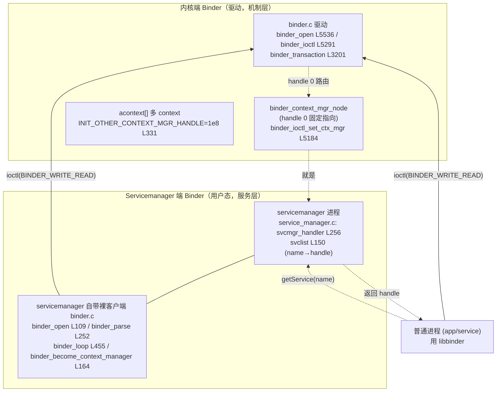
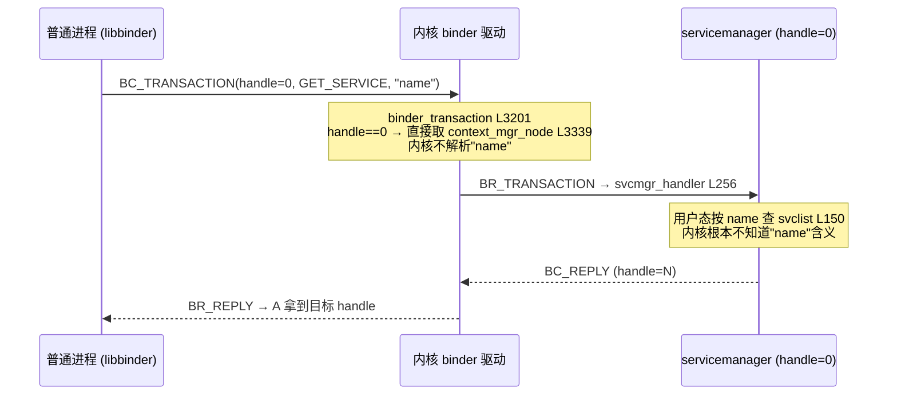
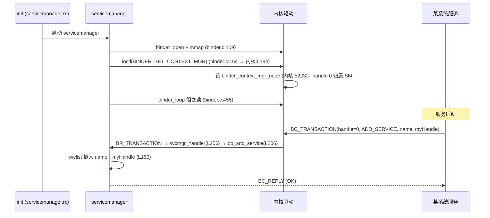

# 内核端 Binder 与 Servicemanager 端 Binder 的区别（Android 10 / 本仓实测）

> 基线：`android-10.0.0_r33`，本仓 `kernel/`（Linux 4.9.200，含多 context manager 改造）+ `frameworks/native/cmds/servicemanager/`（C 实现）
> 分析日期：2026-10-15 | 行号全部本地 `grep`/`Read` 实测
> 配套文档：`doc/binder_source_analysis_Android10.md`（三层端到端拆解）

---

## 1. 结论前置

1. **本质区别是「机制 vs 服务」**：
   - **内核端 binder** = binder **驱动**（`kernel/drivers/android/binder.c`），是 IPC **传输机制**。它只认 `handle`（32 位整数）和 `node`，**根本不知道"服务名"**，只负责把事务从 A 进程路由到 B 进程。
   - **servicemanager 端 binder** 是**双重身份**：① 它自己是一个跑在用户态的 **binder 服务**（被内核赋予"上下文管理者 / context manager"身份，`handle = 0`）；② 它自带一套**手写的极简 binder 客户端代码**（`frameworks/native/cmds/servicemanager/binder.c`），而不是用 `libbinder`。它做的"按名字查服务"是**用户态约定**，内核不实现。
2. **内核对 servicemanager 的唯一特殊对待 = handle 0**：servicemanager 启动时发 `ioctl(BINDER_SET_CONTEXT_MGR)`（`binder_ioctl_set_ctx_mgr` `binder.c:5184`）把自己进程里的一个 `binder_node` 注册成 `binder_context_mgr_node`（`:5223`）。此后任何进程发 `BC_TRANSACTION` 且 `target.handle == 0`，内核在 `binder_transaction` 里**不走普通 handle 查表**，直接取 `context->binder_context_mgr_node`（`:3339`）路由过去。
3. **handle 0 是内核强制分配的，不是约定俗成**：`binder_get_ref_for_node` 里 `new_ref->data.desc = (node == context->binder_context_mgr_node) ? 0 : 1;`（`binder.c:1929`）——谁拿到 context manager 节点的引用，谁就拿到 handle 0。
4. **两套 `binder_open` 是不同的人写的**：内核 `binder_open`（`binder.c:5536`，驱动侧，开 `/dev/binder` 时建 `binder_proc`）；servicemanager 用户态 `binder_open`（`binder.c:109`，client 侧，开设备文件 + `mmap` 共享内存）。同名不同层，是理解"端"的最佳切入点。
5. **本仓内核做了多 context manager 改造**（`acontext[]` 数组 + `INIT_OTHER_CONTEXT_MGR_HANDLE = 100000000` `:331`）：除默认 servicemanager（handle 0）外，还支持 `vndservicemanager` / `hwservicemanager` 等，各绑定不同 binder 设备（`/dev/vndbinder`、`/dev/hwbinder`），各自的 context manager 节点拿 `INIT_OTHER_CONTEXT_MGR_HANDLE + i` 的 handle（`:1909`）。本仓 `servicemanager` 目录下确有 `vndservicemanager.rc`。

---

## 2. 总览

### 2.1 两者关系图（内核 binder 是管道，servicemanager 是管道上的"黄页"）



### 2.2 一次 `getService(name)` 的分工



> 关键：**"name→handle"的翻译发生在 servicemanager 用户态，不在内核。** 内核只负责把 handle=0 的事务交给"当前 context manager"。

---

## 3. 分层拆解

### 3.1 内核端 Binder（驱动 = 纯传输机制）

位置：`kernel/drivers/android/binder.c`（238KB）。它提供：
- 设备文件 `/dev/binder`（及本仓改造后的 `/dev/vndbinder`、`/dev/hwbinder`）；
- `ioctl` 接口（`BINDER_WRITE_READ` 等，uapi `binder.h:266`）；
- 共享内存（`mmap`，payload 零拷贝）；
- 进程/线程/对象模型（`binder_proc` `:641` / `binder_thread` `:759` / `binder_node` `:441` / `binder_ref` `:548`）。

**它"不"做的事**：不知道服务名、不做名字解析、不维护服务列表。它只做 `handle → node → 目标进程/线程` 的路由。

**它对 context manager 的特殊逻辑（就是它对 servicemanager 的全部"偏爱"）**：

| 代码点 | 行号 | 作用 |
|---|---|---|
| `binder_ioctl_set_ctx_mgr()` | `:5184` | 处理 `BINDER_SET_CONTEXT_MGR` ioctl |
| `context->binder_context_mgr_node = new_node` | `:5223` | 把调用进程的某 node 设为 context manager |
| 重复设置拒绝 | `:5193-5194` | "already set" 报错，context manager 唯一 |
| uid 校验 | `:5203` | 只允许特定 uid（init/root）成为 context manager |
| `binder_transaction` 中 `handle==0` 分支 | `:3339` | `target_node = context->binder_context_mgr_node`（不走普通查表） |
| handle 0 固定分配 | `:1929` | context manager node 的引用永远拿 handle 0 |
| 多 context：`handle >= INIT_OTHER_CONTEXT_MGR_HANDLE` | `:3293-3295` | 取 `acontext[handle-1e8]->binder_context_mgr_node`（vnd/hw servicemanager） |

### 3.2 Servicemanager 端 Binder（双重身份）

#### 3.2.1 身份一：作为 context manager 服务（handle=0）

位置：`frameworks/native/cmds/servicemanager/service_manager.c`。它就是一个普通 binder 服务进程，只是被内核登记为 context manager：
- `main()`（`:391`）：`binder_open` → `binder_become_context_manager` → `binder_loop(bs, svcmgr_handler)`（`:451`）；
- `svcmgr_handler`（`:256`）：处理 `SVC_MGR_GET_SERVICE`（`:317`）、`SVC_MGR_ADD_SERVICE`（`:332`）等；
- `svclist`（`:150`）：`name → handle` 的单链表（`struct svcinfo` `:139`），这就是"黄页"本体；
- `do_add_service`（`:206`）做 SELinux 权限校验，`do_find_service`（`:182`）遍历链表返回 handle。

> 它和任何一个 binder 服务没本质区别：**也是收 `BR_TRANSACTION`、回 `BC_REPLY`**。区别只在"内核把 handle 0 固定路由给它"。

#### 3.2.2 身份二：自带裸 binder 客户端（不用 libbinder）

位置：`frameworks/native/cmds/servicemanager/binder.c` + `binder.h`。这是理解 binder 协议最干净的样例——它**没有**用 `ProcessState`/`IPCThreadState`，而是手写了最小客户端：

| 函数 | 行号 | 对比 libbinder |
|---|---|---|
| `binder_open(driver, mapsize)` | `:109` | ≈ `ProcessState` ctor（`open`+`mmap`），但极简 |
| `binder_become_context_manager(bs)` | `:164` | 发 `ioctl(BINDER_SET_CONTEXT_MGR)` |
| `binder_write_read()` | （封装） | ≈ `IPCThreadState::talkWithDriver` 的裸版 |
| `binder_parse(bs, bio, ...)` | `:252` | ≈ `IPCThreadState::executeCommand`，手动 switch `BR_*` |
| `binder_loop(bs, func)` | `:455` | ≈ `joinThreadPool` 的事件循环 |
| `binder_acquire` / `binder_release` | `:363`/`:370` | 强/弱引用计数（对应 `BC_ACQUIRE`/`BC_RELEASE`） |
| `binder_call` / `binder_done` | `binder.h:56`/`:65` | 同步调用 / 完成通知辅助 |

`binder.h` 关键常量：`BINDER_SERVICE_MANAGER 0U`（`:32`，即 handle 0 约定值）、`SVC_MGR_NAME "android.os.IServiceManager"`（`:34`）。

**为什么 servicemanager 不用 libbinder？** 它是"第一个"服务、需自举且保持极小体积；libbinder 依赖更多框架符号，而 `binder.c` 这套裸客户端只依赖 libc + 内核 uapi，是 binder 协议的"最小可运行示范"。

### 3.3 协作时序（启动 + 首次注册）



> 注意本仓 `servicemanager.rc` 已被 cells 项目改造：加了 `onrestart restart cellsservice`（见 `项目分析.md` §3.2），即 servicemanager 重启时会拉起 `cellsservice`。

### 3.4 多 Context Manager（本仓内核改造）

本仓 4.9.200 内核在 `binder_proc` 里加了 `acontext[]` 数组，支持**多个 context manager**，各自绑定不同 binder 设备：
- 默认 context（`/dev/binder`）→ servicemanager，context manager 拿 **handle 0**；
- 其他 context（`/dev/vndbinder` → vndservicemanager，`/dev/hwbinder` → hwservicemanager）→ context manager 拿 `INIT_OTHER_CONTEXT_MGR_HANDLE + i`（= `100000000 + i`，`:1909`）；
- 事务路由时：`handle >= 1e8` 走 `acontext[handle-1e8]`（`:3293-3295`），`handle==0` 走默认 context（`:3339`）。

本仓 `frameworks/native/cmds/servicemanager/` 下确有 `vndservicemanager.rc`，印证 vndservicemanager 存在（vendor 分区服务走 `/dev/vndbinder`，与 framework 服务隔离）。

---

## 4. 速查表

| 维度 | 内核端 Binder | Servicemanager 端 Binder |
|---|---|---|
| 所在层 | 内核（`kernel/drivers/android/binder.c`） | 用户态（`cmds/servicemanager/`） |
| 本质 | IPC **机制/管道** | 跑在管道上的 **context manager 服务** + 裸客户端 |
| 是否知道服务名 | **否**（只认 handle） | **是**（`svclist` 维护 `name→handle`） |
| 特殊身份 | 给 context manager 分配 handle 0 | 被登记为 handle 0 的进程 |
| 关键代码 | `binder_ioctl_set_ctx_mgr` `:5184`、`context_mgr_node` `:5223`、`handle==0` 路由 `:3339` | `svcmgr_handler` `:256`、`svclist` `:150`、`binder_become_context_manager` `:164` |
| 客户端实现 | 无（它是被调用的） | **裸 `binder.c`**（不用 libbinder） |
| `binder_open` | 驱动侧 `:5536`（建 `binder_proc`） | 用户侧 `:109`（开设备 + mmap） |
| 多实例 | `acontext[]` + `INIT_OTHER_CONTEXT_MGR_HANDLE=1e8` `:331` | `vndservicemanager.rc` 对应 `/dev/vndbinder` |

---

## 5. 调试验证

```bash
# 1) 复现本文行号（本仓实测）
cd /d/android_project/cells-android10
grep -n "binder_ioctl_set_ctx_mgr\|binder_context_mgr_node = new_node" kernel/drivers/android/binder.c
grep -n "INIT_OTHER_CONTEXT_MGR_HANDLE\|acontext\[" kernel/drivers/android/binder.c | head
grep -n "binder_open\|binder_become_context_manager\|binder_parse\|binder_loop" frameworks/native/cmds/servicemanager/binder.c
grep -n "svcmgr_handler\|svclist\|do_add_service" frameworks/native/cmds/servicemanager/service_manager.c

# 2) 设备侧（需完整树烧录）
adb shell service list                       # 走 servicemanager 列出所有服务
adb shell cat /d/binder/proc/$(pidof servicemanager)   # 看 context manager 的 proc 信息
adb shell ls -l /dev/binder /dev/vndbinder /dev/hwbinder  # 多 context 设备节点
```

---

## 6. 踩坑清单

1. **混淆"内核 binder"与"servicemanager"**：前者是管道（不认名字），后者是管道上的黄页（认名字）。把"服务发现"归功内核是常见误解——`getService` 的 name 解析 100% 在 `svcmgr_handler` 用户态。
2. **handle 0 是内核强制、非约定**：`binder.c:1929` 把 context manager 节点引用固定为 0；不要以为"0 是随便约定的 magic number"。
3. **servicemanager 不用 libbinder**：它用自带 `binder.c` 裸客户端。读 servicemanager 源码时别去找 `ProcessState`/`IPCThreadState`——那是普通进程用的。
4. **两套 `binder_open` 同名不同层**：内核 `:5536`（驱动）vs 用户态 `:109`（client）。grep "binder_open" 会同时命中两个，注意文件路径区分。
5. **多 context manager 是本仓改造点**：`acontext[]` + `INIT_OTHER_CONTEXT_MGR_HANDLE=1e8` 来自 Columbia Cells 树的定制（非上游 4.9 原生），`vndservicemanager.rc` 印证。对照上游 AOSP 时要注意此差异。
6. **成为 context manager 有 uid 限制**：`binder_ioctl_set_ctx_mgr` 的 uid 校验（`:5203`）——只有 init/root 能注册，普通 app 调 `BINDER_SET_CONTEXT_MGR` 会被拒。
7. **context manager 唯一**：重复 `BINDER_SET_CONTEXT_MGR` 直接报错（`:5193`），所以 servicemanager 进程必须且只能有一个（vndservicemanager 是**另一个 context**，不是第二个默认 servicemanager）。
