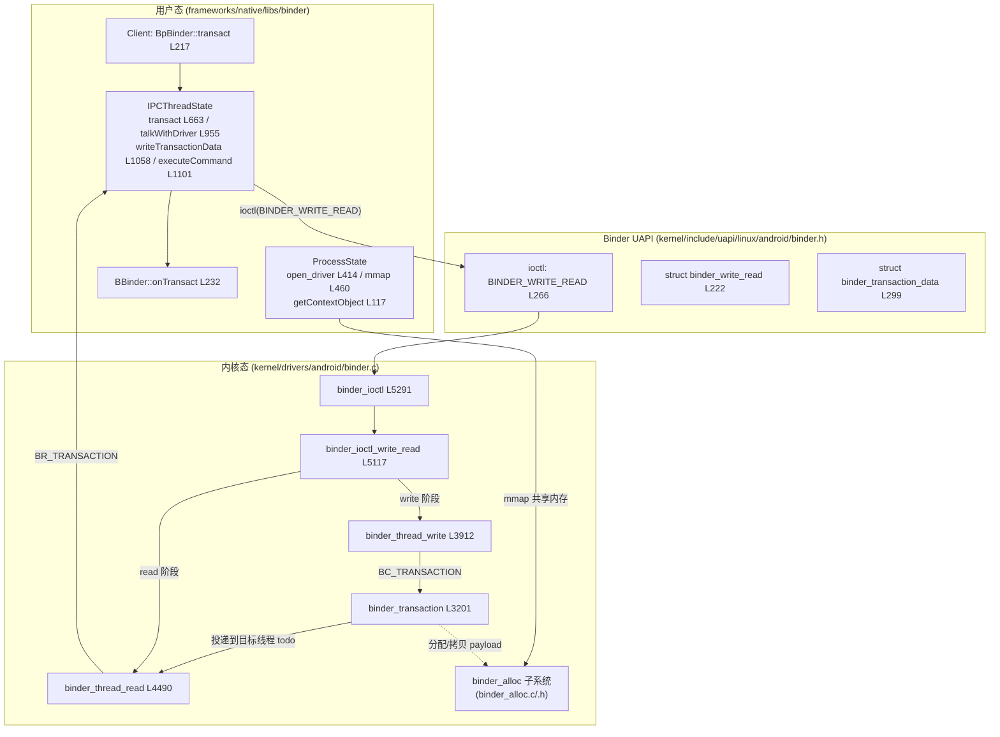
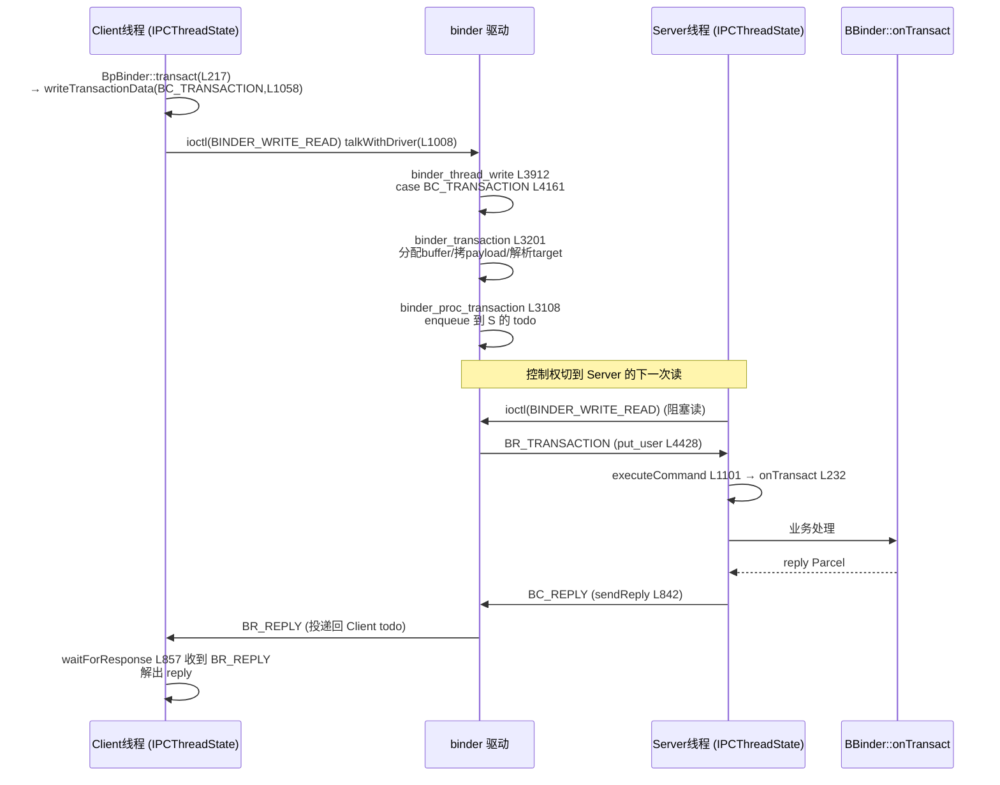
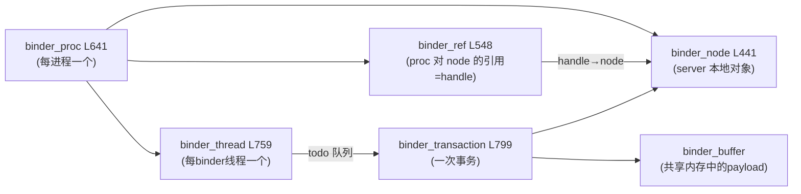
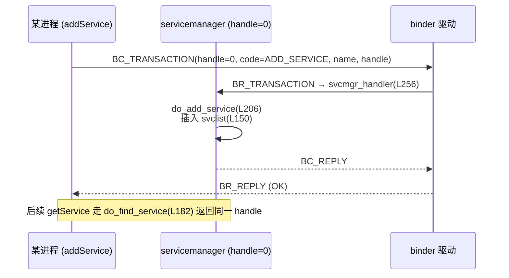

# Binder 源码分析（Android 10 / cells-android10 本仓实测）

> 基线：`android-10.0.0_r33`，本仓 `kernel/`（Linux 4.9.200，完整）+ `frameworks/native/`（完整）
> 分析日期：2026-10-15 | 全部行号为本地实测（`grep` / `Read`），非记忆值
> 文档定位：Binder 端到端三层（libbinder 用户态 → binder UAPI → kernel binder 驱动）函数级速查卡
> 相关文档：`doc/binder_session_2026-09-03.md`、`doc/binder_uapi_kernel_dataflow_analysis.md`、`doc/AOSP_Transaction_分析.md`

---

## 1. 结论前置

1. **Binder 是一次「内核中转 + 共享内存零拷贝」的 IPC**：控制面（命令/事务描述符）走 `ioctl(BINDER_WRITE_READ)` 在用户态与内核间拷贝；数据面（Parcel payload）走 `mmap` 共享内存，内核分配 `binder_buffer` 后两端进程直接读同一物理页，**payload 不在进程间二次拷贝**。
2. **一条事务的端到端函数链（同步调用）**：
   `BpBinder::transact`(L217) → `IPCThreadState::transact`(L663) → `writeTransactionData`(L1058) → `waitForResponse`(L857) → `talkWithDriver`(L955) → `ioctl(BINDER_WRITE_READ)`(L1008) → 内核 `binder_ioctl`(L5291) → `binder_ioctl_write_read`(L5117) → `binder_thread_write`(L3912，`BC_TRANSACTION`@L4161) → `binder_transaction`(L3201) → `binder_proc_transaction`(L3108) → `binder_enqueue_thread_work`(L1057) → 目标线程 `binder_thread_read`(L4490，构造 `BR_TRANSACTION`@`put_user` L4428) → 目标 `IPCThreadState::executeCommand`(L1101) → `BBinder::onTransact`(L232)。
3. **servicemanager 是 handle=0 的 context manager**（C 实现，非 C++）：`service_manager.c` 的 `svcmgr_handler`(L256) 处理 `SVC_MGR_ADD_SERVICE`(L332)/`SVC_MGR_GET_SERVICE`(L317)，`svclist`(L150) 是单链表存储 `name→handle`。
4. **handle 与 node 的映射在驱动内完成**：client 只持 `handle`（32 位），驱动用 `binder_get_ref_olocked`(L3325) 把 handle 翻成 `binder_ref→binder_node`（目标进程内的真实对象）；跨进程传递 Binder 对象时，`Parcel::flatten_binder`(L219) 把本地 `BINDER_TYPE_BINDER` 在接收方翻成 `BINDER_TYPE_HANDLE`。
5. **one-way（`TF_ONE_WAY`）无返回**：client 发完即走，内核不排 `BR_REPLY`，仅回 `BR_TRANSACTION_COMPLETE`(L3903)。

---

## 2. 总览

### 2.1 三层架构与数据面



### 2.2 一次同步事务的时序



---

## 3. 分层拆解

### 3.1 用户态 libbinder（`frameworks/native/libs/binder/`）

#### 3.1.1 ProcessState：打开设备 + mmap 共享内存（每进程单例）

| 函数 | 行号 | 职责 |
|---|---|---|
| `ProcessState::self()` | `ProcessState.cpp:75` | 进程内单例，首次调用触发 ctor |
| `ProcessState::ProcessState()` | `:442` | ctor 调 `open_driver(driver)`(`:444`) |
| `open_driver()` | `:414` | `open("/dev/binder")` + `ioctl(fd, BINDER_VERSION, &vers)`(`:419`) 校验协议版本（当前 v8，见 `binder.h:241`）；设 `max threads` |
| `mmap` | `:460` | `mVMStart = mmap(nullptr, BINDER_VM_SIZE, PROT_READ, MAP_PRIVATE|MAP_NORESERVE, mDriverFD, 0)` —— 映射驱动共享内存，**用户态只读**，写由驱动代劳 |
| `getContextObject()` | `:117`/`:137` | 返回 `BpBinder(0)`（handle=0 = servicemanager） |

> 关键点：`BINDER_VM_SIZE` 默认约 `(1*1024*1024) - (4096*2)`，即 1MB−8KB，是单个进程 binder 共享内存上限（很多「Transaction too large」的 root cause）。

#### 3.1.2 IPCThreadState：每条 binder 线程一个，真正收发

| 函数 | 行号 | 职责 |
|---|---|---|
| `transact()` | `:663` | 入口：组装 `BC_TRANSACTION`(`writeTransactionData` `:680`) → `waitForResponse`(`:857`) |
| `writeTransactionData()` | `:1058` | 把 `binder_transaction_data`（cmd + handle + code + data 指针）写入 `mOut` 写缓冲 |
| `waitForResponse()` | `:857` | 循环 `talkWithDriver` 直到收到 `BR_REPLY` / `BR_TRANSACTION_COMPLETE` / 错误 |
| `talkWithDriver()` | `:955` | 填 `binder_write_read`（`write_buffer=mOut`, `read_buffer=mIn`）→ `ioctl(mDriverFD, BINDER_WRITE_READ, &bwr)`(`:1008`) |
| `sendReply()` | `:842` | server 侧回包：`writeTransactionData(BC_REPLY, ...)`(`:846`) → `waitForResponse` |
| `getAndExecuteCommand()` | `:495` | server 线程主循环：读命令 → `executeCommand` |
| `executeCommand()` | `:1101` | 分发 `BR_TRANSACTION` / `BR_REPLY` / `BR_DEAD_BINDER` 等 |
| `joinThreadPool()` | `:588` | 进入线程池循环（`getAndExecuteCommand` 直到退出） |

#### 3.1.3 BpBinder / BBinder：代理与本地对象

| 函数 | 行号 | 职责 |
|---|---|---|
| `BpBinder::BpBinder(handle)` | `BpBinder.cpp:138` | 持远程 `handle`，`transact`(`:217`) 转发到 `IPCThreadState` |
| `BpBinder::transact()` | `:217` | 直接 `IPCThreadState::self()->transact(handle, code, ...)` |
| `BBinder::transact()` | `Binder.cpp:123` | 本地对象入口，调 `onTransact`(`:232`) |
| `BBinder::onTransact()` | `:232` | 子类（如 `BnInterface`）覆写，分发 `code` 到具体业务方法 |

#### 3.1.4 Parcel：Binder 对象的扁平化（handle 与实体互转）

`Parcel::flatten_binder`（`Parcel.cpp:219`）：本地 `IBinder` 写入时：
- 本地对象 → `obj.hdr.type = BINDER_TYPE_BINDER`(`:250`)（第一次跨进程）；
- 已是 handle → `BINDER_TYPE_HANDLE`(`:241`)。

接收方 `unflatten_binder`(`:148`) 读到 `BINDER_TYPE_BINDER`(`:100`) 时在**自己进程**生成新 `handle`（`BINDER_TYPE_HANDLE` `:110`）。这一步把「对象引用」安全翻译为「跨进程句柄」，是 binder 支持远程对象传递的核心。

### 3.2 Binder UAPI（`kernel/include/uapi/linux/android/binder.h`）

#### 3.2.1 核心数据结构

**`struct binder_write_read`（L222）** —— 每次 `ioctl` 的载体：

| 字段 | 含义 |
|---|---|
| `write_size` / `write_consumed` | 写缓冲大小 / 驱动已消费字节 |
| `write_buffer` | 指向用户态写缓冲（命令流：`BC_*` + 参数） |
| `read_size` / `read_consumed` | 读缓冲大小 / 驱动已填充字节 |
| `read_buffer` | 指向用户态读缓冲（返回流：`BR_*` + 参数） |

**`struct binder_transaction_data`（L299）** —— 单次事务描述：

| 字段 | 含义 |
|---|---|
| `target.handle` / `target.ptr` | 目标 handle（client 用）或 ptr（reply 用，指向 `binder_node`） |
| `cookie` | 目标对象 cookie（server 侧 `onTransact` 时回传，定位 Bn 对象） |
| `code` | 方法号（如 `SVC_MGR_GET_SERVICE=1`） |
| `flags` | `TF_ONE_WAY`(L293) 等 |
| `sender_pid` / `sender_euid` | 驱动填充的调用方身份（不可伪造） |
| `data_size` / `offsets_size` | payload 字节数 / `flat_binder_object` 偏移区字节数 |
| `data.ptr.buffer` / `data.ptr.offsets` | 指向共享内存中的 payload 与对象偏移表 |

#### 3.2.2 关键 ioctl / 命令宏

| 宏 | 行号 | 说明 |
|---|---|---|
| `BINDER_WRITE_READ` | `L266` | 主工作命令（`_IOWR`） |
| `BINDER_VERSION` | `L272` | 协议版本协商（当前 v8，L241） |
| `BINDER_SET_CONTEXT_MGR` | `L270` | 成为 context manager（servicemanager 用） |
| `BC_TRANSACTION` | `L459` | 用户→驱动：发起调用 |
| `BC_REPLY` | `L460` | 用户→驱动：回包 |
| `BR_TRANSACTION` | `L379` | 驱动→用户：收到调用 |
| `BR_REPLY` | `L380` | 驱动→用户：收到回包 |

> 协议版本：`BINDER_CURRENT_PROTOCOL_VERSION` 在 64 位为 **8**（L241），32 位（`BINDER_IPC_32BIT`）为 7（L239）。`open_driver` 用 `BINDER_VERSION` 校验，版本不符直接 `LOG_FATAL`。

### 3.3 内核 binder 驱动（`kernel/drivers/android/binder.c`，238KB）

#### 3.3.1 核心数据结构（进程/线程/对象模型）



| 结构 | 行号 | 关键字段（节选） |
|---|---|---|
| `binder_proc` | `L641` | `tasks`(线程表)、`nodes`(红黑树)、`refs_by_desc`(handle→ref)、`buffers`(共享内存 buffer 链表)、`context`(上下文,含 `binder_context_mgr_node`) |
| `binder_thread` | `L759` | `todo`(工作队列)、`transaction_stack`、`looper` 状态(ENTERED/REGISTERED/EXITED) |
| `binder_node` | `L441` | `ptr`/`cookie`(本地对象地址)、`refs`(反向引用)、`proc`(所属进程)、`internal_strong_refs` |
| `binder_ref` | `L548` | `desc`(即 handle)、`node`(指向 `binder_node`)、`proc`/`death`(死亡通知) |
| `binder_transaction` | `L799` | `from`/`to_proc`/`to_thread`、`buffer`(payload)、`code`、`flags`、`need_reply` |

#### 3.3.2 主入口：`binder_ioctl`（L5291）

`binder_ioctl` 按 `cmd` 分发；`BINDER_WRITE_READ` → `binder_ioctl_write_read`(L5117)：
- 若 `write_size > 0`：`binder_thread_write`(L3912) 消费写缓冲（用户→内核拷贝命令）；
- 随后若 `read_size > 0`：`binder_thread_read`(L4490) 填充读缓冲（内核→用户回传结果）。
- 两者在同一 `ioctl` 调用内顺序完成（典型同步调用：先发 BC_TRANSACTION，立刻尝试读 BR_REPLY/BR_TRANSACTION_COMPLETE）。

`binder_open`(L5536) 建 `binder_proc`；`binder_mmap`(L5488) 把用户 `vma` 与驱动 `binder_alloc` 管理的物理页绑定（共享内存根基）。

#### 3.3.3 写阶段：`binder_thread_write`（L3912）

解析 `write_buffer` 中的 `BC_*` 命令流：
- `case BC_TRANSACTION`(L4161) / `case BC_REPLY`(L4162) → 读入 `binder_transaction_data tr` → `binder_transaction(proc, thread, &tr, reply=0/1, ...)`(L4168)；
- 另有 `BC_ENTER_LOOPER`/`BC_REGISTER_LOOPER`/`BC_EXIT_LOOPER` 管理线程池状态（对应 `joinThreadPool`/`startThreadPool`）。

#### 3.3.4 事务核心：`binder_transaction`（L3201）

这是 binder 的「心脏」，关键步骤（实测行号）：
1. **SELinux 检查**：`security_binder_transaction`(L3365)；
2. **解析目标 node**：
   - `tr->target.handle == 0` → context manager（`binder_context_mgr_node`，L3293-3295 多 context 分支）；
   - 否则 `ref = binder_get_ref_olocked(proc, tr->target.handle, ...)`(L3325) → `ref->node`(L3311/3313)；
3. **分配 buffer**：`binder_alloc` 子系统在目标进程共享内存中分配 `binder_buffer`，`copy_from_user` 把 payload 拷入（零拷贝的「一半」——仅这一次内核拷贝，两端后续读同一页）；
4. **填事务**：`t->code = tr->code`(L3461)，填 `sender_pid`/`sender_euid`（身份由驱动强制，防伪装）；
5. **投递**：`binder_proc_transaction`(L3108) → `binder_enqueue_thread_work`(L1057) 把事务挂到目标线程 `todo`；若目标线程空闲则唤醒。
6. 对同步调用（`!TF_ONE_WAY`）：给发起线程排 `BR_TRANSACTION_COMPLETE`（L3903 附近）表示「已送出」。

#### 3.3.5 读阶段：`binder_thread_read`（L4490）

目标线程阻塞在 `ioctl` 读；驱动从 `todo` 取事务，构造返回给用户：
- `put_user(cmd, (uint32_t *)...)`(L4428) 写入 `BR_TRANSACTION`（或 `BR_REPLY`）；
- 把 `binder_transaction_data`（handle/ptr、code、sender 身份、data 指针指向共享内存中的 payload）拷到用户 `read_buffer`；
- 用户态拿到 `BR_TRANSACTION` 后由 `executeCommand`(L1101) 调 `onTransact`。

> **一次拷贝的本质**：控制信息（`binder_transaction_data` 头部）走 `copy_to_user`/`put_user`；payload 本体已在共享内存里，接收方直接读，无需再拷。这正是 binder 比 socket/pipe 高效的原因。

### 3.4 servicemanager（C 实现，`frameworks/native/cmds/servicemanager/`）

> Android 10 的 servicemanager 仍是 **C 实现**（`service_manager.c` + `binder.c`），不是 C++ 的 `ServiceManager.cpp`（后者在本仓不存在）。`servicemanager.rc` 已为 cells 项目加了 `onrestart restart cellsservice`（见 `项目分析.md` §3.2）。

| 函数 | 行号 | 职责 |
|---|---|---|
| `main()` | `service_manager.c:391` | `binder_open` → `binder_become_context_manager` → `binder_loop(bs, svcmgr_handler)`(L451) |
| `svcmgr_handler()` | `:256` | 事务回调：解析 `code`（`SVC_MGR_GET_SERVICE`/`ADD_SERVICE`/`LIST_SERVICES` 等） |
| `do_find_service()` | `:182` | `find_svc`(L152) 遍历 `svclist`(L150) 按 name 找 handle 返回 |
| `do_add_service()` | `:206` | 校验 SELinux 权限 → 建 `svcinfo`(L139) 插入 `svclist` → 注册死亡通知 `svcinfo_death`(L165/L241) |
| `binder_loop()` | `binder.c:455` | 循环 `ioctl` 读 → `binder_parse`(L252) → 回调 `svcmgr_handler` |
| `binder_parse()` | `binder.c:252` | 把 `binder_write_read` 解析成 `binder_transaction_data` / `binder_io`，分派 `BR_TRANSACTION` |

**注册/查找流**：


---

## 4. 速查表

| 查询项 | 答案（行号） |
|---|---|
| 一条事务的 client 入口 | `BpBinder::transact` `BpBinder.cpp:217` |
| 真正发 ioctl 的地方 | `IPCThreadState::talkWithDriver` `IPCThreadState.cpp:955`（ioctl `@:1008`） |
| 内核总入口 | `binder_ioctl` `binder.c:5291` |
| 事务核心函数 | `binder_transaction` `binder.c:3201` |
| 目标 handle→node 翻译 | `binder_get_ref_olocked` `binder.c:3325` |
| 事务投递到目标 | `binder_proc_transaction` `:3108` → `binder_enqueue_thread_work` `:1057` |
| server 收到调用 | `binder_thread_read` `:4490`（构造 `BR_TRANSACTION` `put_user @:4428`） |
| server 业务入口 | `BBinder::onTransact` `Binder.cpp:232` |
| servicemanager 事务回调 | `svcmgr_handler` `service_manager.c:256` |
| servicemanager 链表 | `svclist` `service_manager.c:150` |
| mmap 共享内存 | `ProcessState.cpp:460` |
| 协议版本（64位） | `BINDER_CURRENT_PROTOCOL_VERSION = 8` `binder.h:241` |
| `binder_transaction_data` | `binder.h:299` |
| `binder_write_read` | `binder.h:222` |
| `BC_TRANSACTION` / `BR_TRANSACTION` | `binder.h:459` / `:379` |
| 内核 binder 结构体 | `binder_node` `:441` / `binder_ref` `:548` / `binder_proc` `:641` / `binder_thread` `:759` / `binder_transaction` `:799` |

---

## 5. 调试验证

```bash
# 1) 复现本文关键行号（本仓实测）
cd /d/android_project/cells-android10
grep -n "^static.*binder_transaction\b\|binder_ioctl(struct" kernel/drivers/android/binder.c
grep -n "::transact\|::talkWithDriver\|::waitForResponse" frameworks/native/libs/binder/IPCThreadState.cpp
grep -n "svcmgr_handler\|do_add_service\|do_find_service" frameworks/native/cmds/servicemanager/service_manager.c

# 2) 设备侧观测 binder 状态（需完整树编译烧录，当前 cells 未接入构建见 项目分析.md §3.3）
adb shell cat /d/binder/proc/<pid>        # 看线程/事务/引用
adb shell binder-service list             # servicemanager 中的服务清单
dumpsys activity                          # AMS 经 Binder 调用，可观察 transaction 耗时

# 3) 跟踪一次事务（内核 ftrace）
adb shell "echo 1 > /d/tracing/events/binder/binder_transaction/enable"
adb shell cat /d/tracing/trace_pipe
```

---

## 6. 踩坑清单

1. **servicemanager 是 C 不是 C++**：本仓 `frameworks/native/cmds/servicemanager/` 下是 `service_manager.c` + `binder.c`，不要去找 `ServiceManager.cpp`（`grep` 已确认不存在）。`servicemanager.rc` 被 cells 项目改过（加了 `onrestart restart cellsservice`）。
2. **one-way 无 reply**：设 `TF_ONE_WAY` 的调用只回 `BR_TRANSACTION_COMPLETE`，`waitForResponse` 不等 `BR_REPLY`；误用同步等待会死锁。
3. **mmap 上限 1MB−8KB**：单个进程 binder 共享内存超 `BINDER_VM_SIZE` 会 `TransactionTooLargeException`；大 payload 应改 socket/文件描述符传递（`TF_ACCEPT_FDS` 控制 fd 透传）。
4. **payload 一次拷贝**：只有 `binder_transaction_data` 头部走 `copy_to_user`/`put_user`，payload 在共享内存；误以为「全量拷贝」会误解性能模型。
5. **sender 身份由驱动填**：`sender_pid`/`sender_euid` 是驱动强制写入，server 不可信 client 自称身份 —— 权限校验应以 `sender_euid` 为准（servicemanager 的 `do_add_service` 即如此）。
6. **handle 进程局部**：同一个 `binder_node` 在不同 client 进程里 `handle` 不同；跨进程传 Binder 对象经 `flatten_binder`/`unflatten_binder` 重新分配 handle（`Parcel.cpp:219`/`:148`）。
7. **本仓限制**：`kernel/` 是 4.9.200 完整源码，`frameworks/native` 完整，可端到端对照；但缺 `build/`、`art/`、`bionic/`，无法整编烧录，设备侧验证需另搭完整树（见 `项目分析.md` §3.4 / 踩坑 #4）。
