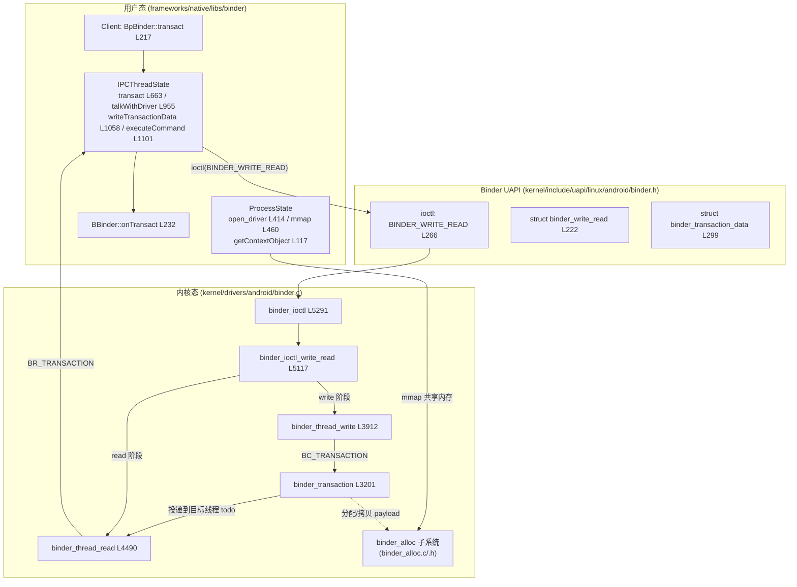
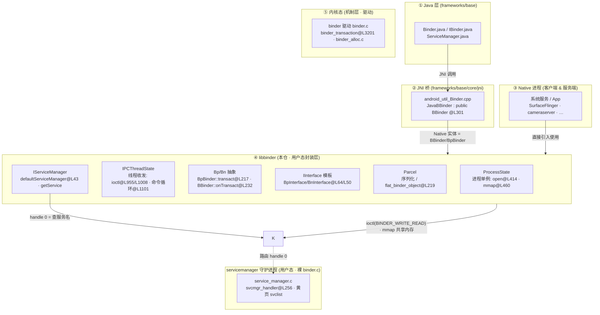
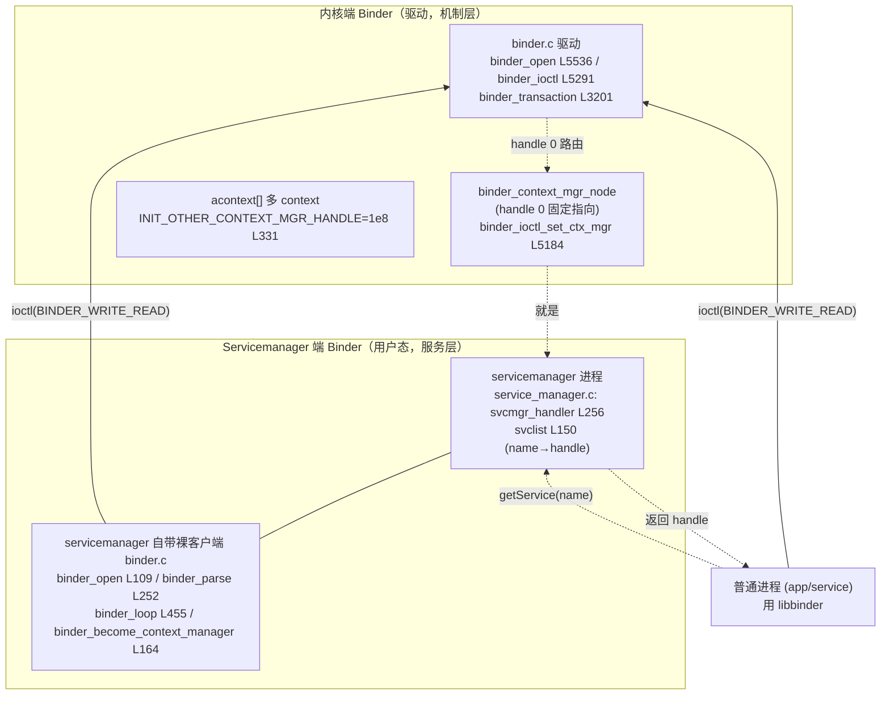
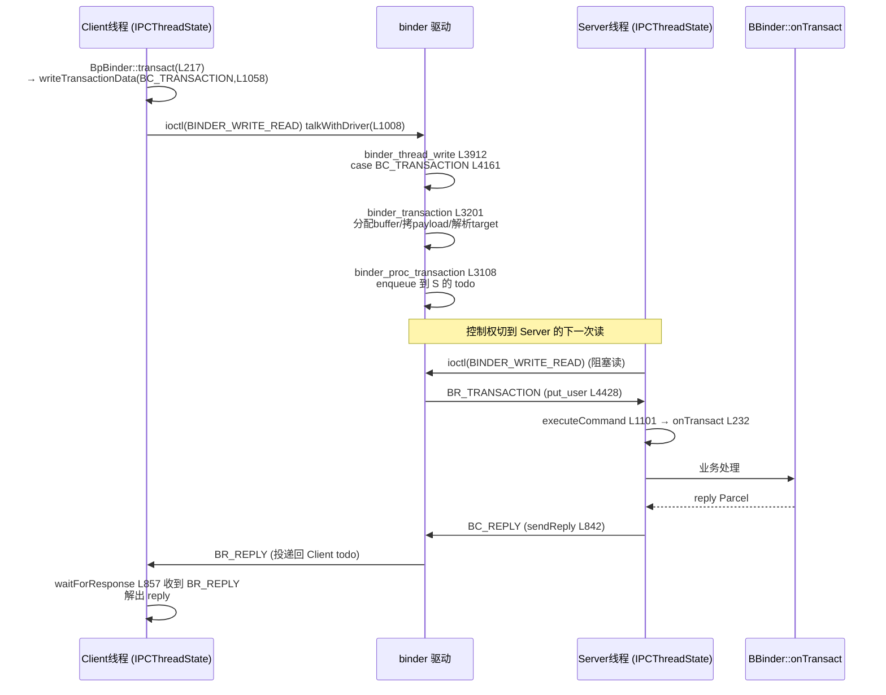
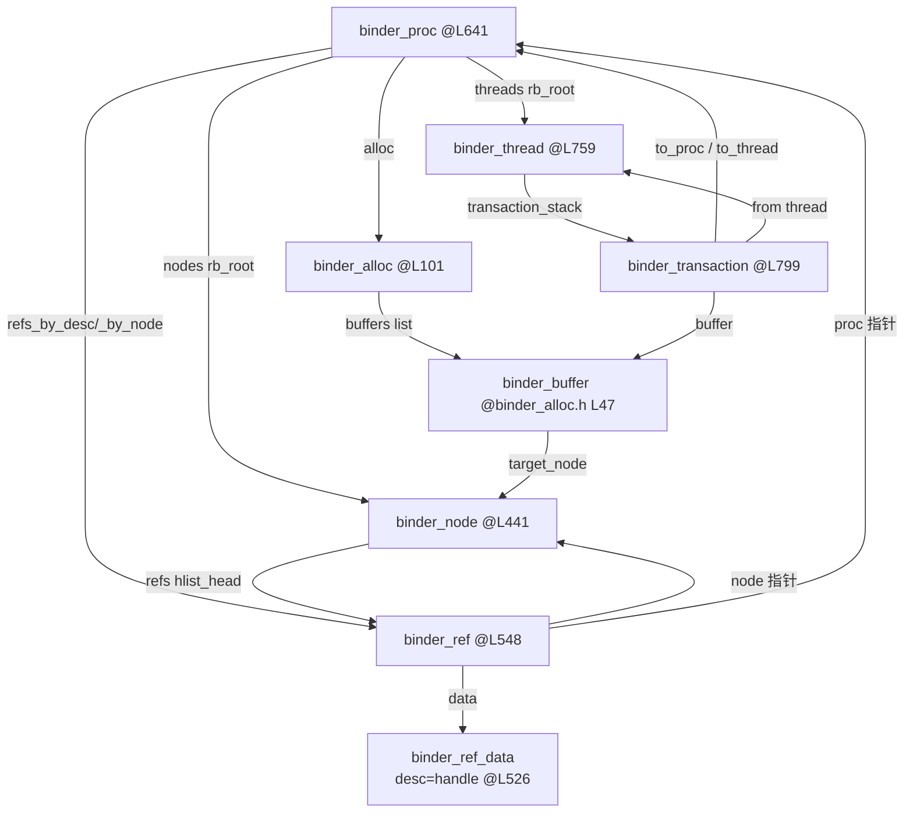

# Binder 全景分析（Android 10 / cells-android10 本仓实测）

> 基线：`android-10.0.0_r33`，本仓 `kernel/`（Linux 4.9.200，完整 + 多 context 改造）+ `frameworks/native/`（完整）
> 分析日期：2026-10-15～16 | 全部行号为本地实测（`grep` / `Read`），非记忆值
> 文档定位：Binder IPC 全链路唯一权威速查卡，合并五篇专题（源码端到端 / 内核 vs servicemanager / libbinder 作用 / 数据结构 / 字段引用图核验）
> 源文档索引：`binder_source_analysis` / `binder_kernel_vs_servicemanager` / `libbinder_role` / `binder_data_structures` / `Binder_字段引用图_核验报告`

---

## 1. 结论前置

### 1.1 Binder 机制一句话

**Binder = 内核中转 + 共享内存零拷贝**：控制面（命令/事务描述符）走 `ioctl(BINDER_WRITE_READ)` 在用户态与内核间拷贝；数据面（Parcel payload）走 `mmap` 共享内存，内核分配 `binder_buffer` 后两端进程直接读同一物理页，**payload 不在进程间二次拷贝**。

### 1.2 一次同步事务的端到端函数链

```
BpBinder::transact(L217) → IPCThreadState::transact(L663)
  → writeTransactionData(L1058) → waitForResponse(L857)
  → talkWithDriver(L955) → ioctl(BINDER_WRITE_READ)(L1008)
  → 内核 binder_ioctl(L5291) → binder_ioctl_write_read(L5117)
  → binder_thread_write(L3912, BC_TRANSACTION@L4161)
  → binder_transaction(L3201) → binder_proc_transaction(L3108)
  → binder_enqueue_thread_work(L1057)
  → 目标 binder_thread_read(L4490, BR_TRANSACTION@put_user L4428)
  → IPCThreadState::executeCommand(L1101) → BBinder::onTransact(L232)
```

### 1.3 四层角色定位

| 层 | 位置 | 角色 | 知道"服务名"？ |
|---|---|---|---|
| **内核驱动** | `kernel/drivers/android/binder.c` | IPC **传输机制**（管道），只认 handle | **否** |
| **servicemanager** | `cmds/servicemanager/`（C 实现） | 跑在管道上的 **context manager 服务**（黄页）+ 手写裸客户端 | **是**（`svclist`） |
| **libbinder** | `frameworks/native/libs/binder/` | 用户态**全功能封装库**（OOP + 线程池 + 序列化） | —（通过 `IServiceManager` 封装黄页访问） |
| **Java Binder** | `Binder.java` → JNI → libbinder | Java 侧壳，native 实体 = `JavaBBinder extends BBinder` | — |

### 1.5 handle 核心事实

- **handle 是 per-proc 局部编号**（`binder_ref_data.desc` L526），不是全局唯一：同一实体在不同进程 handle 不同。
- **handle 0 是内核强制分配**（`binder.c:1929`：`desc = (node == context_mgr_node) ? 0 : 1`），不是约定俗成的 magic number。
- **servicemanager 是 handle=0 的 context manager**：`ioctl(BINDER_SET_CONTEXT_MGR)` → `binder_ioctl_set_ctx_mgr`(L5184) 把某 node 设为 `binder_context_mgr_node`(L5223)。
- **本仓多 context 改造**：`acontext[]` + `INIT_OTHER_CONTEXT_MGR_HANDLE=1e8`(L331)，vnd/hw servicemanager 各拿 `1e8+i` 的 handle。

### 1.6 数据结构本质

Binder 通信 = 一份事实的三个视图：
- **内核记账结构体**：`binder_proc`/`binder_thread`/`binder_node`/`binder_ref`/`binder_buffer`/`binder_transaction`（定义在 `binder.c`/`binder_alloc.h`）
- **UAPI 协议结构体**：`binder_write_read`/`binder_transaction_data`/`flat_binder_object`（定义在 `binder.h`，真正跨 `ioctl` 边界）
- **libbinder 用户态对象**：`IBinder`/`BpBinder`/`BBinder`/`Parcel`/`ProcessState`/`IPCThreadState`（对内核结构体的 C++ 封装，1:1 对应）

---

## 2. 总览

### 2.1 三层架构与数据面



### 2.2 libbinder 在 binder 栈里的位置（五层链路）



### 2.3 内核端 vs Servicemanager 端



### 2.4 一次同步事务时序



### 2.5 内核核心结构体关系



---

## 3. 分层拆解

### 3.1 用户态 libbinder（`frameworks/native/libs/binder/`）

#### 3.1.1 ProcessState：打开设备 + mmap 共享内存（每进程单例）

| 函数 | 行号 | 职责 |
|---|---|---|
| `ProcessState::self()` | `ProcessState.cpp:75` | 进程内单例，首次调用触发 ctor |
| `ProcessState::ProcessState()` | `:442` | ctor 调 `open_driver(driver)`(`:444`) |
| `open_driver()` | `:414` | `open("/dev/binder")` + `ioctl(fd, BINDER_VERSION, &vers)`(`:419`) 校验协议版本 v8（`binder.h:241`）；设 `max threads` |
| `mmap` | `:460` | `mVMStart = mmap(nullptr, BINDER_VM_SIZE, PROT_READ, MAP_PRIVATE|MAP_NORESERVE, mDriverFD, 0)` —— 用户态只读，写由驱动代劳 |
| `getContextObject()` | `:117`/`:137` | 返回 `BpBinder(0)`（handle=0 = servicemanager） |
| `startThreadPool()` | `:173` | 启线程池，让本进程能接收远端调用 |

> `BINDER_VM_SIZE` ≈ 1MB−8KB，是单进程 binder 共享内存上限（`TransactionTooLargeException` 的 root cause）。

#### 3.1.2 IPCThreadState：每条 binder 线程一个，真正收发

| 函数 | 行号 | 职责 |
|---|---|---|
| `transact()` | `:663` | 入口：组装 `BC_TRANSACTION`(`writeTransactionData` `:680`) → `waitForResponse`(`:857`) |
| `writeTransactionData()` | `:1058` | 把 `binder_transaction_data` 写入 `mOut` 写缓冲 |
| `waitForResponse()` | `:857` | 循环 `talkWithDriver` 直到收到 `BR_REPLY` / `BR_TRANSACTION_COMPLETE` |
| `talkWithDriver()` | `:955` | 填 `binder_write_read`（`write_buffer=mOut`, `read_buffer=mIn`）→ `ioctl`(`:1008`) |
| `sendReply()` | `:842` | server 侧回包 |
| `executeCommand()` | `:1101` | 分发 `BR_TRANSACTION` / `BR_REPLY` / `BR_DEAD_BINDER` |
| `joinThreadPool()` | `:588` | 线程池循环 |

#### 3.1.3 BpBinder / BBinder：代理与本地对象

| 函数 | 行号 | 职责 |
|---|---|---|
| `BpBinder::transact()` | `BpBinder.cpp:217` | 直接 `IPCThreadState::self()->transact(handle, code, ...)` |
| `BBinder::onTransact()` | `Binder.cpp:232` | 子类覆写，分发 `code` 到具体业务方法 |

#### 3.1.4 Parcel：Binder 对象扁平化（handle↔实体互转）

- `flatten_binder`（`Parcel.cpp:219`）：本地对象 → `BINDER_TYPE_BINDER`(`:250`)；已是 handle → `BINDER_TYPE_HANDLE`(`:241`)。
- `unflatten_binder`(`:148`)：接收方把 `BINDER_TYPE_BINDER` 在**自己进程**生成新 handle。

#### 3.1.5 IInterface + BpInterface/BnInterface —— AIDL 模板引擎

| 项 | 行号 | 作用 |
|---|---|---|
| `BnInterface` | `IInterface.h:50` | 桩基类 |
| `BpInterface` | `IInterface.h:64` | 代理基类 |
| `asBinder()` | `IInterface.cpp:33`/`:40` | 接口 ↔ `IBinder` 互转 |

#### 3.1.6 IServiceManager —— "查黄页"客户端封装

- `defaultServiceManager()`（`IServiceManager.cpp:43`）：拿 `BpBinder(0)` + `interface_cast<IServiceManager>` 成强类型代理。
- `getService()` / `addService()`：向 servicemanager（handle 0）发事务。

#### 3.1.7 Java 层经 JNI 用 libbinder

- `JavaBBinder : public BBinder`（`android_util_Binder.cpp:301`）—— Java `Binder` 的 native 实体。
- **Java Binder ≠ 独立实现**，native 侧就是 `JavaBBinder extends BBinder`。

### 3.2 Binder UAPI（`kernel/include/uapi/linux/android/binder.h`）

#### 3.2.1 核心数据结构

**`binder_write_read`（L222）** —— 每次 `ioctl` 的载体：

| 字段 | 含义 |
|---|---|
| `write_size` / `write_consumed` | 写缓冲大小 / 驱动已消费字节 |
| `write_buffer` | 指向用户态写缓冲（命令流：`BC_*` + 参数） |
| `read_size` / `read_consumed` | 读缓冲大小 / 驱动已填充字节 |
| `read_buffer` | 指向用户态读缓冲（返回流：`BR_*` + 参数） |

**`binder_transaction_data`（L299）** —— 单次事务描述：

| 字段 | 含义 |
|---|---|
| `target.handle` / `target.ptr` | 目标 handle（client）或 ptr（reply） |
| `cookie` | server 侧回传定位 Bn 对象 |
| `code` | 方法号 |
| `flags` | `TF_ONE_WAY`(L293) 等 |
| `sender_pid` / `sender_euid` | 驱动填充的调用方身份（不可伪造） |
| `data_size` / `offsets_size` | payload 字节数 / `flat_binder_object` 偏移区字节数 |
| `data.ptr.buffer` / `data.ptr.offsets` | 共享内存中的 payload 与对象偏移表 |

**`flat_binder_object`（L123）** —— "可变 Binder 对象"：

| 字段 | 类型 | 说明 |
|---|---|---|
| `hdr.type` | `__u32` | `BINDER_TYPE_BINDER`/`HANDLE`/`FD`/`FDA` @L31-36 |
| `flags` | `__u32` | — |
| `binder` / `handle` | union: `binder_uintptr_t` / `__u32` | 本地指针 vs 远端句柄 |
| `cookie` | `binder_uintptr_t` | **注意：ILP32 下是 __u32，LP64 下是 __u64** |

> **32/64 位兼容**：`binder_size_t`/`binder_uintptr_t` LP64=`__u64`，ILP32=`__u32`（L101-105）。

#### 3.2.2 BC_*/BR_* 命令协议枚举（binder.h:458 / 365 起）

**BC_*（用户态 → 内核）**：`BC_TRANSACTION`(L459)、`BC_REPLY`(L460)、`BC_FREE_BUFFER`(L472)、`BC_INCREFS/ACQUIRE/RELEASE/DECREFS`(L477-480)、`BC_ENTER/REGISTER/EXIT_LOOPER`(L499-506)、`BC_REQUEST/CLEAR_DEATH_NOTIFICATION`(L515/L522)、`BC_DEAD_BINDER_DONE`(L529)、`BC_TRANSACTION_SG/BC_REPLY_SG`(L534-535)。

**BR_*（内核 → 用户态）**：`BR_ERROR`(L366)、`BR_OK`(L371)、`BR_TRANSACTION/BR_TRANSACTION_SEC_CTX`(L379/L374)、`BR_REPLY`(L380)、`BR_DEAD_REPLY/BR_FAILED_REPLY`(L392/L451)、`BR_TRANSACTION_COMPLETE`(L398)、`BR_INCREFS/ACQUIRE/RELEASE/DECREFS`(L405-408)、`BR_SPAWN_LOOPER`(L428)、`BR_DEAD_BINDER`(L442)。

> **关键**：`BR_SPAWN_LOOPER`(L428) 是 binder 线程池动态扩容触发点——内核发它，libbinder spawn 新线程。

### 3.3 内核 binder 驱动（`kernel/drivers/android/binder.c`，238KB）

#### 3.3.1 核心数据结构

| 结构 | 行号 | 关键字段 |
|---|---|---|
| `binder_proc` | L641 | `threads`(rb_root) / `nodes`(rb_root) / `refs_by_desc`(rb_root) / `alloc`(binder_alloc) / `todo`(list_head) / `pid` / `context` / `acontext[MAX_CONTEXT]`(L707, 本仓改造) |
| `binder_thread` | L759 | `proc` / `pid` / `looper` / `transaction_stack` / `todo` / `return_error` |
| `binder_node` | L441 | `ptr`/`cookie`(binder_uintptr_t) / `proc` / `refs`(hlist_head) / `internal_strong_refs` / `async_todo` |
| `binder_ref` | L548 | `data`(binder_ref_data@L524: `desc`=handle/`strong`/`weak`) / `node` / `proc` / `death` |
| `binder_ref_death` | L502 | `work` + `cookie`(binder_uintptr_t) |
| `binder_transaction` | L799 | `from`/`to_proc`/`to_thread` / `from_parent`/`to_parent`(嵌套栈) / `buffer` / `code`/`flags` / `sender_euid`(kuid_t) / `security_ctx` / `lock`(spinlock_t) |
| `binder_buffer` | binder_alloc.h L47 | `transaction` / `target_node` / `data_size`/`offsets_size`/`extra_buffers_size` / `user_data`(void __user*) |
| `binder_alloc` | binder_alloc.h L101 | `buffer`(mmap 基址) / `buffers`(list_head) / `free_buffers`/`allocated_buffers`(rb_root) / `free_async_space` / `buffer_size` |
| `binder_work` | L359 | `type` 枚举决定翻译成哪个 `BR_*` 命令 |

#### 3.3.2 主入口：`binder_ioctl`（L5291）

`BINDER_WRITE_READ` → `binder_ioctl_write_read`(L5117)：
- `write_size > 0`：`binder_thread_write`(L3912) 消费写缓冲；
- `read_size > 0`：`binder_thread_read`(L4490) 填充读缓冲；
- 两者在同一 `ioctl` 调用内顺序完成。

`binder_open`(L5536) 建 `binder_proc`；`binder_mmap`(L5488) 绑定 `vma` 与 `binder_alloc`。

#### 3.3.3 事务核心：`binder_transaction`（L3201）

1. **SELinux 检查**：`security_binder_transaction`(L3365)
2. **解析目标 node**：`handle==0` → context manager（L3339）；否则 `binder_get_ref_olocked`(L3325) → `ref->node`
3. **分配 buffer**：`binder_alloc` 在目标进程共享内存分配 `binder_buffer`，`copy_from_user` 把 payload 拷入（**一次拷贝**）
4. **填事务**：`t->code = tr->code`(L3461)，填 `sender_pid`/`sender_euid`（身份由驱动强制，防伪装）
5. **投递**：`binder_proc_transaction`(L3108) → `binder_enqueue_thread_work`(L1057)
6. 同步调用：给发起线程排 `BR_TRANSACTION_COMPLETE`（L3903）

#### 3.3.4 读阶段：`binder_thread_read`（L4490）

目标线程阻塞在 `ioctl` 读；驱动从 `todo` 取事务，`put_user(cmd, ...)`(L4428) 写入 `BR_TRANSACTION`；用户态 `executeCommand`(L1101) → `onTransact`。

> **一次拷贝本质**：控制信息走 `copy_to_user`/`put_user`；payload 在共享内存，接收方直接读。

### 3.4 Servicemanager（C 实现，`frameworks/native/cmds/servicemanager/`）

> Android 10 仍是 **C 实现**（`service_manager.c` + `binder.c`），不是 C++ `ServiceManager.cpp`。`servicemanager.rc` 已加 `onrestart restart cellsservice`（cells 改造）。

#### 3.4.1 双重身份

**身份一：context manager 服务（handle=0）**

| 函数 | 行号 | 职责 |
|---|---|---|
| `main()` | `:391` | `binder_open` → `binder_become_context_manager` → `binder_loop(bs, svcmgr_handler)` |
| `svcmgr_handler()` | `:256` | 事务回调：`SVC_MGR_GET_SERVICE`(`:317`) / `SVC_MGR_ADD_SERVICE`(`:332`) |
| `do_find_service()` | `:182` | 遍历 `svclist`(`:150`) 按 name 找 handle |
| `do_add_service()` | `:206` | SELinux 校验 → 建 `svcinfo`(`:139`) 插入 `svclist` |

**身份二：自带裸 binder 客户端（不用 libbinder）**

| 函数 | 行号 | 对比 libbinder |
|---|---|---|
| `binder_open()` | `:109` | ≈ `ProcessState` ctor（open+mmap），极简 |
| `binder_become_context_manager()` | `:164` | 发 `ioctl(BINDER_SET_CONTEXT_MGR)` |
| `binder_parse()` | `:252` | ≈ `IPCThreadState::executeCommand` |
| `binder_loop()` | `:455` | ≈ `joinThreadPool` |

> 为什么不用 libbinder？自举 + 极简 + 不依赖框架符号。

#### 3.4.2 内核对 context manager 的全部特殊逻辑

| 代码点 | 行号 | 作用 |
|---|---|---|
| `binder_ioctl_set_ctx_mgr()` | `:5184` | 处理 `BINDER_SET_CONTEXT_MGR` |
| `context->binder_context_mgr_node = new_node` | `:5223` | 设 context manager |
| uid 校验 | `:5203` | 只有 init/root 能注册 |
| `handle==0` 分支 | `:3339` | 直接取 `context_mgr_node`（不走查表） |
| handle 0 固定分配 | `:1929` | `desc = (node == context_mgr_node) ? 0 : 1` |
| 多 context：`handle >= 1e8` | `:3293-3295` | `acontext[handle-1e8]->binder_context_mgr_node` |

### 3.5 多 Context Manager（本仓内核改造）

`binder_proc.acontext[MAX_CONTEXT]`(L707，`MAX_CONTEXT=6` L276) + `INIT_OTHER_CONTEXT_MGR_HANDLE=1e8`(L331)：
- 默认 `/dev/binder` → servicemanager（handle 0）
- `/dev/vndbinder` → vndservicemanager（handle `1e8+i`）
- `/dev/hwbinder` → hwservicemanager
- 事务路由：`handle >= 1e8` 走 `acontext[handle-1e8]`(L3295)

### 3.6 事务栈嵌套

`from_parent`(L803)/`to_parent`(L806) 把嵌套调用串成栈。同一线程嵌套串行化；`one-way` 事务 `need_reply=0`，不入回复等待栈。

### 3.7 死亡通知流

1. Client 发 `BC_REQUEST_DEATH_NOTIFICATION(handle, cookie)`(L515)
2. 内核设 `ref->death = binder_ref_death{work, cookie}`(L502)
3. Server 进程死亡 → 内核发 `BR_DEAD_BINDER(cookie)`(L442)
4. Client 处理完回 `BC_DEAD_BINDER_DONE(cookie)`(L529)

### 3.8 libbinder 内部结构补充

- **BBinder::Extras**(Binder.cpp L86)：延迟初始化扩展区（`mRequestingSid` + `mLock` + `mObjects`）。
- **BpBinder 防泄漏追踪**：`sTrackingMap`(L37) / `mTrackedUid`(L143) / `mAlive`(L130)，Java BinderProxy 泄漏检测底层。
- **Parcel object 管理**：`mObjects`(L482) 与内核 `offsets_size` 对应；`mNextObjectHint`(L485) 加速遍历。

### 3.9 内核补充结构

| 结构 | 行号 | 说明 |
|---|---|---|
| `binder_context` | L267 | context manager 信息（mgr_node/uid/name） |
| `binder_device` | L279 | 设备，内嵌 `context[MAX_CONTEXT]`(L284) |
| `binder_error` | L373 | 错误回报载体 |
| `binder_priority` | L579 | 优先级继承单元 |
| `binder_stats` | L206 | 进程/线程统计 |
| `binder_object`(union) | L837 | 类型无关 object 拷贝 |

---

## 4. 速查表

### 4.1 函数/结构体 → 文件 → 行号

| 查询项 | 答案（行号） |
|---|---|
| 一条事务的 client 入口 | `BpBinder::transact` `BpBinder.cpp:217` |
| 真正发 ioctl 的地方 | `IPCThreadState::talkWithDriver` `IPCThreadState.cpp:955`（ioctl `@:1008`） |
| 内核总入口 | `binder_ioctl` `binder.c:5291` |
| 事务核心函数 | `binder_transaction` `binder.c:3201` |
| 目标 handle→node 翻译 | `binder_get_ref_olocked` `binder.c:3325` |
| 事务投递 | `binder_proc_transaction` `:3108` → `binder_enqueue_thread_work` `:1057` |
| server 收到调用 | `binder_thread_read` `:4490`（`BR_TRANSACTION` `put_user @:4428`） |
| server 业务入口 | `BBinder::onTransact` `Binder.cpp:232` |
| servicemanager 事务回调 | `svcmgr_handler` `service_manager.c:256` |
| servicemanager 链表 | `svclist` `service_manager.c:150` |
| mmap 共享内存 | `ProcessState.cpp:460` |
| 协议版本（64位） | `BINDER_CURRENT_PROTOCOL_VERSION = 8` `binder.h:241` |
| context manager 设置 | `binder_ioctl_set_ctx_mgr` `binder.c:5184` |
| handle 0 固定分配 | `binder.c:1929` |
| 多 context 基址 | `INIT_OTHER_CONTEXT_MGR_HANDLE = 1e8` `binder.c:331` |

### 4.2 数据结构 → 文件 → 行号 → 角色

| 结构体/类 | 文件 | 行号 | 角色 |
|---|---|---|---|
| `binder_proc` | binder.c | L641 | 进程记账 |
| `binder_thread` | binder.c | L759 | 线程记账 |
| `binder_node` | binder.c | L441 | 实体（ptr/cookie ↔ BBinder） |
| `binder_ref` | binder.c | L548 | 引用（data.desc=handle ↔ BpBinder） |
| `binder_ref_data` | binder.c | L524 | ref 计数 + desc |
| `binder_ref_death` | binder.c | L502 | 死亡通知 |
| `binder_buffer` | binder_alloc.h | L47 | 共享内存数据块 |
| `binder_alloc` | binder_alloc.h | L101 | proc 内存分配器 |
| `binder_transaction` | binder.c | L799 | 一次事务 |
| `binder_work` | binder.c | L359 | work 链表元素 |
| `binder_write_read` | binder.h | L222 | ioctl 顶层载体 |
| `binder_transaction_data` | binder.h | L299 | 事务元数据 |
| `flat_binder_object` | binder.h | L123 | 可变 Binder 对象 |
| `binder_context` | binder.c | L267 | context manager 信息 |
| `IBinder` | IBinder.h | — | 统一接口 |
| `BpBinder` | BpBinder.cpp | transact L217 | 代理 |
| `BBinder` | Binder.cpp | onTransact L232 | 桩 |
| `JavaBBinder` | android_util_Binder.cpp | L301 | Java Binder native 实体 |
| `Parcel` | Parcel.h | mData L478 | 数据集装箱 |
| `ProcessState` | ProcessState.cpp | ctor L443 | 进程连接（↔ binder_proc） |
| `IPCThreadState` | IPCThreadState.cpp | mProcess L354 | 线程收发（↔ binder_thread） |

### 4.3 内核端 vs Servicemanager 端

| 维度 | 内核端 Binder | Servicemanager 端 Binder |
|---|---|---|
| 本质 | IPC **机制/管道** | context manager 服务 + 裸客户端 |
| 知道服务名？ | **否**（只认 handle） | **是**（`svclist`） |
| `binder_open` | 驱动侧 `:5536` | 用户侧 `:109` |
| 特殊逻辑 | handle 0 → `context_mgr_node` `:3339` | 被登记为 handle 0 的进程 |

### 4.4 libbinder 四大职责

| 职责 | 对应类 | 关键方法 |
|---|---|---|
| 连接/内存管理 | `ProcessState` | `self` L75 / `open_driver` L414 / `mmap` L460 |
| 线程与收发 | `IPCThreadState` | `transact` L663 / `talkWithDriver` L955 / `executeCommand` L1101 |
| 代理/桩抽象 | `IBinder`/`BpBinder`/`BBinder` + `IInterface` | `transact` L217 / `onTransact` L232 / `Bp/BnInterface` L64/L50 |
| 序列化 | `Parcel` | `flatten_binder` L219 / `unflatten_binder` L148 |

---

## 5. 调试验证

```bash
# 1) 复现本文关键行号（本仓实测）
cd /d/android_project/cells-android10
grep -n "^static.*binder_transaction\b\|binder_ioctl(struct" kernel/drivers/android/binder.c
grep -n "::transact\|::talkWithDriver\|::waitForResponse" frameworks/native/libs/binder/IPCThreadState.cpp
grep -n "svcmgr_handler\|do_add_service\|do_find_service" frameworks/native/cmds/servicemanager/service_manager.c
grep -n "struct binder_proc {\|struct binder_transaction {" kernel/drivers/android/binder.c
grep -n "struct binder_write_read {\|struct flat_binder_object {" kernel/include/uapi/linux/android/binder.h

# 2) 设备侧观测（需完整树烧录，本仓缺 build/ 见 项目分析.md §3.4）
adb shell cat /d/binder/proc/<pid>        # 看线程/事务/引用
adb shell service list                    # servicemanager 服务清单
adb shell ls -l /dev/binder /dev/vndbinder /dev/hwbinder  # 多 context 设备节点

# 3) 跟踪一次事务（ftrace）
adb shell "echo 1 > /d/tracing/events/binder/binder_transaction/enable"
adb shell cat /d/tracing/trace_pipe
```

---

## 6. 踩坑清单

### 6.1 通用坑

1. **servicemanager 是 C 不是 C++**：`service_manager.c` + `binder.c`，别找 `ServiceManager.cpp`。
2. **one-way 无 reply**：`TF_ONE_WAY` 只回 `BR_TRANSACTION_COMPLETE`，误等 `BR_REPLY` 死锁。
3. **mmap 上限 1MB−8KB**：超 `BINDER_VM_SIZE` 抛 `TransactionTooLargeException`；大 payload 改 socket/fd。
4. **payload 一次拷贝**：只有 `binder_transaction_data` 头部走 `copy_to_user`，payload 在共享内存。
5. **sender 身份由驱动填**：`sender_pid`/`sender_euid` 不可伪造，权限校验以此为凭。
6. **handle 进程局部**：跨进程传 Binder 对象经 `flatten_binder`/`unflatten_binder` 重新分配 handle。
7. **`todo` 有两级**：`binder_thread.todo`（线程专属，优先）与 `binder_proc.todo`（进程级）。

### 6.2 架构认知坑

8. **内核 binder = 管道 ≠ 黄页**：`getService(name)` 的 name 解析 100% 在 `svcmgr_handler` 用户态，内核不实现。
9. **handle 0 是内核强制、非约定**：`binder.c:1929` 固定分配。
10. **servicemanager 不用 libbinder**：裸 `binder.c` 客户端（自举极简）。
11. **两套 `binder_open` 同名不同层**：驱动 `:5536` vs 用户态 `:109`。
12. **libbinder ≠ 传输层**：只封装不传输，瓶颈在驱动/共享内存/锁。
13. **Java Binder 也走 libbinder**：`JavaBBinder extends BBinder`，native 侧就是 libbinder。

### 6.3 数据结构坑

14. **handle 不是全局唯一**：`binder_ref_data.desc` per-proc，跨进程不能直接用。
15. **`flat_binder_object` 会变形**：sender 写 `BINDER_TYPE_BINDER`，receiver 收 `BINDER_TYPE_HANDLE`。
16. **`binder_ref` 的 desc/strong/weak 嵌套在 `binder_ref_data` 内**（L524），非平铺。
17. **`binder_buffer` 无 `data` 字段**：4.9 已改为 `void __user *user_data`(binder_alloc.h L62)；老内核 3.x 的 `uint8_t *data` 已不存在。
18. **`binder_uintptr_t` ≠ `__u64`**：ILP32 下是 `__u32`（binder.h L101-105）。
19. **`binder_transaction` 本仓无 `sender_uid`**：只有 `kuid_t sender_euid`(L823)；`sender_uid` 上游 5.x 才加入。

### 6.4 本仓特有坑

20. **多 context 改造**：`acontext[MAX_CONTEXT]`(L707) + `INIT_OTHER_CONTEXT_MGR_HANDLE=1e8`(L331) 来自 Columbia Cells 树（非上游 4.9 原生）。
21. **`servicemanager.rc` 被 cells 改**：`onrestart restart cellsservice`。
22. **cells_build.mk 孤儿**：8 个 cells 模块不进编译路径（见 `项目分析.md` §3.3）。
23. **缺 `build/`/`art/`/`bionic/`**：无法整编烧录，设备侧验证需另搭完整树。

---

## 附录：字段引用图核验摘要

> 详细报告见 `doc/Binder_字段引用图_核验报告.md`

图整体框架与三类箭头语义正确，但查出 **2 硬错误 + 3 精度问题**：

| 编号 | 位置 | 问题 | 修正 |
|---|---|---|---|
| E1 | ① IPCThreadState | `mIsServing` 不存在于 Android 10 | 删掉 |
| E2 | ③ binder_transaction | `sender_uid` 本仓无此字段 |6 | 删掉，保留 `sender_euid` |
| E3 | ③ binder_buffer | `data(uint8[])` 字段名错 | 改为 `user_data(void __user*)`，补 `extra_buffers_size` |
| E4 | ② flat_binder_object | cookie 标 `__u64` 不精确 | 改为 `binder_uintptr_t` |
| E5 | ③ binder_ref | desc/strong/weak 平铺 | 改为嵌套 `binder_ref_data` |
| E6 | ① BBinder | mExtras 标 `extras` | 改为 `std::atomic<Extras*>` |
