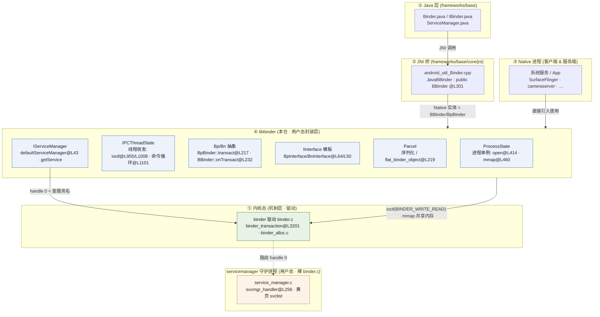

# libbinder 的作用（Android 10 / 本仓实测）

> 基线：`android-10.0.0_r33`，`frameworks/native/libs/binder/`（构建入口 `Android.bp`，完整）
> 分析日期：2026-10-15 | 行号全部本地 `grep`/`Read` 实测
> 配套：`doc/binder_source_analysis_Android10.md`（三层端到端）、`doc/binder_kernel_vs_servicemanager_Android10.md`（内核 vs servicemanager）

---

## 1. 结论前置

1. **libbinder 是「用户态对内核 binder 驱动的**全功能封装库**」**：它把内核那套原始的 `ioctl(BINDER_WRITE_READ)` + `BC_*`/`BR_*` 命令流 + 线程池管理，封装成一套**面向对象**的 C++ API（`IBinder` / `Bp`/`Bn` / `Parcel` / `ProcessState` / `IPCThreadState`）。开发者写 AIDL 风格的接口即可，**不用手写命令解析**——而 servicemanager 为了自举极简，**没用** libbinder，而是手写了裸 `binder.c`（见配套文档 §3.2.2）。
2. **libbinder 是 binder 体系的「中间层」**：上接 app / native 服务（含 Java 层经 JNI），下接内核 binder 驱动。它**不实现 IPC 传输**（那是内核的事），只负责"把面向对象的调用翻译成内核能懂的 binder 事务，再把返回结果翻回对象"。
3. **libbinder 同时支撑 Native 与 Java 两端**：所有 native 系统服务（SurfaceFlinger、cameraserver…）直接用 libbinder；Java 的 `Binder.java`/`IBinder.java` 通过 JNI（`frameworks/base/core/jni/android_util_Binder.cpp` 的 `JavaBBinder` 继承 `BBinder`，L301）也最终落到 libbinder。所以 **libbinder 是 Android 整个 IPC 栈的事实基石**。
4. **它提供"服务发现"的客户侧封装**：`IServiceManager::defaultServiceManager()`（L43）+ `getService()` 是应用/服务拿到远端 handle 0（servicemanager）并 `interface_cast` 成 `IServiceManager` 的标准入口——把"查服务"从裸 ioctl 变成一行调用。

---

## 2. 总览

### 2.1 libbinder 在 binder 栈里的位置



> 优化点：① 新增 `servicemanager 守护进程` 节点，把原图歧义的 `SM -->|handle 0| K` 拆成「`IServiceManager`（libbinder 内）以 handle 0 进内核 → 内核路由到 servicemanager 守护进程（裸 binder.c）」两段，呼应 `doc/binder_kernel_vs_servicemanager_Android10.md`；② 用 ①~⑤ 编号子图明确五层链路并给边加语义标签；③ 行号与 §3 / §4 表格对齐（`ProcessState` 拆成 `open@L414 · mmap@L460`）。

### 2.2 libbinder 的四大职责

| 职责 | 对应类 | 说明 |
|---|---|---|
| **连接/内存管理** | `ProcessState` | 每进程单例：打开 `/dev/binder`、`mmap` 共享内存、管理线程数 |
| **线程与收发** | `IPCThreadState` | 每条 binder 线程一个：真正发 `ioctl`、解析 `BR_*`、跑线程池循环 |
| **代理/桩抽象** | `IBinder`/`BpBinder`/`BBinder` + `IInterface` | 把"远程对象"抽象成接口，开发者写 `BpXxx`/`BnXxx` 而非手搓命令 |
| **序列化** | `Parcel` | 数据 + `flat_binder_object` 的打包/拆包（handle↔实体翻译） |

---

## 3. 分层拆解（核心类逐一说明作用）

### 3.1 ProcessState —— 进程的"连接管理器"

| 函数 | 行号 | 作用 |
|---|---|---|
| `self()` | `ProcessState.cpp:75` | 进程内单例，首次触发 ctor |
| ctor | `:442` | 调 `open_driver`（`:444`） |
| `open_driver()` | `:414` | `open("/dev/binder")` + `ioctl(BINDER_VERSION)`(`:419`) 校验协议版本 |
| `mmap` | `:460` | `mmap(... BINDER_VM_SIZE ...)` 映射内核共享内存（payload 零拷贝根基） |
| `getContextObject()` | `:117` | 返回 `BpBinder(0)`——即 servicemanager 的代理（`BINDER_SERVICE_MANAGER=0`） |
| `startThreadPool()` | `:173` | 启线程池，让本进程能接收远端调用 |

> **作用小结**：一个进程只要 `#include <binder/ProcessState.h>` 并 `ProcessState::self()`，就完成了"连上 binder 驱动 + 准备好共享内存"。这是 libbinder 的"开箱即用"入口。

### 3.2 IPCThreadState —— 线程的"收发机"

| 函数 | 行号 | 作用 |
|---|---|---|
| `transact()` | `:663` | 组装 `BC_TRANSACTION` → `writeTransactionData`(`:1058`) → `waitForResponse`(`:857`) |
| `talkWithDriver()` | `:955` | 填 `binder_write_read` 并 `ioctl(mDriverFD, BINDER_WRITE_READ, &bwr)`(`:1008`)——**真正触达内核的地方** |
| `waitForResponse()` | `:857` | 循环读 `BR_REPLY` / `BR_TRANSACTION_COMPLETE` |
| `executeCommand()` | `:1101` | 分发 `BR_TRANSACTION`/`BR_REPLY`/`BR_DEAD_BINDER` |
| `joinThreadPool()` | `:588` | 线程池循环（`getAndExecuteCommand` `:495` 直到退出） |

> **作用小结**：它把"调用一个方法"翻译成内核事务，又把内核回的 `BR_*` 翻回 C++ 返回值/异常。**servicemanager 的裸 `binder.c` 干的正是这个活，只是 libbinder 做得更完整、更安全（错误码、异常、one-way 处理等）。**

### 3.3 IBinder / BpBinder / BBinder —— "远程对象"抽象

| 类/函数 | 行号 | 作用 |
|---|---|---|
| `IBinder` | `include/binder/IBinder.h` |  binder 对象的统一接口（`transact` / `queryLocalInterface` / `linkToDeath`） |
| `BpBinder::transact()` | `BpBinder.cpp:217` | **代理端**：把调用转发给 `IPCThreadState`（代表"远端那个对象"） |
| `BpBinder` ctor | `:138` | 持一个 `handle`（远程引用） |
| `BBinder::onTransact()` | `Binder.cpp:232` | **桩端**：本地对象收到事务后分发 `code` 到业务实现 |
| `BBinder::transact()` | `:123` | 本地入口 |

> **作用小结**：`Bp` = Binder proxy（客户端手里指向远端的句柄），`Bn` = Binder native（服务端本地实现）。libbinder 用这对抽象让"调远程方法"写得跟"调本地虚函数"几乎一样。

### 3.4 IInterface + BpInterface/BnInterface —— AIDL 的"模板引擎"

| 项 | 行号 | 作用 |
|---|---|---|
| `BnInterface` | `IInterface.h:50` | `class BnInterface : public INTERFACE, public BBinder`——桩基类 |
| `BpInterface` | `IInterface.h:64` | `class BpInterface : public INTERFACE, public BpRefBase`——代理基类 |
| `asBinder()` | `IInterface.cpp:33`/`:40` | 接口 → `IBinder` 互转 |

> **作用小结**：这是 AIDL 生成的代码骨架。`BpXxx` 继承 `BpInterface<IXxx>`，`BnXxx` 继承 `BnInterface<IXxx>`。libbinder 用 CRTP 风格模板把"接口定义"自动变成"可跨进程调用的代理/桩"——**开发者只填业务逻辑，序列化/分发由模板兜底**。

### 3.5 Parcel —— 跨进程数据"集装箱"

| 函数 | 行号 | 作用 |
|---|---|---|
| `flatten_binder()` | `Parcel.cpp:219` | 写 `IBinder` 时：本地对象 → `BINDER_TYPE_BINDER`，已是 handle → `BINDER_TYPE_HANDLE`（`:241`/`:250`） |
| `unflatten_binder()` | `:148` | 读时把 `BINDER_TYPE_BINDER` 在**本进程**翻译为新 `handle`（`:100`/`:110`） |

> **作用小结**：Parcel 是 binder 的"序列化协议"。它让任意 C++ 基本类型、`String16`、甚至**另一个 Binder 对象**都能在进程间搬运——后者正是 Android 能"传远程对象"而非只传数据的秘密。

### 3.6 IServiceManager —— "查黄页"的客户侧封装

| 函数 | 行号 | 作用 |
|---|---|---|
| `defaultServiceManager()` | `IServiceManager.cpp:43` | 经 `getContextObject()` 拿 `BpBinder(0)`，再 `interface_cast<IServiceManager>`(L53) 成强类型代理 |
| `getService()` / `checkService()` | 同文件（L192 附近） | 向 servicemanager（handle 0）发 `SVC_MGR_GET_SERVICE` 查 name→handle |
| `addService()` | 同文件 | 向 servicemanager 注册自己 |

> **作用小结**：这是"服务发现"在客户端的标准姿势。没有 libbinder 时你得手写 `BC_TRANSACTION(handle=0, GET_SERVICE, "name")`；有了它，一行 `defaultServiceManager()->getService(name)` 搞定。

### 3.7 BinderService —— 发布服务的便捷基类

`include/binder/BinderService.h`：系统服务（如 SurfaceFlinger）继承它即可一键 `publish()` 把自己 `addService` 到 servicemanager，省去样板代码。

### 3.8 Java 层经 JNI 也用 libbinder

`frameworks/base/core/jni/android_util_Binder.cpp`：
- `JavaBBinder : public BBinder`（L301）—— Java 端 `Binder` 对象在 native 侧的实体就是这个 `BBinder` 子类；
- 收到调用时取 `IPCThreadState::self()`（L362）走 libbinder 收发。

> 即：**Java Binder ≠ 独立实现**，它只是 libbinder 在 Java 侧的壳。整条 Android IPC 栈最终都汇聚到 libbinder → 内核驱动。

---

## 4. 速查表（类 → 文件 → 作用 → 关键行）

| 类/接口 | 文件 | 作用 | 关键行 |
|---|---|---|---|
| `ProcessState` | `ProcessState.cpp` | 进程连接/内存管理（open+mmap） | `self` L75 / `open_driver` L414 / `mmap` L460 |
| `IPCThreadState` | `IPCThreadState.cpp` | 线程收发/ioctl/命令循环 | `transact` L663 / `talkWithDriver` L955(ioctl L1008) / `executeCommand` L1101 |
| `IBinder` | `IBinder.h` | binder 对象统一接口 | — |
| `BpBinder` | `BpBinder.cpp` | 代理（持 handle） | `transact` L217 |
| `BBinder` | `Binder.cpp` | 桩（本地实现） | `onTransact` L232 |
| `IInterface` | `IInterface.h/.cpp` | Bp/Bn 模板 + asBinder | `BnInterface` L50 / `BpInterface` L64 |
| `Parcel` | `Parcel.cpp` | 序列化/对象扁平化 | `flatten_binder` L219 |
| `IServiceManager` | `IServiceManager.cpp` | 服务发现客户端封装 | `defaultServiceManager` L43 |
| `BinderService` | `BinderService.h` | 发布服务便捷基类 | — |
| `JavaBBinder` | `android_util_Binder.cpp` | Java Binder 的 native 实体 | 继承 `BBinder` L301 |

---

## 5. 调试验证

```bash
# 1) 复现本文行号（本仓实测）
cd /d/android_project/cells-android10
grep -n "::self\b\|open_driver\|mVMStart = mmap" frameworks/native/libs/binder/ProcessState.cpp
grep -n "::talkWithDriver\|ioctl(mProcess" frameworks/native/libs/binder/IPCThreadState.cpp
grep -n "class BnInterface\|class BpInterface" frameworks/native/libs/binder/include/binder/IInterface.h
grep -n "defaultServiceManager" frameworks/native/libs/binder/IServiceManager.cpp

# 2) 谁链接了 libbinder（本仓 native 服务）
grep -rln "libbinder" frameworks/native/cmds/ frameworks/ 2>/dev/null | head
# servicemanager 故意不链 libbinder（对比）
grep -n "libbinder" frameworks/native/cmds/servicemanager/Android.bp   # 预期：无
```

---

## 6. 踩坑清单

1. **libbinder ≠ 传输层**：它只封装、不传输。真正的 IPC 在内核 `binder.c`。把"binder 通信慢"归咎 libbinder 多半找错地方（瓶颈在驱动/共享内存/锁）。
2. **servicemanager 不用 libbinder**：它是裸 `binder.c` 客户端（自举 + 极简），所以读 servicemanager 源码别找 `ProcessState`/`IPCThreadState`——那是"别人家"的。
3. **Java Binder 也走 libbinder**：`Binder.java` 不是另起炉灶，native 侧是 `JavaBBinder extends BBinder`（`android_util_Binder.cpp:301`）。Java↔Native binder 调用最终都过 libbinder。
4. **`Bp`/`Bn` 是模板不是魔法**：`BpInterface`/`BnInterface`（`IInterface.h:64`/`:50`）是 AIDL 生成代码的基类；手写 Binder 服务时也继承它们，别自己重写收发逻辑。
5. **`getContextObject()` 拿到的就是 servicemanager**：`ProcessState::getContextObject` 返回 `BpBinder(0)`（handle 0 = context manager），`IServiceManager::defaultServiceManager()` 在此基础上 `interface_cast`——这是访问"黄页"的唯一正路。
6. **多线程模型由 libbinder 托管**：`startThreadPool`(L173) + `joinThreadPool`(L588) 决定进程能并发处理多少 binder 调用；不启线程池，服务端只能串行收包（常见问题根因）。
7. **mmap 上限在 libbinder 侧设定**：`BINDER_VM_SIZE`（ProcessState `:460`）决定单进程 binder 共享内存上限，超了抛 `TransactionTooLargeException`——这是 libbinder 的硬约束，不是内核独占。
