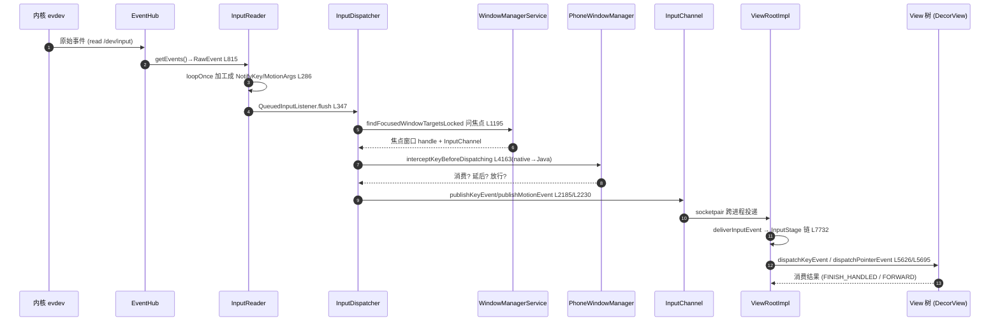

# 输入事件处理流程（Android 10 / android-10.0.0_r33）

> 本文把「一次触摸 / 按键如何到达 App 的 View」端到端打通。源码基线 `cells-android10`（android-10.0.0_r33），native 在 `frameworks/native/services/inputflinger/`，Java 在 `frameworks/base/`。
> 前序文档：`EventHub_分析_Android10.md`（设备层）、`inputDispatcher_anr.md`（ANR 路径）、IMS 系列（输入法与 `InputConnection` 文本回传）。

---

## 一、结论前置

**一句话**：输入事件从 Linux 内核 `evdev` 设备节点出发，经 `EventHub`（epoll 读）→ `InputReader`（加工成 Key/Motion）→ `InputDispatcher`（查焦点窗口 + Policy 拦截）→ 通过 `InputChannel`（socketpair 共享内存）发给目标窗口的 `ViewRootImpl`，再走 `InputStage` 责任链（PreIme → Ime → EarlyPostIme → ViewPostIme）交给 `DecorView`→`View` 树分发。

1. **三进程、两段跨进程**：`InputReader`/`InputDispatcher` 跑在 **system_server**（native 线程）；事件经 `InputChannel`（不是 Binder）跨进程发给 **App 进程** 的 `ViewRootImpl`；Policy 拦截（`interceptKeyBeforeDispatching`）又通过 **native→Java→PhoneWindowManager** 回 system_server。
2. **焦点决定目标窗口**：`InputDispatcher::findFocusedWindowTargetsLocked`（`InputDispatcher.cpp:1195`）问 WMS 当前焦点窗口，把事件投到该窗口的 `InputChannel`。
3. **按键有「拦截闸门」**：`interceptKeyBeforeDispatching`（`InputDispatcher.cpp:4163`→`InputManagerService.java:1873`→`PhoneWindowManager`）在派发前先让系统策略处理 HOME/Back/音量等；返回 delay>0 表示系统「消费并延后」，APP 收不到。
4. **IME 场景（衔接 IMS 系列）**：软键盘触摸事件发给 **IME 自己的窗口**（`SoftInputWindow`，独立 `InputChannel`）；IME 把文字回写 App 走 **`InputConnection`（IInputContext Binder）**，不经过 `InputDispatcher` 二次派发。焦点窗口仍是 App 的编辑框窗口。
5. **ANR 在这里诞生**：目标窗口 5 秒不消费完事件 → `handleTargetsNotReadyLocked`（`InputDispatcher.cpp:1044`）→ `InputManagerService.notifyANR`（`L1840`）→ WMS/AMS 杀掉无响应窗口（详见 `inputDispatcher_anr.md`）。

---

## 二、总览

### 2.1 分层架构（谁在哪个进程）

```
┌─────────────── 内核 ───────────────┐
│ /dev/input/eventX (evdev)          │  ← 触摸屏/按键驱动写原始事件
└────────────────┬───────────────────┘
                 │ 读 (epoll)
┌──────── system_server (native 线程) ────────┐
│ EventHub.getEvents        (epoll_wait)  L815│
│ InputReader.loopOnce      (加工)        L286│
│   └─ Keyboard/MultiTouchMapper → NotifyXxxArgs
│   └─ QueuedInputListener.flush           L347│
│ InputDispatcher.dispatchOnce             L265│
│   ├─ findFocusedWindowTargetsLocked      L1195│  ← 问 WMS 焦点
│   ├─ interceptKeyBeforeDispatching        L4163│ ← Policy 闸门
│   ├─ enqueueDispatchEntriesLocked         L1999│
│   └─ startDispatchCycleLocked→publishXxx L2160│
└────────────────┬─────────────────────────────┘
                 │ InputChannel (socketpair + ashmem，非 Binder)
┌──────── App 进程 ────────────────────────────┐
│ WindowInputEventReceiver.onInputEvent    L7857│
│   └─ enqueueInputEvent → deliverInputEvent L7732│
│ InputStage 责任链 (L1019-1030):            │
│   NativePreIme→ViewPreIme→Ime→EarlyPostIme│
│   →NativePostIme→ViewPostIme              │
│ ViewPostImeInputStage.onProcess           L5492│
│   ├─ processKeyEvent  → mView.dispatchKeyEvent   L5626│
│   └─ processPointerEvent→ mView.dispatchPointerEvent L5695│
│ DecorView → ViewGroup → View 树分发        │
└──────────────────────────────────────────────┘
```

### 2.2 端到端时序图



---

## 三、分层拆解

### 3.1 启动与线程模型（native）

入口 `InputManager::initialize`（`InputManager.cpp:46`）/`start`（`L51`）：
```cpp
// InputManager.cpp
mDispatcher = new InputDispatcher(dispatcherPolicy);          // L36
mReader = createInputReader(readerPolicy, mClassifier);      // L38
mReaderThread = new InputReaderThread(mReader);               // L47
mDispatcherThread = new InputDispatcherThread(mDispatcher);   // L48
...
status_t InputManager::start() {                             // L51
    mDispatcherThread->run("InputDispatcher", ...);          // L52
    mReaderThread->run("InputReader", ...);                  // L58
}
```
两条 native 线程并行：`InputReader` 只负责「读+加工」，`InputDispatcher` 只负责「派发」——两者通过 `InputListener`（`QueuedInputListener`）解耦。

### 3.2 ① EventHub：从设备节点读原始事件

```cpp
// EventHub.cpp
size_t EventHub::getEvents(int timeoutMillis, RawEvent* buffer, size_t bufferSize) {  // L815
    ...
    int pollResult = epoll_wait(mEpollFd, mPendingEventItems, EPOLL_MAX_EVENTS, ...); // L1028
    ...
}
```
- 设备热插拔：`openDeviceLocked`（`L1189`）扫描 `/dev/input`，新设备标记为 `DEVICE_ADDED`（`L870`）；`inotify` 监听由 `readNotifyLocked`（`L1810`）处理。
- `epoll_wait` 阻塞等待设备可读，读出来的是 `RawEvent`（驱动原始 `input_event` 结构），尚未加工成 Android 语义事件。

### 3.3 ② InputReader：加工成语义事件并投递

```cpp
// InputReader.cpp
void InputReader::loopOnce() {                                // L286
    size_t count = mEventBufferSize;
    ...
    processEventsLocked(mEventBuffer, count);                 // L315 解析 RawEvent
    ...
    mQueuedListener->flush();                                 // L347 批量投递给 Dispatcher
}
```
- 各类 `InputMapper` 把 RawEvent 转成语义事件：`KeyboardInputMapper::processKey`（`L2358`）产出 `NotifyKeyArgs`（`L2439`）；`MultiTouchInputMapper`（`addMapper L504`）产出 `NotifyMotionArgs`。
- `QueuedInputListener`（构造于 `L270`）把所有事件先入队，`flush()` 一次性通过 `InputDispatcher` 的 listener 接口交给 `InputDispatcher`（这一步完成 Reader→Dispatcher 的同进程交接，无跨进程）。

### 3.4 ③ InputDispatcher：焦点 + 策略 + 派发

```cpp
// InputDispatcher.cpp
void InputDispatcher::dispatchOnce() {                        // L265
    ...
    dispatchOnceInnerLocked(&nextWakeupTime);                 // L274
}
```
`dispatchOnceInnerLocked`（`L290`）从 `mInboundQueue` 取事件，对「普通事件」调用 `findFocusedWindowTargetsLocked`（`L1195`）确定目标窗口，再 `dispatchEventLocked`（`L1018`）。

**焦点查询**：
```cpp
int32_t InputDispatcher::findFocusedWindowTargetsLocked(...) { // L1195
    sp<InputWindowHandle> focusedWindowHandle = getFocusedWindowHandleLocked(displayId);
    ...
    sp<InputChannel> inputChannel = getInputChannelLocked(focusedWindowHandle->getToken()); // L1695
    ...
}
```

**策略闸门（按键）**：
```cpp
// InputDispatcher.cpp
nsecs_t delay = mPolicy->interceptKeyBeforeDispatching(token, keyEvent, policyFlags); // L4163
```
`mPolicy` 是 native 侧 `InputDispatcherPolicyInterface`，经 JNI 回调到 Java `InputManagerService.interceptKeyBeforeDispatching`（`InputManagerService.java:1873`），再 `mWindowManagerCallbacks.interceptKeyBeforeDispatching`（→ `PhoneWindowManager`）。返回 delay 非 0 表示系统策略要消费该键（如 HOME），APP 收不到。

**派发到通道**：
```cpp
void InputDispatcher::startDispatchCycleLocked(...) {         // L2160
    ...
    status = connection->inputPublisher.publishKeyEvent(...);   // L2185 按键
    ...
    status = connection->inputPublisher.publishMotionEvent(...); // L2230 触摸
}
```
`enqueueDispatchEntriesLocked`（`L1999`）把事件放入 connection 的 `outboundQueue`，`startDispatchCycleLocked` 用 `InputPublisher` 经 `InputChannel` 发给窗口。

### 3.5 ④ 跨进程通道 InputChannel（不是 Binder）

`InputChannel` 底层是 **socketpair + ashmem**：`publishKeyEvent`/`publishMotionEvent` 把事件序列化进共享内存，通过 socket fd 通知对端。`registerInputChannel`（`InputDispatcher.cpp:3828`）在 WMS `addWindow` 时为窗口注册通道。

### 3.6 ⑤ App 侧：ViewRootImpl 的 InputStage 责任链

窗口在 `ViewRootImpl` 创建时拿到 `mInputChannel`（`ViewRootImpl.java:410`，`new WindowInputEventReceiver(mInputChannel, …)` `L1000`）。事件到达：
```java
// ViewRootImpl.java
final class WindowInputEventReceiver extends InputEventReceiver {  // L7851
    public void onInputEvent(InputEvent event) {                  // L7857
        enqueueInputEvent(event, this, 0, true);                  // 入队
    }
}
private void deliverInputEvent(QueuedInputEvent q) {               // L7732
    InputStage stage = q.shouldSkipIme() ? mFirstPostImeInputStage
                                        : mFirstInputStage;       // 选链头
    stage.deliver(q);                                              // 进入责任链
}
```
**责任链组装**（`L1019-1030`）：
```
NativePreIme → ViewPreIme → Ime → EarlyPostIme → NativePostIme → ViewPostIme
（mFirstInputStage = NativePreIme，mFirstPostImeInputStage = EarlyPostIme）
```
- `ImeInputStage`（`L5320`）：事件是「需 IME 处理」的按键时，先转给输入法（`imm.dispatchInputEvent` `L5333`）——这是软键盘/输入法拦截硬件按键的入口。
- `ViewPostImeInputStage`（`L5486`）是最终交给 View 树的一环：
```java
protected int onProcess(QueuedInputEvent q) {                     // L5492
    if (q.mEvent instanceof KeyEvent) return processKeyEvent(q);
    ... return processPointerEvent(q);                            // 触摸等
}
private int processKeyEvent(QueuedInputEvent q) {                 // L5618
    if (mView.dispatchKeyEvent(event)) return FINISH_HANDLED;     // L5626
}
private int processPointerEvent(QueuedInputEvent q) {             // L5690
    boolean handled = mView.dispatchPointerEvent(event);          // L5695 → dispatchTouchEvent
}
```
`mView` 即 `DecorView`，事件由此进入 `ViewGroup/View` 分发体系：
- `View.dispatchKeyEvent`（`View.java:13877`）→ `onKeyDown`（`L14625`）等。
- `View.dispatchTouchEvent`（`View.java:13918`）→ `onTouchEvent`（`L15290`）。

---

## 四、IME 场景衔接（与 IMS 系列闭环）

当输入法（软键盘）显示时，输入事件处理出现两条分流：

| 事件类型 | 目标窗口 | 通道/路径 |
|---|---|---|
| **触摸软键盘 UI** | IME 自己的 `SoftInputWindow`（`type=2011`） | 该窗口独立 `InputChannel`（WMS `addWindow` 时注册）；`InputDispatcher` 把触摸投到 IME 窗口 |
| **App 编辑框的触摸/点击** | App 焦点窗口（仍是编辑框所在窗口） | 正常 `InputChannel` |
| **硬件按键** | App 焦点窗口 | 经 `ImeInputStage`（`L5320`）可先转给 IME；系统键被 `interceptKeyBeforeDispatching` 吞掉 |
| **IME 提交的文字** | App 编辑器（EditText） | **不走 InputDispatcher**，而是 `InputConnection`（`IInputContext` Binder）回写（见 IMS 系列 `InputConnection` 模块） |

> 关键：**输入法窗口显示 ≠ App 失去输入焦点**。焦点（input target）仍是 App 的编辑框窗口；软键盘只是叠加的浮动窗口，它的触摸事件独立派发给 IME 窗口。IME 把用户输入映射成的文本，通过 `InputConnection` 直接提交给 App，不经过 `InputDispatcher` 二次派发。这也是为什么「输入法进程 ANR」与「App ANR」在 `InputDispatcher` 里是两个不同窗口的超时统计。

---

## 五、速查表（方法 → 文件 → 行号）

### native（`frameworks/native/services/inputflinger`）
| 步骤 | 方法 | 文件 | 行号 |
|---|---|---|---|
| 启动线程 | `InputManager::start` | `InputManager.cpp` | `L51`（`L52`/`L58` run 线程） |
| 读设备 | `EventHub::getEvents`（epoll_wait） | `EventHub.cpp` | `L815` / `L1028` |
| 设备热插拔 | `openDeviceLocked` / `readNotifyLocked` | `EventHub.cpp` | `L1189` / `L1810` |
| 加工循环 | `InputReader::loopOnce` / `processEventsLocked` | `InputReader.cpp` | `L286` / `L350` |
| 键盘加工 | `KeyboardInputMapper::processKey` | `InputReader.cpp` | `L2358`（NotifyKeyArgs `L2439`） |
| 投递 Dispatcher | `QueuedInputListener::flush` | `InputReader.cpp` | `L347` |
| 派发主循环 | `InputDispatcher::dispatchOnce` / `dispatchOnceInnerLocked` | `InputDispatcher.cpp` | `L265` / `L290` |
| 查焦点窗口 | `findFocusedWindowTargetsLocked` | `InputDispatcher.cpp` | `L1195` |
| 目标未就绪/ANR | `handleTargetsNotReadyLocked` | `InputDispatcher.cpp` | `L1044` |
| 策略闸门 | `mPolicy->interceptKeyBeforeDispatching` | `InputDispatcher.cpp` | `L4163` |
| 入队派发 | `enqueueDispatchEntriesLocked` | `InputDispatcher.cpp` | `L1999` |
| 发往通道 | `startDispatchCycleLocked` / `publishKeyEvent` / `publishMotionEvent` | `InputDispatcher.cpp` | `L2160` / `L2185` / `L2230` |
| 注册通道 | `registerInputChannel` | `InputDispatcher.cpp` | `L3828` |

### Java（`frameworks/base`）
| 步骤 | 方法 | 文件 | 行号 |
|---|---|---|---|
| 服务启动 | `InputManagerService.start` → `nativeStart` | `services/.../input/InputManagerService.java` | `L349` / `L351`（`L193`） |
| 策略回调入口 | `interceptKeyBeforeDispatching` | `InputManagerService.java` | `L1873`（→ `L1874` 回调 PWM） |
| 队列前拦截 | `interceptKeyBeforeQueueing` | `InputManagerService.java` | `L1862` |
| ANR 上报 | `notifyANR` | `InputManagerService.java` | `L1840` |
| 接收通道 | `WindowInputEventReceiver.onInputEvent` | `core/.../ViewRootImpl.java` | `L7857` |
| 投递入口 | `deliverInputEvent` | `ViewRootImpl.java` | `L7732` |
| 责任链组装 | `mFirstInputStage` / `mFirstPostImeInputStage` | `ViewRootImpl.java` | `L1019-1030` |
| IME 拦截环节 | `ImeInputStage`（`imm.dispatchInputEvent`） | `ViewRootImpl.java` | `L5320` / `L5333` |
| 终投 View | `ViewPostImeInputStage.onProcess` | `ViewRootImpl.java` | `L5492` |
| 按键投 View | `processKeyEvent` → `mView.dispatchKeyEvent` | `ViewRootImpl.java` | `L5618` / `L5626` |
| 触摸投 View | `processPointerEvent` → `mView.dispatchPointerEvent` | `ViewRootImpl.java` | `L5690` / `L5695` |
| View 分发 | `View.dispatchKeyEvent` / `dispatchTouchEvent` / `onKeyDown` / `onTouchEvent` | `core/.../View.java` | `L13877` / `L13918` / `L14625` / `L15290` |

---

## 六、调试验证

### 6.1 看原始事件（内核级）
```bash
adb shell getevent -l        # 实时打印 /dev/input 原始事件（验证 EventHub 拿到什么）
```

### 6.2 看 InputReader/Dispatcher 状态
```bash
adb shell dumpsys input       # 列出 devices / 焦点窗口 / 各 connection 队列
adb shell dumpsys input | grep -i "focused"   # 当前 InputDispatcher 视角焦点窗口
```

### 6.3 看 InputChannel 与窗口绑定
```bash
adb shell dumpsys window windows | grep -i "inputchannel\|focus"  # 窗口↔InputChannel↔焦点
```

### 6.4 看系统策略拦截
`logcat` 关键字：`InputManager`（Java 侧 `interceptKeyBeforeDispatching`）、`PhoneWindowManager`（系统键消费）。

### 6.5 ANR 排查（衔接 `inputDispatcher_anr.md`）
- 窗口 5s 未消费完 inbound 事件 → `handleTargetsNotReadyLocked`（`L1044`）→ `notifyANR`（`L1840`）。
- `adb shell dumpsys input` 看 `Connections:` 下各窗口 `outboundQueue`/`waitQueue` 长度，定位卡在哪个窗口。

---

## 七、踩坑清单

1. **InputChannel 不是 Binder**：事件跨进程走 socketpair+ashmem，极低延迟、绕开 Binder 线程池；所以「事件投递」与「IME 文本回传（Binder）」是两套机制，性能与排查路径都不同。
2. **Reader 与 Dispatcher 是两条线程**：`InputReader` 永不阻塞派发，`InputDispatcher` 永不阻塞读设备；两者经 `QueuedInputListener` 解耦，单看一边容易误解时序。
3. **按键「被吃掉」先查策略闸门**：APP 收不到某键（尤其 HOME/Back/音量/相机），先查 `interceptKeyBeforeDispatching`（`L4163`）是否返回 delay>0 交系统处理，而不是 View 没收到。
4. **焦点窗口决定投送对象**：事件投到「InputDispatcher 视角的焦点窗口」，不是「Z-order 最上」的窗口。输入法浮动窗（`type=2011`）显示时，输入焦点仍是 App 编辑框窗口（`findFocusedWindowTargetsLocked` 的语义）。
5. **IME 拦截硬件键走 `ImeInputStage`**：`L5320` 是软键盘/输入法介入硬件按键的唯一 Java 入口；不是所有键都过 IME，纯系统键在 Policy 层已拦掉。
6. **ANR 按窗口统计**：`InputDispatcher` 对每个 connection 单独计时，`handleTargetsNotReadyLocked`（`L1044`）是 ANR 起点；输入法进程卡和 App 卡是两套独立 waitQueue。
7. **责任链可跳过 IME**：`q.shouldSkipIme()` 为真时直接用 `mFirstPostImeInputStage`（EarlyPostIme）开头，绕过 `ImeInputStage`——某些非文本输入（如游戏手柄）不进输入法。
8. **版本差异（android-10 基线）**：本文全部行号基于 android-10.0.0_r33；android-11+ 在 `InputDispatcher` 引入 `InputFilter`/`UnattendedTutorial`、焦点查询接口与多屏 `DisplayId` 处理有调整，阅读高版本 dumpsys 注意版本代差（与 WMS/IMS 篇同一提醒）。

---

## 八、与系列其他文档的关系
- 设备层细节：`EventHub_分析_Android10.md`
- ANR 路径：`inputDispatcher_anr.md`
- 输入法文本回传（IME 提交文字走 `InputConnection`）：IMS 系列（`IMS_总览与启动_Android10.md` 模块 4）
- 焦点/窗口/`type=2011` 令牌：`WMS_Session与窗口令牌体系_Android10.md`、`WMS_dumpsys_window_tokens_分析.md`
- 系统策略：`PhoneWindowManager`（WMS 篇已述 Policy 外置）
